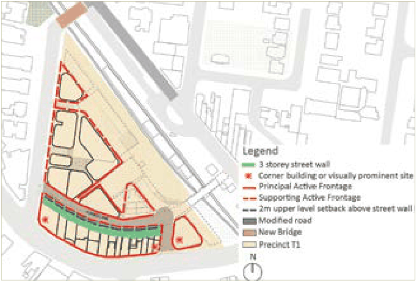
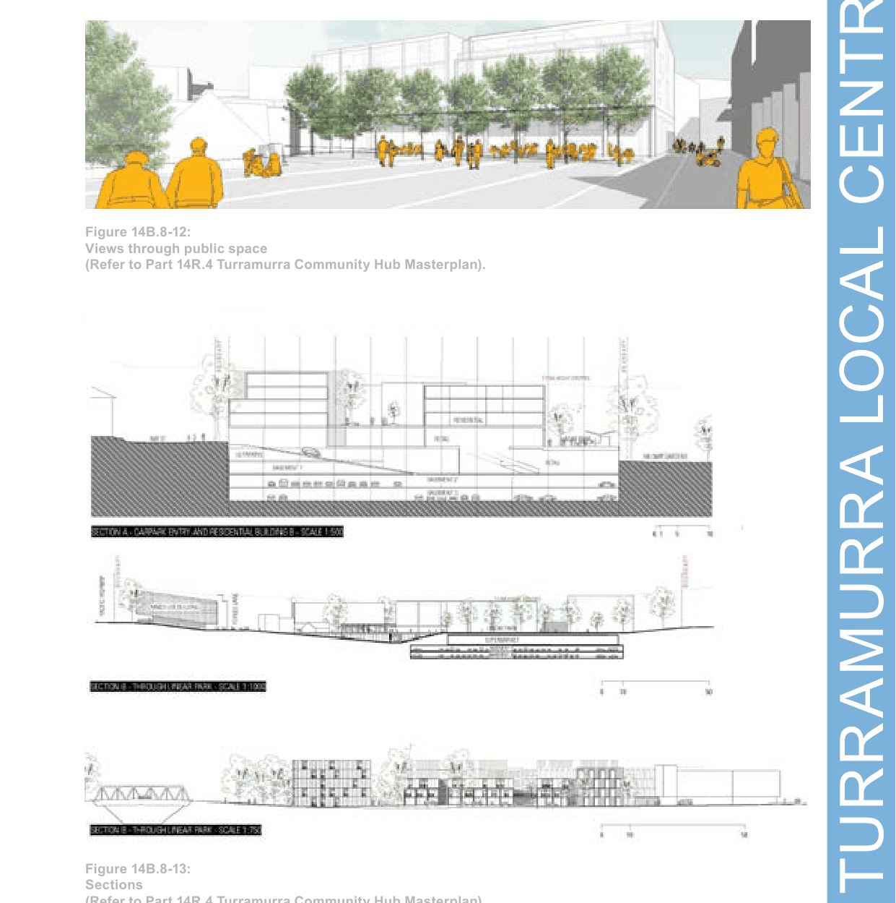
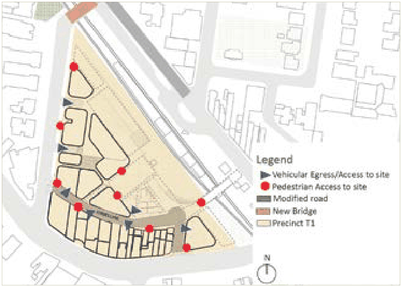
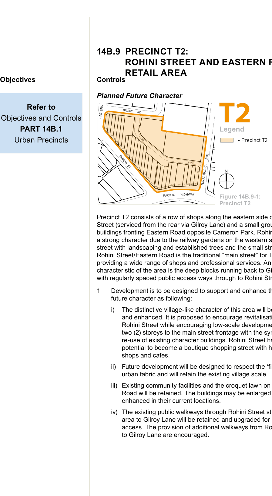
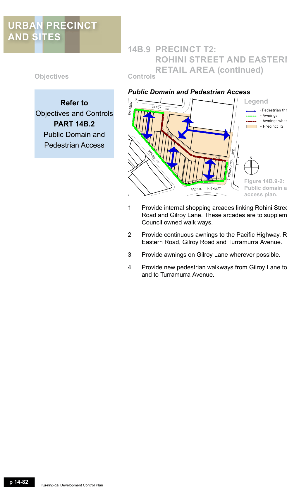
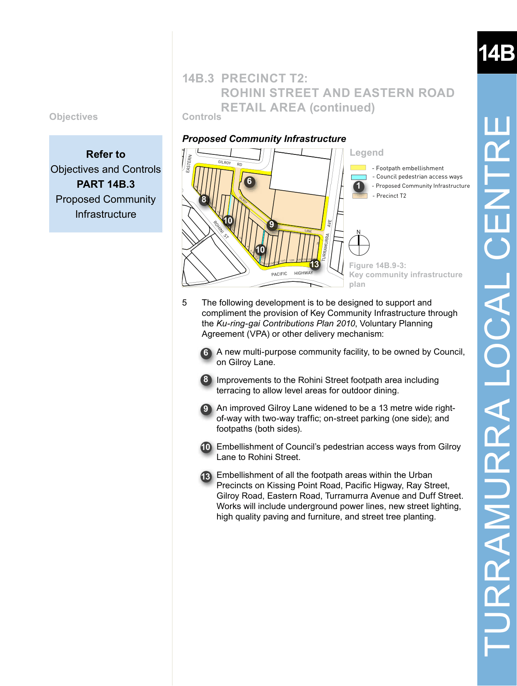

### 14B.8  PRECINCT T1:

### PACIFIC HIGHWAY AND RAY STREET

### RETAIL AREA (continued)

#### Controls Built Form

> [Picture on page 18: a picture, saved as a picture (images/part-14b-turramurra-local-centre-page-18-6.gif, 150 dpi).]

Refer to

#### PART 14B.5

Built Form

Refer to

#### PART 14R.4

Turramurra Community

Hub Masterplan

#### Objectives

41 To encourage design excellence and Ecologically Sustainable Development (ESD) provisions in all new developments.

42 To promote well articulated and modulated building facades.

#### Figure 14B.8-11:

#### Built form plan.

(Refer to Part 14R.4 Turramurra Community Hub Masterplan).

8 Buildings are to be designed in accordance with the development control plan, Figure 14B.8-10, and as follows:

43 To encourage the use of varied materials to enhance the visual quality of buildings.

i) Create a consistent street wall of 3 storeys (11.5 metres) built

parallel to the street alignment for buildings fronting the Forbes

Lane;

ii)	 Provide a 2m setback to all levels above the street wall height

44 To design and locate new buildings to maximise district views.

along the frontages of the Forbes Lane;

iii)	 All buildings within the precinct are to be designed to minimise

overshadowing of the proposed Town Square;

iv)	 Provide active frontages addressing the Town Square, the

Pacific Highway and William Street;

v)	 Ray Street is to have a residential character;

45 To ensure design and choice of building materials incorporate appropriate noise attenuation measures in all new developments.

vi)	 The Town Square is to have a vibrant leisure-oriented retail

character;

vii)	 Properties along the Pacific Highway are required to provide

supporting active frontages to Forbes Lane to create a quiet

shopping street away from the highway and through traffic; and

46 To ensure buildings are located to minimise overshadowing of parks and open spaces.

viii)	Provide supporting active frontages to proposed park areas.

Refer to Figures 14B.8-11, 14B.8-12 and 14B.8-13 (see Turramurra

Community Hub Masterplan at Part 14R.4 for complete illustrations).

### 14B.8  PRECINCT T1:

### PACIFIC HIGHWAY AND RAY STREET

### RETAIL AREA (continued)

#### Controls

> [Picture on page 19: a picture, saved as a picture (images/part-14b-turramurra-local-centre-page-19-5.gif, 150 dpi).]
> Words printed on the picture (title and legend, copied from the PDF):
> Views through public space
> (Refer to Part 14R.4 Turramurra Community Hub Masterplan).
> Sections

Figure 14B.8-12:

Figure 14B.8-13:

### TURRAMURRA LOCAL CENTRE

(Refer to Part 14R.4 Turramurra Community Hub Masterplan).

### 14B.8  PRECINCT T1:

### PACIFIC HIGHWAY AND RAY STREET

### RETAIL AREA (continued)

#### Controls Building Entries, Car Parking and Service Areas

> [Picture on page 20: a picture, saved as a picture (images/part-14b-turramurra-local-centre-page-20-6.gif, 150 dpi).]

Refer to

#### PART 14B.6

Building Entries, Car Park-

ing and Service Access

Refer to

#### PART 14R.4

Turramurra Community

Hub Masterplan

#### Objectives

47 To ensure the community

facility has its frontage and main entry to the town square. 48 To minimise vehicular

entry points to the site. 49 To retain a cohesive

streetscape character.

#### Figure 14B.8-14

#### Building entries, car parking and service access plan.

(Refer to Part 14R.4 Turramurra Community Hub Masterplan). :

50 To minimise conflicts

between vehicular,

pedestrian and service

entry points.

9 Vehicle access/egress for car parking and service/loading is

restricted to Forbes Lane, Ray Street, William Street (southern end) and Higgs Lane; 10 No vehicle access is permissible from the building frontages along

the edge of the proposed Town Square or park. 11 Residential foyers and lobbies are to be located off Ray Street or

Forbes Lane or the Town Square.

51 To accommodate car

parking within basement

levels of new buildings,

in order to minimise

adverse impacts on the

surrounding streetscapes.

Refer to Figure 14B.8-14 (see Turramurra Community Hub

Masterplan at Part 14R.4 for complete illustrations).

52 To provide for

unambiguous and clearly

marked building entry

points. 53 To provide a clear

distinction between

commercial, retail and

residential building entry

points. 54 To allow provisions for

electrical charging points

and 	bicycle 	parking

spaces within car park

structures in new

developments.

PATH

> [Picture on page 21: a map, saved as a picture (images/part-14b-turramurra-local-centre-page-21-2.gif, 150 dpi); the street names and other small labels are on the picture.]
> Words printed on the picture (title and legend, copied from the PDF):
> - Continuous awnings
> - Continuous colonnade
> 9 7 5 3 1
> 8 6 4
> - Vehicular access to site
> - Pedestrian access to site
> - Precinct T1
> - Precinct T2
> - Precinct T3
> - Precinct T4
> 10A PACIFIC 19
> KISSING POINT RD
> shops and cafes.
> 2 iv)	 The existing public walkways through Rohini Street strip shop

Figure 14B.9-1:

GILROY

- Continuous awnings where possible

ROHINI

### T2

ST PATHWAY

17

19

21

37 35 33 31 29 27 25 23

39

BUILDING ENTRIES AND CARPAT

#### Objectives

### 14B.9  PRECINCT T2:

### ROHINI STREET AND EASTERN ROAD

### RETAIL AREA

#### Controls Planned Future Character

ST

### T4

Refer to

#### Objectives and Controls

### T2

#### Legend

ST

BOYD

HIGHWAY

#### PART 14B.1

#### Urban Precincts

ST

KU-RING-GAI

19

2

AVE

RSEY

23

21

11

15

7

5

3

9

ST

DUFF

ST

2A 2

CR

6

4

6

8

10

Precinct T2 consists of a row of shops along the eastern side of Rohini

Street (serviced from the rear via Gilroy Lane) and a small group of

buildings fronting Eastern Road opposite Cameron Park. Rohini street has

a strong character due to the railway gardens on the western side of the

street with landscaping and established trees and the small strip shops.

Rohini Street/Eastern Road is the traditional “main street” for Turramurra

providing a wide range of shops and professional services. An additional

characteristic of the area is the deep blocks running back to Gilroy Lane

with regularly spaced public access ways through to Rohini Street. 1 Development is to be designed to support and enhance the planned

future character as following:

1292

WOMERAH

3

5

5

9

9A

11

15

17

19

19A

21

23

25

27

3A

1A

1

i) The distinctive village-like character of this area will be preserved

and enhanced. It is proposed to encourage revitalisation of

Rohini Street while encouraging low-scale developments up to

two (2) storeys to the main street frontage with the sympathetic

re-use of existing character buildings. Rohini Street has the

potential to become a boutique shopping street with high quality

1197

ii)	 Future development will be designed to respect the ‘fine grain’

urban fabric and will retain the existing village scale.

1282

1284

1290

iii)	 Existing community facilities and the croquet lawn on Gilroy

1187

1189

1276

21

19

23

Road will be retained. The buildings may be enlarged or

enhanced in their current locations.

27

25

1274

29 29A 28

26

1

30

area to Gilroy Lane will be retained and upgraded for pedestrian

access. The provision of additional walkways from Rohini Street

to Gilroy Lane are encouraged.

RD

### TURRAMURRA LOCAL CENTRE

ADE 72

PA

LINDFIELD

PATH

Y

- Primary active frontage

- 10m setback

- 6m setback

- Alternate deep soil requirement

- 12m setback

- 10m setback

> [Picture on page 22: a map, saved as a picture (images/part-14b-turramurra-local-centre-page-22-12.gif, 150 dpi); the street names and other small labels are on the picture.]
> Words printed on the picture (title and legend, copied from the PDF):
> - 5m setback
> - 4m setback
> - 3m setback
> - 2m setback
> - Land dedication
> ( UNFORMED )
> - 6m setback
> - 5m setback
> - 4m setback
> - 3m setback
> - 2m setback
> - Land dedication
> 1 ( UNFORMED ) PUBLIC DOMAIN AND PEDESTRIAN
> 10 23 (Howard)
> 47 15 45
> - Through site link
> - Entry plaza/forecourt
> - Continuous awnings
> - Continuous colonnade
> 9 7 5 3 1
> 8 6 4
> - Primary active frontage
> - 3 storey street wall
> 16 2 4
> - Primary active frontage
> - 3 storey street wall
> - Vehicular access to site
> - Pedestrian access to site
> KISSING POINT RD
> 6 EASTERN 63
> - Entry plaza/forecourt
> - Continuous colonnade
> - Entry plaza/forecourt
> - Continuous colonnade
> - Precinct T1
> - Precinct T2
> - Precinct T3
> - Precinct T4
> - Vehicular access to site
> - Precinct L1
> - Precinct L2
> - Precinct L3
> - Precinct L4
> - Precinct L5
> - Precinct L6
> - Precinct L7
> - Precinct L8
> - Precinct L9
> FIELD 1 PL
> - Precinct L1
> - Precinct L2
> - Precinct L3
> - Precinct L4
> - Precinct L5
> - Precinct L6
> - Precinct L7
> - Precinct L8
> - Precinct L9
> Council owned walk ways.
> 1-3 5 7
> 9 LLEWELLYN LANE 7
> 1-3 5 7
> KISSING POINT RD
> and to Turramurra Avenue.

Figure 14B.9-2:

- Alternate deep soil requirement

- Continuous awnings where possible

### T2

### T1

### T1

BUILDING ENTRIES AND CARPAT

### 14B.9  PRECINCT T2:

### ROHINI STREET AND EASTERN ROAD

### RETAIL AREA (continued)

#### Controls

#### Objectives

- Secondary active frontage

- 2m upper level setback above street

- 4m upper level setback above street

- Secondary active frontage

- 2m upper level setback above street

- 4m upper level setback above street

#### Public Domain and Pedestrian Access

PUBLIC DOMAIN AND PEDESTRIAN PUBLIC DOMAIN AND PEDESTRIAN

ST

NULLA

#### Legend

### T3 T4

Refer to

#### Objectives and Controls

- Pedestrian through site link

Awnings where possible

28

- Pedestrian through site link

Awnings where possible

8

BUILDING ENTRIES AND CARPAT

#### PART 14B.2

Public Domain and

BUILDING ENTRIES AND CARPAT

#### Pedestrian Access

- Vehicular access to site

- Pedestrian access to site

25

- Pedestrian access to site

KU-RING-GAI

6

AVE

#### Public domain and pedestrian

0

ST

0

1 Provide internal shopping arcades linking Rohini Street with Gilroy

Road and Gilroy Lane. These arcades are to supplement the existing

2 Provide continuous awnings to the Pacific Highway, Rohini Street,

Eastern Road, Gilroy Road and Turramurra Avenue.

19

1

19

1

3 Provide awnings on Gilroy Lane wherever possible. 4 Provide new pedestrian walkways from Gilroy Lane to Gilroy Road

1292

WOMERAH

3

5

5

9

9A

11

15

17

19

19A

21

23

25

27

3A

1A

1

1197

1282

1284

1290

1187

1189

1276

1274

1

RD

LAWSON

STUR

NG

> [Picture on page 23: a map, saved as a picture (images/part-14b-turramurra-local-centre-page-23-4.gif, 150 dpi); the street names and other small labels are on the picture.]
> Words printed on the picture (title and legend, copied from the PDF):
> T DENLEY LAN
> RD 5 7 9 11
> 4 6 8 10
> - Pedestrian through site link
> - Awnings where possible
> 10 12 14 16 18
> 3 5 7 11
> BUILDING ENTRIES AND CARPAT
> - Primary active frontage
> MONA ST RD
> - Vehicular access to site
> - Pedestrian access to site
> 4 8 10
> 5 7 9 11
> - Continuous awnings
> - Continuous awnings where possible
> - Continuous colonnade
> - Entry plaza/forecourt
> - Continuous awnings
> - Continuous awnings where possible
> - Continuous colonnade
> 24 22 20 18
> BUILDING ENTRIES AND CARPAT
> - Heritage item
> - Through site link
> - Entry plaza/forecourt
> - Continuous awnings
> - Continuous awnings where possible
> - Continuous colonnade
> 9 7 5 3 1
> BUILDING ENTRIES AND CARPAT
> 10 12 14 16 18
> 4 6 8
> 8 6 4
> 9 7 5 3 1
> BUILDING ENTRIES AND CARPAT
> 3 5 7 11
> - Landmark building
> - Vehicular access to site
> - Pedestrian access to site
> 8 6 4
> - Vehicular access to site
> - Pedestrian access to site
> - Vehicular access to site
> - Pedestrian access to site
> - Character item
> KEY COMMUNITY INFRASTRUCTRE
> KISSING POINT RD
> 6 EASTERN 30
> KISSING POINT RD
> - Council pedestrian access ways
> - Refer to site specific DCP
> - Proposed road
> 24 22 20 18
> - Proposed Community Infrastructure
> - Precinct T1
> - Precinct T2
> - Precinct T3
> - Precinct T4
> 3.66W PATHWAY 18
> - Footpath embellishment
> - New or existing park to be upgraded
> - Historic/character building to be
> - New/realigned road
> - Proposed pedestrian promenade
> - New community facility
> 28 5 24
> 7A 1259 TURRAMURRA 3
> Key community infrastructure
> KISSING POINT RD

Figure 14B.9-3:

RY

### PUBLIC DOMAIN AND PEDESTRIAN 14B

### T2

### T1

### T1

#### Objectives
