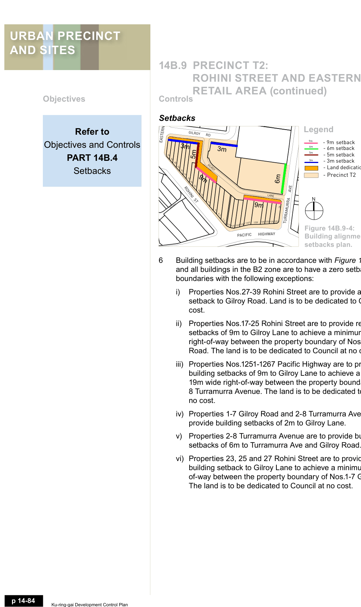

### 14B.3  PRECINCT T2:

### ROHINI STREET AND EASTERN ROAD

### RETAIL AREA (continued)

#### Controls

### 6 *

#### Proposed Community Infrastructure

### T3 T4

Refer to

#### Objectives and Controls

CIFIC

#### PART 14B.3

#### Proposed Community

37

#### Infrastructure 1 80

23

0

5 The following development is to be designed to support and

compliment the provision of Key Community Infrastructure through

the Ku-ring-gai Contributions Plan 2010, Voluntary Planning

Agreement (VPA) or other delivery mechanism:

#### 6

A new multi-purpose community facility, to be owned by Council,

on Gilroy Lane. Improvements to the Rohini Street footpath area including

terracing to allow level areas for outdoor dining. An improved Gilroy Lane widened to be a 13 metre wide right-

of-way with two-way traffic; on-street parking (one side); and

footpaths (both sides). Embellishment of Council’s pedestrian access ways from Gilroy

Lane to Rohini Street. Embellishment of all the footpath areas within the Urban

Precincts on Kissing Point Road, Pacific Higway, Ray Street,

Gilroy Road, Eastern Road, Turramurra Avenue and Duff Street.

Works will include underground power lines, new street lighting,

high quality paving and furniture, and street tree planting.

1

H

### TURRAMURRA LOCAL CENTRE

> [Picture on page 24: a map, saved as a picture (images/part-14b-turramurra-local-centre-page-24-1.gif, 150 dpi); the street names and other small labels are on the picture.]
> Words printed on the picture (title and legend, copied from the PDF):
> - 9m setback
> - Through site link
> - Entry plaza/forecourt
> - Continuous awnings
> - Continuous colonnade
> 27 25 23
> 21 19 17
> - 9m setback
> 51 53 - 15m setback
> 27 25 23
> 26 24 22
> - 13m setback
> 21 19 17
> 9 7 5 3 1
> - 9m setback
> - 15m setback
> 12 10 8
> 27 25 23
> 26 24 22
> - 12m setback
> - 13m setback
> 21 19 17
> 8 6 4
> - 15m setback
> 12 10 8
> - 11m setback
> 26 24 22
> - 12m setback
> - 13m setback
> PL 12 10 8
> - 11m setback
> - 12m setback
> - Vehicular access to site
> - Pedestrian access to site
> - 11m setback
> 7.32 / 3.66 W.
> ESMT FOR SERVICES
> - 9m setback
> 27 25 23
> 7.32 / 3.66 W.
> ESMT FOR SERVICES
> 21 19 17
> - 15m setback
> 26 24 22
> 7.32 / 3.66 W.
> KISSING POINT RD
> ESMT FOR SERVICES
> - 13m setback
> 12 10 8 6
> - 12m setback
> - 11m setback
> 101 103 105
> - 10m setback
> - 6m setback
> - 5m setback
> - 4m setback
> - 3m setback
> - 2m setback
> - Land dedication
> (% of site)
> 101 103 105
> - Precinct T1
> - Precinct T2
> - Precinct T3
> - Precinct T4
> - 10m setback
> - 6m setback
> - 5m setback
> - 4m setback
> - 3m setback
> - 2m setback
> - Land dedication
> (% of site)
> 7.32 / 3.66 W.
> 123 125 127
> ESMT FOR SERVICES
> 101 103 105
> - 10m setback
> - 6m setback
> - 5m setback
> - 4m setback
> - 3m setback
> - 2m setback
> - Land dedication
> (% of site)
> 123 125 127
> 123 125 127
> 9A RD 3
> 101 103 105
> 4 6 8 10
> - 3 storey street wall
> - 10m setback
> - 6m setback
> - 5m setback
> - 4m setback
> - 3m setback
> - 2m setback
> - Land dedication
> (% of site)
> 4 6 8 10
> 1 3 5
> 7A ST CR CARCOOLA
> - Principal active frontage
> - 3 storey street wall
> 123 125 127
> 4 6 8 10
> 1 3 5
> - Principal active frontage
> - 3 storey street wall
> Building alignment and
> 1 1 3 5
> street wall height
> street wall height
> 3m AVE 6m
> 4 8 10
> 4 6 8 10
> - Principal active frontage
> - 3 storey street wall
> 5 7 9 11
> 4 8 10
> 1 3 5
> 5 7 9 11
> 4 8 10
> 5 7 9 11
> street wall height
> - Entry plaza/forecourt
> - Awnings where possible
> 10 12 14 16 18
> 4 6 8
> KISSING POINT RD
> - Entry plaza/forecourt
> - Awnings where possible
> 10 12 14 16 18
> 4 6 8
> 3 5 7 11
> - Entry plaza/forecourt
> - Awnings where possible
> 4 8 10
> 10 12 14 16 18
> 4 6 8
> 3 5 7 11
> RD ii)	 Properties Nos.17-25 Rohini Street are to provide rear building
> 5 7 9 11
> 3 5 7 11
> - Vehicular access to site
> - Vehicular access to site
> 2 59 24
> - Entry plaza/forecourt
> - Awnings where possible
> - Vehicular access to site
> 10 12 14 16 18
> 4 6 8
> 3 5 7 11
> 24 22 20 18
> - Heritage item
> 24 22 20 18
> 1 STANLEY 16
> - Heritage item
> 24 22 20 18
> - Vehicular access to site
> - Heritage item
> - Landmark building
> IKARA 1 80
> - Landmark building
> 6 10 2
> - Character item
> 24 22 20 18
> 16 iv)	 Properties 1-7 Gilroy Road and 2-8 Turramurra Avenue are to
> - Character item
> - Heritage item
> PRIESTLEY 9 74
> 76 3.66W PATHWAY
> - Character item
> 9 v)	 Properties 2-8 Turramurra Avenue are to provide building
> - Proposed road
> - Landmark building
> - Proposed road
> - Proposed road
> - Character item
> - Proposed road
> 1 7 3.66W PATHWAY

Figure 14B.9-4:

ALIGNMENT AND SETBACKS ALIGNMENT AND SETBACKS

- Continuous awnings where possible

### T2

### T1

### T1

ALIGNMENT AND SETBACKS

#### Objectives
