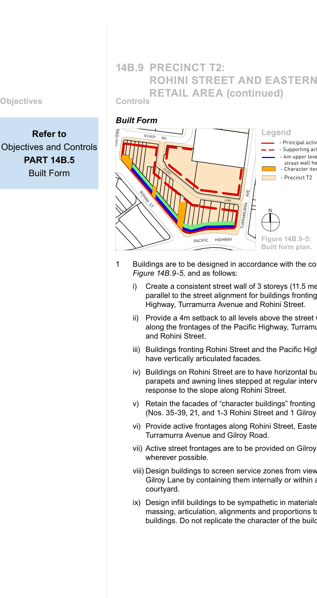
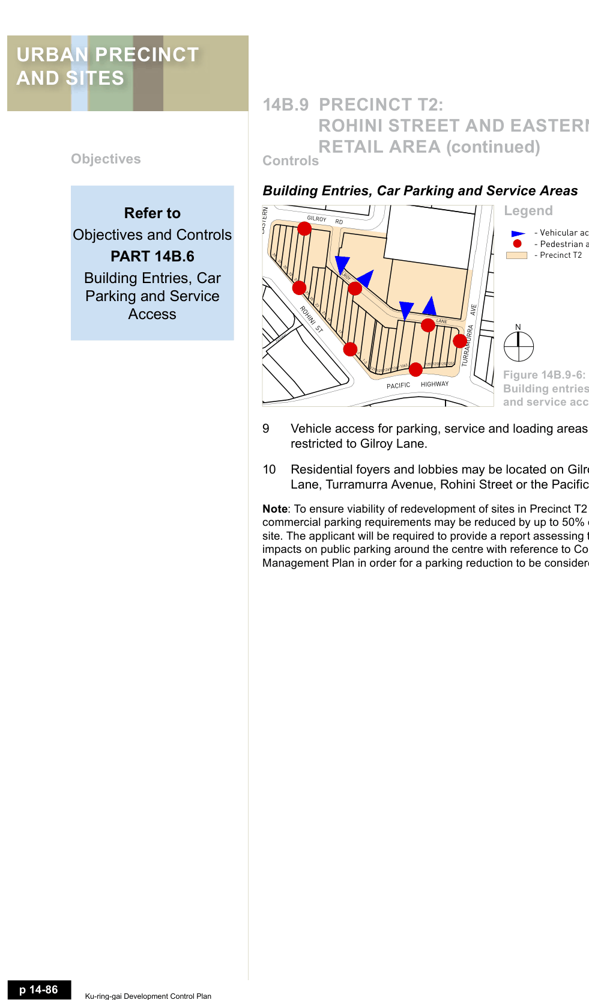
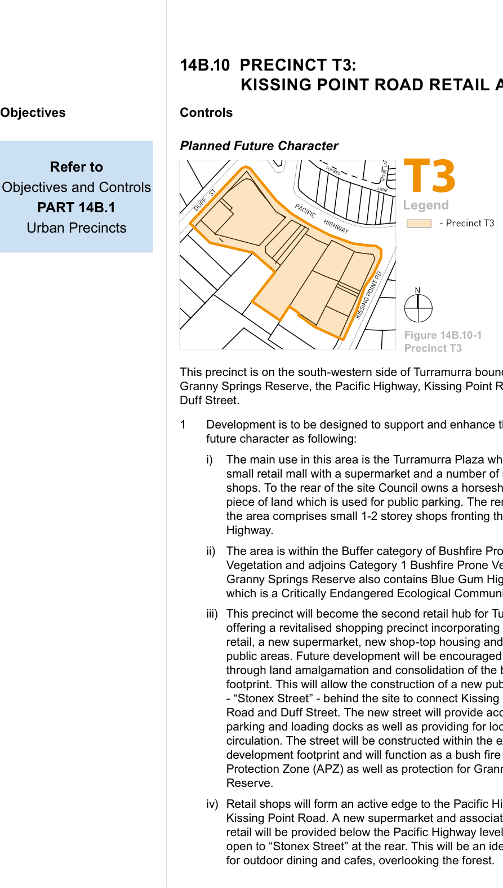

### 14B.9  PRECINCT T2:

### ROHINI STREET AND EASTERN ROAD

### RETAIL AREA (continued)

#### Controls

BUILDING ENTRIES AND CARPAT

WAY

ST

ALIGNMENT AND SETBACKS

#### Legend

Refer to

#### Objectives and Controls

## 3 T4

#### PART 14B.4

#### Setbacks

- Alternate deep soil landscaping

- Alternate deep soil landscaping

KU-RING-GAI

- Alternate deep soil landscaping

6

AVE

- Principal active frontage

- Supporting active frontage

- 2m upper level setback above

- Alternate deep soil landscaping

PA

- Supporting active frontage

- 2m upper level setback above

- 4m upper level setback above

- Supporting active frontage

- 2m upper level setback above

ST

- 4m upper level setback above

- 4m upper level setback above

PUBLIC DOMAIN AND PEDESTRIAN PUBLIC DOMAIN AND PEDESTRIAN

- Supporting active frontage

- 2m upper level setback above

PUBLIC DOMAIN AND PEDESTRIAN

6 Building setbacks are to be in accordance with Figure 14B.9-4,

and all buildings in the B2 zone are to have a zero setback to all lot

boundaries with the following exceptions:

- 4m upper level setback above

- Pedestrian through site link

- Pedestrian through site link

PUBLIC DOMAIN AND PEDESTRIAN

i) Properties Nos.27-39 Rohini Street are to provide a 3m building

setback to Gilroy Road. Land is to be dedicated to Council at no

BUILDING ENTRIES AND CARPAT

- Pedestrian through site link

BUILDING ENTRIES AND CARPAT BUILDING ENTRIES AND CARPAT

- Pedestrian access to site

- Pedestrian access to site

- Pedestrian through site link

setbacks of 9m to Gilroy Lane to achieve a minimum 19m wide

right-of-way between the property boundary of Nos.1-7 Gilroy

Road. The land is to be dedicated to Council at no cost.

- Pedestrian access to site

iii)	 Properties Nos.1251-1267 Pacific Highway are to provide rear

BUILDING ENTRIES AND CARPAT

1292

- Pedestrian access to site

WOMERAH

### *

building setbacks of 9m to Gilroy Lane to achieve a minimum

19m wide right-of-way between the property boundary of Nos.2-

8 Turramurra Avenue. The land is to be dedicated to Council at

3

5

5

9

9A

11

15

17

19

19A

21

23

25

27

### * - Landmark building

3A

1A

### *

1

provide building setbacks of 2m to Gilroy Lane.

- Refer to site specific DCP

1197

4 - Proposed Community Infrastructure

- Refer to site specific DCP

setbacks of 6m to Turramurra Ave and Gilroy Road.

### *

- Proposed Community Infrastructure

1282

1284

1290

- Refer to site specific DCP

vi)	 Properties 23, 25 and 27 Rohini Street are to provide a 5m

- Proposed Community Infrastructure

1187

1189

1276

building setback to Gilroy Lane to achieve a minimum 19m right-

of-way between the property boundary of Nos.1-7 Gilroy Road.

The land is to be dedicated to Council at no cost.

- Refer to site specific DCP

- Proposed Community Infrastructure

1274

1

RD

ALIGNMENT AND SETBACKS

- 4m upper level setback above

> [Picture on page 25: a map, saved as a picture (images/part-14b-turramurra-local-centre-page-25-3.gif, 150 dpi); the street names and other small labels are on the picture.]
> Words printed on the picture (title and legend, copied from the PDF):
> street wall height
> - 9m setback
> - 15m setback
> - 13m setback
> - 12m setback
> - 9m setback
> 15m - 11m setback
> 5 7 9 11
> - 15m setback
> - 13m setback
> - 12m setback
> - 11m setback
> 7.32 / 3.66 W.
> ESMT FOR SERVICES
> 10 12 14 16 18
> 3 5 7 11
> 3.66W 14 12
> 7.32 / 3.66 W.
> ESMT FOR SERVICES
> 3 19 5
> 101 103 105
> - Vehicular access to site
> - 10m setback
> - 6m setback
> - 5m setback
> - 4m setback
> - 3m setback
> - 2m setback
> - Land dedication
> (% of site)
> - Through site link
> - Entry plaza/forecourt
> - Continuous awnings
> - Continuous colonnade
> 123 125 127
> 101 103 105
> 9 7 5 3 1
> - 10m setback
> - 6m setback
> - 5m setback
> - 4m setback
> - 3m setback
> - 2m setback
> - Land dedication
> (% of site)
> 8 6 4
> 24 22 20 18
> 123 125 127
> 16 Built Form
> - Heritage item
> - Vehicular access to site
> - Pedestrian access to site
> 4 6 8 10
> - 3 storey street wall
> 1 3 5
> - Landmark building
> 4 6 8 10
> - Principal active frontage
> - 3 storey street wall
> 1 3 5
> - Character item
> 4 8 10
> - Precinct T1
> - Precinct T2
> - Precinct T3
> - Precinct T4
> 5 7 9 11
> - Proposed road
> NEWHAVEN 3.66W PATHWAY
> 4 8 10
> 5 7 9 11
> - Entry plaza/forecourt
> - Awnings where possible
> 10 12 14 16 18
> 4 6 8
> 3 5 7 11
> - Entry plaza/forecourt
> - Awnings where possible
> 10 12 14 16 18
> 4 6 8
> Built form plan.
> 3 5 7 11
> - Vehicular access to site
> - Vehicular access to site
> 24 22 20 18
> - Heritage item
> 24 22 20 18
> - Heritage item
> - Landmark building
> IKARA 1 80
> KISSING POINT RD
> 76 82 3.66W PATHWAY
> - Landmark building
> - Character item
> and Rohini Street.
> - Character item
> 6 4 2
> - Proposed road
> have vertically articulated facades.
> 5 3.66W PATHWAY
> - Proposed road
> 1 7 3.66W PATHWAY ST

Figure 14B.9-5:

Figure 14B.9-5, and as follows:

4.57W 6m

VALE MONA

ALIGNMENT AND SETBACKS

MEMORIAL

RHAM

- Primary active frontage

ROSEDALE

- Pedestrian through site link

- Awnings where possible

16 73B

PORTERS

27

29

6 EASTERN

BUILDING ENTRIES AND CARPAT

- Pedestrian access to site

- Alternate deep soil landscaping

- Continuous awnings where possible

### T2

### T1

### T1

### 14B.9  PRECINCT T2:

### ROHINI STREET AND EASTERN ROAD

### RETAIL AREA (continued)

#### Controls

#### Objectives

FORBES

FORBES

HIGGS   LN

BUILDING ENTRIES AND CARPAT

- Alternate deep soil landscaping

LANE

LANE

SHINFIELD C

HIGHWAY

ST

6m

DR

#### Legend

5

- Principal active frontage

- Supporting active frontage

- 2m upper level setback above

4

7

Refer to

#### Objectives and Controls 80

6m

### T3 T4

### *

- 4m upper level setback above

11

9

KISSING POINT RD

6m

- Supporting active frontage

- 2m upper level setback above

#### PART 14B.5

AVE

VALE

BOYD

HWAY

MONA

#### Built Form

DORSET LN

- 4m upper level setback above

16

PUBLIC DOMAIN AND PEDESTRIAN

MEMORIAL

6m

3m 21

19

17

15

18

14

12

8

6

10

AVE

HAM

AVE

10m

VALE

- Refer to site specific DCP

MONA

PUBLIC DOMAIN AND PEDESTRIAN

MEMORIAL

KU-RING-GAI

3m

6

- Proposed Community Infrastructure

AVE

HAM

10m

2

ROSEDALE

RD

- Pedestrian through site link

PORTERS

AVE

JERSEY

CATALPA

BUILDING ENTRIES AND CARPAT

7

5

3

ROSEDALE

RD

1

- Pedestrian through site link

ST

F

PORTERS

BUILDING ENTRIES AND CARPAT

- Pedestrian access to site

### *

ST

2A 2

CR

3

1

6

4

5

8

- Pedestrian access to site

1 Buildings are to be designed in accordance with the control plan,

SHINFIELD

DR

### *

5

SHINFIELD

4

7

i) Create a consistent street wall of 3 storeys (11.5 metres) built

parallel to the street alignment for buildings fronting the Pacific

Highway, Turramurra Avenue and Rohini Street.

DR

### *

11

9

5

ii)	 Provide a 4m setback to all levels above the street wall height

4

7

### *

DORSET 16 11

9

along the frontages of the Pacific Highway, Turramurra Avenue

21

19

17

15

18

14

12

8

6

10

iii)	 Buildings fronting Rohini Street and the Pacific Highway are to

- Refer to site specific DCP

DORSET 16

21

19

17

15

18

14

12

8

6

10

- Proposed Community Infrastructure

- Refer to site specific DCP

iv)	 Buildings on Rohini Street are to have horizontal building

- Proposed Community Infrastructure

1292

parapets and awning lines stepped at regular intervals in

response to the slope along Rohini Street.

WOMERAH

v)	 Retain the facades of “character buildings” fronting Rohini Street

(Nos. 35-39, 21, and 1-3 Rohini Street and 1 Gilroy Road).

3

5

5

9

9A

11

15

17

19

19A

21

23

3A

1A

vi)	 Provide active frontages along Rohini Street, Eastern Road,

1

Turramurra Avenue and Gilroy Road.

vii)	 Active street frontages are to be provided on Gilroy Lane

1197

1282

1284

1290

viii)	Design buildings to screen service zones from view along

1187

1189

1276

21

19

17

Gilroy Lane by containing them internally or within an internal

23

24

ix)	 Design infill buildings to be sympathetic in materials, form, scale,

27

25

12

29 29A

massing, articulation, alignments and proportions to existing

buildings. Do not replicate the character of the buildings.

28

26

1

30

RD

### TURRAMURRA LOCAL CENTRE

WAY 4.57

LINK

PAT

- Primary active frontage

> [Picture on page 26: a map, saved as a picture (images/part-14b-turramurra-local-centre-page-26-6.gif, 150 dpi); the street names and other small labels are on the picture.]
> Words printed on the picture (title and legend, copied from the PDF):
> 2 4 6 8 10
> 1 3 5 PUBLIC DOMAIN AND PEDESTRIAN
> street wall height
> 4 8 10
> - Entry plaza/forecourt
> - Continuous awnings
> - Continuous colonnade
> 5 7 9 11
> 9 7 5 3 1
> 8 6 4
> - Entry plaza/forecourt
> - Vehicular access to site
> - Pedestrian access to site
> 10 12 14 16 18
> 4 6 8
> 3 5 7 11
> KISSING POINT RD
> - Precinct T1
> - Precinct T2
> - Precinct T3
> - Precinct T4
> 26 30A 10
> 24 22 20 18
> - Heritage item
> - Landmark building
> 6 10 16
> 1259 7 TURRAMURRA
> - Character item
> and service access plan.
> 6 4 2
> - Proposed road
> 1 7 3.66W PATHWAY
> restricted to Gilroy Lane.
> KISSING POINT RD
> Note: To ensure viability of redevelopment of sites in Precinct T2 the retail and
> commercial parking requirements may be reduced by up to 50% on amalgamated
> site. The applicant will be required to provide a report assessing the potential
> impacts on public parking around the centre with reference to Council’s Parking
> Management Plan in order for a parking reduction to be considered by Council.

Figure 14B.9-6:

- Principal active frontage

- Supporting active frontage

- 2m upper level setback above

- 4m upper level setback above

PUBLIC DOMAIN AND PEDESTRIAN

- Continuous awnings where possible

### T2

### T1

### T1

BUILDING ENTRIES AND CARPAT

T

### 14B.9  PRECINCT T2:

### ROHINI STREET AND EASTERN ROAD

### RETAIL AREA (continued)

#### Controls

#### Objectives

- Pedestrian through site link

- Awnings where possible

#### Building Entries, Car Parking and Service Areas

ST

BUILDING ENTRIES AND CARPAT

### T3 T4

Refer to

#### Objectives and Controls

- Vehicular access to site

- Pedestrian access to site

#### PART 14B.6

#### Building Entries, Car

29

#### Parking and Service

25

#### Access

KU-R

KU-RING-GAI

6

### *

AVE

9

DUFF

#### Building entries, car parking

ST

- Refer to site specific DCP

- Proposed Community Infrastructure

9 Vehicle access for parking, service and loading areas is to be

10 Residential foyers and lobbies may be located on Gilroy Road, Gilroy

Lane, Turramurra Avenue, Rohini Street or the Pacific Highway.

1292

WOMERAH

3

5

5

9

9A

11

15

17

19

19A

21

29

23

25

27

3A

1A

1

1197

1282

1284

1290

1187

1189

1276

1270

1274

1

RD

LIVE

EASTERN

> [Picture on page 27: a map, saved as a picture (images/part-14b-turramurra-local-centre-page-27-3.gif, 150 dpi); the street names and other small labels are on the picture.]
> Words printed on the picture (title and legend, copied from the PDF):
> - Continuous awnings
> - Continuous colonnade
> 9 7 5 3 1
> 8 6 4
> - Vehicular access to site
> - Pedestrian access to site
> - Precinct T1
> - Precinct T2
> - Precinct T3
> - Precinct T4
> KISSING POINT RD

Figure 14B.10-1

- Continuous awnings where possible

ROHINI

### T2

ST PATHWAY
