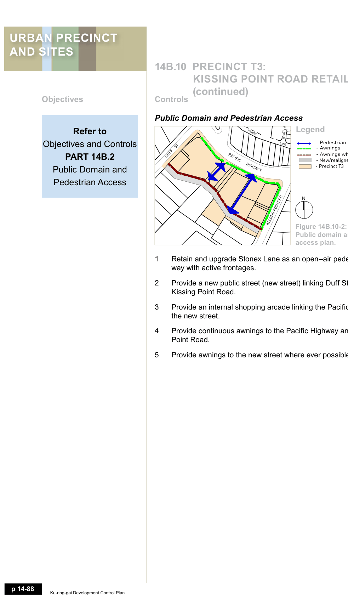
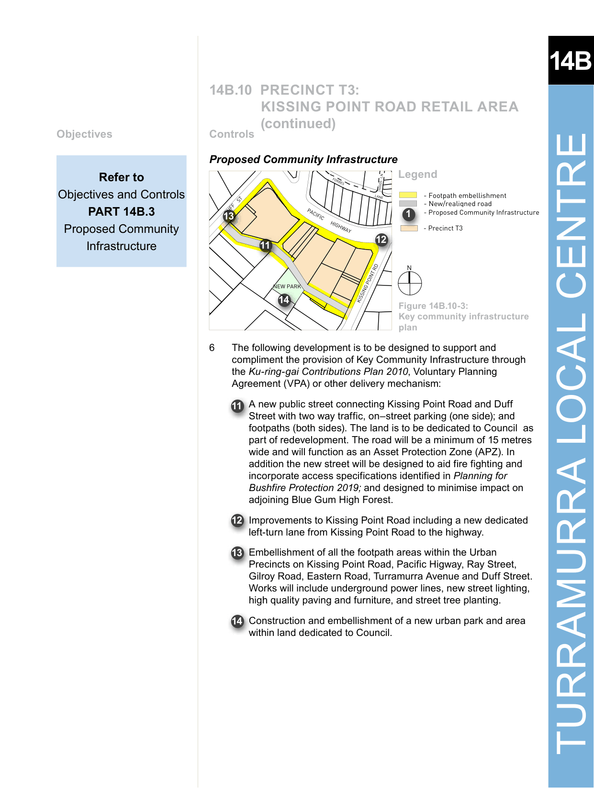
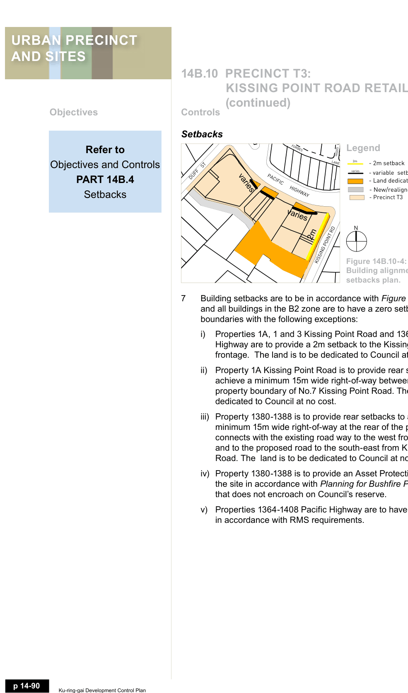
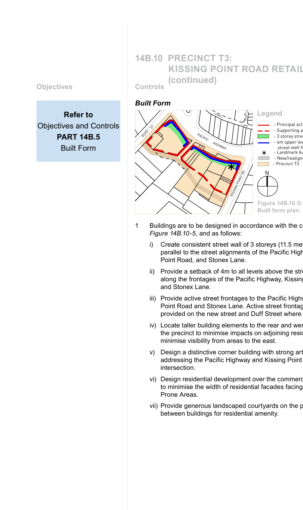
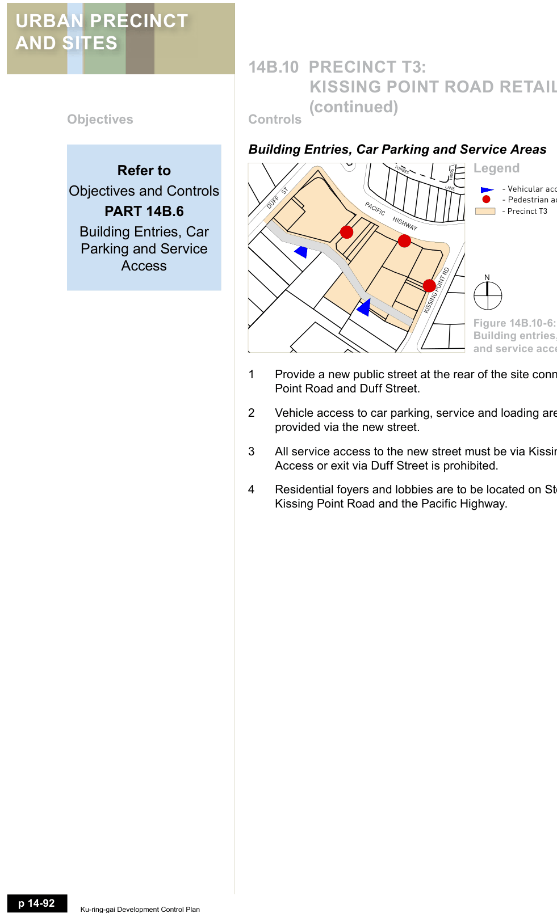
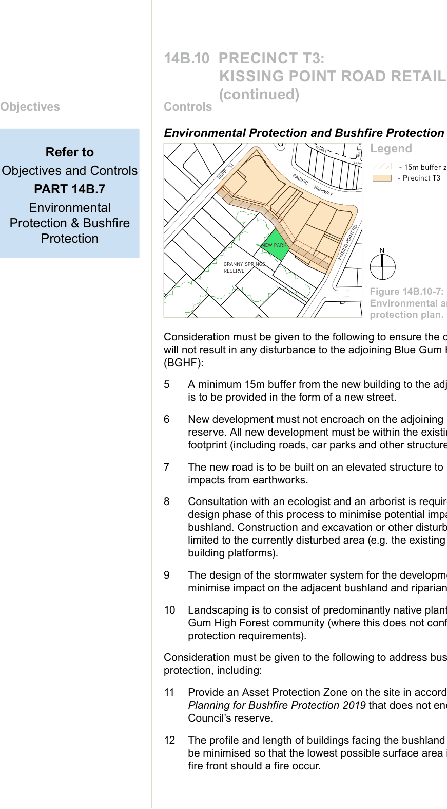
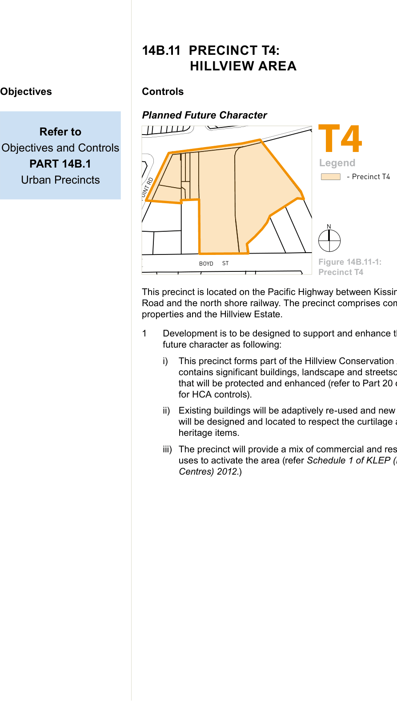
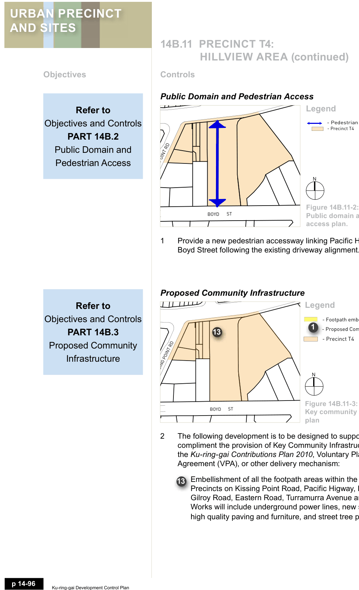
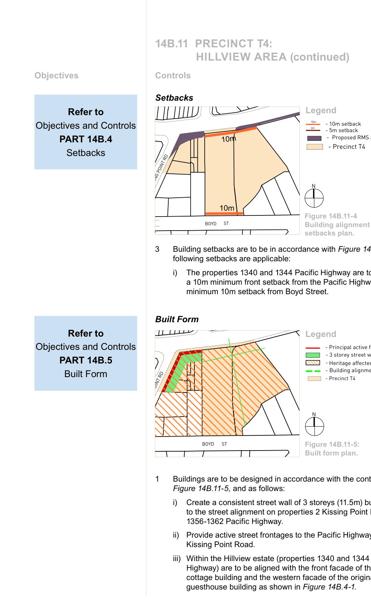

### 14B.10  PRECINCT T3:

### KISSING POINT ROAD RETAIL AREA

17

19

21

GILROY

31 29 27 25 23

BUILDING ENTRIES AND CARPAT

#### Objectives

#### Controls

LANE

ST

#### Planned Future Character

5-7

9

17

19

21

### T4

1-3

23

1255

1257 1251

1253

1259

1263

1267

1269

1273

1271

Refer to

#### Objectives and Controls

HIGHWAY

### T3

PACIFIC

ST

BOYD

#### Legend

#### PART 14B.1

#### Urban Precincts

21

23

19

ST

17

25

19

2 6A

4

SEY

25

23

21

11

15

7

5

9

6

10 10A

12

8

2A 2

14

2

CR

4

6

8

10

15

9

5

7

This precinct is on the south-western side of Turramurra bounded by

Granny Springs Reserve, the Pacific Highway, Kissing Point Road and

Duff Street.

27

29

ST

39

37

ST

1 Development is to be designed to support and enhance the planned

future character as following:

41 34A

43

34

42

40

38

36A

PATHWAY

24

24A

i) The main use in this area is the Turramurra Plaza which is a

small retail mall with a supermarket and a number of speciality

shops. To the rear of the site Council owns a horseshoe-shaped

piece of land which is used for public parking. The remainder of

the area comprises small 1-2 storey shops fronting the Pacific

25

23

21

22

ii)	 The area is within the Buffer category of Bushfire Prone

22

16

18

Vegetation and adjoins Category 1 Bushfire Prone Vegetation.

Granny Springs Reserve also contains Blue Gum High Forest

which is a Critically Endangered Ecological Community.

iii)	 This precinct will become the second retail hub for Turramurra

15

17

19

24

26

9

20

22A

14

12

8

10

35

37

CORNWALL

offering a revitalised shopping precinct incorporating speciality

retail, a new supermarket, new shop-top housing and improved

public areas. Future development will be encouraged to occur

through land amalgamation and consolidation of the building

footprint. This will allow the construction of a new public street

- “Stonex Street” - behind the site to connect Kissing Point

Road and Duff Street. The new street will provide access to car

parking and loading docks as well as providing for local traffic

circulation. The street will be constructed within the existing

development footprint and will function as a bush fire Asset

Protection Zone (APZ) as well as protection for Granny Springs

iv)	 Retail shops will form an active edge to the Pacific Highway and

### TURRAMURRA LOCAL CENTRE

Kissing Point Road. A new supermarket and associated specialty

retail will be provided below the Pacific Highway level, and will

open to “Stonex Street” at the rear. This will be an ideal location

for outdoor dining and cafes, overlooking the forest.

4 RD

> [Picture on page 28: a map, saved as a picture (images/part-14b-turramurra-local-centre-page-28-2.gif, 150 dpi); the street names and other small labels are on the picture.]
> Words printed on the picture (title and legend, copied from the PDF):
> 7.32 / 3.66 W.
> ESMT FOR SERVICES
> 7.32 / 3.66 W.
> 4 6 8 10
> ESMT FOR SERVICES
> 2 CARCOOLA 4m
> 101 103 105 107
> VALE KIRAWA     CLOSE
> - 10m setback
> - 6m setback
> - 5m setback
> - 4m setback
> - 3m setback
> - 2m setback
> - Land dedication
> (% of site)
> - 12m setback
> - 10m setback
> - 6m setback
> - 5m setback
> - 4m setback
> - 3m setback
> - 2m setback
> - Land dedication
> (% of site)
> 121 4 8 10
> 6 BUILT FORM
> LAWSON 123 125 127
> 5 7 9 11 BUILT FORM
> - Continuous awnings
> - Continuous colonnade
> - Through site link
> - Entry plaza/forecourt
> - Continuous awnings
> - Continuous colonnade
> 4 6 8 10
> 10 12 14 16 18
> 4 6 8
> 4 6 8 10
> 1 3 5
> 9 7 5 3 1
> 3 5 7 11
> 1 3 5
> 8 6 4
> - 3 storey street wall
> - 3 storey street wall
> - Vehicular access to site
> - Pedestrian access to site
> 4 8 10
> HIGGS   LN 2
> 5 7 9 11
> 4 8 10
> KISSING POINT RD
> 5 7 9 11
> 24 22 20 18
> 10 12 14 16 18
> 4 6 8
> 10 12 14 16 18
> 4 6 8
> 26 HIGHWAY 15 19
> 3 5 7 11
> - Precinct T1
> - Precinct T2
> - Precinct T3
> - Precinct T4
> IKARA 1 1292
> 3 5 7 11
> - New/realigned road
> ST 1197 2
> 24 22 20 18
> 4 2 HERITATGGEA
> 24 22 20 18 5
> KISSING POINT RD
> IKARA 1 80
> 82 3.66W PATHWAY
> way with active frontages.
> 5 4 2
> Kissing Point Road.
> the new street.
> 23 A 5 Provide awnings to the new street where ever possible.

Figure 14B.10-2:

Y

- Primary active frontage

- Alternate deep soil landscaping

- Alternate deep soil landscaping

- Continuous awnings where possible

BUILDING ENTRIES AND CARPAT

GILROY

- Continuous awnings where possible

### T2

### T1

### T1

### 14B.10  PRECINCT T3:

### KISSING POINT ROAD RETAIL AREA

### (continued)

#### Controls

BUILDING ENTRIES AND CARPAT

- Vehicular access to site

- Pedestrian access to site

- Primary active frontage

- Secondary active frontage

- 2m upper level setback above street

- 4m upper level setback above street

LANE

ROHINI

ST

- Primary active frontage

- Secondary active frontage

- 2m upper level setback above street

- 4m upper level setback above street

#### Public Domain and Pedestrian Access

KEY COMMUNITY INFRASTRUCTRE

PUBLIC DOMAIN AND PEDESTRIAN PUBLIC DOMAIN AND PEDESTRIAN

5-7

9

17

19

21

#### Legend

#### Legend

1-3

29 27 25 23

1255

1257 125

1253

1259

1263

1267

1269

1273

1271

### T3 T4

RD

Refer to

#### Objectives and Controls

HIGHWAY

PACIFIC

RD

- Pedestrian through site link

- Entry plaza/forecourt

- Awnings where possible

- Pedestrian through site link

- Entry plaza/forecourt

- Awnings where possible

BUILDING ENTRIES AND CARPAT

#### PART 14B.2

Public Domain and

BUILDING ENTRIES AND CARPAT

- Footpath embellishment

- New or existing park to be upgraded

- Historic/character building to be

- Proposed pedestrian promenade

- New community facility

#### Pedestrian Access

- Vehicular access to site

- Pedestrian access to site

- Vehicular access to site

- Pedestrian access to site

- Heritage/character item

- Heritage/character item

#### Public domain and pedestrian

1 Retain and upgrade Stonex Lane as an open–air pedestrian lane

27

29

ST

2 Provide a new public street (new street) linking Duff Street and

19

3 Provide an internal shopping arcade linking the Pacific Highway and

4 Provide continuous awnings to the Pacific Highway and Kissing

PATHWAY

24

24A

25

23

21

22

22

10A

16

18

15

17

19

9

20

22A

14

12

6

8

10

- Pedestrian through site link

> [Picture on page 29: a map, saved as a picture (images/part-14b-turramurra-local-centre-page-29-2.gif, 150 dpi); the street names and other small labels are on the picture.]
> Words printed on the picture (title and legend, copied from the PDF):
> 72 7 9 11
> 4 6 8 10
> 23 1 3 5
> 2 2 4 6 8 10
> - Awnings where possible
> 10 12 14 16 18
> 3 5 7 11
> BUILDING ENTRIES AND CARPAT
> 5 7 9 11
> - Vehicular access to site
> - Pedestrian access to site
> - Continuous awnings
> - Continuous awnings where possible
> - Continuous colonnade
> 4 8 10
> BUILDING ENTRIES AND CARPAT
> 5 7 9 11
> - Continuous awnings
> - Continuous awnings where possible
> - Continuous colonnade
> 10 12 14 16 18
> 4 6 8
> 24 22 20 18
> 29 ST 1
> - Heritage item
> 3 5 7 11
> - Vehicular access to site
> - Pedestrian access to site
> - Through site link
> - Entry plaza/forecourt
> - Continuous awnings
> - Continuous awnings where possible
> - Continuous colonnade
> BUILDING ENTRIES AND CARPAT
> 10 12 14 16 18
> 4 6 8
> 9 7 5 3 1
> BUILDING ENTRIES AND CARPAT
> - Landmark building
> 8 6 4
> 3 5 7 11
> KEY COMMUNITY INFRASTRUCTRE
> - Vehicular access to site
> - Pedestrian access to site
> - Vehicular access to site
> - Pedestrian access to site
> - Character item
> KEY COMMUNITY INFRASTRUCTRE
> 26 72 10 15
> 24 22 20 18 3.66W PATHWAY
> KISSING POINT RD
> - Refer to site specific DCP
> - Proposed road
> DUFF 3.66W PATHWAY
> - Proposed Community Infrastructure
> 24 22 20 18
> 3.66W PATHWAY 18
> IKARA 1 80
> 3 4 AVE
> - Footpath embellishment
> - New or existing park to be upgraded
> - Historic/character building to be
> - New/realigned road
> - Proposed pedestrian promenade
> - New community facility
> - Precinct T1
> - Precinct T2
> - Precinct T3
> - Precinct T4
> 28 5 2
> - Footpath embellishment
> - New or existing park to be upgraded
> - Historic/character building to be
> - New/realigned road
> - Proposed pedestrian promenade
> - New community facility
> KISSING POINT RD
> Key community infrastructure

Figure 14B.10-3:

- Primary active frontage

M

M

### T2

### T1

### T1

#### Objectives

### 14B.10  PRECINCT T3:

### KISSING POINT ROAD RETAIL AREA

### (continued)

#### Controls

### *

#### Proposed Community Infrastructure

#### Legend

### T3 T4

Refer to

#### Objectives and Controls 1312

1

#### PART 14B.3

#### Proposed Community Infrastructure

9

26

6 The following development is to be designed to support and

compliment the provision of Key Community Infrastructure through

the Ku-ring-gai Contributions Plan 2010, Voluntary Planning

Agreement (VPA) or other delivery mechanism:

30A

#### 11

T

A new public street connecting Kissing Point Road and Duff

Street with two way traffic, on–street parking (one side); and

footpaths (both sides). The land is to be dedicated to Council  as

part of redevelopment. The road will be a minimum of 15 metres

wide and will function as an Asset Protection Zone (APZ). In

addition the new street will be designed to aid fire fighting and

incorporate access specifications identified in Planning for

Bushfire Protection 2019; and designed to minimise impact on

adjoining Blue Gum High Forest. Improvements to Kissing Point Road including a new dedicated

left-turn lane from Kissing Point Road to the highway. Embellishment of all the footpath areas within the Urban

Precincts on Kissing Point Road, Pacific Higway, Ray Street,

Gilroy Road, Eastern Road, Turramurra Avenue and Duff Street.

Works will include underground power lines, new street lighting,

high quality paving and furniture, and street tree planting. 14 Construction and embellishment of a new urban park and area

within land dedicated to Council.

### TURRAMURRA LOCAL CENTRE

CH

HILL

> [Picture on page 30: a map, saved as a picture (images/part-14b-turramurra-local-centre-page-30-3.gif, 150 dpi); the street names and other small labels are on the picture.]
> Words printed on the picture (title and legend, copied from the PDF):
> (2 - 12)
> 4 6 8 10
> - Continuous awnings
> - Continuous awnings where possible
> - Continuous colonnade
> BUILDING ENTRIES AND CARPAT
> 43-47 24 26
> 5 7 9 11
> - Vehicular access to site
> - Pedestrian access to site
> - Continuous awnings
> - 9m setback
> 27 25 23
> 21 19 17
> - 15m setback
> - 9m setback
> 27 25 23
> 26 24 22
> - 13m setback
> 21 19 17
> - 15m setback
> 12 10 8
> - Through site link
> - Entry plaza/forecourt
> - Continuous awnings
> - Continuous colonnade
> 10 12 14 16 18
> 4 6 8
> - 12m setback
> 26 24 22
> - 13m setback
> 12 10 8
> - 11m setback
> 3 5 7 11
> - 12m setback
> 9 7 5 3 1
> - 11m setback
> 8 6 4
> 7.32 / 3.66 W.
> ESMT FOR SERVICES
> - Vehicular access to site
> - Pedestrian access to site
> 7.32 / 3.66 W.
> ESMT FOR SERVICES
> 2 HIGGS   LN 4m
> KISSING POINT RD
> - variable setback
> 24 22 20 18
> 265 101 103 105
> - 10m setback
> - 6m setback
> - 5m setback
> - 4m setback
> - 3m setback
> - 2m setback
> - Land dedication
> (% of site)
> 101 103 105
> 123 125 127
> - 10m setback
> - 6m setback
> - 5m setback
> - 4m setback
> - 3m setback
> - 2m setback
> - Land dedication
> (% of site)
> - Precinct T1
> - Precinct T2
> - Precinct T3
> - Precinct T4
> 34B 123 125 127
> 3.66W PATHWAY 18
> - New/realigned road
> 4 6 8 10
> - 3 storey street wall
> 3 24 24A
> 1 3 5
> 4 6 8 10
> - 3 storey street wall
> 1 3 5
> KISSING POINT RD
> street wall height
> street wall height
> Building alignment and
> 3m 5 GILLOTT
> 4 8 10
> 5 7 9 11
> 4 8 10
> 5 7 9 11
> - Entry plaza/forecourt
> 10 12 14 16 18
> 4 6 8
> - Entry plaza/forecourt
> 10 12 14 16 18
> 4 6 8 15 19
> 3 5 7 11
> 3 5 7 11
> ST 3 2
> 24 22 20 18
> - Heritage item
> 24 22 20 18
> - Heritage item
> 6 23 A
> - Landmark building
> 10 1 80
> 45 3.66W PATHWAY
> - Landmark building
> 6 10 PL
> - Character item
> - Character item
> 72 15 30
> - Proposed road
> - Proposed road
> 1 7 3.66W PATHWAY

Figure 14B.10-4:

RECREATION

- Primary active frontage

ALIGNMENT AND SETBACKS

- Continuous awnings where possible

- Continuous colonnade

ALIGNMENT AND SETBACKS

GILROY

RK

BUILDING ENTRIES AND CARPAT

- Continuous awnings where possible

### T2

### T1

### T1

#### Objectives

### 14B.10  PRECINCT T3:

### KISSING POINT ROAD RETAIL AREA

### (continued)

#### Controls

- Vehicular access to site

- Pedestrian access to site

BUILDING ENTRIES AND CARPAT

ROHINI

ST

9m

KEY COMMUNITY INFRASTRUCTRE

5-7

9

17

19

21

#### Legend

1-3

33 31 29 27 25 23

1257

1259

1263

1267

1269

1273

1271

### T3 T4

Refer to

#### Objectives and Controls

HIG

PACIFIC

#### PART 14B.4 1310

- Alternate deep soil landscaping

- Alternate deep soil landscaping

19

#### Setbacks

- Footpath embellishment

- New or existing park to be upgraded

- Historic/character building to be

- Proposed pedestrian promenade

- New community facility

- Principal active frontage

- Supporting active frontage

- 2m upper level setback above

- Principal active frontage

- Supporting active frontage

- 2m upper level setback above

wall height

- 4m upper level setback above

wall height

- 4m upper level setback above

25

PUBLIC DOMAIN AND PEDESTRIAN

30

PUBLIC DOMAIN AND PEDESTRIAN

7 Building setbacks are to be in accordance with Figure 14B.10-4,

and all buildings in the B2 zone are to have a zero setback to all lot

boundaries with the following exceptions:

- Pedestrian through site link

- Awnings where possible

27

29

- Pedestrian through site link

- Awnings where possible

ST

BUILDING ENTRIES AND CARPAT BUILDING ENTRIES AND CARPAT

i) Properties 1A, 1 and 3 Kissing Point Road and 1364 Pacific

Highway are to provide a 2m setback to the Kissing Point Road

frontage.  The land is to be dedicated to Council at no cost.

- Vehicular access to site

- Pedestrian access to site

3

ii)	 Property 1A Kissing Point Road is to provide rear setbacks to

19

- Vehicular access to site

- Pedestrian access to site

0

achieve a minimum 15m wide right-of-way between the northern

property boundary of No.7 Kissing Point Road. The land is to be

dedicated to Council at no cost.

iii)	 Property 1380-1388 is to provide rear setbacks to achieve a

PATHWAY

### *

25

23

21

22

### *

minimum 15m wide right-of-way at the rear of the property that

connects with the existing road way to the west from Duff Street

and to the proposed road to the south-east from Kissing Point

Road. The  land is to be dedicated to Council at no cost.

10A

16

18

iv)	 Property 1380-1388 is to provide an Asset Protection Zone on

- Refer to site specific DCP

6 - Proposed Community Infrastructure

- Refer to site specific DCP

the site in accordance with Planning for Bushfire Protection 2019

that does not encroach on Council’s reserve.

- Proposed Community Infrastructure

15

17

19

v)	 Properties 1364-1408 Pacific Highway are to have front setbacks

9

in accordance with RMS requirements.

20

22A

14

12

6

8

10

BUILT FORM

> [Picture on page 31: a map, saved as a picture (images/part-14b-turramurra-local-centre-page-31-2.gif, 150 dpi); the street names and other small labels are on the picture.]
> Words printed on the picture (title and legend, copied from the PDF):
> 4 6 8 10
> - 9m setback
> - 15m setback
> - 13m setback
> - 9m setback
> 4 6 8 10
> - 12m setback
> - 15m setback
> - 11m setback
> - 13m setback
> - 12m setback
> - Primary active frontage
> - 11m setback
> 7.32 / 3.66 W.
> 5 7 9 11
> ESMT FOR SERVICES
> 7.32 / 3.66 W.
> 4 8 10
> ESMT FOR SERVICES
> 5 7 9 11
> - Entry plaza/forecourt
> - Continuous awnings
> - Entry plaza/forecourt
> 10 12 14 16 18
> 4 6 8
> 101 103 105 22
> 3 5 7 11
> - 10m setback
> - 6m setback
> - 5m setback
> - 4m setback
> - 3m setback
> - 2m setback
> - Land dedication
> (% of site)
> - Through site link
> - Entry plaza/forecourt
> - Continuous awnings
> - Continuous colonnade
> 123 125 127
> 101 103 105
> 10 12 14 16 18
> 4 6 8
> - 10m setback
> - 6m setback
> - 5m setback
> - 4m setback
> - 3m setback
> - 2m setback
> - Land dedication
> (% of site)
> 3 5 7 11
> 9 7 5 3 1
> 123 125 127
> 8 6 4
> 3 HIGGS   LN
> - Vehicular access to site
> - Pedestrian access to site
> 4 6 8 10
> 24 22 20 18
> - 3 storey street wall
> 1 3 5 - Heritage item
> 4 6 8 10
> - 3 storey street wall
> KISSING POINT RD
> 1 3 5
> 24 22 20 18
> - Landmark building
> 27 8 8
> 4 8 10
> - Precinct T1
> - Precinct T2
> - Precinct T3
> - Precinct T4
> - Character item
> 5 7 9 11
> 28 5 2
> - New/realigned road
> 4 8 10
> 5 7 9 11
> 29 30 30
> - Proposed road
> - Entry plaza/forecourt
> KISSING POINT RD
> 10 12 14 16 18
> 4 6 8
> 3 5 7 11
> - Entry plaza/forecourt
> 10 12 14 16 18
> 4 6 8
> Built form plan.
> 3 5 7 11
> 24 22 20 18
> - Heritage item
> 24 22 20 18
> - Heritage item
> - Landmark building
> 5 28A IKARA
> BYRON 1 80
> - Landmark building
> - Character item
> and Stonex Lane.
> 27 8 74
> 9 72 15
> - Character item
> - Proposed road
> - Proposed road
> 1 7 iv)	 Locate taller building elements to the rear and western side of
> 31 vi)	 Design residential development over the commercial podium

Figure 14B.10-5:

Figure 14B.10-5, and as follows:

ALIGNMENT AND SETBACKS

WAY

- Supporting active frontage

- 2m upper level setback above ALIGNMENT AND SETBACKS

- 4m upper level setback above

12m PUBLIC DOMAIN AND PEDESTRIAN

PUBLIC DOMAIN AND PEDESTRIAN

M

GILROY

- Continuous awnings where possible

- Continuous colonnade

- Pedestrian through site link

- Awnings where possible

BUILDING ENTRIES AND CARPAT

BUILDING ENTRIES AND CARPAT

#### Objectives

### 14B.10  PRECINCT T3:

### KISSING POINT ROAD RETAIL AREA

### (continued)

#### Controls

- Alternate deep soil landscaping

- Continuous awnings where possible

### T2

### T1

### T1

LANE

ROHINI

- Alternate deep soil landscaping ST

BUILDING ENTRIES AND CARPAT

- Vehicular access to site

- Pedestrian access to site

- Vehicular access to site

- Pedestrian access to site

#### Built Form

2A

5-7

9

17

19

21

#### Legend

1-3

29 27 25 23

1255

1257 1251

1253

1259

1263

1267

1269

1273

1271

KEY COMMUNITY INFRASTRUCTRE

Refer to

#### Objectives and Controls

- Principal active frontage

- Supporting active frontage

- 2m upper level setback above HIGHWAY

PACIFIC

#### PART 14B.5

### T3 T4 5

- Principal active frontage

- Supporting active frontage

- 2m upper level setback above

wall height

- 4m upper level setback above wall height

#### Built Form

wall height

- 4m upper level setback above

### *

wall height

PUBLIC DOMAIN AND PEDESTRIAN

AM

PUBLIC DOMAIN AND PEDESTRIAN

A AM

- Footpath embellishment

- New or existing park to be upgraded

- Historic/character building to be

- Proposed pedestrian promenade

- New community facility

### *

- Refer to site specific DCP

- Pedestrian through site link

- Awnings where possible

- Proposed Community Infrastructure

- Pedestrian through site link

- Awnings where possible BUILDING ENTRIES AND CARPAT

4

BUILDING ENTRIES AND CARPAT

- Vehicular access to site

- Pedestrian access to site

1 Buildings are to be designed in accordance with the control plan,

- Vehicular access to site

- Pedestrian access to site

27

29

ST

i) Create consistent street wall of 3 storeys (11.5 metres) built

parallel to the street alignments of the Pacific Highway, Kissing

Point Road, and Stonex Lane.

ii)	 Provide a setback of 4m to all levels above the street wall height

19

### *

### *

along the frontages of the Pacific Highway, Kissing Point Road

42

iii)	 Provide active street frontages to the Pacific Highway, Kissing

PATHWAY

24

24A

- Refer to site specific DCP

Point Road and Stonex Lane. Active street frontages are to be

provided on the new street and Duff Street where possible.

1 - Proposed Community Infrastructure

25

23

21

- Refer to site specific DCP

22

- Proposed Community Infrastructure

22

10A

16

18

the precinct to minimise impacts on adjoining residents and

minimise visibility from areas to the east.

v)	 Design a distinctive corner building with strong articulation

15

17

19

addressing the Pacific Highway and Kissing Point Road

9

20

22A

14

12

6

8

10

to minimise the width of residential facades facing the Bushfire

vii)	 Provide generous landscaped courtyards on the podium

between buildings for residential amenity.

### TURRAMURRA LOCAL CENTRE

LINK

63 ST

BUILT FORM

60A 1

STURT

- Principal active frontage

> [Picture on page 32: a map, saved as a picture (images/part-14b-turramurra-local-centre-page-32-7.gif, 150 dpi); the street names and other small labels are on the picture.]
> Words printed on the picture (title and legend, copied from the PDF):
> 4 6 8 10
> 1 3 5 street
> street wall height
> - Continuous awnings
> - Continuous colonnade
> 4 8 10
> 5 7 9 11
> 9 7 5 3 1
> 8 6 4
> - Vehicular access to site
> - Pedestrian access to site
> - Entry plaza/forecourt
> - Colonnade ST
> 10 12 14 16 18
> 4 6 8
> 3 5 7 11
> KISSING POINT RD
> 11A ST 59
> - Precinct T1
> - Precinct T2
> - Precinct T3
> - Precinct T4
> 24 22 20 18
> - Heritage item
> PATHWAY 24 24A
> 82 3.66W PATHWAY
> - Landmark building
> KISSING POINT RD
> - Character item
> 26 4 15
> and service access plan.
> - Proposed road
> 1 7 3.66W PATHWAY

Figure 14B.10-6:

- Supporting active frontage

- 2m upper level setback above

- 4m upper level setback above

PUBLIC DOMAIN AND PEDESTRIAN

- Continuous awnings where possible

M

### T2

### T1

### T1

GILROY

BUILDING ENTRIES AND CARPAT

### 14B.10  PRECINCT T3:

### KISSING POINT ROAD RETAIL AREA

### (continued)

#### Controls

#### Objectives

LANE

ROHINI

- Pedestrian through site link

- Awnings where possible

2A

#### Building Entries, Car Parking and Service Areas

5-7

9

17

19

21

BUILDING ENTRIES AND CARPAT

### T3 T4

#### Legend

1-3

27 25 23

1255

1257 1251

1253

1259 TURRAMUR

1263

1267

1269

1273

1271

Refer to

#### Objectives and Controls 1304

HIGHWAY

PACIFIC

- Vehicular access to site

- Pedestrian access to site

1

#### PART 14B.6

#### Building Entries, Car

#### Parking and Service

#### Access

### *

#### Building entries, car parking

- Refer to site specific DCP

- Proposed Community Infrastructure

1 Provide a new public street at the rear of the site connecting Kissing

Point Road and Duff Street.

7

27

29

ST

30A

2 Vehicle access to car parking, service and loading areas is to be

provided via the new street. 3 All service access to the new street must be via Kissing Point Road.

Access or exit via Duff Street is prohibited. 4 Residential foyers and lobbies are to be located on Stonex Lane,

Kissing Point Road and the Pacific Highway.

PATHWAY

24

24A

26

27

25

23

21

22

T

22

20

10A 16

18

15

17

19

9

20

22A

14

12

6

8

10

RAY

RAY

RD

> [Picture on page 33: a map, saved as a picture (images/part-14b-turramurra-local-centre-page-33-4.gif, 150 dpi); the street names and other small labels are on the picture.]
> Words printed on the picture (title and legend, copied from the PDF):
> - Continuous awnings
> - Continuous colonnade
> 9 7 5 3 1
> - Continuous awnings
> 9 7 5 3 1
> 8 6 4
> 8 6 4
> 2 4 8
> - Vehicular access to site
> - Pedestrian access to site
> - 15m buffer zone
> - Precinct T1
> - Precinct T2
> - Precinct T3
> - Precinct T4
> KISSING POINT RD
> impacts from earthworks.

Figure 14B.10-7:

GILROY

FINLAY

- Continuous awnings where possible

### ST T2

### T1

### T1

FORBES

FORBES

FORBES HIGGS   LN

- Continuous awnings where possible

- Continuous colonnade

HIGGS   LN

BUILDING ENTRIES AND CARPAT

LANE

LANE

GILROY

PACIFIC

PACIFIC

BUILDING ENTRIES AND CARPAT

HIGHWAY

HIGHWAY

DENMAN

### 14B.10  PRECINCT T3:

### KISSING POINT ROAD RETAIL AREA

### (continued)

#### Controls

#### Objectives

AVE LANE

- Vehicular access to site

- Pedestrian access to site

ST

NEW PARK

2A

#### Environmental Protection and Bushfire Protection

### T3 T4

KISSING POINT RD

KISSING POINT RD

RINGS

5-7

9

17

19

21

#### Legend

1-3

23

1255

1257 1251

1253

1259 TURRAMURRA

1263

1267

1269

1273

1271

HIGHWAY

PACIFIC

Refer to

#### Objectives and Controls

5

7-9

1

3

#### PART 14B.7

#### Environmental

#### Protection & Bushfire

CATALPA JERSEY

CATALPA

#### Protection

1

16

18

20

16

18

20 21

19

17

23 22

22 24

24

3

1

28

26

5 5

8

26

22

#### Environmental and bushfire

27

29

ST

28

24

30A

23

21

25

34

30

27

Consideration must be given to the following to ensure the development

will not result in any disturbance to the adjoining Blue Gum High Forest

(BGHF):

36

30

29

ST

33

31

5 A minimum 15m buffer from the new building to the adjacent BGHF

is to be provided in the form of a new street.

PATHWAY

24

24A

26

27

25

23

21

22 25

23

6 New development must not encroach on the adjoining bushland

reserve. All new development must be within the existing developed

footprint (including roads, car parks and other structures).

51

TERRIGAL

16

18

53

16

22

20

18

14

DUFF

7 The new road is to be built on an elevated structure to minimise

55

15

17

19

57

9

28

20

22A

14

12

8

10

59

8 Consultation with an ecologist and an arborist is required during the

design phase of this process to minimise potential impacts on the

bushland. Construction and excavation or other disturbances will be

limited to the currently disturbed area (e.g. the existing car parks and

9 The design of the stormwater system for the development is to

minimise impact on the adjacent bushland and riparian lands. 10 Landscaping is to consist of predominantly native plants of the Blue

Gum High Forest community (where this does not conflict with fire

Consideration must be given to the following to address bushfire

protection, including: 11 Provide an Asset Protection Zone on the site in accordance with

Planning for Bushfire Protection 2019 that does not encroach on

12 The profile and length of buildings facing the bushland reserve is to

be minimised so that the lowest possible surface area is open to the

fire front should a fire occur.

### TURRAMURRA LOCAL CENTRE

### 14B.10  PRECINCT T3:

### KISSING POINT ROAD RETAIL AREA

### (continued)

#### Controls

13 All building facades facing the hazard require building construction

standards to Level 3 as per AS3959. All other facades require

building construction standards to Level 2 as per AS3959. 14 Entrance and exit points to underground parking and service areas

are to be provided via the new street. Because the area will be

subject to ember attack, radiated heat and smoke during a bush fire,

appropriate measures are required to ensure safe evacuation during

a fire. 15 To minimise the impacts of wind-borne ember attack, landscaped

gardens are to be separated from each other by a minimum distance

of 5m. 16 Garden beds that run up to a building or are up against buildings, are

to be avoided, especially where they run beneath windows. Organic

mulch should be avoided, with inorganic mulches such as decorative

pebbles preferred. 17 Tree plantings should not link with those trees within the reserve

nor should they form rows leading up to buildings. ‘Fire retardant’

species should be considered for inclusion. Note: ‘Fire retardant’ species do not generally retard a fire, rather, they take longer to burn. 18 A dedicated water supply for fighting fires is required. The tanks

are to be minimum capacity of 10,000 litres and each building is to

have a separate tank. Installation of tanks at ground level or below is

preferred however they may be installed on upper levels of building.

Signage indicating the location of the outlets should be prominent. 19 A deluge system designed to spray water over of the building façade

facing the bushland reserve is required. 20 Air conditioning systems are to be designed to be automatically

switched off in a bushfire emergency, or alternatively, have smoke

scrubbers fitted. 21 All gas, water and electricity services are to be sited below ground.

Where they must be above ground then they are to be sited on the

opposite side of the buildings to the hazard.

6 EASTE

PACIFIC

LIVE

EASTERN

HIGHWAY

51A53

> [Picture on page 35: a map, saved as a picture (images/part-14b-turramurra-local-centre-page-35-7.gif, 150 dpi); the street names and other small labels are on the picture.]
> Words printed on the picture (title and legend, copied from the PDF):
> - Continuous awnings
> - Continuous colonnade
> 9 7 5 3 1
> 8 6 4
> - Vehicular access to site
> - Pedestrian access to site
> - Precinct T1
> - Precinct T2
> - Precinct T3
> - Precinct T4
> KISSING POINT RD
> for HCA controls).

Figure 14B.11-1:

AVE

- Continuous awnings where possible

ROHINI

### T2

ST PATHWAY

17

19

21

23

BUILDING ENTRIES AND CARPAT

### 14B.11  PRECINCT T4:

### HILLVIEW AREA

#### Objectives

#### Controls Planned Future Character

ST

DUFF

### T4

KU-RING-G

Refer to

#### Objectives and Controls

ST

BOYD

### T4

#### Legend

ST

#### PART 14B.1

#### Urban Precincts

19

2

PACIFIC

1312

1316

SEY

25

23

21

11

15

7

5

9

10A

1310

1304

2A 2

CR

4

6

8

10

This precinct is located on the Pacific Highway between Kissing Point

Road and the north shore railway. The precinct comprises commercial

properties and the Hillview Estate. 1 Development is to be designed to support and enhance the planned

future character as following:

30

ST

i) This precinct forms part of the Hillview Conservation Area and

contains significant buildings, landscape and streetscape items

that will be protected and enhanced (refer to Part 20 of this DCP

ii)	 Existing buildings will be adaptively re-used and new buildings

23 A

25

will be designed and located to respect the curtilage and scale of

23C

23B

iii)	 The precinct will provide a mix of commercial and residential

19

uses to activate the area (refer Schedule 1 of KLEP (Local

23

11

17

15

9

7

31

28

16

18

12

10

8

14

6

4

TERRIGAL

TERRIGAL

### TURRAMURRA LOCAL CENTRE

4 RD

ALIGNMENT AND SETBACKS

6 EAS

- 9m setback

PACIFIC

- 15m setback

MYRTLE

FLINDERS

- 13m setback

7.32 / 3.66 W.

ESMT FOR SERVICES

VALE

GARRICK

GARRICK

TURRAMURRA

OND

- 15m setback

- 12m setback

- 10m setback

- 6m setback

- 5m setback

> [Picture on page 36: a map, saved as a picture (images/part-14b-turramurra-local-centre-page-36-22.gif, 150 dpi); the street names and other small labels are on the picture.]
> Words printed on the picture (title and legend, copied from the PDF):
> - 12m setback
> - 11m setback
> GILROY 258 MONA
> 5 PUBLIC DOMAIN AND PEDESTRIAN
> 6 7.32 / 3.66 W.
> ESMT FOR SERVICES
> 101 103 105 107
> - 4m setback
> - 3m setback
> - 2m setback
> - Land dedication
> (% of site)
> 123 125 127
> - Continuous awnings
> - Continuous colonnade
> 9 7 5 3 1
> 101 103 105 107
> - 10m setback
> - 6m setback
> - 5m setback
> - 4m setback
> - 3m setback
> - 2m setback
> - Land dedication
> (% of site)
> 8 6 4
> ALIGNMENT AND SETBACKS
> 27 25 23
> 21 19 17
> 31 29 27
> 4 6 8 10
> 123 125 127
> 26 24 22
> - Vehicular access to site
> - Pedestrian access to site
> 1 3 5
> 12 10 8
> 4 RD 287A
> 11 9 5 1
> - 3 storey street wall
> 49-51 47 45
> KISSING POINT RD
> 43 41 37 35 35A
> 4 6 8 10
> 14 12 1310
> 7.32 / 3.66 W.
> ESMT FOR SERVICES
> - Principal active frontage
> - 3 storey street wall
> 4 8 10
> - 10m setback
> - 6m setback
> - 3m setback
> - Nil setback
> - Land dedication
> 1 3 5
> 5 7 9 11
> - Precinct T1
> - Precinct T2
> - Precinct T3
> - Precinct T4
> - 10m setback
> - 6m setback
> - 3m setback
> - Nil setback
> - Land dedication
> street wall height
> 101 103 105
> 10 12 14 16 18
> 4 6 8
> 65 113 115
> RD 66 67
> 4 8 10
> 6 15 19
> 3 5 7 11
> 123 125 127
> 5 7 9 11
> KISSING POINT RD
> 6 EASTERN 3A
> - Entry plaza/forecourt
> - Awnings where possible
> - Primary active frontage
> - Secondary active frontage
> - 3 storey street wall
> 10 12 14 16 18
> 4 6 8
> 4 6 8 10 HERITATGGEA
> - Primary active frontage
> - 3 storey street wall
> 3 5 7 11
> 24 22 20 18
> 1 3 5
> - Vehicular access to site
> 3.66W PATHWAY 18
> IKARA 1 80
> 4 8 10
> - Through site link
> - Entry plaza/forecourt
> - Continuous awnings
> - Continuous colonnade
> 5 7 9 11
> 24 22 20 18
> - Through site link
> - Entry plaza/forecourt
> - Continuous awnings
> - Continuous colonnade
> - Heritage item
> 9 7 5 3 1
> 8 6 4
> - Landmark building
> 10 12 14 16 18
> 4 6 8
> 1 IKARA 7
> 10 7 1271
> - Vehicular access to site
> - Pedestrian access to site
> 3 5 7 11
> - Vehicular access to site
> Proposed Community Infrastructure - Character item
> KISSING POINT RD
> 6 4 2
> - Proposed road
> 24 22 20 18
> - Precinct T1
> - Precinct T2
> - Precinct T3
> - Precinct T4
> 4 AVE 1
> KISSING POINT RD
> - New/realigned road
> - New community facility
> 26 4 27
> 31 22 25
> 1 19 6

Figure 14B.11-2:

Figure 14B.11-3:

- Alternate deep soil landscaping

WONGA

- Continuous awnings where possible

### T2

### T1

### T1

2A

### 14B.11  PRECINCT T4:

### HILLVIEW AREA (continued)

BUILDING ENTRIES AND CARPAT

- Alternate deep soil landscaping

TURRAMURRA

#### Controls

#### Objectives

ALIGNMENT AND SETBACKS

- Primary active frontage

- Secondary active frontage

- 2m upper level setback above street

- 4m upper level setback above street

### T3 T4

#### Public Domain and Pedestrian Access

PUBLIC DOMAIN AND PEDESTRIAN

#### Legend

#### Legend

KU-RING-G

- Supporting active frontage

- 2m upper level setback above

- Alternate deep soil requirement

0

Refer to

#### Objectives and Controls

- 4m upper level setback above

D

- Alternate deep soil requirement

- Pedestrian through site link

- Entry plaza/forecourt

- Awnings where possible PUBLIC DOMAIN AND PEDESTRIAN

#### PART 14B.2

Public Domain and

BUILDING ENTRIES AND CARPAT

NULLA

NULLA

#### Pedestrian Access

m

- Vehicular access to site

- Pedestrian access to site

PACIFIC

1312

1316

- Pedestrian through site link

- 2m upper level setback above street

- 4m upper level setback above street

- Secondary active frontage

- 2m upper level setback above street

- 4m upper level setback above street BUILDING ENTRIES AND CARPAT

PUBLIC DOMAIN AND PEDESTRIAN

1310

- Heritage/character item

PUBLIC DOMAIN AND PEDESTRIAN

1304

- Pedestrian access to site

#### Public domain and pedestrian

AVE

6

- Continuous awnings where possible

### T2

### T1

### T1

1 Provide a new pedestrian accessway linking Pacific Highway and

Boyd Street following the existing driveway alignment.

- Continuous awnings where possible

BUILDING ENTRIES AND CARPAT

D

BUILDING ENTRIES AND CARPAT

30A

151

### *

- Pedestrian access to site

30

### T3 T4

KEY COMMUNITY INFRASTRUCTRE

#### Legend

KU-RING-GAI

ST

Refer to

#### Objectives and Controls

- Refer to site specific DCP

- Proposed Community Infrastructure

26

#### PART 14B.3

#### Proposed Community

27 25

#### Infrastructure 1

7

- Footpath embellishment

- New or existing park to be upgraded

- Historic/character building to be

- Proposed pedestrian promenade

PACIFIC

19

1312

1316

1310

1304

#### Key community infrastructure

23

11

17

15

9

7

28

16

20

18

12

10

8

14

6

4

TERRIGA

TERRIGAL

30A

2 The following development is to be designed to support and

compliment the provision of Key Community Infrastructure through

the Ku-ring-gai Contributions Plan 2010, Voluntary Planning

Agreement (VPA), or other delivery mechanism:

30

ST

Embellishment of all the footpath areas within the Urban

Precincts on Kissing Point Road, Pacific Higway, Ray Street,

Gilroy Road, Eastern Road, Turramurra Avenue and Duff Street.

Works will include underground power lines, new street lighting, high quality paving and furniture, and street tree planting.

26

27 25

CR

29A 28

23

28

TE

TERRIGAL

ANE

R

6m 43-47 6 EASTERN

> [Picture on page 37: a map, saved as a picture (images/part-14b-turramurra-local-centre-page-37-4.gif, 150 dpi); the street names and other small labels are on the picture.]
> Words printed on the picture (title and legend, copied from the PDF):
> 6m 6 EASTERN
> - Continuous awnings
> - Continuous colonnade
> 9 7 5 3 1
> 8 6 4
> 9 7 5 3 1
> - Through site link
> - Entry plaza/forecourt
> - Continuous awnings
> - Continuous colonnade
> 7 LANE 8
> ALIGNMENT AND SETBACKS
> 8 6 4
> 2 4 ALIGNMENT AND SETBACKS
> - Vehicular access to site
> - Pedestrian access to site
> - 9m setback
> 27 25 23
> 21 19 17
> 1273 - 9m setback
> - 15m setback
> ALIGNMENT AND SETBACKS
> 27 25 23
> 26 24 22
> - 13m setback
> 21 19 17
> - 15m setback
> 33 31 29 27
> 12 10 8
> 26 24 22
> - 12m setback
> - Vehicular access to site
> - Pedestrian access to site
> - 13m setback
> PL 12 10 8
> 41A 6 74
> - 11m setback
> - 12m setback
> 11 9 5 1
> KISSING POINT RD
> - 11m setback
> ALIGNMENT AND SETBACKS
> 49-51 47 45 270
> - 9m setback
> 33 31 29
> 43 41 37 35 35A
> 7.32 / 3.66 W.
> ESMT FOR SERVICES
> - Proposed RMS aquisition
> 7.32 / 3.66 W.
> ESMT FOR SERVICES
> 74 28 4
> 11 9 5 1
> - Precinct T1
> - Precinct T2
> - Precinct T3
> - Precinct T4
> 49-51 47 45
> - 10m setback
> - 6m setback
> - 5m setback
> - 3m setback
> - 2m setback
> - Nil setback
> - Land dedication
> 43 41 37 35 35A
> 19 35 37
> 101 103 105 79
> ALIGNMENT AND SETBACKS
> - 10m setback
> - 6m setback
> - 3m setback
> - Nil setback
> - Land dedication
> - Alternate deep soil requirement
> 25 27 70
> - 10m setback
> - 6m setback
> - 5m setback
> - 4m setback
> - 3m setback
> - 2m setback
> - Land dedication
> (% of site)
> 33 31 29 27
> 101 103 105
> ST LINK 50
> - 10m setback
> - 6m setback
> - 5m setback
> - 4m setback
> - 3m setback
> - 2m setback
> - Land dedication
> (% of site)
> 123 125 127
> 42 40 BUILT FORM
> KISSING POINT RD
> 123 125 127
> 11 9 5 1
> 49-51 47 45
> 43 41 37 35 35A
> 11 9 5 1
> ALIGNMENT AND SETBACKS
> ALIGNMENT AND SETBACKS
> 4 6 8 10
> 49-51 47 45
> - 9m setback
> - Principal active frontage
> - Supporting active frontage
> - 3 storey street wall
> 27 25 23
> 43 41 37 35 35A
> 4 6 8 10
> - 9m setback
> 1 3 5
> 21 19 17
> - 15m setback
> - Principal active frontage
> - Supporting active frontage
> - 3 storey street wall
> 27 25 23
> - 10m setback
> - 6m setback
> - 5m setback
> - 3m setback
> - 2m setback
> - Nil setback
> - Land dedication
> 26 24 22
> 28 1 14
> 21 19 17
> Building alignment and
> - Primary active frontage
> - Secondary active frontage
> - 3 storey street wall
> - Distinctive corner building
> - 13m setback
> - 15m setback
> 1 3 5
> - Primary active frontage
> - Secondary active frontage
> - 3 storey street wall
> 12 10 8
> 26 24 22
> - 13m setback
> - 12m setback
> 12 10 8
> 74 - 11m setback
> - 12m setback
> 3 PUBLIC DOMAIN AND PEDESTRIAN
> PUBLIC DOMAIN AND PEDESTRIAN
> - 11m setback
> - 10m setback
> - 6m setback
> - 5m setback
> - 3m setback
> - 2m setback
> - Nil setback
> - Land dedication
> 4 8 10
> 7.32 / 3.66 W.
> ESMT FOR SERVICES
> FLINDERS 74 4m
> 5 7 9 11
> 4 8 10
> 6m 7.32 / 3.66 W.
> ESMT FOR SERVICES
> 5 7 9 11 67
> 9 7 5 3 1
> 8 6 4
> - Through site link
> - Entry plaza/forecourt
> - Continuous awnings
> - Continuous colonnade
> - Through site link
> - Entry plaza/forecourt
> - Continuous awnings
> - Continuous colonnade
> - Primary active frontage
> - Secondary active frontage
> - 3 storey street wall
> - Pedestrian through site link
> - Entry plaza/forecourt
> - Awnings where possible
> 10 12 14 16 18
> 4 6 8
> 9 7 5 3 1
> BUILDING ENTRIES AND CARPAT
> 101 103 105
> - Pedestrian through site link
> - Entry plaza/forecourt
> - Awnings where possible
> 8 6 4
> - 10m setback
> - 6m setback
> - 5m setback
> - 4m setback
> - 3m setback
> - 2m setback
> - Land dedication
> (% of site)
> 10 12 14 16 18
> 4 6 8
> 101 103 105
> 3 5 7 11
> - Landmark building
> - 10m setback
> - 6m setback
> - 5m setback
> - 4m setback
> - 3m setback
> - 2m setback
> - Land dedication
> (% of site)
> 3 123 125 127
> 3 5 7 11
> - Primary active frontage
> - 3 storey street wall
> 2 BUILDING ENTRIES AND CARPAT
> - Vehicular access to site
> - Pedestrian access to site
> 123 125 127
> - Vehicular access to site
> - Pedestrian access to site
> KISSING POINT RD
> - Vehicular access to site
> - Pedestrian access to site
> - Building alignment
> - Vehicular access to site
> - Pedestrian access to site
> KISSING POINT RD
> - Character street wall
> - New Bridge
> - Landmark building
> - Character street wall
> 4 6 8 10
> - Principal active frontage
> - Supporting active frontage
> - 3 storey street wall
> HIGGS   LN ST
> BOYD ST 1255
> 9 7 5 3 1
> 4 6 8 10
> 24 22 20 18
> 1 3 5
> - Principal active frontage
> - Supporting active frontage
> - 3 storey street wall
> 8 6 4
> - Heritage affected site
> - Modified Road
> - Building alignment
> - Heritage affected site
> - Modified Road
> - Heritage item
> - Building alignment
> 1 3 5
> 24 22 20 18
> - Precinct T1
> - Precinct T2
> - Precinct T3
> - Precinct T4 45
> - New Bridge
> - Character street wall
> 9 - Heritage item
> - Character street wall
> - Building alignment
> street wall height
> - Landmark building
> 9 7 5 3 1
> Corner Building or Visually prominent
> - Landmark building
> 8 6 4
> - Heritage affected site
> - Modified Road
> 4 8 10
> KISSING POINT RD
> KISSING POINT RD
> 4 8 10
> 5 7 9 11 N - New Bridge
> - Character item
> 9 22 74
> 5 7 9 11
> - Character item
> 2 CLOSE PRIESTLEY
> CR 10A 1
> - 4m upper level setback above street
> - Pedestrian through site link
> - Entry plaza/forecourt
> - Awnings where possible
> - Refer to site specific DCP
> - Proposed road
> 10 12 14 16 18
> 4 6 8
> - Pedestrian through site link
> - Entry plaza/forecourt
> - Awnings where possible
> 30A 2 4
> 10 12 14 16 18
> 4 6 8
> - Refer to site specific DCP
> - Proposed road
> 3 5 7 11
> Built form plan. 62A
> 3 5 7 11
> - Primary active frontage
> - Secondary active frontage
> - 3 storey street wall
> - 2m upper level setback above street
> - Vehicular access to site
> - Pedestrian access to site
> - Vehicular access to site
> - Pedestrian access to site
> 24 22 20 18
> - Heritage item
> 24 22 20 18
> - Heritage item 18
> 1356-1362 Pacific Highway.
> 82 3.66W PATHWAY
> - Landmark building
> 2 3.66W PATHWAY
> - Landmark building
> 6 - 10m setback
> - 6m setback
> - 5m setback
> - 3m setback
> - 2m setback
> - Nil setback
> - Land dedication
> - Alternate deep soil requirement
> Kissing Point Road.
> - Character item
> ALIGNMENT AND SETBACKS
> - Character item
> - Refer to site specific DCP
> - Proposed road
> - Refer to site specific DCP
> - Proposed road

Figure 14B.11-4

Figure 14B.11-5:

Figure 14B.11-5, and as follows:

PACIFIC

3m 47

TURRAMURRA

- Continuous awnings where possible

### T2

6m

WONGA

BUILDING ENTRIES AND CARPAT

6

### 14B.11  PRECINCT T4:

### HILLVIEW AREA (continued)

- Continuous awnings where possible

#### Controls

#### Objectives

BUILDING ENTRIES AND CARPAT

varies

39

23-25

#### Setbacks

14

### T4

#### Legend

KU-RING-GAI

BOYD

ST.JAMES

41

Refer to

#### Objectives and Controls

CHERRY

#### PART 14B.4

AVE

A

#### Setbacks

- Alternate deep soil requirement

7

9

39

PATHWAY

AUREL

- Alternate deep soil landscaping

2

- Alternate deep soil landscaping

NULLA

NULLA

ALIGNMENT AND SETBACKS

EY

PACIFIC

7

5

9 27

1312

1316

19

17

20 ST

22

MES

24

1179

ST Y 26

1183

1266

1270

1268

1274

HIGHWAY

3A

1310

1185

2A 2

- 2m upper level setback above

1304

CR

WARRANGI

4

1187

- 2m upper level setback above

7A

- Alternate deep soil requirement

- 2m upper level setback above street

- 4m upper level setback above street

- 4m upper level setback above

- 2m upper level setback above street

- 4m upper level setback above street

### *

- 4m upper level setback above

9A

5

9

11

15

3

1

- Alternate deep soil requirement

4

6

8

10

14

14A

16

18

12

PUBLIC DOMAIN AND PEDESTRIAN

3 Building setbacks are to be in accordance with Figure 14B.11-4. The

following setbacks are applicable:

3m

AVE

AVE

AM

PUBLIC DOMAIN AND PEDESTRIAN

KING

19

HWAY

19A

3m

6

AVE

AM

17

21

26

28

- Continuous awnings where possible

- Continuous awnings where possible

i) The properties 1340 and 1344 Pacific Highway are to provide

a 10m minimum front setback from the Pacific Highway and a

minimum 10m setback from Boyd Street.

### T2

- 2m upper level setback above street

### T1

### T1

30A

30

ROSEDALE

RD

13

11A

30

- 4m upper level setback above street

ROSEDALE

RD

BUILDING ENTRIES AND CARPAT

- Alternate deep soil landscaping

33

7

BUILDING ENTRIES AND CARPAT

34A

- Alternate deep soil landscaping

ST

### *

35

#### Built Form

- Secondary active frontage

- 2m upper level setback above street Corner Building or Visually prominent

25A

### * -

### *

### *

- 4m upper level setback above street

20

22

32

32A

34

24

36

38

38A

KU-RING-GAI

5 3

### T3 T4

ST

BERRILLEE 2

Refer to

#### Objectives and Controls

29

2

17

19

19A

21

29

23

25

27

8

6

4

10

41

ST

TURUGA

- 2m upper level setback above

9

7

5

3

1

#### PART 14B.5

Corner Building or Visually prominent

### * -

### *

37

21A

23

25

27

29

31

39

39A

43

- 2m upper level setback above

25

- 4m upper level setback above

#### Built Form

### * *

### *

- 4m upper level setback above

19

wall height 44

42

BERRILLEE

21

S

S

PUBLIC DOMAIN AND PEDESTRIAN

### *

3m

### *

AVE

AM

PUBLIC DOMAIN AND PEDESTRIAN

3m

PACIFIC

### *
