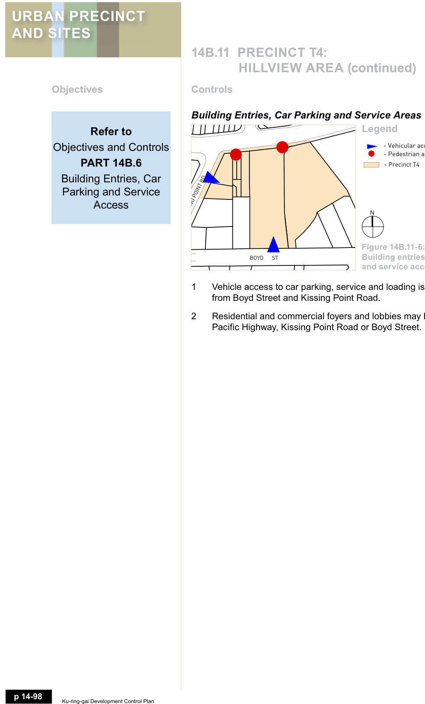

### 31 29 TURRAMURRA LOCAL CENTRE

23 A

Highway) are to be aligned with the front facade of the original

cottage building and the western facade of the original

guesthouse building as shown in Figure 14B.4-1.

- Proposed Community Infrastructure

- Proposed Community Infrastructure

23C

LYNBARA

TERRIGAL

28

LINK

62A 123 125 127

BUILT FORM

60A 152

6 EASTER

STURT

PACIFIC

- Principal active frontage

> [Picture on page 38: a map, saved as a picture (images/part-14b-turramurra-local-centre-page-38-9.gif, 150 dpi); the street names and other small labels are on the picture.]
> Words printed on the picture (title and legend, copied from the PDF):
> 4 6 8 10
> - Continuous awnings
> - Continuous colonnade
> 4 8 10
> 9 7 5 3 1
> 5 7 9 11
> 8 6 4
> - Vehicular access to site
> - Pedestrian access to site
> - Entry plaza/forecourt
> 10 12 14 16 18
> 4 6 8
> 3 5 7 11
> KISSING POINT RD
> - Precinct T1
> - Precinct T2
> - Precinct T3
> - Precinct T4
> 24 22 20 18
> - Heritage item
> PATHWAY 5 24 24A
> KISSING POINT RD
> 82 3.66W PATHWAY
> - Landmark building
> - Character item
> and service access plan.
> 6 4 2
> - Proposed road
> 1 7 3.66W PATHWAY

Figure 14B.11-6:

- Supporting active frontage

- 2m upper level setback above

- 4m upper level setback above

AVE

6

- Continuous awnings where possible PUBLIC DOMAIN AND PEDESTRIAN

### T2

### T1

### T1
