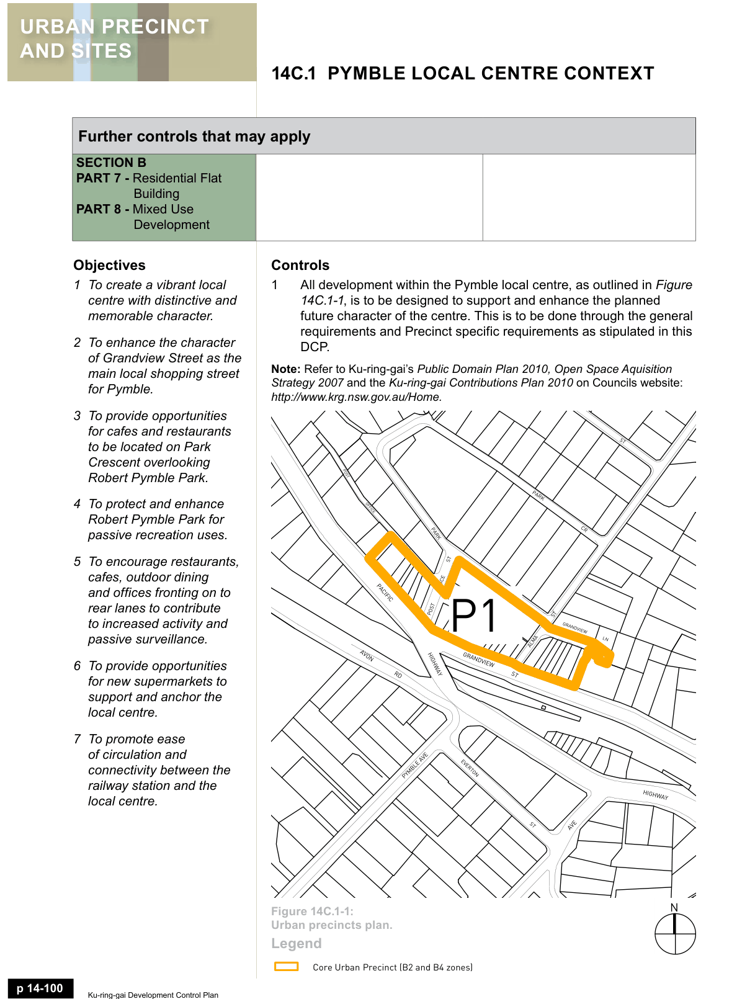
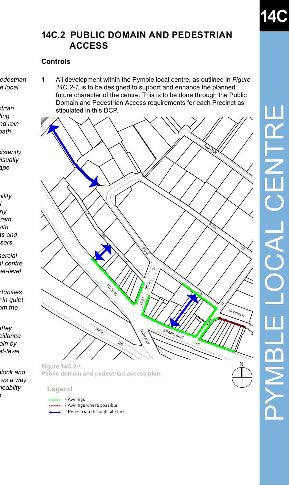
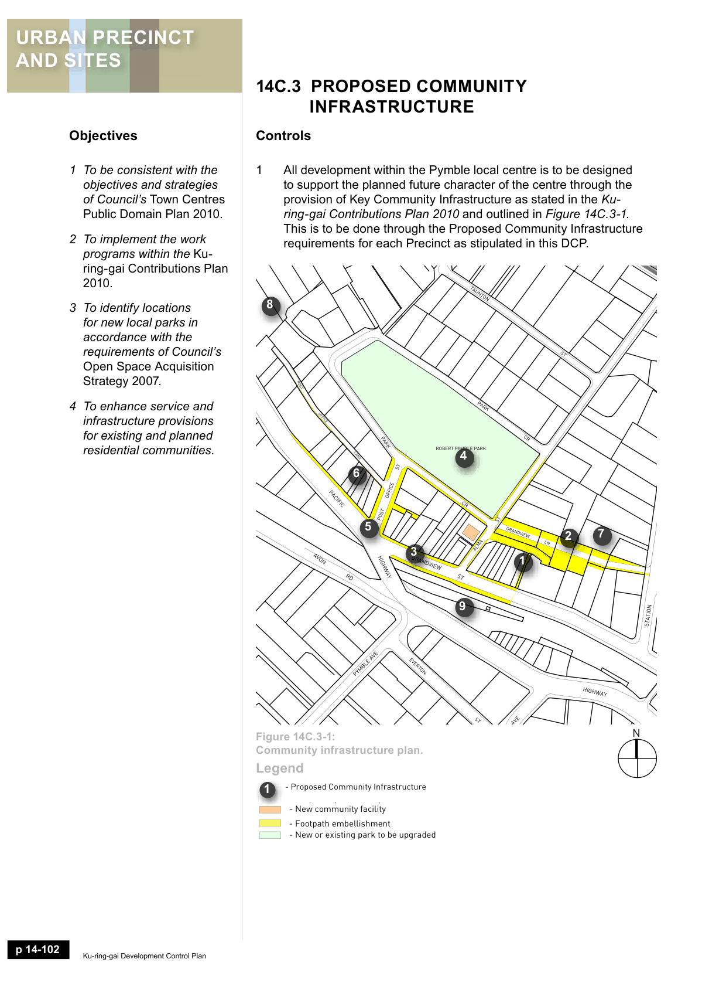
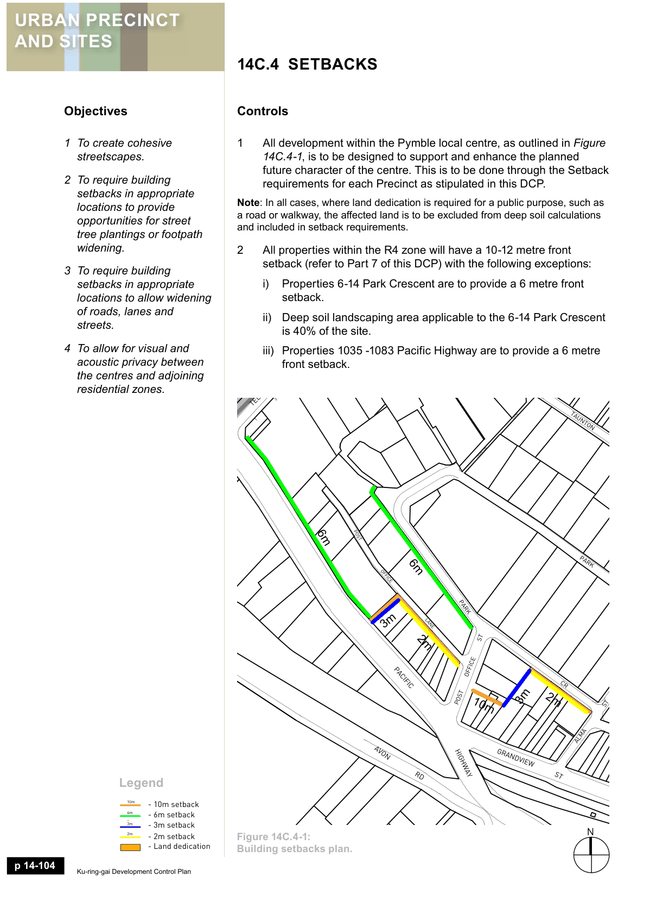
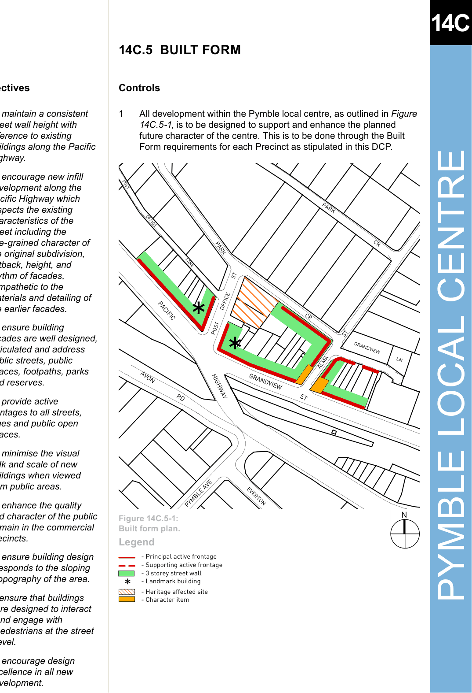

### 14C		 Pymble Local Centre

14C.1	 	Pymble Local Centre Context 14C.2	 	Public Domain and Pedestrian Access 14C.3	 	Proposed Community Infrastructure

### 14C.4	 	Setbacks 14C.5	 	Built Form 14C.6	 	Building Entries, Car Parking and Service

### Access 14C.7 	 Precinct 1: Grandview Street and Pacific

### Highway Commercial Area

### PYMBLE LOCAL CENTRE

> [Picture on page 2: a map, saved as a picture (images/part-14c-pymble-local-centre-page-2-1.gif, 150 dpi); the street names and other small labels are on the picture.]
> Words printed on the picture (title and legend, copied from the PDF):
> 21 19 17
> GARRICK 1 272
> 4 RD 287A

Figure 14C.1-1:

### VOLUME B

### VOLUME B

### 14C.1  PYMBLE LOCAL CENTRE CONTEXT

4

#### BOBBIN

#### RD

37

1147

### Further controls that may apply

#### MERRIVALE

#### TELEGRAPH

#### BUNGALOW

#### RICHARD PORTER WAY

#### GRAHAM

### SECTION B

## PART 7 - Residential Flat Building PART 8 - Mixed Use Development RESERVOIR

#### RD

#### RD

### Objectives

### Controls

#### BANNOCKBURN

26

24

22A

22

20

18A

## 1	 To create a vibrant local

centre with distinctive and

### memorable character.

14

#### AVE

12

## 1 All development within the Pymble local centre, as outlined in Figure

### 14C.1-1, is to be designed to support and enhance the planned

### future character of the centre. This is to be done through the general

### requirements and Precinct specific requirements as stipulated in this

### DCP.

#### TELEGRAPH

#### PL

#### TAUNTON

## 2	 To enhance the character

of Grandview Street as the

### main local shopping street

### for Pymble.

11

#### CLYDESDALE

### Note: Refer to Ku-ring-gai’s Public Domain Plan 2010, Open Space Aquisition

### Strategy 2007 and the Ku-ring-gai Contributions Plan 2010 on Councils website:

### http://www.krg.nsw.gov.au/Home.

#### ST

#### POST

## 3	 To provide opportunities

### for cafes and restaurants

### to be located on Park

### Crescent overlooking

### Robert Pymble Park.

#### PARK

#### ST

#### STATION

#### OFFICE

#### RD

#### CR

#### PARK

## 4	 To protect and enhance

Robert Pymble Park for

### passive recreation uses.

#### LANE

#### CR

#### PACIFIC

#### OFFICE

#### POST

#### ST

#### ST

#### GRANDVIEW

### P1

#### LN

## 5	 To encourage restaurants,

### cafes, outdoor dining

and offices fronting on to

### rear lanes to contribute

to increased activity and

### passive surveillance.

#### ALMA

#### AVON

#### AVON

#### GRANDVIEW

#### HIGHWAY

#### ST

#### RD

#### KIN

## 6	 To provide opportunities

for new supermarkets to

support and anchor the

### local centre.

#### STATION

#### PYMBLE AVE

#### HIGHWAY

#### GR

## 7	 To promote ease

of circulation and

connectivity between the

railway station and the

### local centre.

#### ST

#### EVERTON

#### AVE

### N

### Urban precincts plan.

### URBAN STRUCTURE

### Legend

### Core Urban Precinct (B2 and B4 zones) - Fringe Urban Precinct (R4 zone)

#### BLOOMSBURY

### 12 p 14-100

### Precinct Number

### -

### L1

3 AVE

#### AV

#### PYMBLE

258 MONA

### - Precinct S1

### - Precinct S2

### - Precinct S3

> [Picture on page 3: a map, saved as a picture (images/part-14c-pymble-local-centre-page-3-1.gif, 150 dpi); the street names and other small labels are on the picture.]
> Words printed on the picture (title and legend, copied from the PDF):
> 123 125 127
> 123 125 127
> 123 125 127
> 1 3 5
> 1 3 5
> 1 3 5
> 4 8 10
> 5 7 9 11
> 4 8 10
> 5 7 9 11
> 4 8 10
> 5 7 9 11
> 4 6 8
> 2 15 19
> 3 5 7 11
> 4 6 8
> 3 5 7 11
> RD 10 12 14 16 18
> 4 6 8
> 3 5 7 11

Figure 14C.2-1:

### MERRIVALE

#### 2

#### 12

#### 21

#### 19

#### 17

### BUNGALOW

#### RICHARD PORTER WAY

#### 2

### 14C.2  PUBLIC DOMAIN AND PEDESTRIAN

### ACCESS

#### GRAHAM

#### RESERVOIR

### RD

#### 4

#### 9

#### 5

#### 7

### Objectives

### Controls

#### 1119

#### 1A

#### 8

#### 6

#### 11

#### 13

#### 15

#### 7

#### 5

#### 3

#### 1

### BANNOCKBURN

## 1	 To increase the pedestrian

### permeability of the local

### centre.

#### 10 9

#### 2C

#### 2B

#### 11

## 1 All development within the Pymble local centre, as outlined in Figure

### 14C.2-1, is to be designed to support and enhance the planned

### future character of the centre. This is to be done through the Public

### Domain and Pedestrian Access requirements for each Precinct as

### stipulated in this DCP.

#### 1103

#### 1089

#### 5

#### 7

#### 9

### TELEGRAPH

#### PL

## 2	 To improve pedestrian

### amenity by providing

### continuous sun and rain

### protection to footpath

### areas.

#### 3

#### 1

#### TAUNTON

#### 1083

#### CLYDESDALE

## 3	 To provide a consistently

### high quality and visually

### pleasing streetscape

### environment.

#### ST

#### POST

#### PARK

276

23

#### OFFICE

### ALIGNMENT AND SETBACKS

21 19 17

293

15 11 7 5

9

18 16

3

14

276

## 4	 To improve and

### enhance accessibility

### to the commercial

### precinct particularly

### for pedestrians, pram

walkers, people with

disabilities, cyclists and

### public transport users.

### RD

VALE

#### 15m

295

289

GARRICK 1 272

274

23 12 10 8 6

### ALIGNMENT AND SETBACKS

#### CR

4

21 19 17

RD 287A 2

#### 12m

293

285

PL

15 11 7 5

9

#### PARK

18 16

3

14

VALE

#### 15m

295

289

GARRICK 1 276

#### 55 10m

4

3

272

274

12 10 8 6

23

270

4 RD

### ALIGNMENT AND SETBACKS

287A

#### LANE

2

21 19 17 6

#### 12m

#### 6m

285

PL

293

5

7 6A

287

283

281

279

15 11 7 5

9

18 16

3

8

14

RTLE

#### 10m

4

3

#### 5m

VALE

#### 15m

295

289

266

268

GARRICK 1 272

274

277

12 10 8 270

14 12

6 4 RD

6

287A

258

#### 6m

2

#### 4m

#### 12m

5

7 6A

285

287

283

281

279

PL 8

RTLE

#### 5m

275

271

273

266

268

## 5	 To improve commercial

### activity in the local centre

### by promoting street-level

### activity.

#### 10m

4

3

#### 3m

277

260

264

262

14 12

270

258 269

#### 4m

6

#### 2m

258

#### 6m

MONA

#### 11 5

7 6A

287

283

281

279

267 8

RTLE

275

271

273

#### 5m

#### 3m

260

264

262

107A

266

268

265

277

#### CR

### PACIFIC

14 12 269

#### 2m

258 258

MONA

#### 4m

99

97

#### 40%

267

101 103 105 107

#### OFFICE

#### POST

#### ST

KILLEATON

ST

107A

275

271

273

#### ST

265

#### DAINTON 3m

260

264

262

- 15m setback - 12m setback - 10m setback - 6m setback - 5m setback - 4m setback - 3m setback - 2m setback

### - Land dedication - Alternate deep soil landscaping (% of site)

111

109

269

#### 2m

99

97 258

#### 40%

MONA

101 103 105

267

107

KILLEATON

ST

#### GRANDVIEW

107A

## 6	 To facilitate opportunities

### for outdoor dining in quiet

locations away from the

### highway.

- 15m setback - 12m setback - 10m setback - 6m setback - 5m setback - 4m setback - 3m setback - 2m setback

### - Land dedication - Alternate deep soil landscaping (% of site)

111

109

265

### BUILT FORM

#### LN

99

97

#### 40%

#### ALMA

101 103 105 107

KILLEATON

ST

### BUILT FORM

- 15m setback - 12m setback - 10m setback - 6m setback - 5m setback - 4m setback - 3m setback - 2m setback

### - Land dedication - Alternate deep soil landscaping (% of site)

111

109

### AVON

### GRANDVIEW

### BUILT FORM

### HIGHWAY

2 4 6 8 10

### ST

### RD

2 4 6 8 10

## 7	 To improve the saftey

### and passive surveillance

of the public domain by

### encouraging street-level

### activity.

- Primary active frontage - Secondary active frontage - 3 storey street wall - 2m upper level setback above street

### wall height - 4m upper level setback above street wall height

### N

2 4 6 8 10

### Public domain and pedestrian access plan.

- Primary active frontage - Secondary active frontage - 3 storey street wall - 2m upper level setback above street

### wall height - 4m upper level setback above street wall height

### PUBLIC DOMAIN AND PEDESTRIAN

PL

### Legend

### PUBLIC DOMAIN AND PEDESTRIAN

RD

- Primary active frontage - Secondary active frontage - 3 storey street wall - 2m upper level setback above street

### wall height - 4m upper level setback above street wall height

PL

### Legend

18

16

12

20

14

10

8

6

4

## 8	 To promote mid-block and

### through-site links as a way

### of improving permeabilty

### of the local centre.

NEWHAVEN

RD

COLLEGE

### PUBLIC DOMAIN AND PEDESTRIAN

22

PL

### Legend

18

16

12

20

14

10

8

6

4

NEWHAVEN

### PYMBLE AVE

COLLEGE

- Pedestrian through site link - Entry plaza/forecourt - Awnings - Awnings where possible - Colonnade

RD

22

10 12 14 16 18

18

16

12

20

14

10

8

6

4

### PYMBLE LOCAL CENTRE

NEWHAVEN

- Pedestrian through site link - Entry plaza/forecourt - Awnings - Awnings where possible - Colonnade

### HIGH

### BUILDING ENTRIES AND CARPAT

COLLEGE

10 12 14 16 18

22

### BUILDING ENTRIES AND CARPAT

- Pedestrian through site link - Entry plaza/forecourt - Awnings - Awnings where possible - Colonnade

### - Vehicular access to site - Pedestrian access to site

ST 59

#### ST

#### EVERTON

RD

57 55

### AVE

### BUILDING ENTRIES AND CARPAT

ST

2 RD

6

### - Vehicular access to site - Pedestrian access to site

AVE ST 59

RD

57

3 55

8

### HERITATGGEA

ST 2

6 10

### - Vehicular access to site - Pedestrian access to site

14 RD

### HERITATGGEA

### - Heritage/character item

7

5

### - Heritage/character item

### HERITATGGEA

6

82 3.66W PATHWAY 18

8

4

6

4

5

### - Heritage/character item

29

82 3.66W PATHWAY 18

GREVILLEA

YARRABUNG 34

3.66W PATHWAY 18

#### 31B 41

AVE 24 3.66W PATHWAY

BUNG GREVILLEA

TER

#### IN

#### S

> [Picture on page 4: a map, saved as a picture (images/part-14c-pymble-local-centre-page-4-3.gif, 150 dpi); the street names and other small labels are on the picture.]
> Words printed on the picture (title and legend, copied from the PDF):
> 21 19 17
> GARRICK 1 272
> 21 19 17 MONA
> 265 GARRICK 1 272
> 12 10 8
> 4 RD 287A
> 101 103 105
> 123 125 127
> 2 51 53
> 21 19 17 260
> 16 269 3
> 12 10 8
> 4 6 8 10
> 1 3 5
> 101 103 105
> 123 125 127
> 4 8 10
> 5 7 9 11
> 4 6 8 10
> 101 103 105
> 123 125 127
> 4 6 8
> 1 15 19
> 3 5 7 11
> 4 8 10
> 4 6 8 10
> 5 7 9 11
> 1 3 5
> 4 6 8
> 3 5 7 11
> 4 8 10
> 82 3.66W PATHWAY
> 5 7 9 11
> 4 6 8
> 6 3.66W PATHWAY
> 3 5 7 11
> 7 3.66W PATHWAY
> 3.66W PATHWAY 18
> 3.66W PATHWAY 18
> AVE 3.66W PATHWAY
> 7 3.66W PATHWAY

Figure 14C.3-1:

#### MERRIVALE

#### TELEGRAPH

### 14C.3  PROPOSED COMMUNITY

### INFRASTRUCTURE

17

### Objectives

### Controls 17

#### BUNGALOW

#### RICHARD PORTER WAY

#### GRAHAM

#### RESERVOIR

#### RD

2

#### BANNOCKBURN

## 1	 To be consistent with the

### objectives and strategies

### of Council’s Town Centres

### Public Domain Plan 2010.

### ALIGNMENT AND SETBACKS 2B - 9m setback

#### 9m

#### 15m

## 1 All development within the Pymble local centre is to be designed

to support the planned future character of the centre through the

### provision of Key Community Infrastructure as stated in the Ku-

### ring-gai Contributions Plan 2010 and outlined in Figure 14C.3-1.

### This is to be done through the Proposed Community Infrastructure

### requirements for each Precinct as stipulated in this DCP.

### - 15m setback

### - 13m setback

#### 13m

#### AVE

#### 12m

12 10 8 6 4

### - 12m setback

### - 11m setback

#### 11m

#### TELEGRAPH

#### PL

#### 10m

## 2	 To implement the work

### programs within the Ku-

### ring-gai Contributions Plan

### 2010.

#### 6m

#### TAUNTON

E

#### 5m

### 8

#### CLYDESDALE

#### 4m

#### 51 53 3m 2m

#### ST

### ALIGNMENT AND SETBACKS

#### 40%

- 10m setback - 6m setback - 5m setback - 4m setback - 3m setback - 2m setback - Land dedication - Alternate deep soil landscaping

### (% of site)

## 3	 To identify locations

for new local parks in

accordance with the

### requirements of Council’s

### Open Space Acquisition

### Strategy 2007.

#### POST

### BUILT FORM

#### PARK

#### ST

#### STATION

#### OFFICE

#### MONA RD

- 10m setback - 6m setback - 3m setback - Nil setback - Land dedication - Alternate deep soil requirement

### ALIGNMENT AND SETBACKS

#### CR

#### PARK

#### ROBERT PYMBLE PARK

- Principal active frontage - Supporting active frontage - 3 storey street wall - 2m upper level setback above

## 4	 To enhance service and

### infrastructure provisions

### for existing and planned

### residential communities.

### BUILT FORM

#### LANE

### street

### 4

### wall height - 4m upper level setback above

### 6

### street

### wall height

### PUBLIC DOMAIN AND PEDESTRIAN

#### CR

#### PACIFIC

- 10m setback - 6m setback - 3m setback - Nil setback - Land dedication - Alternate deep soil requirement

#### OFFICE

#### POST

#### ST

#### ST

### 5

#### GRANDVIEW

### BUILT FORM

### 7

### 2

#### LN

21

- Primary active frontage - Secondary active frontage - 3 storey street wall - 2m upper level setback above street

### wall height - 4m upper level setback above street wall height

#### ALMA

22 117 1 3 5

### 3

#### AVON

#### AVON

### 1

- Pedestrian through site link - Entry plaza/forecourt - Awnings - Awnings where possible - Colonnade

### PUBLIC DOMAIN AND PEDESTRIAN

#### GRANDVIEW

10 12 14 16 18

#### HIGHWAY

#### ST

#### RD

### BUILDING ENTRIES AND CARPAT

#### KING

### 9

### - Vehicular access to site - Pedestrian access to site

#### STATION

- Primary active frontage - Secondary active frontage - 3 storey street wall - 2m upper level setback above street

### wall height - 4m upper level setback above street wall height

- Through site link - Entry plaza/forecourt - Continuous awnings - Continuous awnings where possible

### - Continuous colonnade PUBLIC DOMAIN AND PEDESTRIAN

### HERITATGGEA

### BUILDING ENTRIES AND CARPAT - Heritage item

10 12 14 16 18

#### PYMBLE AVE

### - Vehicular access to site - Pedestrian access to site

#### NEW PARK

#### HIGHWAY

### - Landmark building

#### GRANDVIEW

- Through site link - Entry plaza/forecourt - Continuous awnings - Continuous awnings where possible

### - Continuous colonnade

### *

#### ST

#### EVERTON

### KEY COMMUNITY INFRASTRUCTRE

43

#### AVE

### N

### - Character item

### BUILDING ENTRIES AND CARPAT

10 12 14 16 18

### Community infrastructure plan.

### - Vehicular access to site - Pedestrian access to site

### Legend

#### NEW PARK

### - Refer to site specific DCP

### - Proposed road - Proposed Community Infrastructure

### 1

### KEY COMMUNITY INFRASTRUCTRE

- Footpath embellishment - New or existing park to be upgraded - Historic/character building to be retained - New/realigned road - Proposed pedestrian promenade - New community facility - Landscaping

#### PACIFIC

#### ST

#### BLOOMSBURY

- Footpath embellishment - New or existing park to be upgraded - Historic/character building to be retained - New/realigned road - Proposed pedestrian promenade - New community facility - Landscaping

#### PYMBLE

#### RAND

#### ORINOCO

#### LIVINGSTONE

#### ORINOCO

#### AV

#### S

### 14C.3  PROPOSED COMMUNITY

### INFRASTRUCTURE (continued)

### Controls

## 2 The following development is to be designed to support and

### compliment the provision of Key Community Infrastructure through

### the Ku-ring-gai Contributions Plan 2010, Voluntary Planning

### Agreement (VPA) or other mechanism (refer to individual precinct

### 14C.7):

### 1

### Upgrade works to the existing pedestrian access way from

### Grandview Lane to Grandview Street.

## 2 Extension of Grandview Lane from Alma Street through to Sta-

### tion Street and increased off-street parking.

## 3 Road modification works to Grandview Street, between Pacific

Highway and Alma Street, for one way traffic and increased on

### street parking. Improvement works to Robert Pymble Park.

### 4 5

### Embellishment of Grandview Street, Pacific Highway, Post Office

### Street, Post Office Lane, Park Crescent and Alma Street includ-

### ing underground power lines, new lighting, high quality paving

### and furniture.

## 6 Construction of a new pedestrian access way linking Post Office

### Lane with the Pacific Highway.

## 7 Construction of a new pedestrian access way linking Alma Street

### and Station Street.

### 8

### Construction of a new pedestrian access way linking Telegraph

### Road and Park Crescent (land acquired by dedication refer

### 14C.5).

## 9 Improvements to the existing rail underpass connecting Grand-

### view Street with Avon Road.

### PYMBLE LOCAL CENTRE

> [Picture on page 6: a map, saved as a picture (images/part-14c-pymble-local-centre-page-6-1.gif, 150 dpi); the street names and other small labels are on the picture.]

Figure 14C.4-1:

### 14C.4  SETBACKS

#### 9

#### 26

#### 9

#### 22

### Objectives

### Controls

#### 5

#### 8

#### 10

#### 12

#### 3

#### 3

#### 6

#### 4A

#### 6

#### 6A

#### 8

#### 10

#### 12

## 1	 To create cohesive

### streetscapes.

#### 1

#### 4

#### 10 8

#### 12

#### 14

#### 16

#### 18

#### 4

#### 4

### MERRIVALE

#### 4

#### 18B

#### 18A

#### 16A

## 1 All development within the Pymble local centre, as outlined in Figure

### 14C.4-1, is to be designed to support and enhance the planned

### future character of the centre. This is to be done through the Setback

### requirements for each Precinct as stipulated in this DCP.

#### 16

### TELEGRAPH

#### 2

#### 11 2

#### 2A

#### 20

#### 2

#### 1125

#### 20

#### 24

#### 12

#### 29 23

#### 21

#### 19

#### 31

### Note: In all cases, where land dedication is required for a public purpose, such as

### a road or walkway, the affected land is to be excluded from deep soil calculations

### and included in setback requirements.

#### 17

### BUNGALOW

#### RICHARD PORTER WAY

#### 2

### GRAHAM

### RESERVOIR

### RD

## 2	 To require building

### setbacks in appropriate

### locations to provide

### opportunities for street

### tree plantings or footpath

### widening.

#### 4

#### 23

#### 25

#### 9

#### 15

#### 19

#### 21

#### 5

#### 7

## 2 All properties within the R4 zone will have a 10-12 metre front

### setback (refer to Part 7 of this DCP) with the following exceptions:

#### 6

#### 1119

#### 1A

#### 11

#### 13

#### 15

#### 7

#### 5

### i) Properties 6-14 Park Crescent are to provide a 6 metre front

### setback.

#### 3

#### 1

### BANNOCKBURN

### ii)	 Deep soil landscaping area applicable to the 6-14 Park Crescent

## 3	 To require building

### setbacks in appropriate

### locations to allow widening

of roads, lanes and

### streets.

### is 40% of the site.

#### 2C

#### 2B

### iii)	 Properties 1035 -1083 Pacific Highway are to provide a 6 metre

#### 1103

#### 1089

#### 5

#### 7

#### 9

### front setback.

## 4	 To allow for visual and

### acoustic privacy between

### the centres and adjoining

### residential zones.

### TELEGRAPH

### PL

#### 3

#### 1

### TAUNTON

#### 1083

### CLYDESDALE

#### POST

### 6m

### PARK

### 6m

#### OFFICE

### RD

### CR

### PARK

#### LANE

### 3m

### 2m

### CR

### PACIFIC

### OFFICE

### POST

### ST

### 3m

#### 11

#### 15

#### 17

### ST

### 2m

### 10m

#### 9

### ALIGNMENT AND SETBACKS

### ALIGNMENT AND SETBACKS

#### GRANDVIEW

#### LN

### - 9m setback

#### 9m

### 51 53 - 9m setback

#### 9m

### ALMA

### ALIGNMENT AND SETBACKS

#### 15m

#### 15m

### - 15m setback

### - 15m setback

### - 13m setback

#### 13m

### - 9m setback

#### 9m

### 51 53 - 13m setback

#### 13m

### AVON

#### 12m

#### 12m

#### 15m

### GRANDVIEW

### - 12m setback

### - 12m setback

### - 15m setback

85

85

### HIGHWAY

### - 11m setback

#### 11m

### 3 - 11m setback

#### 11m

### - 13m setback

#### 13m

### ST

### RD

#### 10m

#### 10m

#### 12m

### 5 - 12m setback

### Legend

#### 6m

#### 6m

85

### - 11m setback

#### 11m 5m

#### 10m

#### 5m 4m

#### 6m

#### 4m

#### FLINDERS 3m

### N

### Building setbacks plan.

#### 40%

#### 40%

- 10m setback - 6m setback - 5m setback - 4m setback - 3m setback - 2m setback - Alternate deep soil landscaping

### (% of site)

- 10m setback - 6m setback - 5m setback - 4m setback - 3m setback - 2m setback - Alternate deep soil landscaping

### (% of site)

#### 40%

- 10m setback - 6m setback - 5m setback - 4m setback - 3m setback - 2m setback - Alternate deep soil landscaping

### (% of site)

## 152 BUILT FORM

### EVERTON

### PYMBLE AVE

2B 15

### - Principal active frontage - Supporting active frontage

### - Principal active frontage - Supporting active frontage

### BANNOCK

> [Picture on page 7: a map, saved as a picture (images/part-14c-pymble-local-centre-page-7-2.gif, 150 dpi); the street names and other small labels are on the picture.]
> Words printed on the picture (title and legend, copied from the PDF):
> ST 117 123 125 127
> 123 125 127
> 101 103 105 107
> 123 125 127
> 4 6 8 10
> 1 3 5
> 1 3 5
> 4 8 10
> 4 8 10
> 5 7 9 11
> 5 7 9 11
> 4 8 10
> 4 6 8
> 4 6 8
> 1 15 19
> 3 5 7 11
> RD 15 19
> 3 5 7 11
> 4 6 8
> 101 103 105 59
> DAINTON 15 19
> 3 5 7 11
> 123 125 127
> 4 6 8 10
> 1 3 5
> 15 5 CL
> 4 4 2
> 4 8 10
> 3 44 YARRABUNG
> 5 7 9 11
> 30 47 16

Figure 14C.5-1:

### 14C.5  BUILT FORM

### TELEGRAPH

### PL

#### 3

#### 1

### TAUNTON

### Objectives

### Controls

#### 1083

### CLYDESDALE

#### TAUNTON

#### LANE

## 1 All development within the Pymble local centre, as outlined in Figure

### 14C.5-1, is to be designed to support and enhance the planned

### future character of the centre. This is to be done through the Built

### Form requirements for each Precinct as stipulated in this DCP. ST
