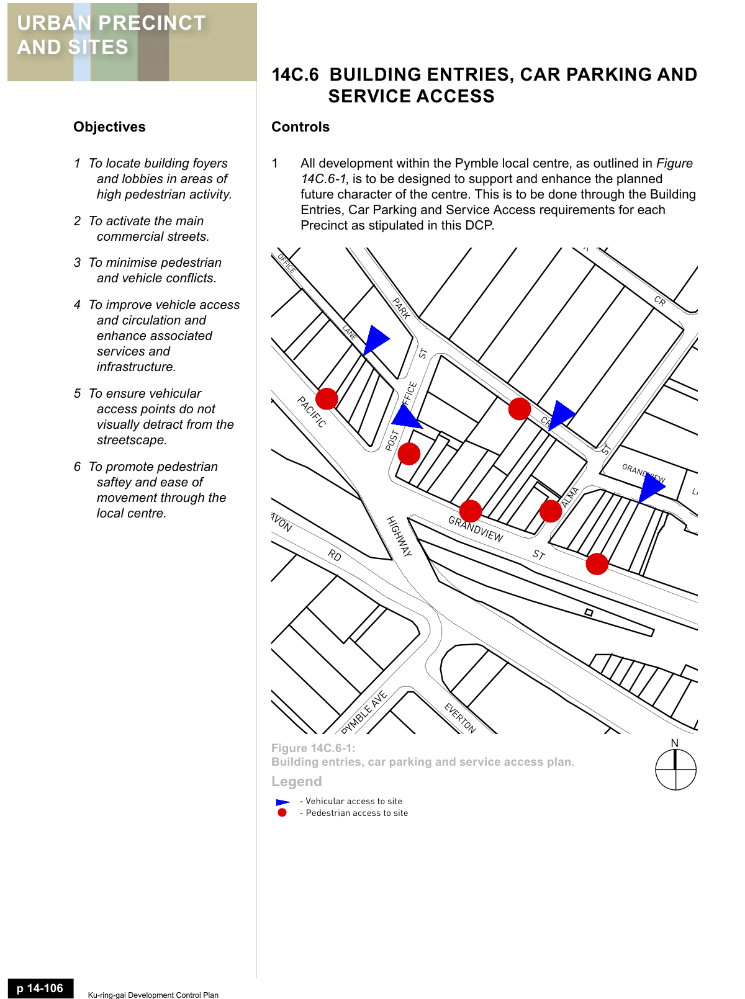
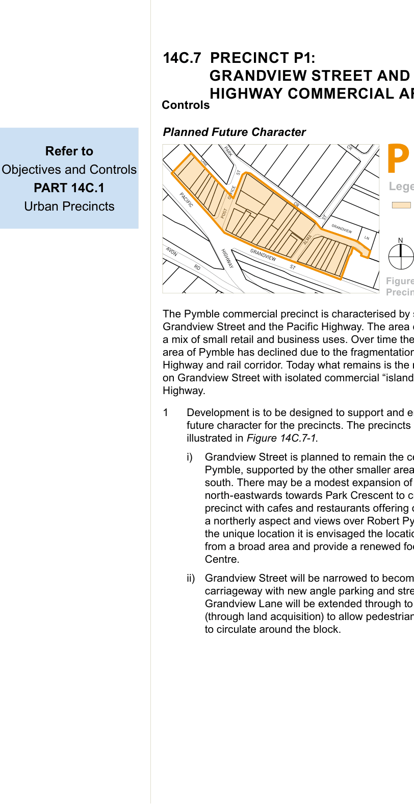

## 1	 To maintain a consistent

street wall height with

### reference to existing

### buildings along the Pacific

### Highway.

#### POST

### ALIGNMENT AND SETBACKS

### ALIGNMENT AND SETBACKS

### PARK

### - 9m setback

#### 9m

### 15m - 9m setback

#### 9m

21 19 17

### - 15m setback

#### 15m OFFICE

15 11 7 5

9

21 19 17

16

3

### - 15m setback

14

### - 13m setback

#### 13m

GARRICK 1 272

#### 12m

15 11 7 5

9

12 10 8

16

3

14 6

### - 13m setback

#### 13m

4

### - 12m setback

GARRICK 1 287A

#### 12m

2

12 10 8 6 285

### ALIGNMENT AND SETBACKS

PL

4

### - 12m setback

### - 11m setback

#### 11m

### CR

2

#### 10m

3 4

PL

### - 11m setback

#### 11m

270

### PARK

### - 9m setback

#### 9m

#### 10m

3 4 6

#### 6m

270

5 6A

#### 15m

6 8

21 19 17

### 6m - 15m setback

#### 5m

5

#### LANE

266

268

6A 12

15 11 7 5

9

8

16

3

14

### 5m - 13m setback

#### 13m

266

268

258

GARRICK 277

#### 4m

12

#### 12m

12 10 8 6 4

258

### - 12m setback

#### 4m

2

275

271

273

#### 3m

260

264

262

PL

### - 11m setback

#### 11m

275

271

273

269

#### 3m

260

264

262

#### 10m

3 4

#### 2m

258 MONA 270

269

267

#### 2m

258

6 MONA

#### 6m

5 265

6A 267

8

#### 5m

266

268

265 99

97

12

#### 40%

## 2	 To encourage new infill

development along the

### Pacific Highway which

### respects the existing

characteristics of the

street including the

fine-grained character of

the original subdivision,

setback, height, and

rhythm of facades,

sympathetic to the

materials and detailing of

### the earlier facades.

101 103 105 107

258 KILLEATON

99

97

#### 4m

#### 40%

### CR

- 10m setback - 6m setback - 5m setback - 4m setback - 3m setback - 2m setback - Land dedication - Alternate deep soil landscaping

### (% of site)

101 103 105 113 115

### PACIFIC

KILLEATON

275

271

273

#### DAINTON 3m

260

264

262

- 10m setback - 6m setback - 5m setback - 4m setback - 3m setback - 2m setback - Land dedication - Alternate deep soil landscaping

### (% of site)

269

#### 121 2m

258

### OFFICE

### POST

### ST

MONA

### ST

### BUILT FORM

267

### BUILT FORM

265

99

97

#### 40%

#### GRANDVIEW

KILLEATON

- 10m setback - 6m setback - 5m setback - 4m setback - 3m setback - 2m setback - Land dedication - Alternate deep soil landscaping

### (% of site)

#### LN

### *

### *

### ALMA

2 4 6 8 10

- Principal active frontage - Supporting active frontage - 3 storey street wall - 2m upper level setback above

### BUILT FORM

### AVON

- Principal active frontage - Supporting active frontage - 3 storey street wall - 2m upper level setback above

### street

## 3	 To ensure building

facades are well designed,

### articulated and address

### public streets, public

### spaces, footpaths, parks

### and reserves.

### GRANDVIEW

### 1 3 5 street

### wall height - 4m upper level setback above

### HIGHWAY

### ST

### wall height - 4m upper level setback above

### RD

### street wall height

### ALIGNMENT AND SETBACKS

### street wall height

2 4 6 8 10

### PUBLIC DOMAIN AND PEDESTRIAN

- Principal active frontage - Supporting active frontage - 3 storey street wall - 2m upper level setback above

### - 9m setback

#### 9m

PL

### 15m PUBLIC DOMAIN AND PEDESTRIAN

### street

21 19 17

### - 15m setback

PL

15 11 7 5

9

16

3

14 RD

### - 13m setback

#### 13m

### wall height - 4m upper level setback above

GARRICK 1

## 4	 To provide active

frontages to all streets,

### lanes and public open

### spaces.

#### 12m

12 10 8

RD 6 4

### - 12m setback

### street wall height

2

NEWHAVEN PL

### - 11m setback

#### 11m 10m

3 4

NEWHAVEN

270

## 5 PUBLIC DOMAIN AND PEDESTRIAN

6

#### 6m

PL 5 6A

10

- Pedestrian through site link - Entry plaza/forecourt - Awnings - Awnings where possible - Colonnade

8

#### 5m

266

268

10 12 14 16 18

12

- Pedestrian through site link - Entry plaza/forecourt - Awnings - Awnings where possible - Colonnade

RD

10 12 14 16 18

258

#### 5 7 9 11 4m

### BUILDING ENTRIES AND CARPAT

275

271

273

#### 3m

260

264

262

## 5	 To minimise the visual

### bulk and scale of new

### buildings when viewed

### from public areas.

NEWHAVEN

### BUILDING ENTRIES AND CARPAT

269

#### 2m

258

MONA

267

### PYMBLE AVE

265

### - Vehicular access to site - Pedestrian access to site

- Pedestrian through site link - Entry plaza/forecourt - Awnings - Awnings where possible - Colonnade

RD

10 12 14 16 18

99

97

#### 40%

### - Vehicular access to site - Pedestrian access to site

5

### N

RD ST

KILLEATON

6

- 10m setback - 6m setback - 5m setback - 4m setback - 3m setback - 2m setback - Land dedication - Alternate deep soil landscaping

### (% of site)

ST

### BUILDING ENTRIES AND CARPAT

6

### HIGHWAY

8

### Built form plan.

### HERITATGGEA

8 10

### HERITATGGEA

### BUILT FORM

## 6	 To enhance the quality

### and character of the public

### domain in the commercial

### precincts.

12 10

## 150 Legend

14

### - Heritage item

### - Vehicular access to site - Pedestrian access to site

12 14

RD

### - Heritage item

### ST

### EVERTON

### AVE

ST

15

11

9

7

5

6

15

11

9

7

5

8 84

82 3.66W PATHWAY

### - Landmark building

### HERITATGGEA

18

16

14

12

10

8

4

6

86

AVE 84

82

17

10 3.66W PATHWAY

### - Landmark building

## 7	 To ensure building design

### responds to the sloping

### topography of the area.

18

16

14

12

10

8

4

6

- Principal active frontage - Supporting active frontage - 3 storey street wall - 2m upper level setback above

20

49

47

### 10 *

86

45 AVE

17

12 14

19

20

49

47

### street

### *

45

### - Heritage affected site

19

### wall height - 4m upper level setback above

### PYMBLE LOCAL CENTRE

### - Character item

15

11

9

7

5

### - Character item

### street

### wall height

17 15 84

82

3.66W PATHWAY

17 3.66W PATHWAY

### - Landmark building

18

16

14

12

10

8

4

6

15 86

AVE

17

3.66W PATHWAY 30

26

24

22

28

### PUBLIC DOMAIN AND PEDESTRIAN

PL

20

49

47

LANCASTER

### *

45 PL

29

25

30

26

24

22

28

19

11

9

PL

### - Refer to site specific DCP

### - Proposed road

29

25

11

9

24

26

### - Refer to site specific DCP

### - Proposed road

7

RD 3.66W PATHWAY

### - Proposed Community Infrastructure

34

32

### - Character item

24

26

## 8	 Toensure that buildings

### are designed to interact

and engage with

### pedestrians at the street

### level.

7

21

33

31

27

23

3.66W PATHWAY

### - Proposed Community Infrastructure

34

32

17

21

33

31

27

23

NEWHAVEN

15

3.66W PATHWAY

26

24

22

28

LANCASTER

25

- Pedestrian through site link - Entry plaza/forecourt - Awnings - Awnings where possible - Colonnade

### - Refer to site specific DCP

### - Proposed road

10 12 14 16 18

7 3.66W PATHWAY

### - Proposed Community Infrastructure

## 9	 To encourage design

### excellence in all new

### development.

21

23

### BUILDING ENTRIES AND CARPAT - Vehicular access to site

### HERITATGGEA

### E

> [Picture on page 8: a map, saved as a picture (images/part-14c-pymble-local-centre-page-8-1.gif, 150 dpi); the street names and other small labels are on the picture.]
> Words printed on the picture (title and legend, copied from the PDF):
> 1 19 17
> GARRICK 1 272
> 12 10 8
> 101 103 105 107
> 123 125 127
> 4 8 10
> 5 7 9 11
> 4 6 8
> 3 5 7 11
> 82 3.66W PATHWAY

Figure 14C.6-1:

#### TAUNTON

### 14C.6  BUILDING ENTRIES, CAR PARKING AND

### SERVICE ACCESS

### Objectives

### Controls

### ST

## 1	 To locate building foyers

and lobbies in areas of

### high pedestrian activity.

#### POST

## 1 All development within the Pymble local centre, as outlined in Figure

### 14C.6-1, is to be designed to support and enhance the planned

### future character of the centre. This is to be done through the Building

### Entries, Car Parking and Service Access requirements for each

### Precinct as stipulated in this DCP.

## 2	 To activate the main

### commercial streets.

### PARK

#### OFFICE

## 3	 To minimise pedestrian

### and vehicle conflicts.

### CR

### PARK

#### LANE

## 4	 To improve vehicle access

and circulation and

### enhance associated

services and

### infrastructure.

### ALIGNMENT AND SETBACKS - 9m setback

#### 9m

#### 15m

### - 15m setback

### - 13m setback

#### 13m 12m

### CR

### PACIFIC

### - 12m setback

### - 11m setback

#### 11m

## 5	 To ensure vehicular

### access points do not

visually detract from the

### streetscape.

#### 10m

### OFFICE

### POST

### ST

### ST

#### 6m 5m

### GRANDVIEW

#### 4m

### LN

#### 3m 2m

### ALMA

## 6	 To promote pedestrian

saftey and ease of

movement through the

### local centre.

### AVON

#### 40%

### GRANDVIEW

- 10m setback - 6m setback - 5m setback - 4m setback - 3m setback - 2m setback - Land dedication - Alternate deep soil landscaping

### (% of site)

### HIGHWAY

### ST

### RD

### BUILT FORM

2 4 6 8 10

- Principal active frontage - Supporting active frontage - 3 storey street wall - 2m upper level setback above

### 1 3 5 street wall height

### - 4m upper level setback above

### street wall height

### PUBLIC DOMAIN AND PEDESTRIAN

### PYMBLE AVE

### N

- Pedestrian through site link - Entry plaza/forecourt - Awnings - Awnings where possible - Colonnade

10 12 14 16 18

### HI

### Building entries, car parking and service access plan.

### BUILDING ENTRIES AND CARPAT

### Legend

### - Vehicular access to site - Pedestrian access to site

### ST

### EVERTON

### AVE

### HERITATGGEA - Heritage item

### - Landmark building

### *

### - Character item

### - Refer to site specific DCP

### - Proposed road

7 3.66W PATHWAY

### - Proposed Community Infrastructure

H

> [Picture on page 9: a map, saved as a picture (images/part-14c-pymble-local-centre-page-9-2.gif, 150 dpi); the street names and other small labels are on the picture.]
> Words printed on the picture (title and legend, copied from the PDF):
> 11 7 3
