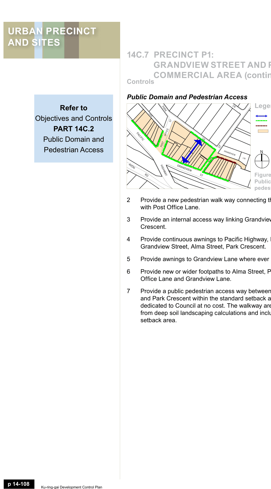

## 19 CR

#### PACIFIC

### - Precinct P1

#### PYMBLE

### PART 14C.1

### Urban Precincts

32

40

34-36

38

#### OFFICE

#### POST

#### ST

#### ST

42

## 5 GRANDVIEW

#### LN

RAND

#### EDWA

### N

39

37

#### ALMA 2

LIVINGSTONE

43

41

35

#### AVON

32

36

34

AVE

#### GRANDVIEW

38

16

12

14

10

40

#### HIGHWAY

#### ST

#### RD

45

42

42A

11A

#### KING

44

11

#### HIGHWAY

### Figure 14C.7-1

### Precinct P1

49

51

53

#### STATION

55

57 52

46

48

50

55A 59

37

#### PYMBLE AVE

#### HIGHWAY

#### GRANDVIEW

#### ST

#### EVERTON

#### AVE

### The Pymble commercial precinct is characterised by strip retail fronting

### Grandview Street and the Pacific Highway. The area currently comprises

### a mix of small retail and business uses. Over time the commercial

area of Pymble has declined due to the fragmentation caused by the

### Highway and rail corridor. Today what remains is the main retail precinct

### on Grandview Street with isolated commercial “islands” on the Pacific

### Highway.

#### W

2

4

33

## 1 Development is to be designed to support and enhance the planned

future character for the precincts. The precincts are listed below and

### illustrated in Figure 14C.7-1.

#### PACIFIC

#### ST

#### BLOOMSBURY

#### AVE

#### PYMBLE

i) Grandview Street is planned to remain the central focus of

Pymble, supported by the other smaller areas to the west and

### south. There may be a modest expansion of the retail area

### north-eastwards towards Park Crescent to create a retail

precinct with cafes and restaurants offering outdoor dining with

### a northerly aspect and views over Robert Pymble Park. Given

### the unique location it is envisaged the location will attract people

### from a broad area and provide a renewed focus for the Pymble

### Centre. ii)	 Grandview Street will be narrowed to become a one-way

#### RAND

#### ORINOCO

#### LIVINGSTONE

#### ORINOCO

### carriageway with new angle parking and street tree planting.

### Grandview Lane will be extended through to Station Street

### (through land acquisition) to allow pedestrians, cycles and traffic

### to circulate around the block.

#### AVE

#### ST

52

#### AVE

#### AVE

56

#### ST

59

55

57

51

53

### PYMBLE LOCAL CENTRE

64

60

62

> [Picture on page 10: a map, saved as a picture (images/part-14c-pymble-local-centre-page-10-1.gif, 150 dpi); the street names and other small labels are on the picture.]
> Words printed on the picture (title and legend, copied from the PDF):
> 7.32 / 3.66 W.
> ESMT FOR SERVICES 20
> 7.32 / 3.66 W.
> ESMT FOR SERVICES
> 123 125 127
> 4 6 8 10
> 1 3 5
> 1 3 5
> VALE RD STANLEY
> 4 8 10
> 5 7 9 11
> 4 8 10
> 5 7 9 11
> 4 6 8
> 4 6 8
> 3 5 7 11
> 3 5 7 11
> ST ST 2
> 24 22 20 18
> 24 22 20 18
> 3.66W PATHWAY 18
> IKARA 1 80
> 47 3.66W PATHWAY 18
> 6 10 2
> 9 74 41
> 7 3.66W PATHWAY
> 7 3.66W PATHWAY

#### FLINDERS 6m 12

#### PL LANE

#### 40%

#### 101 103 105 TAUNTON

#### 40%

### - Alternate deep soil landscaping (% of site)

### - Alternate deep soil landscaping (% of site)

### P1 LN

### PUBLIC DOMAIN AND PEDESTRIAN

### BUILT FORM

### 40%
