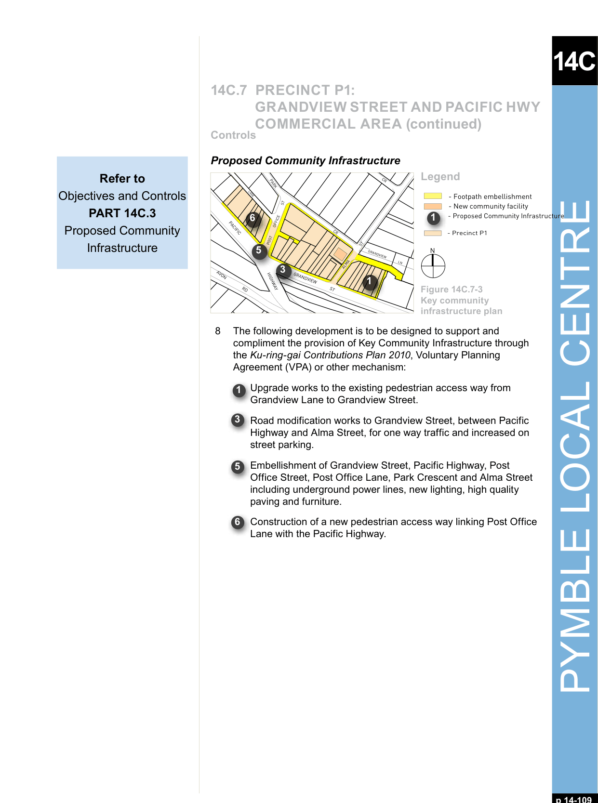
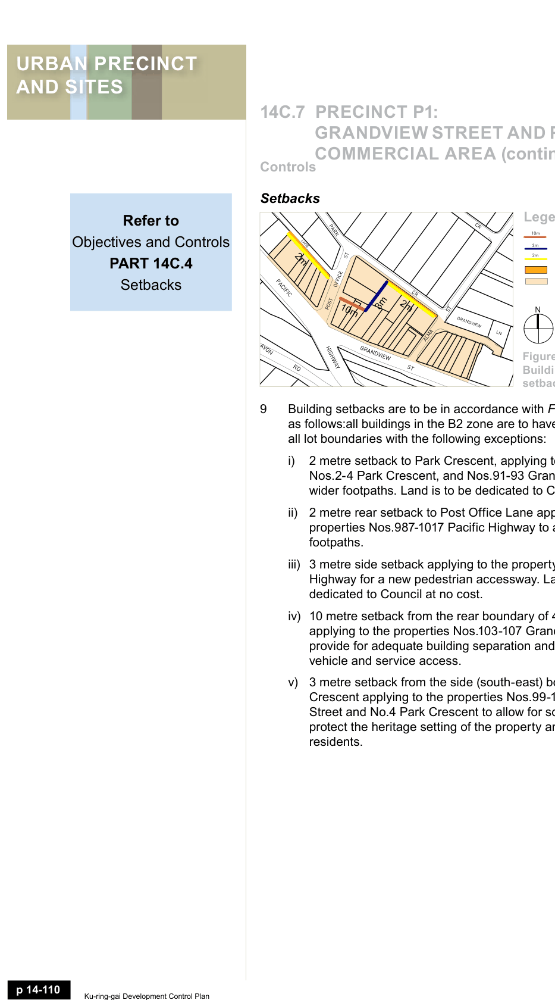

## 5 Provide awnings to Grandview Lane where ever possible.

33

## 6 Provide new or wider footpaths to Alma Street, Park Crescent, Post

### Office Lane and Grandview Lane.

#### PACIFIC

#### ST

#### BLOOMSBURY

## 7 Provide a public pedestrian access way between Telegraph Road

and Park Crescent within the standard setback areas. Land is to be

### dedicated to Council at no cost. The walkway area may be excluded

from deep soil landscaping calculations and included within the

### setback area.

#### AVE

#### PYMBLE

#### RAND

#### ORINOCO

#### LIVINGSTONE

#### ORINOCO

#### AVE

#### ST

#### AVE

#### AVE

#### ST

N

RANA

DE

## 1083 BA

#### ROTARY

#### PARK 1089

### - Pedestrian through site link

> [Picture on page 11: a map, saved as a picture (images/part-14c-pymble-local-centre-page-11-8.gif, 150 dpi); the street names and other small labels are on the picture.]
> Words printed on the picture (title and legend, copied from the PDF):
> LAWSON 15 19
> ST 12 RD
> MONA ST CR
> 4 8 10
> 4 6 8
> 5 7 9 11
> 3 5 7 11
> 24 22 20 18
> 4 6 8
> 3 5 7 11
> 24 22 20 18
> IKARA 1 80
> 24 22 20 18
> 11 7 3
> 4 4 2
> 3 MANDALAY  PL
> 55A 59 52A

Figure 14C.7-3

### - Entry plaza/forecourt - Awnings - Awnings where possible - Colonnade

10 12 14 16 18

### BUILDING ENTRIES AND CARPAT

- Through site link - Entry plaza/forecourt - Continuous awnings - Continuous awnings where possible

### - Continuous colonnade

#### COLLEGE TAUNTON

#### ROTARY

### - Vehicular access to site

#### MEMORIAL

### BUILDING ENTRIES AND CARPAT

### wall height

### P1

10 12 14 16 18

### PUBLIC DOMAIN AND PEDESTRIAN

### HERITATGGEA

- Through site link - Entry plaza/forecourt - Continuous awnings - Continuous awnings where possible

### - Continuous colonnade

### - Vehicular access to site - Pedestrian access to site

#### NEW PARK

#### ST

### - Heritage item

#### MEMORIAL PARK

### BUILDING ENTRIES AND CARPAT KEY COMMUNITY INFRASTRUCTRE

10 12 14 16 18

#### POST

### 14C.7  PRECINCT P1:

### GRANDVIEW STREET AND PACIFIC HWY

### COMMERCIAL AREA (continued)

### Controls

#### CHURCH

### - Landmark building

- Through site link - Entry plaza/forecourt - Continuous awnings - Continuous awnings where possible

### - Continuous colonnade

### - Vehicular access to site - Pedestrian access to site

#### NEW

#### PARK PARK

### *

#### ST

### BUILDING ENTRIES AND CARPAT

### Proposed Community Infrastructure

#### OFFICE

### - Character item

#### RD

### KEY COMMUNITY INFRASTRUCTRE

#### CR

### Legend

#### PARK

### - Vehicular access to site - Pedestrian access to site

#### LANE

Refer to

### Objectives and Controls 5

### - Refer to site specific DCP

### - Proposed road - Proposed Community Infrastructure

- Footpath embellishment - New or existing park to be upgraded - Historic/character building to be retained - New/realigned road - Proposed pedestrian promenade - New community facility - Landscaping

### 1

### 6

#### CR

#### PACIFIC

### - Precinct P1

### PART 14C.3

### Proposed Community

39

#### OFFICE

#### POST

#### ST

#### ST

### N

### Infrastructure

### 5

#### GRANDVIEW

- Footpath embellishment - New or existing park to be upgraded - Historic/character building to be retained - New/realigned road - Proposed pedestrian promenade - New community facility - Landscaping

#### LN

#### EDWARD

#### ALMA

### 3

## 1 AVON

#### GRANDVIEW

### 1

20

#### MO

#### HIGHWAY

#### ST

#### RD

#### LYNBARA

6

#### KING

### Key community

### infrastructure plan

#### STATION

#### LYNBARA

#### PYMBLE AVE

## 8 The following development is to be designed to support and

### compliment the provision of Key Community Infrastructure through

### the Ku-ring-gai Contributions Plan 2010, Voluntary Planning

### Agreement (VPA) or other mechanism:

#### HIGHWAY

### 1

#### GRANDVIEW

#### ST

#### EVERTON

#### AVE

### Upgrade works to the existing pedestrian access way from

### Grandview Lane to Grandview Street.

#### WELLESL

6

### 3

### Road modification works to Grandview Street, between Pacific

Highway and Alma Street, for one way traffic and increased on

### street parking.

### 5

2

#### PACIFIC

#### ST

### Embellishment of Grandview Street, Pacific Highway, Post

### Office Street, Post Office Lane, Park Crescent and Alma Street

### including underground power lines, new lighting, high quality

### paving and furniture.

#### BLOOMSBURY

### 6

### Construction of a new pedestrian access way linking Post Office

### Lane with the Pacific Highway.

#### AVE

#### PYMBLE

#### RAND

#### ORINOCO

#### LIVINGSTONE

#### ORINOCO

#### AVE

#### ST

#### AVE

#### AVE

#### ST

### PYMBLE LOCAL CENTRE

66

> [Picture on page 12: a map, saved as a picture (images/part-14c-pymble-local-centre-page-12-1.gif, 150 dpi); the street names and other small labels are on the picture.]
> Words printed on the picture (title and legend, copied from the PDF):
> 27 25 23
> 27 25 23
> 21 19 17
> 21 19 17
> 26 24 22
> 26 24 22
> 12 10 8
> 12 10 8 6
> 27 25 23
> 21 19 17
> 26 24 22
> 12 10 8
> 14 12 PL
> 7.32 / 3.66 W.
> 7.32 / 3.66 W.
> ESMT FOR SERVICES
> ESMT FOR SERVICES
> 7.32 / 3.66 W.
> ESMT FOR SERVICES
> 101 103 105
> 101 103 105 107
> 123 125 127
> 43 123 125 127
> 101 103 105
> 123 125 127
> 4 6 8 10
> 4 6 8 10
> 1 3 5
> 1 3 5
> 4 6 8 10
> 1 3 5
> 4 8 10
> 4 8 10
> 5 7 9 11
> 5 7 9 11
> 4 8 10
> 5 7 9 11
> 4 6 8
> 3 5 7 11
> 9 15 19
> 3 5 7 11
> 4 6 8
> 3 5 7 11
> 24 22 20 18
> 24 22 20 18
> 24 22 20 18
> 3.66W PATHWAY 18
> 6 7 10
> 6 4 2
> 1 7 3.66W PATHWAY

#### PARK TELEGRAPH

### P1

### PUBLIC DOMAIN AND PEDESTRIAN

### ALIGNMENT AND SETBACKS

### ALIGNMENT AND SETBACKS

#### ST

### - 9m setback

#### 9m
