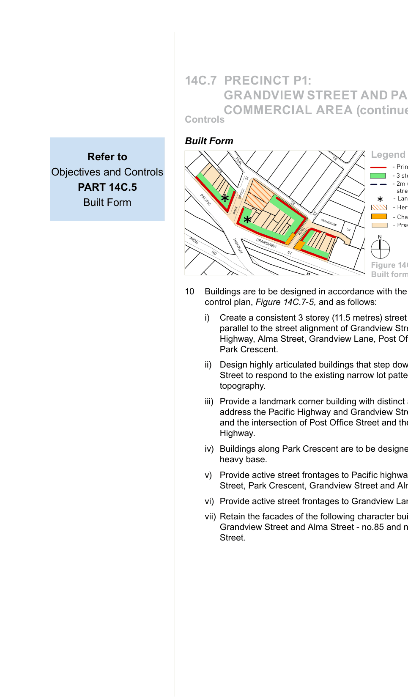

### 25 2 CARCOOLA - 2m upper level setback above

#### BAN

### - 2m upper level setback above

> [Picture on page 13: a map, saved as a picture (images/part-14c-pymble-local-centre-page-13-4.gif, 150 dpi); the street names and other small labels are on the picture.]
> Words printed on the picture (title and legend, copied from the PDF):
> 25A 23A CARCOOLA
> 7.32 / 3.66 W.
> ESMT FOR SERVICES
> 7.32 / 3.66 W.
> ESMT FOR SERVICES
> 4 8 10
> 4 6 8
> 4 6 8
> 3 5 7 11
> 3 5 7 11
> 101 103 105
> 101 103 105
> 4 6 8
> 123 125 127
> 3 5 7 11
> 123 125 127
> 24 22 20 18
> 24 22 20 18
> 4 6 8 10
> 4 6 8 10
> 1 3 5
> 1 3 5
> 1 3.66W PATHWAY
> 4 8 10
> 3.66W PATHWAY 20
> 4 8 10
> 5 7 9 11
> 5 7 9 11
> 4 6 8
> 4 6 8
> 1 15 19
> 3 5 7 11
> 3 5 7 11
> 30 MANDALAY  PL
> ST AVE 2
> 24 22 20 18
> 24 22 20 18
> 82 3.66W PATHWAY
> 82 3.66W PATHWAY
> 27 8 9
> 26 28 4
> 39 3.66W PATHWAY

Figure 14C.7-5:

### street

### ALIGNMENT AND SETBACKS

### street

### - 4m upper level setback above

### ALIGNMENT AND SETBACKS

### - 4m upper level setback above

### street

### - Nil setback

### street wall height - 2m upper level setback above

### street - 4m upper level setback above street

11

#### 6m

#### 5m

#### 3m

#### 2m

### PUBLIC DOMAIN AND PEDESTRIAN

#### 5m

#### 3m
