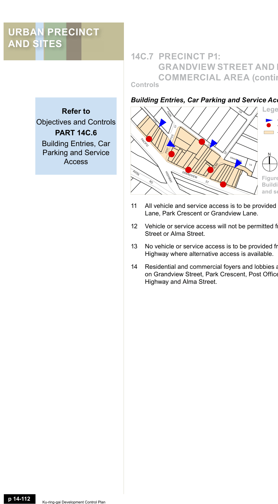

## 10 Buildings are to be designed in accordance with the built form

### control plan, Figure 14C.7-5, and as follows:

#### LYNBARA

### - Vehicular access to site - Pedestrian access to site

#### PYMBLE AVE

### - Vehicular access to site - Pedestrian access to site

#### HIGHWAY

### HERITATGGEA

### HERITATGGEA

#### GRANDVIEW

#### ST

#### EVERTON

### - Heritage item

#### AVE

### i) Create a consistent 3 storey (11.5 metres) street wall that is built

### parallel to the street alignment of Grandview Street, the Pacific

Highway, Alma Street, Grandview Lane, Post Office Street and

### Park Crescent.

### - Heritage item

#### WELLESLEY

2

6

4

### ii)	 Design highly articulated buildings that step down Grandview

### - Landmark building

### - Landmark building

### *

33

Street to respond to the existing narrow lot pattern and

### topography.

### *

### - Character item

31

iii)	 Provide a landmark corner building with distinct articulation to

### - Character item

29

#### PACIFIC

### - Refer to site specific DCP

### - Proposed road

#### ST

### address the Pacific Highway and Grandview Street intersection

### and the intersection of Post Office Street and the Pacific

### Highway.

### - Refer to site specific DCP

### - Proposed road

### - Proposed Community Infrastructure

### - Proposed Community Infrastructure

### *

#### LYNBARA

### iv)	 Buildings along Park Crescent are to be designed with a visually

#### BLOOMSBURY

#### LYNBARA

### heavy base.

#### AVE

#### PYMBLE

### v)	 Provide active street frontages to Pacific highway, Post Office

Street, Park Crescent, Grandview Street and Alma Street. vi)	 Provide active street frontages to Grandview Lane.

#### RAND

### vii)	 Retain the facades of the following character buildings fronting

#### ORINOCO

#### LIVINGSTONE

#### ORINOCO

### Grandview Street and Alma Street - no.85 and no.81 Grandview

### Street.

#### AVE

#### ST

### *

#### AVE

#### AVE

#### ST

### *

61

### PYMBLE LOCAL CENTRE

### *

#### SUAKIN

LINK

### - 2m upper level setback above

### street - 4m upper level setback above

> [Picture on page 14: a map, saved as a picture (images/part-14c-pymble-local-centre-page-14-5.gif, 150 dpi); the street names and other small labels are on the picture.]
> Words printed on the picture (title and legend, copied from the PDF):
> AVE 15 9
> 4 8 10
> 5 7 9 11
> 4 6 8
> 3 5 7 11
> 11 7 3
> 24 22 20 18
> 82 3.66W PATHWAY
> IKARA 1 80
> 57 26 4
> 55A 59 52A
> 6 4 2
> 1 7 3.66W PATHWAY

### AND SITES P1 LN

### street

### PUBLIC DOMAIN AND PEDESTRIAN

#### 3m

#### 2m

### PUBLIC DOMAIN AND PEDESTRIAN

#### 3m

#### 3m

#### ST

#### 10m

33

#### 6m

29

#### 3m

2

- Through site link - Entry plaza/forecourt - Continuous awnings - Continuous awnings where possible

### - Continuous colonnade

#### POST

### 14C.7  PRECINCT P1:

### GRANDVIEW STREET AND PACIFIC HWY

### COMMERCIAL AREA (continued)

### Controls

#### CHURCH

18

22 20

### BUILDING ENTRIES AND CARPAT

16

#### PARK

- Pedestrian through site link - Entry plaza/forecourt - Awnings - Awnings where possible - Colonnade

#### ST

10 12 14 16 18

#### OFFICE

### Building Entries, Car Parking and Service Access

### - Vehicular access to site - Pedestrian access to site

#### RD

### BUILDING ENTRIES AND CARPAT
