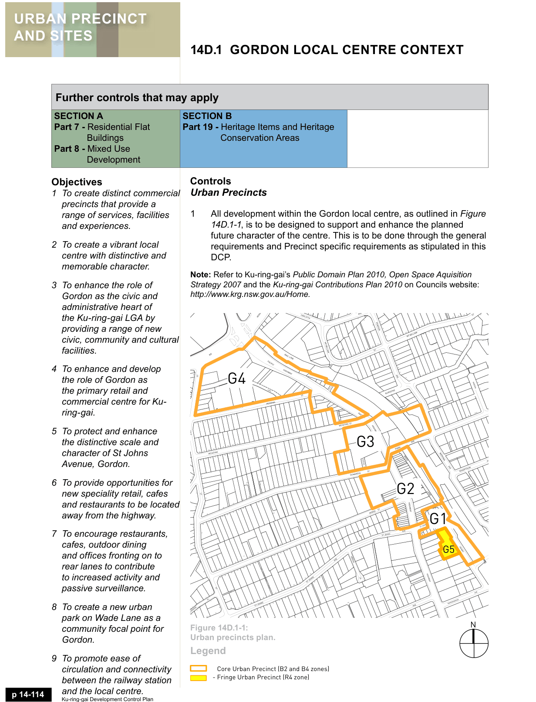

### 14D		 Gordon Local Centre

14D.1	 	Gordon Local Centre Context 14D.2	 	Public Domain and Pedestrian Access 14D.3	 	Proposed Community Infrastructure

### 14D.4	 	Setbacks 14D.5	 	Built Form 14D.6	 	Building Entries, Car Parking and Service

### Access

### 14D.7	 	Precinct G1: St Johns Avenue and Henry

Street 14D.8	 	Precinct G2: Pacific Highway Retail 14D.9	 	Precinct G3: Civic Hub 14D.10		Precinct G4: Mixed Use

### 14D.11		Precinct G5: Buildings in R4 Zones

### GORDON LOCAL CENTRE

> [Picture on page 2: a map, saved as a picture (images/part-14d-gordon-local-centre-page-2-1.gif, 150 dpi); the street names and other small labels are on the picture.]
> Words printed on the picture (title and legend, copied from the PDF):
> 12 14 16 18
> 20 ST 2
> MT.WILLIAM 14 16
> R. O. W.
> 40 38 36
> ROSEDALE EDWARD 1A
> 49 47 45
> MCINTYRE 58 56
> 68 66 64
> ST JOHNS CHURCH  HILL
> 7 39 71
> 21 19 17
> 12 10 8

Figure 14D.1-1:

### VOLUME B

### VOLUME B

### VOLUME B
