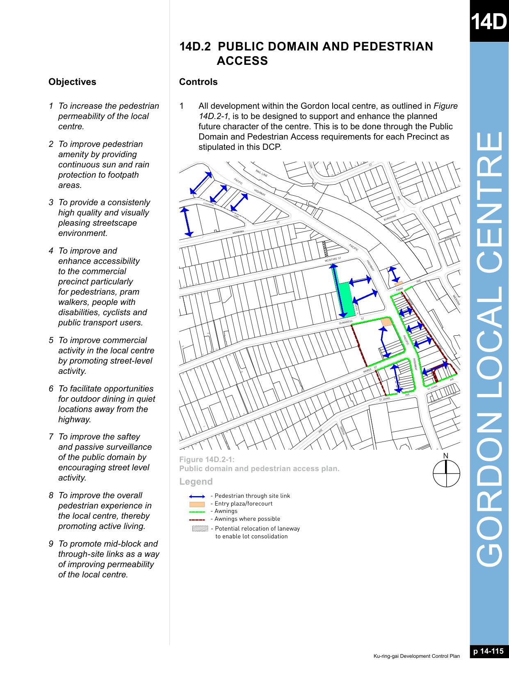

### 14D.1  GORDON LOCAL CENTRE CONTEXT

| Further controls that may | apply |
|---|---|
| SECTION A Part 7 - Residential Flat Buildings Part 8 - Mixed Use Development | SECTION B Part 19 - Heritage Items and Heritage Conservation Areas |

### Objectives

### Controls

### Urban Precincts

## 1	 To create distinct commercial

precincts that provide a

### range of services, facilities

### and experiences.

## 1 All development within the Gordon local centre, as outlined in Figure

### 14D.1-1, is to be designed to support and enhance the planned

### future character of the centre. This is to be done through the general

### requirements and Precinct specific requirements as stipulated in this

### DCP.

## 2	 To create a vibrant local

centre with distinctive and

### memorable character.

GLEN

1

### Note: Refer to Ku-ring-gai’s Public Domain Plan 2010, Open Space Aquisition

### Strategy 2007 and the Ku-ring-gai Contributions Plan 2010 on Councils website:

### http://www.krg.nsw.gov.au/Home.

### PBP

## 3	 To enhance the role of

Gordon as the civic and

administrative heart of

the Ku-ring-gai LGA by

### providing a range of new

### civic, community and cultural

### facilities.

END

### G4

## 4	 To enhance and develop

### the role of Gordon as

the primary retail and

### commercial centre for Ku-

### ring-gai.

### G3

## 5	 To protect and enhance

the distinctive scale and

### character of St Johns

### Avenue, Gordon.

15

11

### G2

## 6	 To provide opportunities for

### new speciality retail, cafes

### and restaurants to be located

### away from the highway.

### G1

### G5

MCINTOSH

## 7	 To encourage restaurants,

### cafes, outdoor dining

and offices fronting on to

### rear lanes to contribute

to increased activity and

### passive surveillance.

### N

### Urban precincts plan.

## 8	 To create a new urban

park on Wade Lane as a

community focal point for

### Gordon. 293

### URBAN STRUCTURE

### Legend

4

### Core Urban Precinct (B2 and B4 zones) - Fringe Urban Precinct (R4 zone) Precinct Number

### -

### L1

## 9	 To promote ease of

### circulation and connectivity

### between the railway station

### and the local centre.

NORFOLK 38A

### - Precinct S1

### - Precinct S2

### - Precinct S3

KILLEATON

AINTON

ECIL

> [Picture on page 3: a map, saved as a picture (images/part-14d-gordon-local-centre-page-3-1.gif, 150 dpi); the street names and other small labels are on the picture.]
> Words printed on the picture (title and legend, copied from the PDF):
> R. O. W.
> 16 18 20
> 25 ST 28
> 21 19 17
> GARRICK 1 20
> 12 10 8 6 4 RD
> 14 12 1
> 101 103 105 107
> 123 125 127
> 46 1 3 5
> 4 8 10
> 5 7 9 11
> 22 4A 6
> 4 6 8
> 30 15 19
> 3 5 7 11
> 3.66W PATHWAY 18
> 6 3.66W PATHWAY

Figure 14D.2-1:
