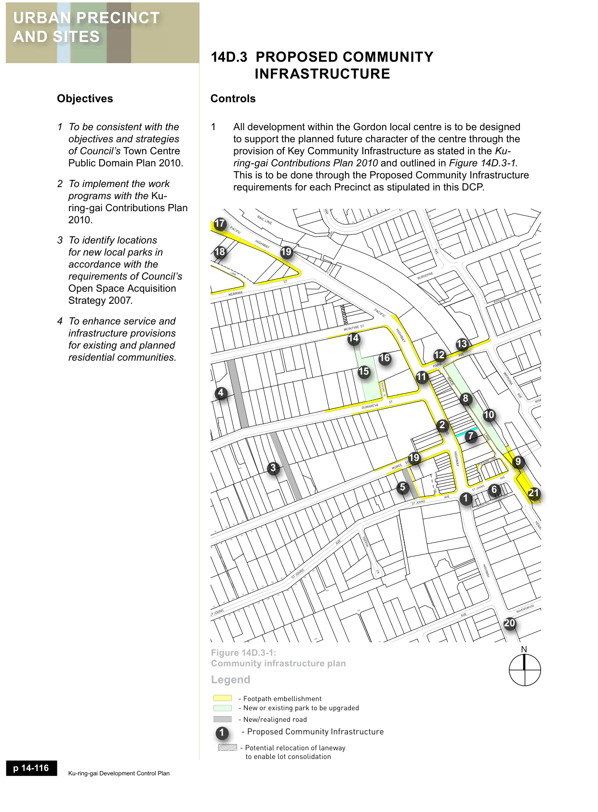

## 29 MT.WILLIAM

## 1 All development within the Gordon local centre, as outlined in Figure

### 14D.2-1, is to be designed to support and enhance the planned

### future character of the centre. This is to be done through the Public

### Domain and Pedestrian Access requirements for each Precinct as

### stipulated in this DCP.

#### ST

#### MT.WILLIAM 14

#### RD

#### RAIL LINE

#### PACIFIC

## 2	 To improve pedestrian

### amenity by providing

### continuous sun and rain

### protection to footpath

### areas.

#### HIGHWAY

## 16 ST

#### AVE

26 28 30 32 34 36 84

86

17 19 21 23 25

#### BURGOYNE

#### ST

#### MERRIWA

## 3	 To provide a consistenly

### high quality and visually

### pleasing streetscape

### environment.

#### PACIFIC

1

#### RIDGE

#### ST

#### MCINTYRE

#### HIGHWAY

#### ST

#### AVE PARK

### ALIGNMENT AND SETBACKS

#### MCINTYRE 58 56

#### WERONA

#### WADE

#### 15m

#### AVE

#### 12m

#### KHARTOUM

#### 10m

#### DUMARESQ

#### ST

## 4	 To improve and

### enhance accessibility

### to the commercial

### precinct particularly

### for pedestrians, pram

walkers, people with

disabilities, cyclists and

### public transport users.

#### 6m 55A

7

#### 5m

#### PACIFIC

#### 4m

#### AVE ST

#### VALE

#### LANE

#### 3m 2m

#### ST

### - 10m setback - 6m setback - 3m setback - Nil setback - Alternate deep soil requirement

#### HIGHWAY

#### MOREE

## 5	 To improve commercial

### activity in the local centre

### by promoting street-level

### activity.

#### 40%

ST

- 15m setback - 12m setback - 10m setback - 6m setback - 5m setback - 4m setback - 3m setback - 2m setback

### - Land dedication - Alternate deep soil landscaping (% of site)

#### AVE ST JOHNS

### BUILT FORM

#### HENRY

## 6	 To facilitate opportunities

### for outdoor dining in quiet

locations away from the

### highway.

- Private land with public access - Through site link - Land dedication - Primary active frontage - Secondary active frontage

#### AVE

2 4 6 8 10

#### HIGHWAY

### N

#### ST JOHNS

- Primary active frontage - Secondary active frontage - 3 storey street wall - 2m upper level setback above street

### wall height - 4m upper level setback above street wall height

#### ST

### Public domain and pedestrian access plan.

## 7	 To improve the saftey

### and passive surveillance

of the public domain by

### encouraging street level

### activity.

### PUBLIC DOMAIN AND PEDESTRIAN

### Legend

### Legend 56

#### ST JOHNS

#### AVE

### - Precinct G1 - Precinct G2 - Precinct G3 - Precinct G4 - Precinct G5

#### YARABAH

- Pedestrian through site link - Entry plaza/forecourt - Awnings - Awnings where possible - Colonnade

## 8	 To improve the overall

pedestrian experience in

### the local centre, thereby

### promoting active living.

#### AVE

10 12 14 16 18

### - Potential relocation of laneway

### to enable lot consolidation

### BUILDING ENTRIES AND CARPAT

#### AVE

#### PACIFIC

#### BUSHLANDS

#### BUSHLANDS

### - Vehicular access to site - Pedestrian access to site

### GORDON LOCAL CENTRE

## 9	 To promote mid-block and

### through-site links as a way

### of improving permeability

### of the local centre.

#### ST

#### AVE

#### RIDGE

#### LYNN

### HERITATGGEA

#### BROWNS

#### RD

8

### - Heritage/character item

#### HIGHWAY

#### NORFOLK 38A

> [Picture on page 4: a map, saved as a picture (images/part-14d-gordon-local-centre-page-4-1.gif, 150 dpi); the street names and other small labels are on the picture.]
> Words printed on the picture (title and legend, copied from the PDF):
> 12 10 8 6
> R. O. W.
> 10 90 6
> 101 103 105
> 123 125 127
> 21 19 17
> 58A 10 12
> 12 10 8 6
> 21 19 17
> 16 18 20
> 12 10 8
> 4 6 8 10
> 1 3 5 5
> 5 6A RD
> 101 103 105 107A
> 101 103 105
> 123 125 127
> 5 7 9 11
> 1 123 125 127
> 4 6 8
> 3 5 7 11
> 1 3 5
> 4 6 8 10
> 1 3 5
> 4 8 10
> 5 7 9 11
> 4 8 10
> 5 7 9 11
> 4 6 8
> 3 5 7 11
> 4 6 8
> 83 34 34B 48
> 3 5 7 11
> 82 3.66W PATHWAY 18
> 3.66W PATHWAY 18
> 3.66W PAT LANCASTER

Figure 14D.3-1:

### 14D.3  PROPOSED COMMUNITY

### INFRASTRUCTURE

### Objectives

### Controls

## 1 CARLOTTA

#### GR

## 2 CARLOTTA

#### AVE

#### ST

#### MONA

#### MINNS

#### CARLOTTA

### ALIGNMENT AND SETBACKS

## 1	 To be consistent with the

### objectives and strategies

### of Council’s Town Centre

### Public Domain Plan 2010.

#### PEARSON

### - 9m setback

#### 9m

## 20 ST

#### 15m

#### MT.WILLIAM

### - 15m setback

## 1 All development within the Gordon local centre is to be designed

to support the planned future character of the centre through the

### provision of Key Community Infrastructure as stated in the Ku-

### ring-gai Contributions Plan 2010 and outlined in Figure 14D.3-1.

### This is to be done through the Proposed Community Infrastructure

### requirements for each Precinct as stipulated in this DCP.

### - 13m setback

#### 13m

#### VALE

#### GARRICK 1 272

#### 12m

#### ST

### - 12m setback

#### RD 287A

#### MT.WILLIAM

#### RD

### - 11m setback

#### 11m

#### RAIL LINE

## 2	 To implement the work

### programs with the Ku-

### ring-gai Contributions Plan

### 2010.

#### 10m

### 17

#### PACIFIC

#### 6m 5m

#### HIGHWAY

#### FLINDERS
