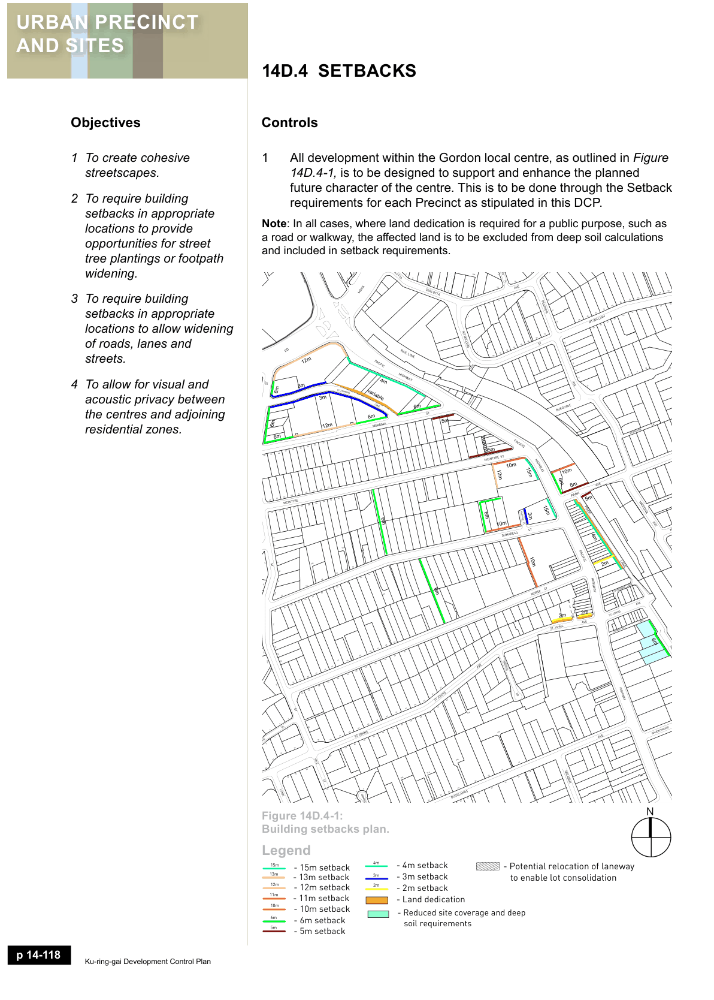

## 19 Embellishment of the footpath areas throughout the area including underground power lines,

### new lighting, high quality paving and furniture and street tree planting.

### Installation of new traffic lights at intersection of Ravenswood Avenue and Pacific Highway

## 21 Construction of a new Gordon bus interchange, incorporating taxi stands, a kiss-and-ride

### area, and an underground commuter car park.

> [Picture on page 6: a map, saved as a picture (images/part-14d-gordon-local-centre-page-6-1.gif, 150 dpi); the street names and other small labels are on the picture.]
> Words printed on the picture (title and legend, copied from the PDF):
> 12 14 16
> MT.WILLIAM 14 16
> R. O. W.
> 16 18 20
> 38 42 44 46
> R. O. W.
> 53 1 17
> ( UNFORMED )
> 49 TRYON 55
> 2 6 7
> 27 25 23
> 21 19 17 63
> 26 24 22
> 12 10 8
> 7.32 / 3.66 W.
> ESMT FOR SERVICES
> 51 53 AVE
> 21 19 17
> 12 10 8
> AVE WERONA 117

Figure 14D.4-1:
