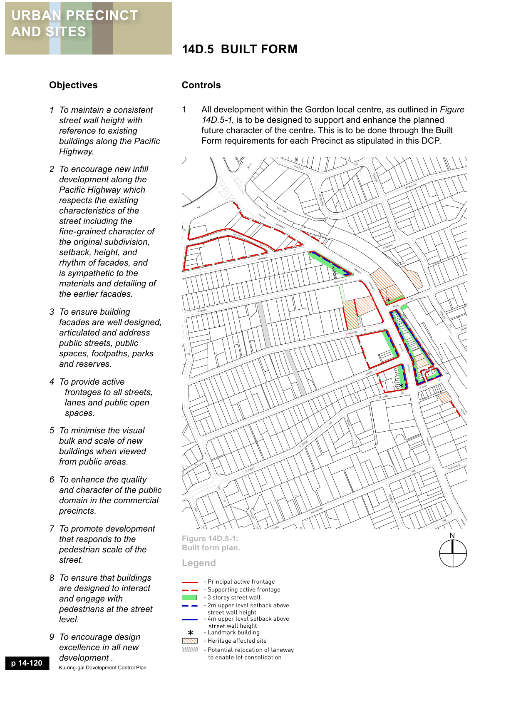

### 14D.4  SETBACKS

### Objectives

### Controls

## 1	 To create cohesive

### streetscapes.

## 1 All development within the Gordon local centre, as outlined in Figure

### 14D.4-1, is to be designed to support and enhance the planned

### future character of the centre. This is to be done through the Setback

### requirements for each Precinct as stipulated in this DCP.

### Note: In all cases, where land dedication is required for a public purpose, such as

### a road or walkway, the affected land is to be excluded from deep soil calculations

### and included in setback requirements. 3

## 2	 To require building

### setbacks in appropriate

### locations to provide

### opportunities for street

### tree plantings or footpath

### widening.

MINNS

24 22 3

1

#### 12m

## 3	 To require building

### setbacks in appropriate

### locations to allow widening

of roads, lanes and

### streets.

#### 4m

#### RD 77 3m

#### 6m

#### 3m variable

26 28 30 32 34 36

17 19 21 23 25

#### 5m

#### 6m

#### 12m

24

26

## 4	 To allow for visual and

### acoustic privacy between

### the centres and adjoining

### residential zones.

#### 6m

#### 6m

#### 6m

21

23

#### 5m 10m

#### 10m

#### 12m

16 20 22 24 28 30

#### 6m AVE

#### 5m

### ALIGNMENT AND SETBACKS

LANE

#### 5m

AVE

#### 15m

#### 15m

#### 6m 3m

#### 6m

#### 10m

#### 4m

#### 10m

#### 2m

#### 42A 6m

- 15m setback - 12m setback - 10m setback - 6m setback - 5m setback - 4m setback - 3m setback - 2m setback

### - Land dedication - Alternate deep soil requirement

#### 2m

#### 2m

#### PARK

### - 10m setback - 6m setback - 3m setback - Nil setback - Alternate deep soil requirement

### BUILT FORM

#### 6m

#### WERONA

#### WADE

#### KHARTOUM

VILAH

#### 4-5m

#### 4-5m

#### PACIFIC

#### LANE

### G2

#### 6m

- Private land with public access - Through site link - Land dedication - Primary active frontage - Secondary active frontage

- Primary active frontage - Secondary active frontage - 3 storey street wall - 2m upper level setback above street

### wall height - 4m upper level setback above street wall height 19A

#### HIGHWAY

### PUBLIC DOMAIN AND PEDESTRIAN

#### 4m

### G1

### ALIGNMENT AND SETBACKS

#### 5m

### - 9m setback

#### 9m

#### 15m

### 5 - 15m setback

### - 13m setback

#### 13m

### G5

#### 12m

1

### - 12m setback

### N

- Through site link - Entry plaza/forecourt - Continuous awnings - Continuous awnings where possible

### - Continuous colonnade

### - 11m setback

#### 11m 10m

16

14

CECIL

### - Precinct G1 - Precinct G2 - Precinct G3 - Precinct G4

### Building setbacks plan. 8

### BUILDING ENTRIES AND CARPAT

#### 6m

### ALIGNMENT AND SETBACKS

### - Precinct G5

#### 5m

### - 9m setback

#### 9m

### Legend

#### 4m 2

#### 15m

### - 15m setback

### - Vehicular access to site - Pedestrian access to site

#### 3m

### - 13m setback

#### 13m

### - Potential relocation of laneway

### to enable lot consolidation

#### 13m

#### 12m

#### 2m

### - 12m setback

2A

#### 6m

2B

### - 11m setback

#### 11m

#### 6m

#### 40%

#### 6m - 10m

- 10m setback - 6m setback - 5m setback - 4m setback - 3m setback - 2m setback - Land dedication - Alternate deep soil landscaping

### (% of site)

### - Reduced site coverage and deep soil requirements

#### 4m MARJORIE

### p 14-118 36

GRE

#### 40%

### - Land dedication - Alternate deep soil landscaping (% of site)

### - Principal active frontage - Supporting active frontage

STRICKLAN

E

S

### street wall height

### 14D.4  SETBACKS (continued)

### Objectives

### Controls

## 2 Building setbacks are to be in accordance with Figure 14D.4-

### 1, and all properties within the R4 zone are to provide setbacks

### in accordance with this Part 7 of this DCP with the following

exceptions: i) Properties 31 Moree Street and 30 Dumaresq Street are to

### provide a 6 metre setback to the new street between Moree

### Street and Dumaresq Street.

ii)	 Properties 39 Dumaresq Street and 34 McIntyre Street are to

### provide a 6 metre setback to the new street between Dumaresq

### Street and McIntyre Street.

### GORDON LOCAL CENTRE

> [Picture on page 8: a map, saved as a picture (images/part-14d-gordon-local-centre-page-8-1.gif, 150 dpi); the street names and other small labels are on the picture.]
> Words printed on the picture (title and legend, copied from the PDF):
> 12 14 16 18
> 20 ST 5
> MT.WILLIAM 14 16
> R. O. W.
> 40 38 36
> 21 19 17
> 49 47 45
> 12 10 8
> 68 66 64
> PL 1 3
> 32A 32A 5 5
> 21 19 17
> 5 3A 3A 6A
> 16 18 20
> 16 18 20
> 12 10 8
> 8A 8A RD 287A
> 25 25 4
> 2 2 6
> 5 6A 8
> 4 6 8
> 7 9 9A
> 101 103 105 107
> 10 123 125 127
> 101 103 105 107
> ST 38C 38C
> 123 125 127
> 4 6 8 10
> 51 53 ST
> 21 19 17
> 21 19 17
> GARRICK 1 17A 17B
> 12 10 8 GARRICK 1
> 12 10 8
> 4 6 8 10
> 2 RD 287A
> 36 36 5
> 4 8 10
> YARRABUNG 8 12
> FLINDERS 91 72A
> 5 7 9 11
> 27 27 95
> 4 8 10
> 5 7 9 11
> 4 6 8
> 101 103 105
> 3 5 7 11
> 101 103 105
> 121 123 125 127
> 123 125 127
> 4 6 8
> 3 5 7 11
> 4 6 8 10
> 1 3 5
> 1 3 5
> 4A 4A 6 6
> AVE 42 42
> 82 3.66W PATHWAY
> 47 48 CATHERINE

Figure 14D.5-1:
