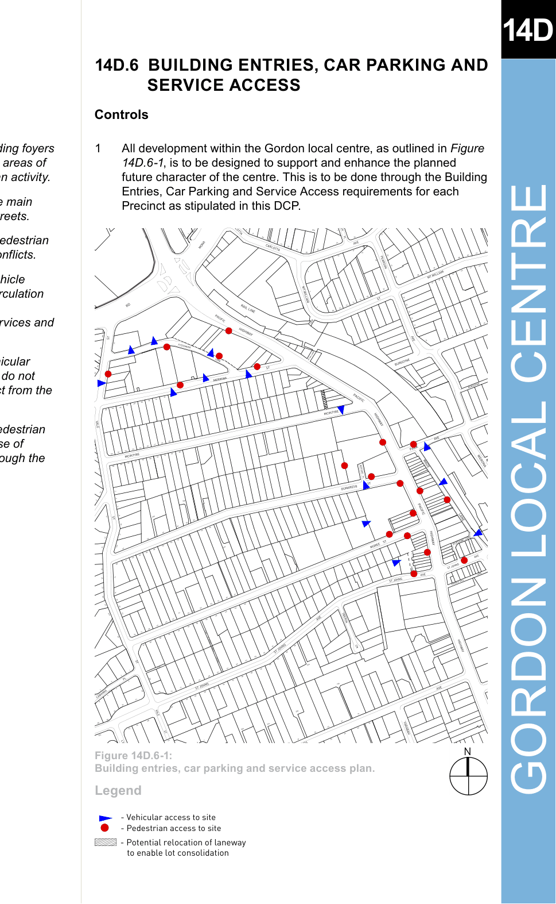

### 38A 38A - 15m setback 63

### - 15m setback

### wall height - 4m upper level setback above

### - 13m setback

#### 13m

## 5	 To minimise the visual

### bulk and scale of new

### buildings when viewed

### from public areas.

### - 13m setback

#### 13m 12m

### street

### wall height

#### 12m

### - 12m setback

### - 12m setback

- Principal active frontage - Supporting active frontage - 3 storey street wall - 2m upper level setback above

### - 11m setback

#### 11m

### 12 - 11m setback

#### 11m 10m 66

### 1 3 5 PUBLIC DOMAIN AND PEDESTRIAN

### street

#### 10m 6m

### - 10m setback - 6m setback - 3m setback - Nil setback - Alternate deep soil requirement

### - 10m setback - 6m setback - 3m setback - Nil setback - Alternate deep soil requirement

### wall height - 4m upper level setback above

#### 6m 5m

#### 5m

### street wall height

#### 2 93 4m

#### 4m

## 6	 To enhance the quality

### and character of the public

### domain in the commercial

### precincts.

E

#### 3m

### PUBLIC DOMAIN AND PEDESTRIAN

#### 3m

#### 80 2m

#### 2m

- Pedestrian through site link - Entry plaza/forecourt - Awnings - Awnings where possible - Colonnade

10 12 14 16 18

### N

#### 40%

#### 40%

- Private land with public access - Through site link - Land dedication - Primary active frontage - Secondary active frontage

- Private land with public access - Through site link - Land dedication - Primary active frontage - Secondary active frontage

### BUILDING ENTRIES AND CARPAT

- 10m setback - 6m setback - 5m setback - 4m setback - 3m setback - 2m setback - Land dedication - Alternate deep soil landscaping

### (% of site)

### Built form plan.

- 10m setback - 6m setback - 5m setback - 4m setback - 3m setback - 2m setback - Land dedication - Alternate deep soil landscaping

### (% of site)

## 7	 To promote development

that responds to the

pedestrian scale of the

### street.

- Pedestrian through site link - Entry plaza/forecourt - Awnings - Awnings where possible - Colonnade

### BUILT FORM

10 12 14 16 18

### BUILT FORM

### Legend

150

### - Vehicular access to site - Pedestrian access to site

150

### BUILDING ENTRIES AND CARPAT HERITATGGEA

LE

2 4 6 8 10

### - Vehicular access to site - Pedestrian access to site

- Principal active frontage - Supporting active frontage - 3 storey street wall - 2m upper level setback above

- Principal active frontage - Supporting active frontage - 3 storey street wall - 2m upper level setback above

### - Heritage item

### street

### street

### wall height - 4m upper level setback above

### wall height - 4m upper level setback above

2

## 8	 To ensure that buildings

### are designed to interact

and engage with

### pedestrians at the street

### level.

### HERITATGGEA

### street

### wall height

### street wall height

### - Landmark building

### - Precinct G1 - Precinct G2 - Precinct G3 - Precinct G4 - Precinct G5

### - Precinct G1 - Precinct G2 - Precinct G3 - Precinct G4 - Precinct G5

### * - Heritage affected site

### PUBLIC DOMAIN AND PEDESTRIAN

### PUBLIC DOMAIN AND PEDESTRIAN - Character item

### - Potential relocation of laneway

### to enable lot consolidation

### - Potential relocation of laneway

### to enable lot consolidation

## 9	 To encourage design

### excellence in all new

### development . 30 30 5 7 9 11

### - Landmark building

### *

### - Refer to site specific DCP

### - Proposed road

### - Character item

- Pedestrian through site link - Entry plaza/forecourt - Awnings - Awnings where possible - Colonnade

- Pedestrian through site link - Entry plaza/forecourt - Awnings - Awnings where possible - Colonnade

10 12 14 16 18

### - Proposed Community Infrastructure

10 12 14 16 18

### BUILDING ENTRIES AND CARPAT

> [Picture on page 9: a map, saved as a picture (images/part-14d-gordon-local-centre-page-9-1.gif, 150 dpi); the street names and other small labels are on the picture.]
> Words printed on the picture (title and legend, copied from the PDF):
> 12 14 16
> MT.WILLIAM 14 16
> R. O. W.
> 57 51 53
> MCINTYRE 58 56
> 3 4 38C
> 123 125 127
> 4 6 8 10
> 1 3 5
> 4 8 10
> 5 7 9 11
> 4 6 8
> 3 5 7 11

Figure 14D.6-1:
