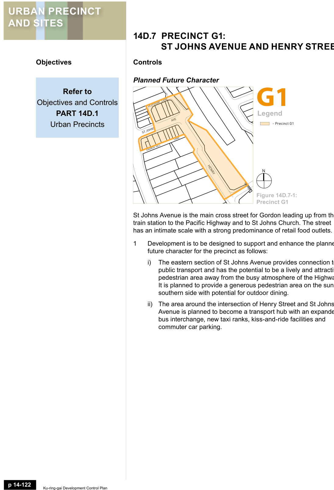

### 39 wall height

1

3

5

- Private land with public access - Through site link - Land dedication - Primary active frontage - Secondary active frontage

### PUBLIC DOMAIN AND PEDESTRIAN

PL

7

9

RD

5

3

18

16

12

20

14

10

8

6

4

NEWHAVEN

COLLEGE

### N

1

22

24

26

28

30

34

36

RD 22

### Building entries, car parking and service access plan.

- Pedestrian through site link - Entry plaza/forecourt - Awnings - Awnings where possible - Colonnade

10 12 14 16 18

25

29 27

33 31

35

39

41

37

### GORDON LOCAL CENTRE

### Legend

### BUILDING ENTRIES AND CARPAT

### - Precinct G1 - Precinct G2 - Precinct G3 - Precinct G4

MCINTOSH

### - Precinct G5

### - Vehicular access to site - Pedestrian access to site

ST 59

RD

57 55 2

ST 2

6

AVE

### - Potential relocation of laneway

### to enable lot consolidation

3

8

### HERITATGGEA - Heritage item

5

FORSYTH

3.66W PATHWAY

### - Landmark building

4

6

4 29

YARRABUNG

ELVA

### - Character item

GREVILLEA

### Y

25 ST

ARSON

ST 2

29 MT.WILLIAM

MT.WILLIAM 14 16

> [Picture on page 10: a map, saved as a picture (images/part-14d-gordon-local-centre-page-10-7.gif, 150 dpi); the street names and other small labels are on the picture.]
> Words printed on the picture (title and legend, copied from the PDF):
> 18 19 21
> 2 7 9
> ST CLIPSHAM LANE

Figure 14D.7-1:

AIL LINE

### WADE 14

#### RADFORD PL

#### AVE

#### 15

### KHARTOUM

#### LANE

#### DUMARESQ

#### ST

#### 11

### 14D.7  PRECINCT G1:

### ST JOHNS AVENUE AND HENRY STREET

### G3

### - 10m setback - 6m setback - 3m setback - Nil setback - Alternate deep soil requirement

#### 6.1W

#### LANE

### Objectives

### Controls

#### ST

#### 4

#### 8 6

### PACIFIC

#### 2

#### NELSON

### LANE 12

### LANE Planned Future Character

#### 1

#### 3

#### 5

### G2

- Private land with public access - Through site link - Land dedication - Primary active frontage - Secondary active frontage

#### ST

Refer to

### Objectives and Controls

#### CLIPSHAM LANE

### AVE HIGHWAY

### MOREE G1

### G1

### Legend

#### AVE

#### 7

#### 9

40

### PART 14D.1

### Urban Precincts

### G5

#### ST.JOHNS

#### LANE

#### 5

#### 3

#### LANE

### - Precinct G1 - Precinct G2 - Precinct G3 - Precinct G4

#### AVE

### - Precinct G5

#### ST JOHNS

#### CHURCH  HILL

### - Potential relocation of laneway

### to enable lot consolidation

#### R

### N

#### HENRY

#### AVE

### Precinct G1

#### MCINTOSH

#### CR

#### OBERON

#### HIGHWAY

St Johns Avenue is the main cross street for Gordon leading up from the

### train station to the Pacific Highway and to St Johns Church. The street

### has an intimate scale with a strong predominance of retail food outlets.

7
