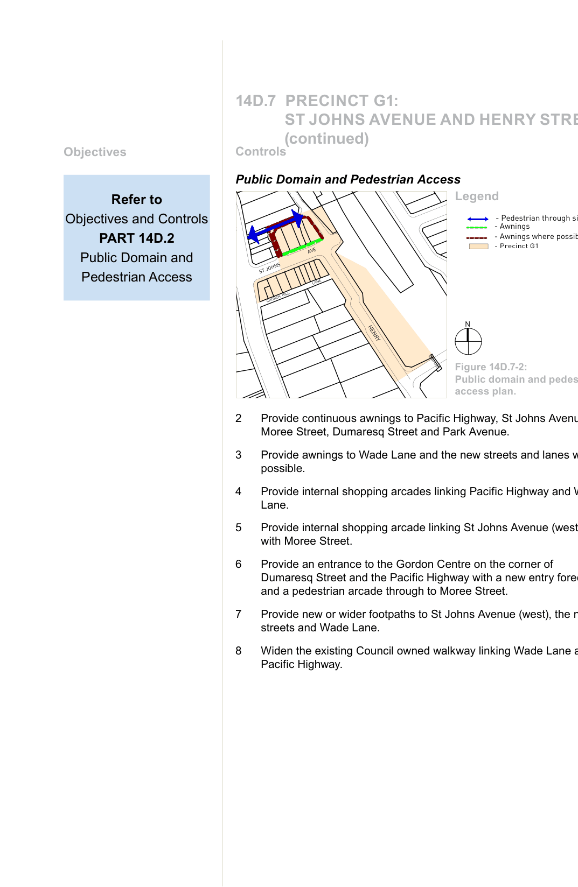
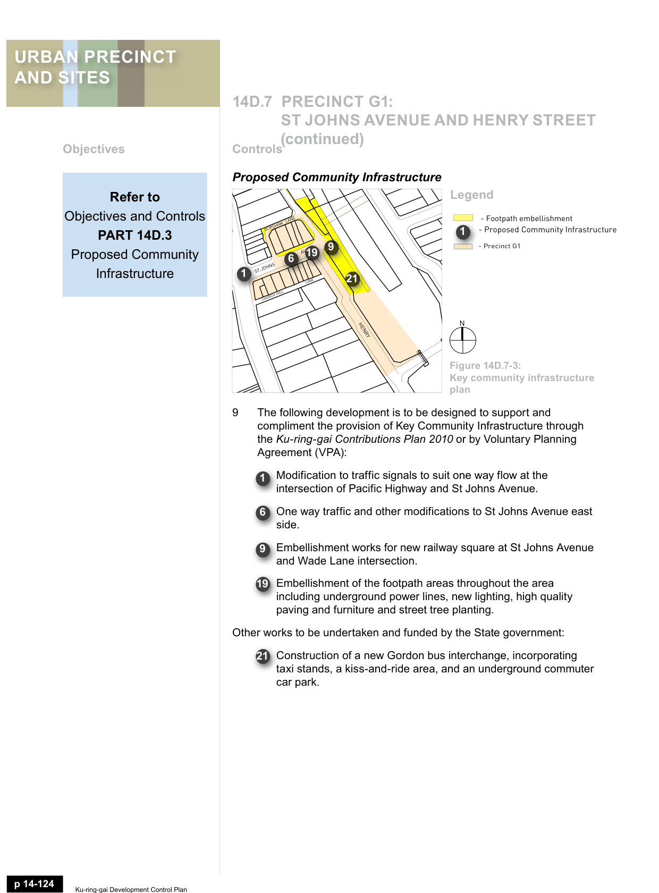
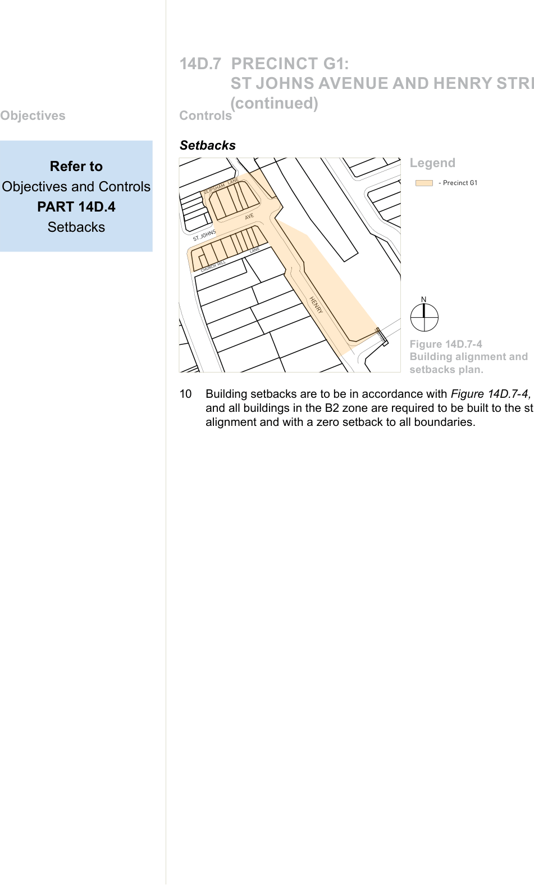

## 1 Development is to be designed to support and enhance the planned

### future character for the precinct as follows:

#### 19A

#### AVE

#### RAVENSWOOD

8

#### AVE

i) The eastern section of St Johns Avenue provides connection to

### public transport and has the potential to be a lively and attractive

### pedestrian area away from the busy atmosphere of the Highway.

### It is planned to provide a generous pedestrian area on the sunny

### southern side with potential for outdoor dining.

#### ST

#### WERONA

#### 23

#### 21

#### 19

### ii)	 The area around the intersection of Henry Street and St Johns

#### 5

#### YARABAH

#### 26

#### 24

#### 22

#### 2

#### 28

#### 18

### Avenue is planned to become a transport hub with an expanded

bus interchange, new taxi ranks, kiss-and-ride facilities and

### commuter car parking.

#### ST

#### AVE

#### 1A

#### PACIFIC

#### 16

#### 10

#### 8

#### 6

#### 4

#### 12 14

#### CECIL

#### 2 4

#### AVE

#### 673

#### 3

#### 5

#### 3

#### 1

#### 19A

#### ST

#### 671

#### 716

#### 9 11

#### 7

#### 5

#### 19

#### 15

#### 17

#### 10

#### 10A

#### AVE

#### 8A

#### 12

#### 14

#### 25

#### 23

#### 25

#### 21

#### 30

#### 28

#### 26

#### 24

#### 22

#### 30A

#### 32

#### 34

#### 36 38

#### 27

#### 29

#### HIGHWAY

#### 8

#### 2A

#### 2

#### 4

#### 6

#### 18

#### 20

#### 16

#### 27

#### 11

#### 15

#### 17

#### 19

#### 21

#### 23

#### 9

#### 663

#### 667

#### 669

#### 2B

#### 702

#### 24

#### 1

#### 3

#### 5

#### 7

#### 36A

#### BRUCE

#### 36B

#### 30B

#### 30C 32A

#### 37

#### 35

#### 31 40

#### 46

#### 44

#### 42

#### 50

#### NORFOLK

#### 48

#### L

#### EENGATE

FLINDERS

MT.WILLIA

### IGHWAY

> [Picture on page 11: a map, saved as a picture (images/part-14d-gordon-local-centre-page-11-4.gif, 150 dpi); the street names and other small labels are on the picture.]
> Words printed on the picture (title and legend, copied from the PDF):
> 7.32 / 3.66 W.
> ESMT FOR SERVICE
> 7.32 / 3.66 W.
> ESMT FOR SERVICES
> DAINTON 123 125 127
> 38B 123 125 127
> 18 19 21
> 4 6 8 10
> 1 3 5
> 1 3 5
> 4 8 10
> DURHAM MOREE STANLEY
> 5 7 9 11
> 4 8 10
> 5 7 9 11
> 4 6 8
> 4 6 8
> 3 5 7 11
> 3 5 7 11
> 24 22 20 18
> 24 22 20 18
> 10 IKARA 1 80
> 82 3.66W PATHWAY
> 27 8 76
> 25 21 31

Figure 14D.7-2:

#### AVE 269

#### 107A PARK

### WADE

### BUILT FORM

#### RADFORD

### 40%

#### PL

#### AVE

### HIGHWAY 40%

#### 15

### KHARTOUM

#### 6m

#### LANE

#### DUMARESQ

#### ST

#### 6m

### G3

### - 10m setback - 6m setback - 3m setback - Nil setback - Alternate deep soil requirement

#### 19

#### 11

2 4 6 8 10

### 14D.7  PRECINCT G1:

### ST JOHNS AVENUE AND HENRY STREET

### (continued)

#### 6.1W

#### LANE

### Objectives

### Controls

#### ST

- Primary active frontage - Secondary active frontage - 3 storey street wall - 2m upper level setback above street

### wall height - 4m upper level setback above street wall height

4

8

#### 10

6

### PACIFIC

2

- Primary active frontage - Secondary active frontage - 3 storey street wall - 2m upper level setback above street

### wall height - 4m upper level setback above street wall height

7

#### NELSON

#### 3m

#### 2m

### LANE

### Public Domain and Pedestrian Access

### PUBLIC DOMAIN AND PEDESTRIAN

### MEMORIAL G2

#### 3m

- Private land with public access - Through site link - Land dedication - Primary active frontage - Secondary active frontage

#### 3m 3m

### Legend

1

3

5

#### 2m LN

### PUBLIC DOMAIN AND PEDESTRIAN

### 40%

NE

### LAWSON Legend

#### 3m 10m

#### 3m

### Legend

### 40%

#### 6m

#### 10m

#### 3m

#### 6m

### G1

Refer to

### Objectives and Controls

#### ST

#### CLIPSHAM LANE

#### 3m

### HIGHWAY

#### MOREE

- Pedestrian through site link - Entry plaza/forecourt - Awnings - Awnings where possible - Colonnade

#### AVE

10 12 14 16 18

### G5

7

9

- Pedestrian through site link - Entry plaza/forecourt - Awnings - Awnings where possible - Colonnade

E

### PART 14D.2

### Public Domain and HENRY PASS

10 12 14 16 18

### BUILDING ENTRIES AND CARPAT

#### ST.JOHNS

#### LANE

5

3

### BUILDING ENTRIES AND CARPAT

#### LANE

### Pedestrian Access

#### AVE

### - Precinct G1 - Precinct G2 - Precinct G3 - Precinct G4 - Precinct G5

#### ST JOHNS

### - Vehicular access to site - Pedestrian access to site

#### CHURCH  HILL

1

### - Vehicular access to site - Pedestrian access to site

### - Potential relocation of laneway

### to enable lot consolidation

#### RD

#### LE

### N

### HERITATGGEA

#### HENRY

### HERITATGGEA

### - Heritage/character item - Heritage/character item

#### AVE

#### MCINTOSH

### Public domain and pedestrian

### access plan.

#### CR

#### OBERON

#### HIGHWAY

143

## 2 Provide continuous awnings to Pacific Highway, St Johns Avenue,

### Moree Street, Dumaresq Street and Park Avenue.

2

## 3 Provide awnings to Wade Lane and the new streets and lanes where

### possible. 19

#### LYNBARA

#### AVE

#### RAVENSWOOD

## 17 LYNBARA

#### AVE

## 4 Provide internal shopping arcades linking Pacific Highway and Wade

### Lane.

## 5 Provide internal shopping arcade linking St Johns Avenue (west)

### with Moree Street.

#### ST

#### WERONA

#### 23

#### 21

#### 19

#### 25

#### YARABAH

#### 26

#### 24

#### 22

#### NDS 28

#### 18

## 6 Provide an entrance to the Gordon Centre on the corner of

### Dumaresq Street and the Pacific Highway with a new entry forecourt

### and a pedestrian arcade through to Moree Street.

#### 30

#### ST

#### AVE

#### PACIFIC

## 7 Provide new or wider footpaths to St Johns Avenue (west), the new

### streets and Wade Lane.

#### 16

#### 10

4

#### 12 14

#### CECIL

## 8 Widen the existing Council owned walkway linking Wade Lane and

### Pacific Highway.

#### AVE

#### NNANT

#### ST

#### 11

#### 29

#### 19

#### 15

#### 17

#### 10

10A

#### BR

#### AVE

#### 12

#### 14

#### 25

#### 23

#### 25

#### 21

#### 30

#### 28

#### 26

#### 24

#### 22

#### 32

#### 34

#### 36 38

#### 27

#### 29

#### HIGHWAY

#### 18

#### 20

#### 16

#### 27

#### 11

#### 15

#### 17

#### 19

#### 21

#### 23

### GORDON LOCAL CENTRE

#### 24

#### BRUCE

#### 40

#### 46

#### 44

#### 42

#### 50

#### 39

#### 37

#### 35

#### 31

#### NORFOLK 38A

#### 61

#### LANE

#### GREENGATE

#### 48

#### 56

#### 54

#### 50 52

#### ST

#### 14

#### 20

#### 16

#### 18

> [Picture on page 12: a map, saved as a picture (images/part-14d-gordon-local-centre-page-12-1.gif, 150 dpi); the street names and other small labels are on the picture.]
> Words printed on the picture (title and legend, copied from the PDF):
> 18 19 21
> 4 8 10
> 24 22 20 18
> 5 7 9 11
> AVE 3.66W PATHWAY
> 4 6 8
> 3 5 7 11
> CHURCH  HILL 26
> 24 22 20 18
> 44 6 4
> 2 4 AVE
> 10 10A AVE

Figure 14D.7-3:

ROSEDAL

10 12 14 16 18

### - 2m upper level setback above street - 4m upper level setback above street

### - Vehicular access to site - Pedestrian access to site

#### ROTARY

### HERITATGGEA

#### AVE

#### RADFORD PL

### - Heritage item

#### AVE

### - Through site link - Continuous awnings - Continuous awnings where possible - Continuous colonnade

#### KHARTOUM

#### LANE

### G3

#### DUMARESQ

#### ST

### - 10m setback - 6m setback - 3m setback - Nil setback - Alternate deep soil requirement

#### MEMORIAL PARK

### BUILDING ENTRIES AND CARPAT

### 14D.7  PRECINCT G1:

### ST JOHNS AVENUE AND HENRY STREET

### (continued) 2

### - Landmark building

10 12 14 16 18

### Objectives

### Controls

### *

#### 6.1W

#### LANE

#### ST

### - Vehicular access to site - Pedestrian access to site

#### NEW PARK

#### PACIFIC

### - Character item

### Proposed Community Infrastructure

#### NELSON

#### LANE

### G2 28 5

- Private land with public access - Through site link - Land dedication - Primary active frontage - Secondary active frontage

### KEY COMMUNITY INFRASTRUCTRE

### Legend

### - Refer to site specific DCP

### - Proposed road

Refer to

### Objectives and Controls

### G1

#### ST

#### CLIPSHAM LANE

#### HIGHWAY

### - Proposed Community Infrastructure

#### MOREE

### 1

#### LYNBARA

### 22 9

#### AVE

### G5

### 19

### PART 14D.3

### Proposed Community

### 6

#### ST.JOHNS

#### LANE

### 1

### Infrastructure

151

#### LANE

#### IKARA AVE

### 21

### - Precinct G1 - Precinct G2 - Precinct G3 - Precinct G4 - Precinct G5

- Footpath embellishment - New or existing park to be upgraded - Historic/character building to be retained - New/realigned road - Proposed pedestrian promenade - New community facility - Landscaping

#### ST JOHNS

#### CHURCH  HILL

### - Potential relocation of laneway

### to enable lot consolidation

#### RD

#### SEDALE

### N

2

#### HENRY

#### AVE

#### LYNBARA PACIFIC

#### MCINTOSH

### Key community infrastructure

### plan

#### CR

#### OBERON

#### HIGHWAY

## 9 The following development is to be designed to support and

### compliment the provision of Key Community Infrastructure through

### the Ku-ring-gai Contributions Plan 2010 or by Voluntary Planning

### Agreement (VPA): AVE

#### AVE

#### RAVENSWOOD

## 698 AVE

### 1

Modification to traffic signals to suit one way flow at the

### intersection of Pacific Highway and St Johns Avenue.

## 6 One way traffic and other modifications to St Johns Avenue east

### side.

#### ST

#### WERONA

#### FO

### 9

#### YARABAH

7

### Embellishment works for new railway square at St Johns Avenue

### and Wade Lane intersection.

#### HLANDS

### 19

#### ST

#### AVE

#### PACIFIC

### Embellishment of the footpath areas throughout the area

### including underground power lines, new lighting, high quality

### paving and furniture and street tree planting.

#### CECIL

### Other works to be undertaken and funded by the State government:

### 21

#### AVE

#### PENNANT

#### ST

### Construction of a new Gordon bus interchange, incorporating

### taxi stands, a kiss-and-ride area, and an underground commuter

### car park.

#### AVE

## 25 BRUCE

31

#### HIGHWAY

#### BRUCE

#### NORFOLK 38A

#### RD

#### LANE

#### GREENGATE

#### L

#### ST

### 10m 21

41 VAR WIDTH

### 15m 2A 4

> [Picture on page 13: a map, saved as a picture (images/part-14d-gordon-local-centre-page-13-4.gif, 150 dpi); the street names and other small labels are on the picture.]
> Words printed on the picture (title and legend, copied from the PDF):
> 2 7 9
> 10 10A AVE

Figure 14D.7-4

### PARK 24

### 1A WERONA

#### PL PARK

### - Nil setback - Alternate deep soil requirement

#### AVE

### 10m

#### 15

## 17 KHARTOUM

#### LANE

#### DUMARESQ

#### ST

#### 11

### 4m

### 14D.7  PRECINCT G1:

### ST JOHNS AVENUE AND HENRY STREET

### (continued)

#### 6.1W

#### LANE

### Objectives

### Controls

### G2

#### ST

- Private land with public access - Through site link - Land dedication - Primary active frontage - Secondary active frontage

4

8

#### 10

6

### PACIFIC

2 7

#### NELSON

### 10m

### LANE

### Setbacks

1

3

5

### G1

### Legend

40

#### ST

#### HENRY CLIPSHAM LANE

Refer to

### Objectives and Controls
