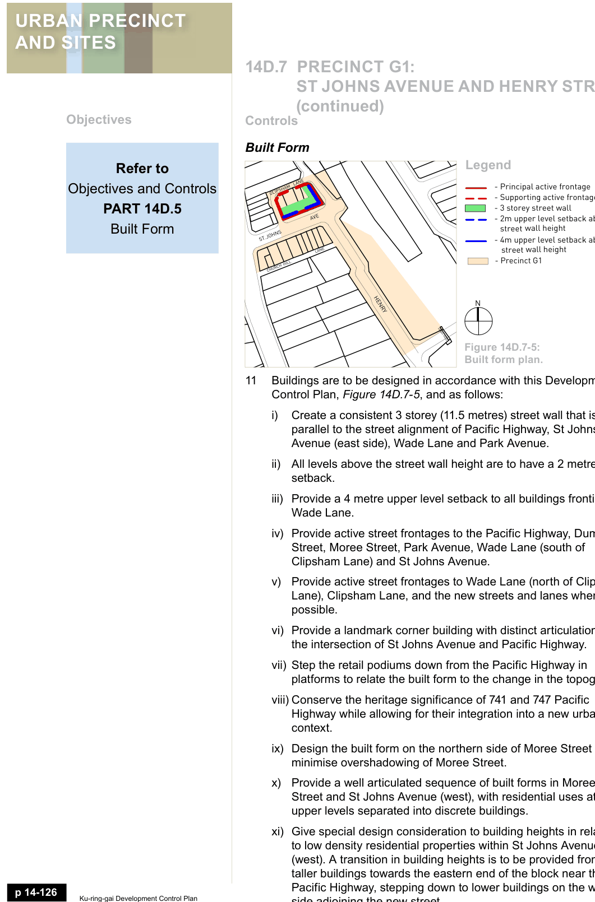

### G5 HIGHWAY

#### MOREE

AVE

### - Precinct G1 - Precinct G2 - Precinct G3 - Precinct G4

### PART 14D.4

#### AVE

38

51

49

### - Precinct G5

7

9

ST JOHNS

53 55

40

42

### Setbacks

57 36A

#### ST.JOHNS

#### LANE

50

48

46

44

5

3

### - Potential relocation of laneway

### to enable lot consolidation

#### LANE

#### AVE

#### ST JOHNS

#### CHURCH  HILL

1

25A

31A

35A

#### RD

### N

33 34 32

30

#### HENRY

36

28 28A

37

33

31 29

35

27

25

BUSHLANDS

DS 42

38

30 25

#### AVE 2

23 AVE

1

PENNANT

19

BROWNS

RD

#### MCINTOSH

18

22 24

26 28

20

17

15 11 9

Building alignment and

### setbacks plan.

37A

CECIL     WALK

#### CR

#### OBERON

7

5

3

#### HIGHWAY

1

2

RD

OWNS

CECIL

## 10 Building setbacks are to be in accordance with Figure 14D.7-4,

### and all buildings in the B2 zone are required to be built to the street

### alignment and with a zero setback to all boundaries.

56

54

52

62

60

58

53

51

49

45

43

41

39

64

66

68

#### 19A

#### AVE

#### RAVENSWOOD

#### AVE

#### ST

#### WERONA

#### 23

#### 21

#### 19

#### 25

#### YARABAH

#### 26

#### 24

#### 22

#### 28

#### 18

#### 8A

#### ST

#### AVE

#### PACIFIC

#### 16

#### 10

4

#### 12 14

#### CECIL

2 4

#### AVE

#### 673

3

5

1

#### 19A

#### ST

#### 716 671

#### 11

#### 29

#### 19

#### 15

#### 17

#### 10

#### 10A

#### BR

#### AVE

#### 12

#### 14

#### 25

#### 23

#### 25

#### 21

#### 30

#### 28

#### 26

#### 24

#### 22

#### 30A

#### 32

#### 34

#### 36 38

#### 27

#### 29

#### HIGHWAY

#### 37A

#### 18

#### 20

#### 16

#### 27

#### 11

#### 15

#### 17

#### 19

#### 21

#### 23

### GORDON LOCAL CENTRE

#### 663

#### 667

#### 669

#### 2B

#### 702

#### 24

#### 36A

#### BRUCE

#### 30C 32A

#### 40

#### 46

#### 44

#### 42

#### 50

#### 39

#### 37

#### 35

#### 31

#### NORFOLK

#### 38A

#### 48

#### 54

#### 50 52

#### 61

#### LANE

#### GREENGATE

#### 20 18

### WAY 15

#### AVE VAR WIDTH

### ALIGNMENT AND SETBACKS

> [Picture on page 14: a map, saved as a picture (images/part-14d-gordon-local-centre-page-14-4.gif, 150 dpi); the street names and other small labels are on the picture.]
> Words printed on the picture (title and legend, copied from the PDF):
> 7.32 / 3.66 W.
> ESMT FOR SERVICES
> 101 103 105
> 123 125 127
> 4 6 8 10
> 4 8 10
> 5 7 9 11
> COLLEGE 4A 6
> 24 LAGONDA AVE
> 4 6 8
> 3 5 7 11
> RICHARD PACIFIC 26
> 24 22 20 18
> PL 10 10A
> 32A 28 5
> 698 7 3.66W PATHWAY

Figure 14D.7-5:

#### PL

#### 6m

#### AVE

#### ACIFIC

#### 15

#### 5m

### KHARTOUM

#### LANE

#### 4m

#### DUMARESQ

#### ST

#### 19

#### 11

#### HIGHWAY

#### 3m 2m

#### 12

### 14D.7  PRECINCT G1:

### ST JOHNS AVENUE AND HENRY STREET

### (continued)

#### 6.1W

#### LANE

#### PARK

### G3

### - 10m setback - 6m setback - 3m setback - Nil setback - Alternate deep soil requirement

### Objectives

### Controls

#### ST

4

8

#### 10

6

#### 40%

#### WERONA

#### WADE

### PACIFIC

2 7

#### NELSON

- 10m setback - 6m setback - 5m setback - 4m setback - 3m setback - 2m setback - Land dedication - Alternate deep soil landscaping

### (% of site)

### LANE

#### KHARTOUM

### Built Form

1

3

5

### BUILT FORM

### Legend

#### PACIFIC

#### LANE

### G2

#### ST

#### CLIPSHAM LANE

### HIGHWAY

Refer to

### Objectives and Controls

- Private land with public access - Through site link - Land dedication - Primary active frontage - Secondary active frontage

#### MOREE

#### 6m

#### HIGHWAY

### PART 14D.5

#### AVE

- Principal active frontage - Supporting active frontage - 3 storey street wall - 2m upper level setback above

7

9

### 1 3 5 street

### G1

### Built Form

#### ST.JOHNS

### wall height - 4m upper level setback above

#### LANE

#### 6m

5

3

#### LANE

### street wall height

#### AVE

#### STANLEY ST JOHNS

#### 3m

#### CHURCH  HILL

1

#### 2m

### PUBLIC DOMAIN AND PEDESTRIAN

### G5

#### 3m

#### 3m

#### 10m

#### RD

### - Precinct G1 - Precinct G2 - Precinct G3 - Precinct G4

#### 6m

## 1 N

### - Precinct G5

CR

#### HENRY

- Pedestrian through site link - Entry plaza/forecourt - Awnings - Awnings where possible - Colonnade

#### AVE

10 12 14 16 18

### - Potential relocation of laneway

### to enable lot consolidation BUILDING ENTRIES AND CARPAT

### Built form plan. MCINTOSH

22

### - Vehicular access to site - Pedestrian access to site

#### CR

#### OBERON

#### HIGHWAY

## 11 Buildings are to be designed in accordance with this Development

### Control Plan, Figure 14D.7-5, and as follows:

### HERITATGGEA - Heritage item

### i) Create a consistent 3 storey (11.5 metres) street wall that is built

### parallel to the street alignment of Pacific Highway, St Johns

### Avenue (east side), Wade Lane and Park Avenue.

#### 19A

#### AVE

#### RAVENSWOOD

### AVE ii)	 All levels above the street wall height are to have a 2 metre

### - Landmark building

### setback.

### *

### iii)	 Provide a 4 metre upper level setback to all buildings fronting

### - Character item

### Wade Lane. 1

#### ST

#### WERONA

### iv)	 Provide active street frontages to the Pacific Highway, Dumaresq

#### 23

#### 21

#### 19

### - Refer to site specific DCP

### - Proposed road

#### 25

#### YARABAH 3

### - Proposed Community Infrastructure

#### 26

#### 24

#### 22

Street, Moree Street, Park Avenue, Wade Lane (south of

### Clipsham Lane) and St Johns Avenue.

#### LYNBARA

#### 28

#### 18

#### 28A

### v)	 Provide active street frontages to Wade Lane (north of Clipsham

#### ST

#### AVE

### Lane), Clipsham Lane, and the new streets and lanes wherever

### possible. PACIFIC

### vi)	 Provide a landmark corner building with distinct articulation at

#### 16

#### 10

4

#### 12 14

#### CECIL

### the intersection of St Johns Avenue and Pacific Highway.

vii)	 Step the retail podiums down from the Pacific Highway in

#### AVE

### platforms to relate the built form to the change in the topography.

#### 19A

#### ST

### viii)	Conserve the heritage significance of 741 and 747 Pacific

#### 11

#### 29

#### 19

#### 15

#### 17

#### 10

#### 10A

#### AVE

#### 12

#### 14
