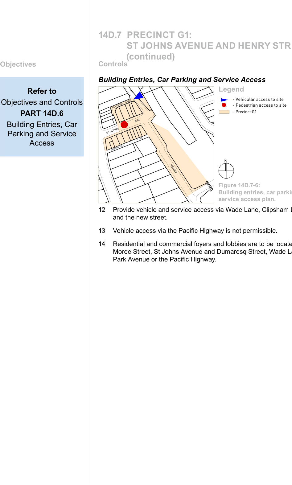

## 25 BRUC

### Highway while allowing for their integration into a new urban

### context.

#### 23

#### 25

#### 21

#### 30

#### 28

#### 26

#### 24

#### 22

#### 30A

#### 32

#### 34

ix)	 Design the built form on the northern side of Moree Street to

#### 36 38

#### 27

#### 29

#### HIGHWAY

#### 37A

#### 18

#### 20

#### 16

#### 27

#### 11

#### 15

#### 17

#### 19

#### 21

#### 23

### minimise overshadowing of Moree Street.

#### 2B

#### 24

#### 36A

### x)	 Provide a well articulated sequence of built forms in Moree

#### BRUCE

#### 32A

#### 40

#### 46

#### 44

#### 42

#### 50

#### 39

#### 37

#### 35

#### 31

Street and St Johns Avenue (west), with residential uses at the

### upper levels separated into discrete buildings.

#### NORFOLK

#### 38A

#### 22

#### 48

#### 54

#### 50 52

#### RD

#### 61

### xi)	 Give special design consideration to building heights in relation

#### LANE

#### GREENGATE

#### 20

#### 16

#### 18

## 51 Ku-ring-gai Development Control Plan

### to low density residential properties within St Johns Avenue

### (west). A transition in building heights is to be provided from

taller buildings towards the eastern end of the block near the

### Pacific Highway, stepping down to lower buildings on the western

### side adjoining the new street.

NK

#### EDWA

### HWAY

> [Picture on page 15: a map, saved as a picture (images/part-14d-gordon-local-centre-page-15-4.gif, 150 dpi); the street names and other small labels are on the picture.]
> Words printed on the picture (title and legend, copied from the PDF):
> 4 8 10
> 5 7 9 11
> 2 7 9
> 4 6 8
> 3 5 7 11
> 24 22 20 18
> 82 3.66W PATHWAY
> 1 7 3.66W PATHWAY
> 10 10A AVE

Figure 14D.7-6:

AVE

#### STANLEY PL GILLOTT

#### AVE

#### 3m

### G3

MONA

### - Nil setback - Alternate deep soil requirement

#### 2m

### PUBLIC DOMAIN AND PEDESTRIAN

MEMORIAL

#### 15

### KHARTOUM

#### 3m

#### 3m

#### LANE

VE

#### DUMARESQ

#### ST

#### 10m

RADFORD

#### 19

#### 11

PL

#### 6m

DUMARESQ

ST
