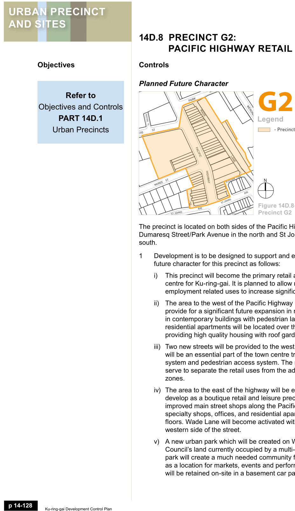
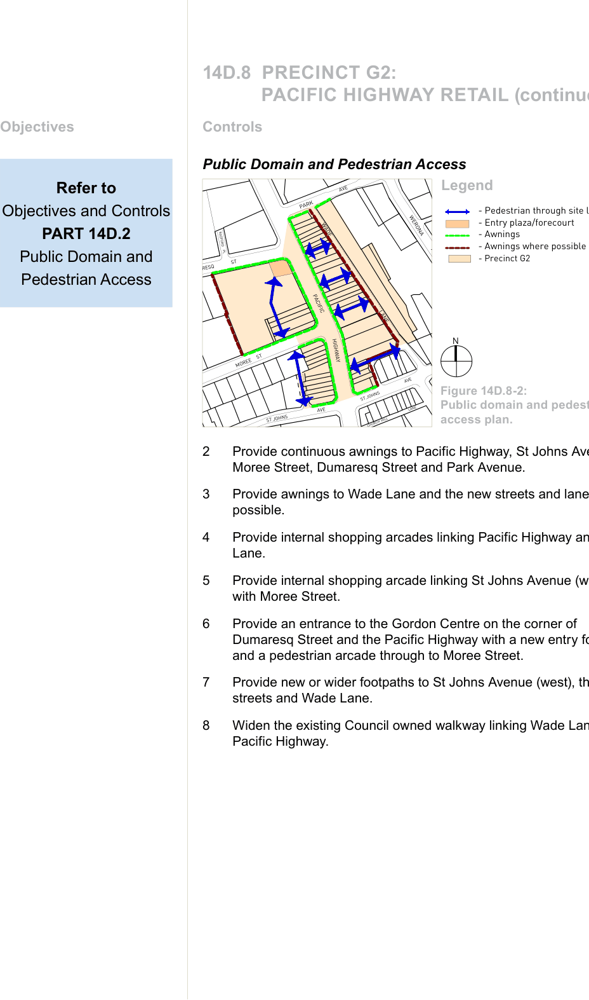
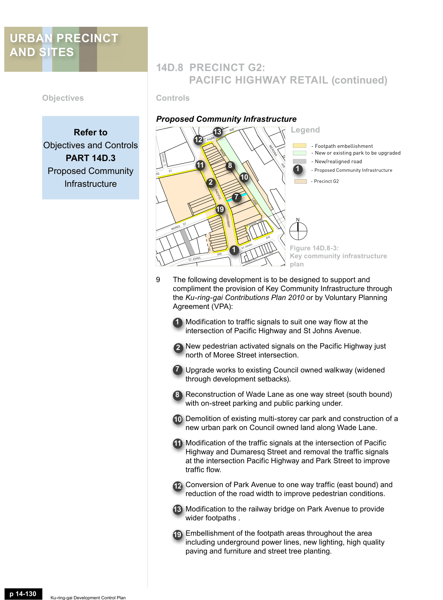

### 14D.7  PRECINCT G1:

### ST JOHNS AVENUE AND HENRY STREET

### (continued)

#### 6.1W

#### LANE

STANLEY

### Objectives

### Controls 22

#### ST

4

8

#### 10

6

ROSEDALE

RD

### G2

### PACIFIC

2

- Pedestrian through site link - Entry plaza/forecourt - Awnings - Awnings where possible - Colonnade

- Private land with public access - Through site link - Land dedication - Primary active frontage - Secondary active frontage

7

10 12 14 16 18

#### NELSON

PORTERS

### LANE

### Building Entries, Car Parking and Service Access

ST

MOREE

### BUILDING ENTRIES AND CARPAT 1

3

5

### Legend

### G1

Refer to

### Objectives and Controls

#### CHURCH  HILL ST

### - Vehicular access to site - Pedestrian access to site

#### CLIPSHAM LANE

### HIGHWAY

#### MOREE

### G5

#### AVE

AVE

### HERITATGGEA

7

9

### PART 14D.6

### Building Entries, Car

SHINFIELD

### - Precinct G1 - Precinct G2 - Precinct G3 - Precinct G4

#### ST.JOHNS

## 4 LANE

### - Heritage item

### - Precinct G5

CR

OBERON

### Parking and Service

5

3

DR

#### LANE

#### AVE

5

### Access

#### ST JOHNS

4

#### CHURCH  HILL

1

7

### - Landmark building

### - Potential relocation of laneway

### to enable lot consolidation

19A

### *

11

9

### N

#### RD

### - Character item

#### HENRY

23

21

19

DORSET 16

21

19

17

15

26

24

22

18

14

12

8

6

10

28

18

#### AVE

### - Refer to site specific DCP

### - Proposed road - Proposed Community Infrastructure

Building entries, car parking and

### service access plan.

#### MCINTOSH

2

#### LYNBARA

4 AVE

3

5

1

#### CR

#### OBERON

#### HIGHWAY

## 12 Provide vehicle and service access via Wade Lane, Clipsham Lane

### and the new street.

27

29

## 13 Vehicle access via the Pacific Highway is not permissible.

37

35

31 40

46

44

42

50

NORFOLK 38A

48 50 52

61

#### 19A

59

48

#### AVE

#### RAVENSWOOD

57 46

## 698 AVE

55

## 14 Residential and commercial foyers and lobbies are to be located off

Moree Street, St Johns Avenue and Dumaresq Street, Wade Lane,

### Park Avenue or the Pacific Highway.

44 53

51 42

#### ST

#### WERONA

#### 23

#### 21

#### 19

#### 25

#### YARABAH

#### 26

#### 24

#### 22

#### 28

#### 18

#### 28A

#### ST

#### AVE

#### PACIFIC

#### 16

#### 10

4

#### 12 14

#### CECIL

2 4

#### AVE

#### 673

3

5

1

#### 19A

#### ST

#### 716 671

#### 11

#### 29

#### 19

#### 15

#### 17

#### 10

#### 10A

#### BRU

#### AVE

#### 12

#### 14

#### 25

#### 23

#### 25

#### 21

#### 30

#### 28

#### 26

#### 24

#### 22

#### 30A

#### 32

#### 34

#### 36 38

#### 27

#### 29

#### HIGHWAY

#### 37A

#### 18

#### 20

#### 16

#### 27

#### 11

#### 15

#### 17

#### 19

#### 21

#### 23

#### 663

#### 667

#### 669

### GORDON LOCAL CENTRE

#### 2B

#### 702

#### 24

#### 36A

#### BRUCE

#### 30C 32A

#### 40

#### 46

#### 44

#### 42

#### 50

#### 39

#### 37

#### 35

#### 31

#### NORFOLK

#### 38A

#### 22

#### 48

#### 54

#### 50 52

#### R

#### 61

#### LANE

#### GREENGATE

#### 20 18

VAR

#### S

#### Y

35

> [Picture on page 16: a map, saved as a picture (images/part-14d-gordon-local-centre-page-16-5.gif, 150 dpi); the street names and other small labels are on the picture.]
> Words printed on the picture (title and legend, copied from the PDF):
> LAGONDA AVE 42
> 10 10A AVE

Figure 14D.8-1:

#### PARK

#### MERRIWA

### - Nil setback - Alternate deep soil requirement

24

26

#### LA BURGOYNE

#### WERONA

#### WADE

33

20-22

### 14D.8  PRECINCT G2:

### PACIFIC HIGHWAY RETAIL

19

21

23

#### PACIFIC

#### KHARTOUM

31

15

17

2A

2

4

### Objectives

### Controls

12

3A

29

#### ST

#### MCINTYRE

1

#### ROSEDALE

#### EDWARD

1A

#### PACIFIC

#### HIGHWAY

#### LANE

### G2

- Private land with public access - Through site link - Land dedication - Primary active frontage - Secondary active frontage

### Planned Future Character

#### AVE

27

#### HIGHWAY

LANE

#### PARK

### G1

Refer to

### Objectives and Controls

#### WERONA

#### WADE

#### AVE

## 18 G2

### Legend

#### AVE

15

25

#### KHARTOUM

### G5

#### LANE

### PART 14D.1

### Urban Precincts

#### DUMARESQ

#### ST

23

19

21

11

### - Precinct G1 - Precinct G2 - Precinct G3 - Precinct G4 - Precinct G5

#### ST

#### PACIFIC

2

#### LANE

1

### - Potential relocation of laneway

### to enable lot consolidation

#### ST

### N

## 24 CLIPSHAM LANE

#### HIGHWAY

#### MOREE

#### AVE

#### ST.JOHNS AVE

#### ST JOHNS

### Precinct G2

#### HENRY

### The precinct is located on both sides of the Pacific Highway, between

Dumaresq Street/Park Avenue in the north and St Johns Avenue in the

### south.

#### AVE

HENRY PASS

#### MCINTOSH

## 1 Development is to be designed to support and enhance the planned

### future character for this precinct as follows:

#### CR

#### OBERON

#### HIGHWAY

## 53 ST JOHNS

### i) This precinct will become the primary retail and commercial

### centre for Ku-ring-gai. It is planned to allow retail and other

### employment related uses to increase significantly in this precinct.

9

#### AVE

#### RAVENSWOOD

ii)	 The area to the west of the Pacific Highway has potential to

#### ST JOHNS

#### AVE

#### ST WERONA

### provide for a significant future expansion in retail floor space

### in contemporary buildings with pedestrian lane ways. New

### residential apartments will be located over the retail podiums

### providing high quality housing with roof gardens.

#### YARABAH

### iii)	 Two new streets will be provided to the west of the precinct; they

2

#### ORMISTON

#### ST

#### AVE

1A

#### PACIFIC

#### AVE 42

#### BUSHLANDS

#### BUSHLANDS

### will be an essential part of the town centre traffic movement

### system and pedestrian access system. The new streets will also

### serve to separate the retail uses from the adjoining residential

### zones.

16

10

8

6

4

12

14

#### CECIL

iv)	 The area to the east of the highway will be encouraged to

#### AVE

673

#### PENNANT

#### ST

#### BROWNS

#### RD

10 10A

#### AVE

8A

12

14

### develop as a boutique retail and leisure precinct providing

### improved main street shops along the Pacific Highway with new

### specialty shops, offices, and residential apartments on upper

floors. Wade Lane will become activated with retail shops on the

### western side of the street.

#### HIGHWAY

8

2A

2

4

6

1

11

15

17

19

21

23

9

663

667

669

v)	 A new urban park which will be created on Wade Lane on

2B

1

3

5

7

#### BRUCE

#### NORFOLK 38A

6

GREENGATE

### Council’s land currently occupied by a multi-storey car park. The

### park will create a much needed community focus for the Gordon

### as a location for markets, events and performances. Car parking

### will be retained on-site in a basement car park.

#### RD

#### BROWNS

#### ST

14

1

#### CECIL

6 41 VAR WIDTH

9A 9 5 MYRTLE

#### WILLIAM

FLINDERS

7.32 / 3.66 W.

ESMT FOR SERVICES

KENTHURST

BURGOYNE ST

ROSEDALE MONA

PATHWAY

> [Picture on page 17: a map, saved as a picture (images/part-14d-gordon-local-centre-page-17-12.gif, 150 dpi); the street names and other small labels are on the picture.]
> Words printed on the picture (title and legend, copied from the PDF):
> 4 6 8 10 18
> 1 3 5
> 4 8 10
> 5 7 9 11
> 4 6 8
> 12 5 15 19
> 3 5 7 11
> ST LAGONDA AVE
> 24 22 20 18
> 82 3.66W PATHWAY 18
> IKARA 1 80
> PL 10 10A
> 7 9 3.66W PATHWAY
> 64 1 3

Figure 14D.8-2:

#### FITZSIMONS

### BUILT FORM

#### BURGOYNE

37

#### ROSEDALE

#### ST

PARK

### 40%

### G3

35

### - 3m setback - Nil setback - Alternate deep soil requirement

#### MERRIWA

### 14D.8  PRECINCT G2:

### PACIFIC HIGHWAY RETAIL (continued)

#### LA BURGOYNE

#### 6m WADE

33

RADFORD PL

6

#### PACIFIC

MARESQ

ST

31

### Objectives

### Controls

2A

2

4

3A

29

#### ST

#### MCINTYRE

1

#### ROSEDALE

#### EDWARD

3

5

1A

RD

- Primary active frontage - Secondary active frontage - 3 storey street wall - 2m upper level setback above street

### wall height - 4m upper level setback above street wall height

#### HIGHWAY

### G2

AVE

### Public Domain and Pedestrian Access

- Private land with public access - Through site link - Land dedication - Primary active frontage - Secondary active frontage

VALE STANLEY

#### 3m

#### MONA 2m LN

### PUBLIC DOMAIN AND PEDESTRIAN

ST

MEMORIAL

#### AVE 12

27

### Legend

#### 3m MOREE 3m

### Legend

E

### 40%

#### PARK YARRABUNG

#### 10m

48

### G1

#### 6m

LANE

Refer to

### Objectives and Controls

17

ST JOHNS

#### WERONA

#### WADE

#### AVE

STANLEY

#### AVE

ROSEDALE

RD

15

25

### G5

- Pedestrian through site link - Entry plaza/forecourt - Awnings - Awnings where possible - Colonnade

#### KHARTOUM

### PART 14D.2

Public Domain and

#### LANE

10 12 14 16 18

PORTERS

#### DUMARESQ

#### ST

23

19

21

11

### BUILDING ENTRIES AND CARPAT

### - Precinct G1 - Precinct G2 - Precinct G3 - Precinct G4

### Pedestrian Access MCINTOSH

55A

### - Precinct G5

CR

RON

#### ST

4

8 6

#### PACIFIC

2

#### NELSON

53

### - Vehicular access to site - Pedestrian access to site

#### LANE

55 7

1

3

### - Potential relocation of laneway

### to enable lot consolidation

### N

50

44

2

46

### HERITATGGEA

#### ST

#### CLIPSHAM LANE

#### HIGHWAY

42A

#### MOREE

SHINFIELD

19

18

### - Heritage/character item

#### AVE

22

7

9

DR

YARABAH

#### ST.JOHNS

5

5

3

4

#### AVE

7

#### ST JOHNS

### Public domain and pedestrian

### access plan.

11

9

#### HENRY

55

19A

DORSET

16

57

53

61

51

59 21

19

17

15

## 2 Provide continuous awnings to Pacific Highway, St Johns Avenue,

### Moree Street, Dumaresq Street and Park Avenue.

18

14

12

8

6

10

#### AVE

23 25

52

50

46

54

48

36 38

27

29

#### MCINTOSH

31

## 3 Provide awnings to Wade Lane and the new streets and lanes where

### possible.

36A 36B

40

44

42

#### CR

#### OBERON

#### LYNBARA

WALK

ST JOHNS

50

#### HIGHWAY

## 53 ST JOHNS

NORFOLK 38A

61

3.66W

PATHWAY

59

48

## 4 Provide internal shopping arcades linking Pacific Highway and Wade

### Lane.

57

63

46

55

53

67

65

51

#### AVE

#### RAVENSWOOD

71

69

56

54

#### ST JOHNS

#### AVE

58

## 5 Provide internal shopping arcade linking St Johns Avenue (west)

### with Moree Street.

62

60

64

#### ST WERONA

## 6 Provide an entrance to the Gordon Centre on the corner of

### Dumaresq Street and the Pacific Highway with a new entry forecourt

### and a pedestrian arcade through to Moree Street.

#### YARABAH

7 8

2

5

6

3

## 7 Provide new or wider footpaths to St Johns Avenue (west), the new

### streets and Wade Lane.

#### ORMISTON

#### ST

#### AVE

1 41

#### PACIFIC

4

2

#### AVE 42

#### BUSHLANDS

#### BUSHLANDS

10

8

6

4

12

#### CECIL

## 8 Widen the existing Council owned walkway linking Wade Lane and

### Pacific Highway.

45 47

54

50

48

52

#### AVE

56

#### PENNANT

#### ST

58

60

#### BROWNS

#### RD

#### 10 10A AVE

8A

12

14

25

#### HIGHWAY

8

4

6

18

20

16

27

11

15

17

19

21

23

9

24

7

#### BRUCE

### GORDON LOCAL CENTRE

#### NORFOLK 38A

6

L

GREENGATE

#### RD

#### BROWNS

#### ST

19

14

16

18

4

6

8

10

12

#### PACIFIC

2

9-15

9-15

#### CECIL

VAL

> [Picture on page 18: a map, saved as a picture (images/part-14d-gordon-local-centre-page-18-2.gif, 150 dpi); the street names and other small labels are on the picture.]
> Words printed on the picture (title and legend, copied from the PDF):
> STURT GILLOTT 15
> 30 9 9A
> 5 7 9 11
> 4 8 10
> 5 7 9 11
> 4 6 8
> 24 22 20 18
> 3 5 7 11
> 4 6 8
> KHARTOUM STANLEY LANE
> 3 5 7 11
> 82 3.66W PATHWAY
> 4 AVE 4
> 3.66W PATHWAY 7
> 18 LANE 6
> 24 22 20 18
> 3.66W PATHWAY 18
> 43 3.66W PATHWAY 18
> 10 1 80
> 72 76 15
> 10 10A AVE

Figure 14D.8-3:

NLEY

#### ST RD

#### LLIAM

#### ROTARY

10 12 14 16 18

#### ZSIMONS MONA ST ROTARY

#### LANE LN

#### ST

ANE

### - Continuous awnings - Continuous awnings where possible - Continuous colonnade

### - Vehicular access to site - Pedestrian access to site

#### MERRIWA

### - Continuous awnings - Continuous awnings where possible - Continuous colonnade

### BUILDING ENTRIES AND CARPAT

#### LA BURGOYNE

### 14D.8  PRECINCT G2:

### PACIFIC HIGHWAY RETAIL (continued)

### G3

10 12 14 16 18

### - 10m setback - 6m setback - 3m setback - Nil setback - Alternate deep soil requirement

### HERITATGGEA
