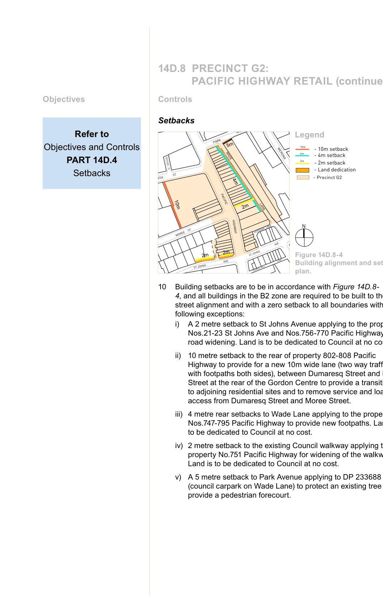
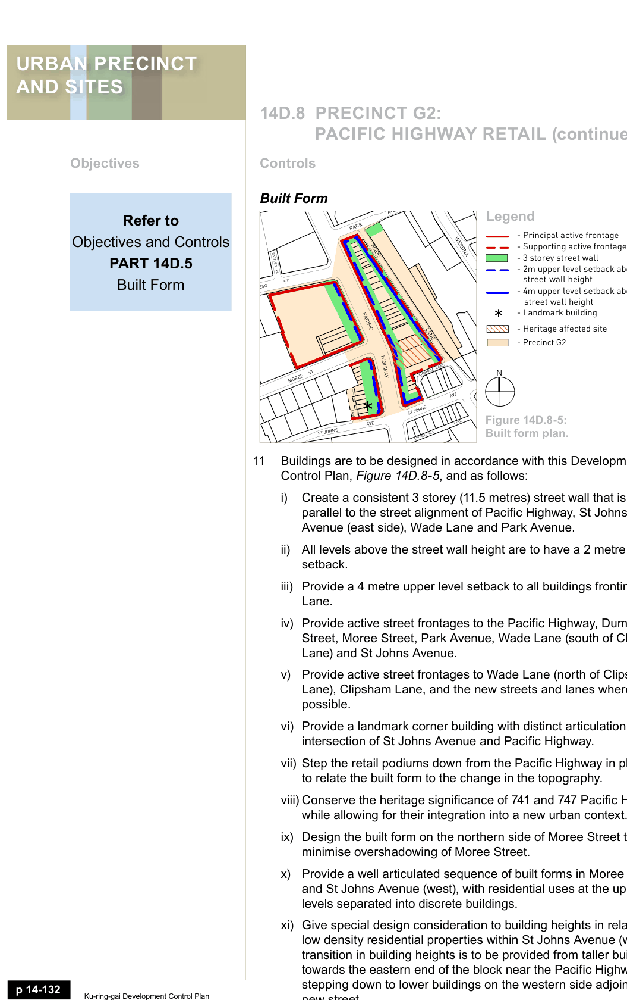

#### 32A ST JOHNS

### 1

Modification to traffic signals to suit one way flow at the

### intersection of Pacific Highway and St Johns Avenue.

### 2

#### AVE

#### RAVENSWOOD

#### ST JOHNS

#### AVE

### New pedestrian activated signals on the Pacific Highway just

### north of Moree Street intersection.

4

### 7

### Upgrade works to existing Council owned walkway (widened

### through development setbacks).

#### ST WERONA

## 8 YARABAH

### Reconstruction of Wade Lane as one way street (south bound)

### with on-street parking and public parking under.

#### ORMISTON

#### ST

### 10

#### AVE

#### PACIFIC

Demolition of existing multi-storey car park and construction of a

### new urban park on Council owned land along Wade Lane.

#### AVE 42

#### BUSHLANDS

#### BUSHLANDS

#### CECIL

### 11

#### AVE

#### PENNANT

#### ST

#### BROWNS

#### RD

### Modification of the traffic signals at the intersection of Pacific

### Highway and Dumaresq Street and removal the traffic signals

### at the intersection Pacific Highway and Park Street to improve

### traffic flow.

#### 10 10A AVE

### 12

Conversion of Park Avenue to one way traffic (east bound) and

### reduction of the road width to improve pedestrian conditions.

#### HIGHWAY

#### BRUCE

### 13

### Modification to the railway bridge on Park Avenue to provide

### wider footpaths .

#### NORFOLK 38A

#### RD

#### BROWNS

### 19

#### ST

### Embellishment of the footpath areas throughout the area

### including underground power lines, new lighting, high quality

### paving and furniture and street tree planting.

#### PACIFIC

#### CECIL

M

D

> [Picture on page 19: a map, saved as a picture (images/part-14d-gordon-local-centre-page-19-3.gif, 150 dpi); the street names and other small labels are on the picture.]
> Words printed on the picture (title and legend, copied from the PDF):
> 27 25 23
> 21 19 17
> 27 25 23
> 26 24 22
> 21 19 17
> 12 10 8
> 26 24 22
> 12 10 8
> 27 25 23
> 21 19 17
> 7 9 285 293
> 26 24 22
> 3 4 1 3
> 12 10 8
> 7.32 / 3.66 W.
> ESMT FOR SERVICES
> AVE 7.32 / 3.66 W.
> ESMT FOR SERVICES
> 7.32 / 3.66 W.
> 101 103 105
> 101 103 105
> 123 125 127
> 123 125 127
> 101 103 105
> 2 123 125 127
> 4 6 8 10
> 4 6 8 10
> 1 3 5
> 1 3 5
> 4 6 8 10
> 1 3 5
> 4 8 10
> E VALE STANLEY
> 4 8 10
> 5 7 9 11
> 5 7 9 11
> 29 COLLEGE 16
> 4 8 10
> 5 7 9 11
> 4 6 8
> 4 6 8
> CATHERINE 15 19
> 3 5 7 11
> 3 5 7 11
> 4 6 8
> POWELL 15 19
> 3 5 7 11
> 24 22 20 18
> 24 22 20 18
> 24 22 20 18
> 2 3.66W PATHWAY
> 5 3.66W PATHWAY

Figure 14D.8-4

#### AM

#### ST RAIL LINE

#### MONS

### variable

#### ST

### 6m

### 5m

35

#### MERRIWA

#### LA BURGOYNE

### 14D.8  PRECINCT G2:

### PACIFIC HIGHWAY RETAIL (continued)

### ALIGNMENT AND SETBACKS 33

### G3

6

### - 10m setback - 6m setback - 3m setback - Nil setback - Alternate deep soil requirement

### ALIGNMENT AND SETBACKS

#### PACIFIC

### - 9m setback

#### 9m

31

#### 15m

### Objectives

### Controls

### - 9m setback

#### 9m

2A

2

4

### - 15m setback

### ALIGNMENT AND SETBACKS

3A

29

#### 15m

#### ST

#### MCINTYRE 15

1

### - 13m setback

#### 13m

### - 15m setback

#### ROSEDALE

#### 12m

#### EDWARD

3

1A

### - 13m setback

#### 13m

### - 12m setback

### - 9m setback

#### 9m

#### HIGHWAY 2

#### 12m

#### 15m

### - 12m setback

### - 11m setback

#### 11m

### Setbacks

### - 15m setback

#### 10m

### - 11m setback

#### 11m

### G2

### - 13m setback

#### 13m

#### VALE AVE

#### 10m

27

- Private land with public access - Through site link - Land dedication - Primary active frontage - Secondary active frontage

#### 6m

#### 12m

### - 12m setback

### Legend

#### 5m

#### 6m PARK

#### PARK

### - 11m setback

#### 11m 5m

#### 10m

### 5m

#### 4m

Refer to

### Objectives and Controls

#### 4m

#### 6m

#### 3m

### G1

17

#### WERONA

#### WADE 4

#### AVE

#### 5m

#### 2m

#### FLINDERS 3m

CHURCH  HILL ESMT FOR SERVICES

### PART 14D.4

#### 2m

#### 4m

### 6m

#### AVE

15

25

#### KHARTOUM

#### 3m

#### LANE

#### 40%

### Setbacks

### G5

#### DUMARESQ

#### ST

#### 2m

23

19

21

11

#### 40%

### 4m

- 10m setback - 6m setback - 5m setback - 4m setback - 3m setback - 2m setback - Land dedication - Alternate deep soil landscaping

### (% of site)

- 10m setback - 6m setback - 5m setback - 4m setback - 3m setback - 2m setback - Land dedication - Alternate deep soil landscaping

### (% of site)

#### 40%

### BUILT FORM

### - Precinct G1 - Precinct G2 - Precinct G3 - Precinct G4 - Precinct G5

#### ST

4

6

#### PACIFIC

2

### BUILT FORM

- 10m setback - 6m setback - 5m setback - 4m setback - 3m setback - 2m setback - Land dedication - Alternate deep soil landscaping

### (% of site)

#### NE

### 10m

### 2m

#### LANE

1

3

### - Potential relocation of laneway

### to enable lot consolidation

### BUILT FORM

#### 6m

### N

#### 6m

#### ST

#### CLIPSHAM LANE CARCOOLA

- Principal active frontage - Supporting active frontage - 3 storey street wall - 2m upper level setback above

#### HIGHWAY 2

#### MOREE

- Principal active frontage - Supporting active frontage - 3 storey street wall - 2m upper level setback above

### street

9

#### 6m

#### AVE

### street

### wall height - 4m upper level setback above

26

#### 6m

### wall height - 4m upper level setback above

### street

- Principal active frontage - Supporting active frontage - 3 storey street wall - 2m upper level setback above

### wall height

#### 6m

#### ST.JOHNS

### 2m

### 2m

### street

### wall height

### street

#### AVE

#### 3m

#### 2m

### wall height - 4m upper level setback above

### PUBLIC DOMAIN AND PEDESTRIAN

#### ST JOHNS

#### 6m

#### 3m

#### 3m

#### 3m

#### 2m

E

### PUBLIC DOMAIN AND PEDESTRIAN

### street wall height

### Building alignment and setbacks

### plan.

#### 3m

#### 3m

#### 10m

#### 6m

#### 10m

#### 3m ST

#### 2m

### PUBLIC DOMAIN AND PEDESTRIAN

#### 6m

#### 3m

#### 3m 11

#### HENRY

E

#### 10m

#### 6m

#### AVE

- Pedestrian through site link - Entry plaza/forecourt - Awnings - Awnings where possible - Colonnade

10 12 14 16 18

- Pedestrian through site link - Entry plaza/forecourt - Awnings - Awnings where possible - Colonnade

10 12 14 16 18

## 10 Building setbacks are to be in accordance with Figure 14D.8-

4, and all buildings in the B2 zone are required to be built to the

street alignment and with a zero setback to all boundaries with the

### following exceptions:

#### MCINTOSH

### BUILDING ENTRIES AND CARPAT

### BUILDING ENTRIES AND CARPAT

- Pedestrian through site link - Entry plaza/forecourt - Awnings - Awnings where possible - Colonnade

#### CR

#### OBERON

10 12 14 16 18

#### HIGHWAY

#### ST JOHNS

### BUILDING ENTRIES AND CARPAT

### - Vehicular access to site - Pedestrian access to site

### i) A 2 metre setback to St Johns Avenue applying to the properties

Nos.21-23 St Johns Ave and Nos.756-770 Pacific Highway for

### road widening. Land is to be dedicated to Council at no cost.

### - Vehicular access to site - Pedestrian access to site

### 8 ii)	 10 metre setback to the rear of property 802-808 Pacific

### - Vehicular access to site - Pedestrian access to site

### HERITATGGEA

#### AVE

### RAVENSWOOD HERITATGGEA

#### ST JOHNS

#### AVE

### - Heritage item

### - Heritage item

### HERITATGGEA - Heritage item

### - Landmark building

#### ST

### - Landmark building

#### WERONA

### *

### Highway to provide for a new 10m wide lane (two way traffic

### with footpaths both sides), between Dumaresq Street and Moree

### Street at the rear of the Gordon Centre to provide a transition

### to adjoining residential sites and to remove service and loading

### access from Dumaresq Street and Moree Street.

### *

#### YARABAH

### - Landmark building

### - Character item

### iii)	 4 metre rear setbacks to Wade Lane applying to the properties

2

### - Character item

### *

#### ORMISTON

Nos.747-795 Pacific Highway to provide new footpaths. Land is

### to be dedicated to Council at no cost.

#### ST

### - Character item

#### AVE

### - Refer to site specific DCP

### - Proposed road

#### PACIFIC

### - Refer to site specific DCP

### - Proposed road

iv)	 2 metre setback to the existing Council walkway applying to the

### - Proposed Community Infrastructure

#### AVE 42

#### BUSHLANDS

#### BUSHLANDS

### - Proposed Community Infrastructure

10

8

6

4

12

#### CECIL

#### LYNBARA

### - Refer to site specific DCP

### - Proposed road

#### LYNBARA

### property No.751 Pacific Highway for widening of the walkway.

### Land is to be dedicated to Council at no cost.

### - Proposed Community Infrastructure

#### AVE

#### PENNANT

#### LYNBARA

### v)	 A 5 metre setback to Park Avenue applying to DP 233688

#### ST

#### BROWNS

#### RD

(council carpark on Wade Lane) to protect an existing tree and

### provide a pedestrian forecourt.

#### 10 10A AVE

8A

12

14

25

#### HIGHWAY

8

4

6

18 16

11

15

17

19

21

23

9

### GORDON LOCAL CENTRE

7

#### BRUCE

#### NORFOLK 38A

6

GREENGATE

#### RD

#### BROWNS

#### ST

14

16

1

8

10

12

9-15

#### CECIL

#### M

> [Picture on page 20: a map, saved as a picture (images/part-14d-gordon-local-centre-page-20-2.gif, 150 dpi); the street names and other small labels are on the picture.]
> Words printed on the picture (title and legend, copied from the PDF):
> 8A 2 2
> 7 9 9A
> 21 R. O. W.
> 1 3 5
> 10 4 8 10
> 7.32 / 3.66 W.
> ESMT FOR SERVICES
> 5 7 9 11
> 4 6 8
> 5 7 9 11
> 101 103 105
> 3 5 7 11
> 123 125 127
> 4 6 8
> RD 15 19
> 3 5 7 11
> 4 6 8 10
> 24 22 20 18
> ST AVE CLIPSHAM LANE
> CLIPSHAM LANE 4
> 1 3 5
> ST JOHNS STANLEY
> 24 22 20 18
> 1 PL 16
> 4 8 10
> 5 7 9 11
> HIGHWAY 32 6 10
> 2 4 2
> 4 6 8
> LAGONDA 1 AVE
> 3 5 7 11
> 6 4 2
> 24 22 20 18
> 657 7 3.66W PATHWAY
> PACIFIC 2 2

Figure 14D.8-5:

#### 4 40%

## 20 PACIFIC

4 6 8 10 R. O. W.

#### HIGHWAY 12

21 19 17 2 2

#### MONS

#### BURGOYNE 2m

#### 3m 16

#### 3m

#### 6m

### - 4m upper level setback above

35

#### 5m

#### 10m

#### MERRIWA

#### 6m

#### 6m

### street wall height

#### LA

#### BURGOYNE 4m

33

### 14D.8  PRECINCT G2:

### PACIFIC HIGHWAY RETAIL (continued)

#### 3m

#### 3m

6

#### 2m

### PUBLIC DOMAIN AND PEDESTRIAN

#### PACIFIC

#### 2m

#### 3m

31

#### 3m

4 8 10

2A

2

4

- Pedestrian through site link - Entry plaza/forecourt - Awnings - Awnings where possible - Colonnade

### 10m Objectives

### Controls

3A

29

10 12 14 16 18

#### ST

#### MCINTYRE RD

1

#### 6m

#### ROSEDALE

#### 40%

7

#### EDWARD

3

1A

### G3

### G3

### - 10m setback - 6m setback - 3m setback - Nil setback - Alternate deep soil requirement

### - 10m setback - 6m setback - 3m setback - Nil setback - Alternate deep soil requirement

#### HIGHWAY

### BUILDING ENTRIES AND CARPAT

- 6m setback - 5m setback - 4m setback - 3m setback - 2m setback - Land dedication - Alternate deep soil landscaping

### (% of site)

### Built Form

#### AVE

27

### BUILT FORM

- Pedestrian through site link - Entry plaza/forecourt - Awnings - Awnings where possible - Colonnade

### Legend

10 12 14 16 18

### - Vehicular access to site - Pedestrian access to site

#### PARK 59

### BUILDING ENTRIES AND CARPAT

Refer to

### Objectives and Controls

17

#### 6m

#### WERONA

#### WADE

### G2

### G2

#### AVE

### HERITATGGEA

- Private land with public access - Through site link - Land dedication - Primary active frontage - Secondary active frontage

- Private land with public access - Through site link - Land dedication - Primary active frontage - Secondary active frontage

### PART 14D.5

- Principal active frontage - Supporting active frontage - 3 storey street wall - 2m upper level setback above

#### AVE

### - Vehicular access to site - Pedestrian access to site

15

25

### - Heritage item

### street

#### KHARTOUM

#### LANE

#### DUMARESQ

#### ST

### Built Form 6

### wall height - 4m upper level setback above

23

19

21

11

#### 6m

### G1

### G1

### street wall height

A

### HERITATGGEA

### - Landmark building

#### ST

#### 3m

4

6

### *

#### 2m

### PUBLIC DOMAIN AND PEDESTRIAN

#### PACIFIC 43

2

### - Heritage affected site

#### 3m

#### NEL

#### 3m

#### LANE

### G5

### G5

#### 10m

### - Character item

1

3

#### 6m HENRY PASS

### - Landmark building

### - Precinct G1 - Precinct G2 - Precinct G3 - Precinct G4

### - Precinct G1 - Precinct G2 - Precinct G3 - Precinct G4

#### ST

### N

#### CLIPSHAM LANE

#### HIGHWAY

### *

### - Precinct G5

### - Precinct G5

#### MOREE

### - Refer to site specific DCP

### - Proposed road

- Pedestrian through site link - Entry plaza/forecourt - Awnings - Awnings where possible - Colonnade

#### AVE

### - Character item

10 12 14 16 18

7

9

### - Proposed Community Infrastructure
