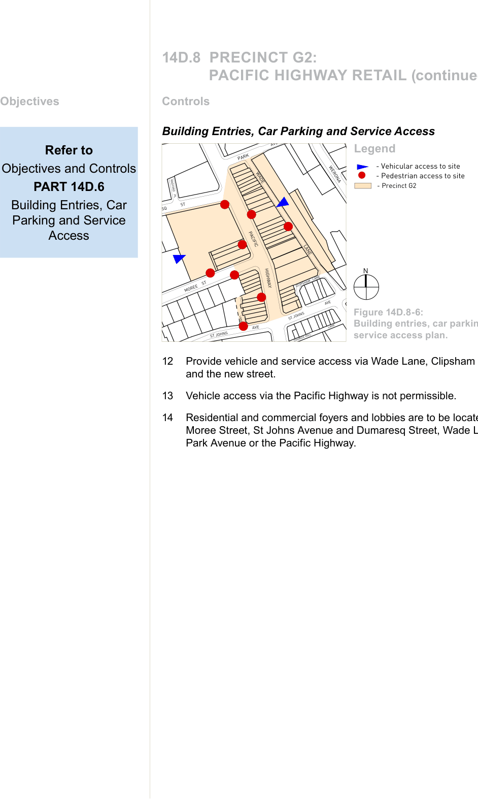

#### 30 ST.JOHNS 15 19

### - Potential relocation of laneway

### to enable lot consolidation

### - Potential relocation of laneway

### to enable lot consolidation

### BUILDING ENTRIES AND CARPAT

#### LYNBARA

### *

#### AVE ST JOHNS

### Built form plan.

### - Refer to site specific DCP

### - Proposed road

### - Vehicular access to site - Pedestrian access to site

### - Proposed Community Infrastructure

#### LYNBARA

#### HENRY

## 11 Buildings are to be designed in accordance with this Development

### Control Plan, Figure 14D.8-5, and as follows:

### HERITATGGEA

#### AVE

### - Heritage item

#### MCINTOSH

### i) Create a consistent 3 storey (11.5 metres) street wall that is built

### parallel to the street alignment of Pacific Highway, St Johns

### Avenue (east side), Wade Lane and Park Avenue.

#### CR

#### OBERON

### - Landmark building

#### HIGHWAY

#### ST JOHNS 4

### *

### ii)	 All levels above the street wall height are to have a 2 metre

### setback. 38

### - Character item

### iii)	 Provide a 4 metre upper level setback to all buildings fronting Wade

4

#### AVE

#### RAVENSWOOD

#### ST JOHNS

#### AVE

### Lane.

### - Refer to site specific DCP

### - Proposed road - Proposed Community Infrastructure

### iv)	 Provide active street frontages to the Pacific Highway, Dumaresq

46

#### LYNBARA

1

#### ST

#### WERONA

### Street, Moree Street, Park Avenue, Wade Lane (south of Clipsham

### Lane) and St Johns Avenue.

#### YARABAH

### v)	 Provide active street frontages to Wade Lane (north of Clipsham

2

#### ORMISTON

#### ST

### Lane), Clipsham Lane, and the new streets and lanes wherever

### possible.

#### AVE

#### PACIFIC

vi)	 Provide a landmark corner building with distinct articulation at the

#### AVE 42

#### BUSHLANDS

#### BUSHLANDS

10

8

6

4

12

#### CECIL

### intersection of St Johns Avenue and Pacific Highway.

### AVE vii)	 Step the retail podiums down from the Pacific Highway in platforms

#### PENNANT

### to relate the built form to the change in the topography.

#### ST

#### BROWNS

#### RD

### viii)	Conserve the heritage significance of 741 and 747 Pacific Highway

#### 10 10A AVE

8A

12

14

25

### while allowing for their integration into a new urban context.

#### HIGHWAY

8

4

6

18 16

27

11

15

17

19

21

23

ix)	 Design the built form on the northern side of Moree Street to

9

2

### minimise overshadowing of Moree Street.

7

#### BRUCE

### x)	 Provide a well articulated sequence of built forms in Moree Street

#### NORFOLK 38A

6

GREENGATE

#### RD

#### BROWNS

### and St Johns Avenue (west), with residential uses at the upper

### levels separated into discrete buildings.

#### ST

xi)	 Give special design consideration to building heights in relation to

14

16

18

4

6

8

10

12

#### PACIFIC

9-15

#### CECIL

### low density residential properties within St Johns Avenue (west). A

### transition in building heights is to be provided from taller buildings

towards the eastern end of the block near the Pacific Highway,

stepping down to lower buildings on the western side adjoining the

### new street.

LINK

17 6 6A

> [Picture on page 21: a map, saved as a picture (images/part-14d-gordon-local-centre-page-21-3.gif, 150 dpi); the street names and other small labels are on the picture.]
> Words printed on the picture (title and legend, copied from the PDF):
> 4 8 10
> 5 7 9 11
> 4 6 8
> 3 5 7 11
> 24 22 20 18
> IKARA 1 80
> 10 10A AVE

Figure 14D.8-6:

#### NS

CINTYRE

### - 4m upper level setback above 14D

RD

AVE

### - Alternate deep soil requirement

VALE STANLEY

35

#### MERRIWA 3m

MONA

#### 2m

### PUBLIC DOMAIN AND PEDESTRIAN

MEMORIAL

#### LA BURGOYNE

#### RADFORD 3m

PL STANLEY

33
