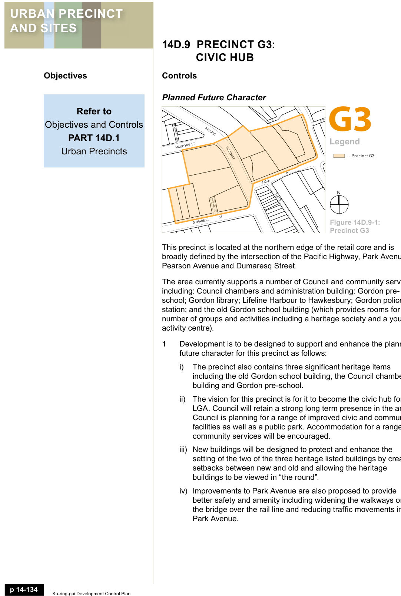
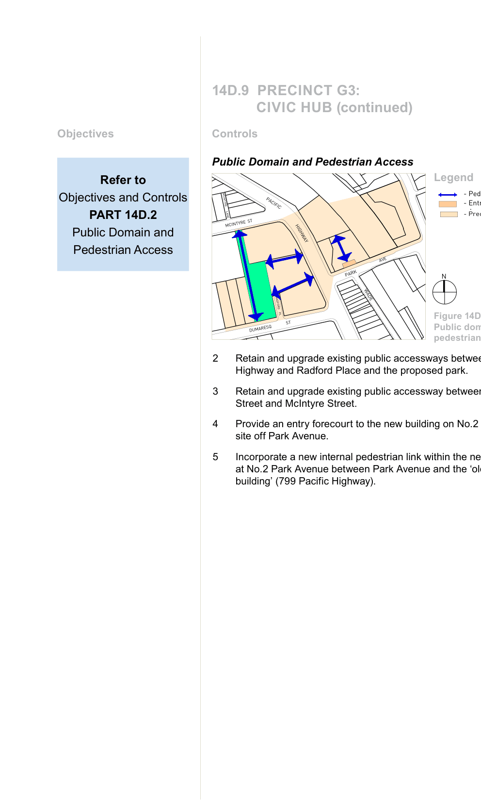
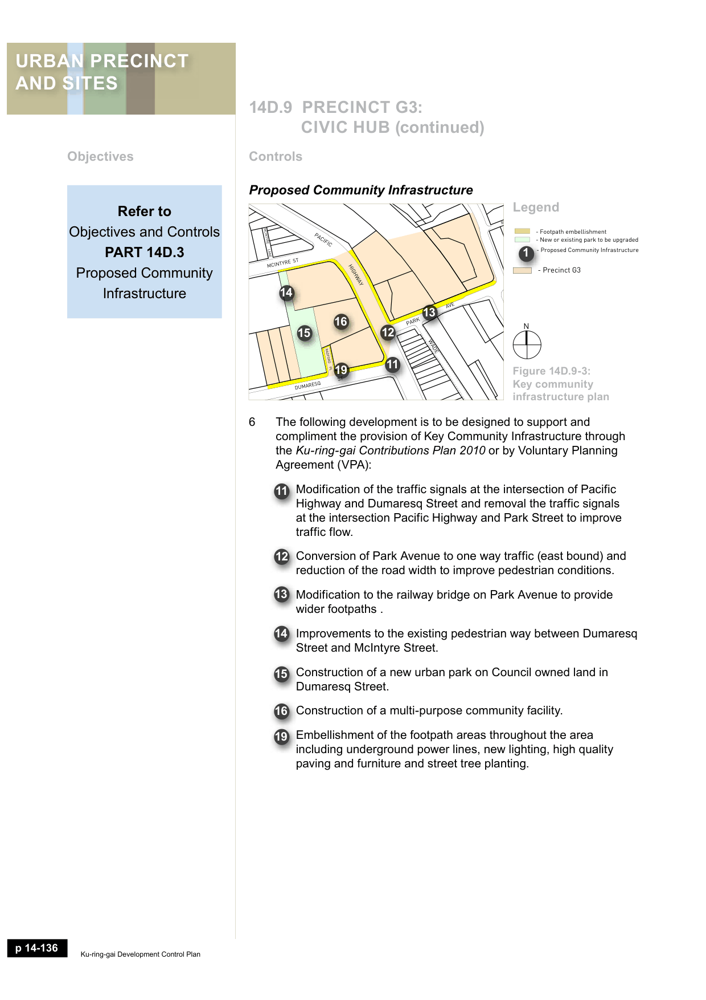

## 14 Residential and commercial foyers and lobbies are to be located off

Moree Street, St Johns Avenue and Dumaresq Street, Wade Lane,

### Park Avenue or the Pacific Highway.

63

67

65

61

69

#### AVE

#### RAVENSWOOD

56

54

52

#### ST JOHNS

#### AVE

58 60

#### ST WERONA

#### YARABAH

7 8

2

5

6

3

#### ORMISTON

#### ST

#### AVE

1 41

#### PACIFIC

4

2

#### AVE 42

#### BUSHLANDS

#### BUSHLANDS

10

8

6

4

12

#### CECIL

54

50

46 48

52

#### AVE

56

#### PENNANT

#### ST

#### BROWNS

#### RD

10 10A

#### AVE

8A

12

14

25

14

#### HIGHWAY

8

4

6

1 16

11

15

17

19

21

23

9

### GORDON LOCAL CENTRE

7

#### BRUCE

#### NORFOLK 38A

12

10

6

GREENGATE

#### RD

#### BROWNS

#### ST

14

16

10

12

#### CECIL

ST 2

29 MT.WILL

#### 23 AVE 8

#### 20 CARLOTTA 15

> [Picture on page 22: a map, saved as a picture (images/part-14d-gordon-local-centre-page-22-5.gif, 150 dpi); the street names and other small labels are on the picture.]
> Words printed on the picture (title and legend, copied from the PDF):
> 18 19 21
> R. O. W.
> PATHWAY 47 45
> 10 10A AVE

Figure 14D.9-1:

#### PEARSON

#### RAIL LINE

41

26

24

#### PACIFIC

### 14D.9  PRECINCT G3:

### CIVIC HUB

### G3

### - 10m setback - 6m setback - 3m setback - Nil setback - Alternate deep soil requirement

#### HIGHWAY

#### AVE

### Objectives

### Controls

#### FITZSIMONS

18

20

22

39

#### GARDEN

#### LANE

#### BURGOYNE

37 14

16

#### ROSEDALE

#### ST

### Planned Future Character

### G2

- Private land with public access - Through site link - Land dedication - Primary active frontage - Secondary active frontage

35

#### MERRIWA ST CLIPSHAM LANE

24

26

#### LA BURGOYNE

33

### G1

Refer to

### Objectives and Controls

19

21

23

#### PACIFIC

31

### G3 15

### Legend

12 29

#### ST

#### MCINTYRE

### G5

#### ROSEDALE

### PART 14D.1

### Urban Precincts

#### HIGHWAY

### - Precinct G1 - Precinct G2 - Precinct G3 - Precinct G4 - Precinct G5

WALK

#### AVE

LANE

#### PARK

### - Potential relocation of laneway

### to enable lot consolidation

### N

#### WERONA

#### WADE

#### AVE

#### AVE

#### KHARTOUM

#### LANE

#### DUMARESQ

#### ST

3

### Precinct G3

#### PACIFIC

#### LANE

This precinct is located at the northern edge of the retail core and is

broadly defined by the intersection of the Pacific Highway, Park Avenue,

### Pearson Avenue and Dumaresq Street.

#### ST

#### CLIPSHAM LANE

#### HIGHWAY

#### MOREE

#### AVE

#### ST.JOHNS AVE

#### ST JOHNS

### The area currently supports a number of Council and community services

### including: Council chambers and administration building: Gordon pre-

### school; Gordon library; Lifeline Harbour to Hawkesbury; Gordon police

station; and the old Gordon school building (which provides rooms for a

### number of groups and activities including a heritage society and a youth

### activity centre).

#### HENRY

#### AVE

## 1 Development is to be designed to support and enhance the planned

### future character for this precinct as follows:

69

#### CR

#### OBERON

#### HIGHWAY

## 53 ST JOHNS

### i) The precinct also contains three significant heritage items

### including the old Gordon school building, the Council chambers

### building and Gordon pre-school.

ii)	 The vision for this precinct is for it to become the civic hub for the

#### AVE

#### RAVENSWOOD

#### ST JOHNS

#### AVE

LGA. Council will retain a strong long term presence in the area,

### Council is planning for a range of improved civic and community

facilities as well as a public park. Accommodation for a range of

### community services will be encouraged.

iii)	 New buildings will be designed to protect and enhance the

#### ST

#### ST

#### VALE

#### YARABAH

### setting of the two of the three heritage listed buildings by creating

### setbacks between new and old and allowing the heritage

### buildings to be viewed in “the round”.

#### ORMISTON

#### S

### iv)	 Improvements to Park Avenue are also proposed to provide

#### AVE

1A

#### PACIFIC

#### AVE 42

#### BUSHLANDS

#### BUSHLANDS

16

10

12

14

#### CECIL

better safety and amenity including widening the walkways on

the bridge over the rail line and reducing traffic movements in

### Park Avenue.

#### AVE

#### PENNANT

#### ST

#### AVE

#### BROWNS

#### RD

6 M

> [Picture on page 23: a map, saved as a picture (images/part-14d-gordon-local-centre-page-23-2.gif, 150 dpi); the street names and other small labels are on the picture.]
> Words printed on the picture (title and legend, copied from the PDF):
> 2A 4 8
> 7.32 / 3.66 W.
> ESMT FOR SERVICES
> 4 6 8 10
> 2 7 9
> 1 3 5
> STANLEY CHURCH  HILL
> 4 8 10
> 5 7 9 11
> 4 6 8
> 3 5 7 11
> LAGONDA AVE 42
> 18A 20 59
> 24 22 20 18
> IKARA 1 80
> 1 7 3.66W PATHWAY

Figure 14D.9-2:

LLIAM

#### 20 ST 5

#### RAIL LINE PARK

### - Alternate deep soil requirement

24

#### PACIFIC

9A

#### LANE

### 40%

R. O. W.

4

### 14D.9  PRECINCT G3:

### CIVIC HUB (continued)

#### HIGHWAY

#### 6m

#### AVE

#### FITZSIMONS

18

20

22

### Objectives

### Controls

### G2

2A

2

#### GARDEN

- Private land with public access - Through site link - Land dedication - Primary active frontage - Secondary active frontage

#### LANE

#### BURGOYNE

- Primary active frontage - Secondary active frontage - 3 storey street wall - 2m upper level setback above street

### wall height - 4m upper level setback above street wall height

14

16

#### ROSEDALE

#### ST

1

5

3

### Public Domain and Pedestrian Access

#### 3m

### G1

#### 2m

### PUBLIC DOMAIN AND PEDESTRIAN

#### MERRIWA

#### 3m

### Legend

#### 3m

24

26

### Legend

### 40%

#### LA BURGOYNE

#### 10m

20-22

#### 6m

#### 32 3m

Refer to

### Objectives and Controls

18 19

21

23

### G5

#### PACIFIC

15

17

#### MCINTYRE LANE

12

#### ST

#### MCINTYRE

#### ROSEDAL

1

- Pedestrian through site link - Entry plaza/forecourt - Awnings - Awnings where possible - Colonnade

### - Precinct G1 - Precinct G2 - Precinct G3 - Precinct G4 - Precinct G5

10 12 14 16 18

### PART 14D.2

Public Domain and

#### HIGHWAY

### BUILDING ENTRIES AND CARPAT

### Pedestrian Access

### - Potential relocation of laneway

### to enable lot consolidation

#### AVE

5

#### PARK

#### LANE

#### PARK

### - Vehicular access to site - Pedestrian access to site

### N

#### WERONA

#### WADE

#### AVE

### HERITATGGEA

## 2 RADFORD

28A

#### PL

#### AVE

#### KHARTOUM

### - Heritage/character item

#### LA

#### DUMARESQ

#### ST

Public domain and

### pedestrian access plan.

#### 6.1W

#### LANE

#### PACIFIC

#### LANE

## 2 Retain and upgrade existing public accessways between the Pacific

### Highway and Radford Place and the proposed park.

#### ST

#### CLIPSHAM LANE

#### HIGHWAY

## 3 Retain and upgrade existing public accessway between Dumaresq

### Street and McIntyre Street.

56

#### MOREE

#### AVE

#### LYNBARA

## 4 Provide an entry forecourt to the new building on No.2 Park Avenue

### site off Park Avenue.

#### ST.JOHNS

#### LANE

#### LANE

#### AVE

#### ST JOHNS

#### CHURCH  HILL

## 5 Incorporate a new internal pedestrian link within the new buildings

### at No.2 Park Avenue between Park Avenue and the ‘old school

### building’ (799 Pacific Highway).

#### HENRY

#### AVE

HENRY PASS

#### CR

#### OBERON

#### HIGHWAY

#### ST JOHNS

#### AVE

#### RAVENSWOOD

#### ST JOHNS

#### AVE

#### ST

#### YARABAH

#### ORMISTON

### GORDON LOCAL CENTRE

#### AVE

1A

#### PACIFIC

#### AVE 42

#### BUSHLANDS

#### BUSHLANDS

16

12

14

#### CECIL

#### AVE

673

#### BROWNS

#### N

#### TTA

> [Picture on page 24: a map, saved as a picture (images/part-14d-gordon-local-centre-page-24-2.gif, 150 dpi); the street names and other small labels are on the picture.]
> Words printed on the picture (title and legend, copied from the PDF):
> MONA VALE RD
> 1 3 5
> 3 5 7 11
> R. O. W.
> 4 8 10
> 5 7 9 11
> MONA VALE RD MEMORIAL
> 4 6 8
> 6 1 3
> 7 24 26
> 24 22 20 18
> 16 3.66W PATHWAY
> DR LYNBARA 6
> IKARA 1 80
> 18A 20 30
> 10 10A AVE

Figure 14D.9-3:

#### CARCOOLA - 2m upper level setback above - Alternate deep soil requirement

#### PEARSON 99

1 5 7 9 11

#### - Primary active frontage - Secondary active frontage

10 12 14 16 18

#### RD 6m

#### BUILDING ENTRIES AND CARPAT

#### PUBLIC DOMAIN AND PEDESTRIAN

#### PACIFIC

#### LANE

### G3

### - 3m setback - Nil setback - Alternate deep soil requirement

#### 3m

#### - Vehicular access to site - Pedestrian access to site

### 14D.9  PRECINCT G3:

### CIVIC HUB (continued)

#### HIGHWAY

#### AVE

#### HERITATGGEA

- Through site link - Entry plaza/forecourt - Continuous awnings - Continuous awnings where possible

#### - Continuous colonnade

#### FITZSIMONS

24 22 20 18 NEWHAVEN

### Objectives

### Controls

#### - Heritage item

#### BUILDING ENTRIES AND CARPAT

#### GARDEN

#### LANE

10 12 14 16 18

### G2

#### BURGOYNE

- Private land with public access - Through site link - Land dedication - Primary active frontage - Secondary active frontage

#### - Landmark building

#### ROSEDALE

#### ST

3 5 7 11 21

#### - Vehicular access to site - Pedestrian access to site

### Proposed Community Infrastructure

### *

#### MERRIWA

#### - Character item

## 48 Legend

#### KEY COMMUNITY INFRASTRUCTRE

#### LA BURGOYNE

### G1

38 36 34 32 28 24 22 20 18 14 12 10 8 4 2

33

Refer to

### Objectives and Controls

#### - Refer to site specific DCP

#### - Proposed road
