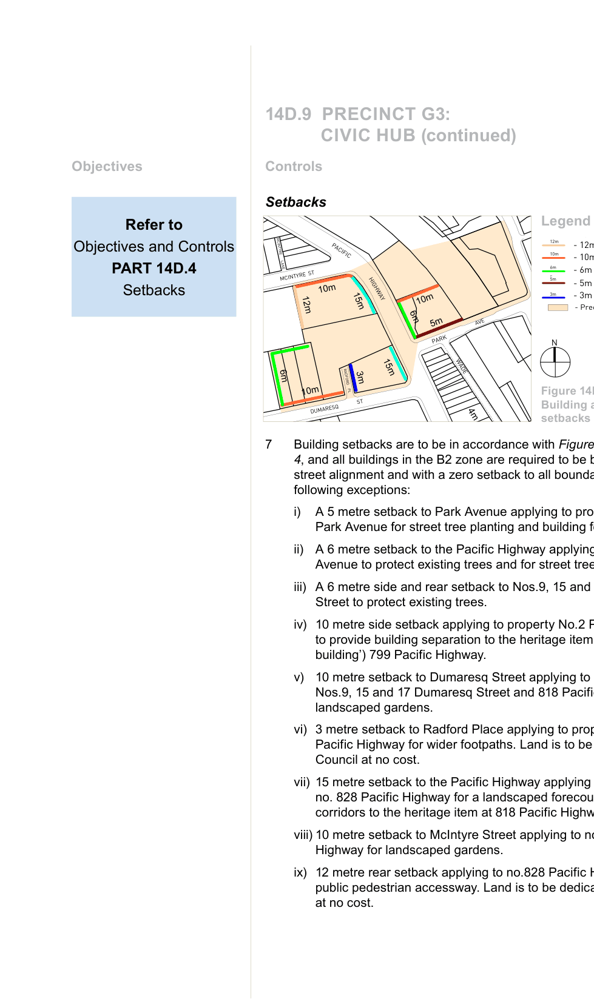

## 24 ST

#### CLIPSHAM LANE

#### HIGHWAY

#### MOREE

### 11

#### AVE

#### ST.JOHNS

#### LANE

#### LANE

#### AVE

### Modification of the traffic signals at the intersection of Pacific

### Highway and Dumaresq Street and removal the traffic signals

### at the intersection Pacific Highway and Park Street to improve

### traffic flow. ST JOHNS

#### CHURCH  HILL

## 12 Conversion of Park Avenue to one way traffic (east bound) and

### reduction of the road width to improve pedestrian conditions.

#### HENRY

### 13

#### AVE

### Modification to the railway bridge on Park Avenue to provide

### wider footpaths .

### 14

#### CR

#### OBERON

#### HIGHWAY

### Improvements to the existing pedestrian way between Dumaresq

### Street and McIntyre Street.

#### ST JOHNS

6W

### 15

Construction of a new urban park on Council owned land in

### Dumaresq Street.

#### AVE

#### RAVENSWOOD

#### ST JOHNS

#### AVE

### Construction of a multi-purpose community facility.

75

### 16 19

### Embellishment of the footpath areas throughout the area

### including underground power lines, new lighting, high quality

### paving and furniture and street tree planting.

#### ST

#### LE

#### YARABAH

#### ORMISTON

#### AVE

#### PACIFIC

#### AVE 42

#### BUSHLANDS

#### BUSHLANDS

#### CECIL

#### AVE

#### PENNANT

#### BROWNS

#### NOR

24

> [Picture on page 25: a map, saved as a picture (images/part-14d-gordon-local-centre-page-25-2.gif, 150 dpi); the street names and other small labels are on the picture.]
> Words printed on the picture (title and legend, copied from the PDF):
> 18 19 21
> 27 25 23
> 21 19 17
> 27 25 23
> 27 25 23
> 27 25 23
> 7 9 276
> 21 19 17
> 21 19 17
> 26 24 22
> 21 19 17
> 27 25 23
> 12 10 8 3
> 26 24 22
> 26 24 22
> 1 VALE 287A
> 12 10 8
> 26 24 22
> 14 12 8
> 18 16 6A 266
> ESMT FOR SERVICES
> 7.32 / 3.66 W.
> ESMT FOR SERVICES
> 3.66W HENRY PASS
> 101 103 105
> 101 103 105
> 101 103 105
> 117 123 125 127
> 121 123 125 127
> 30 123 125 127
> 123 125 127
> 123 125 127
> 18A 20 1
> 4 6 8 10
> 4 6 8 10
> 4 6 8 10
> 1 3 5
> 4 6 8 10
> 1 3 5
> 4 8 10
> 4 8 10
> 4 8 10
> 4 8 10
> 5 7 9 11
> 4 8 10
> 5 7 9 11
> 5 7 9 11
> 5 7 9 11
> 5 7 9 11
> 4 6 8
> 4 6 8
> 4 6 8
> 4 6 8
> 3 5 7 11
> 4 6 8
> 3 5 7 11
> RD 15 19
> 3 5 7 11
> 3 5 7 11
> 3 5 7 11
> 24 22 20 18
> 24 22 20 18
> AVE 3 4
> 5 7 10
> IKARA 2 3.66W PATHWAY
> 6 AVE 86
> 27 6 8
> 31 6 10
> 3.66W PATHWAY 30
> 6 4 2
> 26 3 48 4
> 64 AMINYA 5

Figure 14D.9-4

#### PACIFIC

9A

#### LANE

R. O. W.

4

#### HIGHWAY

### 14D.9  PRECINCT G3:

### CIVIC HUB (continued)

#### AVE

### G3

### - 10m setback - 6m setback - 3m setback - Nil setback - Alternate deep soil requirement

#### FITZSIMONS

18

20

22

### Objectives

### Controls

2A

2

#### GARDEN

### ALIGNMENT AND SETBACKS

#### LANE

### ALIGNMENT AND SETBACKS

### ALIGNMENT AND SETBACKS

### ALIGNMENT AND SETBACKS

#### BURGOYNE

14

16

### ALIGNMENT AND SETBACKS

#### ROSE

### - 9m setback

#### 9m

#### ST

1

5

3

### - 9m setback

#### 9m
