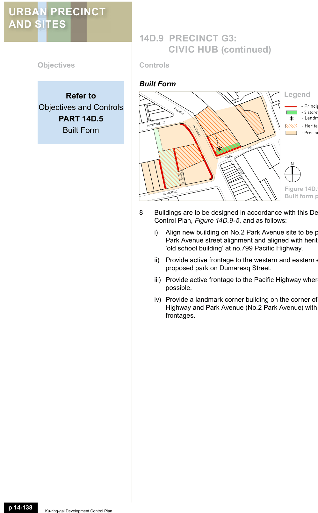

## 45 PACIFIC

### wall height - 4m upper level setback above

### street wall height

#### 6m

#### 2 6m

## 23 AVE 6m

### wall height - 4m upper level setback above

### street wall height

### street

### wall height

#### LANE

#### 6m

### street

### wall height

### street wall height

#### 3m

#### 2m

### PUBLIC DOMAIN AND PEDESTRIAN

#### 3m

#### 3m

#### 3m

#### STANLEY 3m

#### 2m

### PUBLIC DOMAIN AND PEDESTRIAN

#### 3m

#### 2m GILLOTT

### PUBLIC DOMAIN AND PEDESTRIAN

#### 2m

### PUBLIC DOMAIN AND PEDESTRIAN

#### 3m

#### 3m

#### 3m MONA

#### 3m

## 7 Building setbacks are to be in accordance with Figure 14C.9-

4, and all buildings in the B2 zone are required to be built to the

street alignment and with a zero setback to all boundaries with the

### following exceptions:

#### 3m

#### 2m

#### 3m

### PUBLIC DOMAIN AND PEDESTRIAN

#### 3m

#### 10m

#### 3m

#### 3m

#### ST

#### 10m

#### 10m

#### 6m

#### CLIPSHAM LANE

#### 10m

#### HIGHWAY

#### 3m

#### 10m

#### 6m

#### MOREE

#### 6m

#### 32A 6m

#### 3m

#### 3m

#### 3m

#### CLOSE 6m

#### 3m

#### AVE

### i) A 5 metre setback to Park Avenue applying to property No.2

### Park Avenue for street tree planting and building forecourt.

- Pedestrian through site link - Entry plaza/forecourt - Awnings - Awnings where possible - Colonnade

#### ST.JOHNS

10 12 14 16 18

#### LANE 2

### ii)	 A 6 metre setback to the Pacific Highway applying to No.2 Park

- Pedestrian through site link - Entry plaza/forecourt - Awnings - Awnings where possible - Colonnade

- Pedestrian through site link - Entry plaza/forecourt - Awnings - Awnings where possible - Colonnade

- Pedestrian through site link - Entry plaza/forecourt - Awnings - Awnings where possible - Colonnade

10 12 14 16 18

10 12 14 16 18

#### LANE

#### AVE

10 12 14 16 18

- Pedestrian through site link - Entry plaza/forecourt - Awnings - Awnings where possible - Colonnade

9 10 12 14 16 18

### Avenue to protect existing trees and for street tree planting.

### BUILDING ENTRIES AND CARPAT

#### ST JOHNS

9 9

### BUILDING ENTRIES AND CARPAT

### CHURCH  HILL BUILDING ENTRIES AND CARPAT

### BUILDING ENTRIES AND CARPAT

### BUILDING ENTRIES AND CARPAT

### STANLEY iii)	 A 6 metre side and rear setback to Nos.9, 15 and 17 Dumaresq

### 6m

### - Vehicular access to site - Pedestrian access to site

### Street to protect existing trees.

### - Vehicular access to site - Pedestrian access to site

### - Vehicular access to site - Pedestrian access to site

### - Vehicular access to site - Pedestrian access to site

#### HENRY

### - Vehicular access to site - Pedestrian access to site

### iv)	 10 metre side setback applying to property No.2 Park Avenue

### HERITATGGEA

#### AVE 8

HENRY PASS

### HERITATGGEA

### HERITATGGEA

### HERITATGGEA

### HERITATGGEA

### to provide building separation to the heritage item (‘old school

### building’) 799 Pacific Highway.

24 22 20 18 16

### - Heritage item

24 22 20 18 12 10

24 22 20 18

### - Heritage item

### - Heritage item

### - Heritage item

### - Heritage item

### v)	 10 metre setback to Dumaresq Street applying to property

#### CR

#### OBERON

VE

### - Landmark building

#### HIGHWAY

VE

VE

## 53 ST JOHNS

VE

### - Landmark building

### - Landmark building

### - Landmark building

VE

### *

Nos.9, 15 and 17 Dumaresq Street and 818 Pacific Highway for

### landscaped gardens.

### - Landmark building

### *

### *

### *

### *

### - Character item

### vi)	 3 metre setback to Radford Place applying to property no.810

### - Character item

### - Character item

### - Character item

### - Character item

#### AVE

#### RAVENSWOOD

#### ST JOHNS

#### AVE

Pacific Highway for wider footpaths. Land is to be dedicated to

### Council at no cost.

### - Refer to site specific DCP

### - Proposed road

### - Refer to site specific DCP

### - Proposed road

### - Refer to site specific DCP

### - Proposed road

### - Refer to site specific DCP

### - Proposed road

### - Proposed Community Infrastructure

vii)	 15 metre setback to the Pacific Highway applying to no.810 and

### - Refer to site specific DCP

### - Proposed road

### - Proposed Community Infrastructure

### - Proposed Community Infrastructure

### - Proposed Community Infrastructure

### - Proposed Community Infrastructure

#### LYNBARA

#### LYNBARA

#### LYNBARA

#### LYNBARA

### no. 828 Pacific Highway for a landscaped forecourt and view

### corridors to the heritage item at 818 Pacific Highway.

#### LYNBARA

### viii)	10 metre setback to McIntyre Street applying to no.828 Pacific

#### ST

#### YARABAH

### Highway for landscaped gardens.

ix)	 12 metre rear setback applying to no.828 Pacific Highway for a

### GORDON LOCAL CENTRE

#### ORMISTON

#### AVE

1A

#### PACIFIC

### public pedestrian accessway. Land is to be dedicated to Council

### at no cost.

#### AVE 42

#### BUSHLANDS

#### BUSHLANDS

16

1

14

#### CECIL

#### AVE

#### BROWNS

#### TA

41 VAR WIDTH

R. O. W. R. O. W.

PARADE

STANLEY

GILLOTT

WAY

> [Picture on page 26: a map, saved as a picture (images/part-14d-gordon-local-centre-page-26-8.gif, 150 dpi); the street names and other small labels are on the picture.]
> Words printed on the picture (title and legend, copied from the PDF):
> NEWHAVEN 1 1 4
> 4 8 10
> 4 6 8
> 5 7 9 11
> 7.32 / 3.66 W.
> 6 ESMT FOR SERVICES
> 7.32 / 3.66 W.
> ESMT FOR SERVICES
> 3 5 7 11
> COLLEGE 4 33
> 4 6 8
> 101 103 105
> 3 5 7 11
> ST 101 103 105
> 7 9 2 107
> 123 125 127
> 123 125 127
> 24 22 20 18
> 4 6 8 10
> 10 3.66W PATHWAY
> 24 22 20 18 AVE
> 4 6 8 10
> 1 3 5
> 1 3 5
> 26 4 7
> 4A 4A 6 6
> 4 8 10
> 5 7 9 11
> 4 8 10
> 5 7 9 11
> MONA VALE RD
> 4 6 8
> 3 5 7 11
> 4 6 8
> 3 5 7 11
> 2 2 53
> 24 22 20 18
> 24 22 20 18
> 1 9 9
> 5 6 10
> 47 3.66W PATHWAY
> GREENGATE 7 3.66W PATHWAY
> 6 4 2
> 7 3.66W PATHWAY

Figure 14D.9-5:

### 15m - 9m setback

26 24 22 12 10 8

#### 20 3m

#### 10m

#### 3m

#### 6m

#### 6m

#### 10m

24

### - Awnings where possible - Colonnade

#### PACIFIC

#### LANE

10 12 14 16 18

#### 5m

### G3

### G3

#### CATHERINE 5m

#### 6m 7

### - Nil setback - Alternate deep soil requirement

### - Nil setback - Alternate deep soil requirement

#### 3m

R. O. W.

#### 4m

#### 4m

### BUILDING ENTRIES AND CARPAT

4

#### HIGHWAY

### 14D.9  PRECINCT G3:

### CIVIC HUB (continued)

#### 3m

#### 3m

#### AVE

#### 2m

#### 2m

#### FITZSIMONS

18

20

22

- Pedestrian through site link - Entry plaza/forecourt - Awnings - Awnings where possible - Colonnade

### Objectives

### Controls

10 12 14 16 18

### - Vehicular access to site - Pedestrian access to site

2A

2

#### GARDEN

#### 40%

#### 40%

5

#### LANE PACIFIC

### BUILDING ENTRIES AND CARPAT

- 10m setback - 6m setback - 5m setback - 4m setback - 3m setback - 2m setback - Land dedication - Alternate deep soil landscaping

### (% of site)

#### BURGOYNE RD 117

### G2

### G2

14

16

- 10m setback - 6m setback - 5m setback - 4m setback - 3m setback - 2m setback - Land dedication - Alternate deep soil landscaping

### (% of site)

#### ROSEDALE

#### ST

1

5

3

- Private land with public access - Through site link - Land dedication - Primary active frontage - Secondary active frontage

- Private land with public access - Through site link - Land dedication - Primary active frontage - Secondary active frontage

### LINK Built Form

### HERITATGGEA

### BUILT FORM

35

### BUILT FORM

#### MERRIWA

### - Vehicular access to site - Pedestrian access to site

### Legend

24

26

### - Heritage item

#### LA BURGOYNE

33

### G1

### G1

20-22

#### 6m

Refer to

### Objectives and Controls

18

19

21

23

#### PACIFIC

### HERITATGGEA

#### 6m

31

VE

- Principal active frontage - Supporting active frontage - 3 storey street wall - 2m upper level setback above

15

17

### - Landmark building

#### MCINTYRE LANE

### PART 14D.5

### street

12

- Principal active frontage - Supporting active frontage - 3 storey street wall - 2m upper level setback above

### *

#### ST

#### MCINTYRE

### - Heritage affected site

### G5

### G5

### wall height - 4m upper level setback above

#### ROSEDALE

### street

#### 6m 6

### Built Form

### street wall height

#### HIGHWAY

### - Character item

### wall height - 4m upper level setback above

#### 6m

### - Precinct G1 - Precinct G2 - Precinct G3 - Precinct G4

### - Precinct G1 - Precinct G2 - Precinct G3 - Precinct G4

VE

### street wall height

#### 3m

### - Landmark building

#### 2m

### PUBLIC DOMAIN AND PEDESTRIAN

### - Precinct G5

### - Precinct G5

#### 3m

#### AVE

#### 3m

### *

5

#### 3m

#### 10m

#### 2m

### PUBLIC DOMAIN AND PEDESTRIAN

#### PARK

#### LANE

#### 3m

#### PARK

#### 6m

#### 3m

### *

### - Refer to site specific DCP

### - Proposed road

#### 3m

### - Character item

### - Potential relocation of laneway

### to enable lot consolidation

### - Potential relocation of laneway

### to enable lot consolidation

#### 10m

### N

#### 3m 19A

### - Proposed Community Infrastructure

#### 6m

#### 3m

#### WERONA

#### WADE

#### AVE

#### LYNBARA

- Pedestrian through site link - Entry plaza/forecourt - Awnings - Awnings where possible - Colonnade

#### RADFORD

10 12 14 16 18 8

#### PL 29

## 6 AVE

### - Refer to site specific DCP

### - Proposed road

### BUILDING ENTRIES AND CARPAT

#### KHARTOUM

#### LANE

- Pedestrian through site link - Entry plaza/forecourt - Awnings - Awnings where possible - Colonnade

### - Proposed Community Infrastructure

10 12 14 16 18

#### DUMARESQ

#### ST

### Built form plan.

#### LYNBARA

### BUILDING ENTRIES AND CARPAT

### - Vehicular access to site - Pedestrian access to site

#### 6.1W

#### LANE

#### AVE PACIFIC

### HERITATGGEA

### - Vehicular access to site - Pedestrian access to site

#### LANE

## 8 Buildings are to be designed in accordance with this Development

### Control Plan, Figure 14D.9-5, and as follows:

### - Heritage item

### HERITATGGEA

#### ST

#### CLIPSHAM LANE

#### HIGHWAY

#### MOREE

### - Landmark building

### - Heritage item

i) Align new building on No.2 Park Avenue site to be parallel with

### Park Avenue street alignment and aligned with heritage listed

### ‘old school building’ at no.799 Pacific Highway.

### *

## 6 AVE

ii)	 Provide active frontage to the western and eastern edges of the

### - Character item

#### ST.JOHNS

VE

43

43

#### LANE

### - Landmark building
