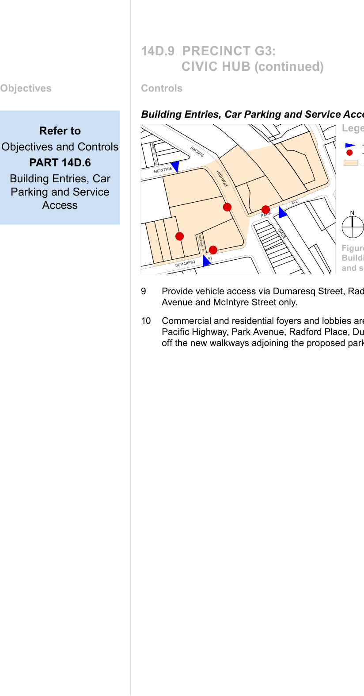

### 17 proposed park on Dumaresq Street.

#### LANE

14 12 10 8 4 2

#### AVE

### *

#### ST JOHNS

#### CHURCH  HILL

### 696 iii)	 Provide active frontage to the Pacific Highway where ever

### - Refer to site specific DCP

### - Proposed road

### - Character item

### - Proposed Community Infrastructure

### possible.

#### HENRY

### iv)	 Provide a landmark corner building on the corner of Pacific

### - Refer to site specific DCP

### - Proposed road

#### AVE

HENRY PASS

### - Proposed Community Infrastructure

### Highway and Park Avenue (No.2 Park Avenue) with active

### frontages.

#### LYNBARA

#### CR

#### OBERON

#### HIGHWAY

#### ST JOHNS

#### AVE

#### RAVENSWOOD

#### ST JOHNS

#### AVE

#### ST

#### YARABAH

#### ORMISTON

#### AVE

1A

#### PACIFIC

#### AVE 42

#### BUSHLANDS

#### BUSHLANDS

16

12

14

#### CECIL

#### AVE

1

673

#### PENNANT

#### BROWNS

#### NOR

18 R. O. W.

#### OTTA

17 6 6A

LINK 20

> [Picture on page 27: a map, saved as a picture (images/part-14d-gordon-local-centre-page-27-5.gif, 150 dpi); the street names and other small labels are on the picture.]
> Words printed on the picture (title and legend, copied from the PDF):
> 4 8 10
> 5 7 9 11
> 2 7 9
> 4 6 8
> 3 5 7 11
> 24 22 20 18
> 82 3.66W PATHWAY
> 6 4 2
> 10 10A AVE
