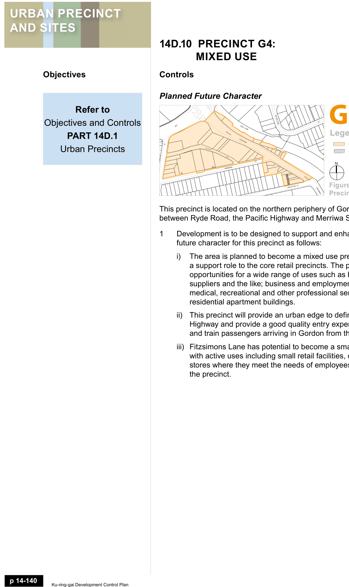
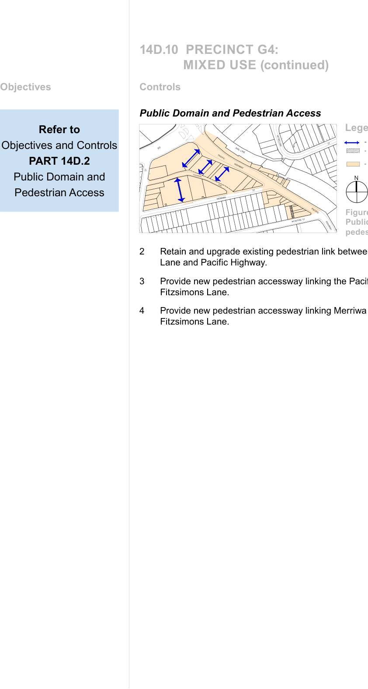

## 53 ST JOHNS

6W

67

#### AVE

#### RAVENSWOOD

#### ST JOHNS

#### AVE

71

69

73

75

62

60

64

66

#### ST

#### ALE

#### YARABAH

43 8

6

#### ORMISTON

#### AVE

1A

### GORDON LOCAL CENTRE

#### PACIFIC

#### AVE 42

#### BUSHLANDS

#### BUSHLANDS

16

12

14

#### CECIL

45 47

#### AVE

56

49

51

673

3

#### PENNANT

#### ST

#### BROWNS

58

#### NORFOL

9A 9A

R. O. W. R. O. W. 41 VAR WIDTH

FITZSIMONS

FITZSIMONS

GARDEN 18

> [Picture on page 28: a map, saved as a picture (images/part-14d-gordon-local-centre-page-28-6.gif, 150 dpi); the street names and other small labels are on the picture.]
> Words printed on the picture (title and legend, copied from the PDF):
> 12 12 3A
> KHARTOUM AVE LANE
> 2 2 14
> ST 1 3
> MANDALAY  PL 7 9
> ST CLIPSHAM LANE
> 12 14 16 18
> ST CLIPSHAM LANE
> 18 18 MT.WILLIAM
> MT.WILLIAM 14 16
> 40 38 36
> 3 3 35A
> 1 1 41 41
> AVE 42 42
> 49 47 45
> 68 66 64
> RD 37A 37A
> 24 24 NORTHCOTE
> 8 1 3
> 700 700 657 657
> ST 694 694
> 7 39 71

GARDEN ROSEDALE

### - Alternate deep soil requirement

### - Alternate deep soil requirement

### G3

### - Nil setback - Alternate deep soil requirement

### 14D.10  PRECINCT G4:

### MIXED USE

11

1

2

32A

### G2

### G2

11A

RD

### Objectives

### Controls

GR

- Private land with public access - Through site link - Land dedication - Primary active frontage - Secondary active frontage

- Private land with public access - Through site link - Land dedication - Primary active frontage - Secondary active frontage 1A

HIGHLANDS   WALK

### G2

- Private land with public access - Through site link - Land dedication - Primary active frontage - Secondary active frontage

6

ST

46

MINNS 59

61

40

44 48

50 52

42

### G1

### G1

### ST.JOHNS Planned Future Character

49 47

53 55

57

51

24

45

RD

22 3

1

20

ST 2

5

18

### PBP

### G1

23

37 39

43 41

M

17

15 30

32

### G5

### G5

32

34

36 38

3

12

16

14

### G5

41

45

43

### - Precinct G1 - Precinct G2 - Precinct G3 - Precinct G4

### - Precinct G1 - Precinct G2 - Precinct G3 - Precinct G4

26

28

24

11

9A

2

## 1 Legend

R. O. W.

### - Precinct G5

### - Precinct G5

6 6A

MEL

4

2A 4

8 10

### - Precinct G1 - Precinct G2 - Precinct G3 - Precinct G4

18

20

22

### AVE - Precinct G5

39

### PART 14D.1

### Urban Precincts HIGHWAY

2A

2

GARDEN

### - Potential relocation of laneway

### to enable lot consolidation

### - Potential relocation of laneway

### to enable lot consolidation

37 14

16

ROSEDALE

1

5

3

### N

### G4

Refer to

### Objectives and Controls

35

### - Potential relocation of laneway

### to enable lot consolidation 24

26

LA BURGOYNE

33

20-22 18 19

21

23

31

15

17

12 29

ROSEDALE

ED

### Figure 14D.10-1:

### Precinct G4

AVE

27

PARK

LANE

4

WERONA

AVE

### This precinct is located on the northern periphery of Gordon Centre

### between Ryde Road, the Pacific Highway and Merriwa Street.

2

AVE

KHARTOUM

LANE

6.1W

LANE

S

## 1 Development is to be designed to support and enhance the planned

### future character for this precinct as follows:

LANE

CLIPSHAM LANE

HIGHWAY

AVE

ST.JOHNS

LANE

CHURCH  HILL

HENRY

HENRY PASS

### i) The area is planned to become a mixed use precinct providing

### a support role to the core retail precincts. The precinct will offer

### opportunities for a wide range of uses such as bulky goods, bulk

suppliers and the like; business and employment related uses;

### medical, recreational and other professional services; as well as

### residential apartment buildings.

### ii)	 This precinct will provide an urban edge to define the Pacific

HIGHWAY

### Highway and provide a good quality entry experience for drivers

### and train passengers arriving in Gordon from the north.

AVE

RAVENSWOOD

AVE

### iii)	 Fitzsimons Lane has potential to become a smaller scale street

ST

### with active uses including small retail facilities, cafes or corner

stores where they meet the needs of employees and residents in

### the precinct.

ST

AVE

1A

PACIFIC

16

10

8

12

14

CECIL

673

3 ST 671

716

9

11

7

5

19 15

17

25 21 30 28

26 24

22

30A 32

HIGHWAY

8

2A

2 4

6

11 9

663

667

669

2B

702 1 3

5 7

BRUCE

30B 30C 32A

6

GREENGATE

ST

17A

700 657

2 698 4 6

15 11

9 7

PACIFIC

2

17

696 655A

6 4 8

14

10 12

3 1 5

23 21

19

3 5

694 GREENGATE

1 1 RICK 1

R R

38C 38C

41 6 VAR WIDTH

RD 287A

MERRIWA

MERRIWA 8

38B 38B

COLLINS

38A 38A

30A 30A

MYRTLE

30A 30A

12 12 3A

MCINTYRE ST

FLINDERS

BURGOYNE 6

7.32 / 3.66 W.

ESMT FOR SERVICES

> [Picture on page 29: a map, saved as a picture (images/part-14d-gordon-local-centre-page-29-20.gif, 150 dpi); the street names and other small labels are on the picture.]
> Words printed on the picture (title and legend, copied from the PDF):
> 38B 36 36
> 3.66W 19 21
> KILLEATON 15 17
> 17 17 107A
> 123 125 127
> 1 33 35
> ST CLIPSHAM LANE
> 4 6 8 10
> 4 7 9
> MANDALAY  PL 1 3
> 1 3 5
> 12 14 16 18
> 22 22 CARLOTTA
> 4 8 10
> 5 5 20
> 4A 4A 8
> 5 7 9 11
> 6 2 2 10
> 4 6 8
> 3 5 7 11
> 18A 20 57 PACIFIC
> 3 3 55
> 40 38 36
> CECIL 6 ST
> AVE 45 45
> 24 22 20 18
> 49 47 45
> 41 41 32
> 68 66 64
> 30 CECIL     WALK
> 673 4 86
> 48 48 23
> 72 696 696
> 7 39 71

MERRIWA

TON

### - Alternate deep soil requirement

COLLINS

### BUILT FORM

53 53

### G2

### G2

- Private land with public access - Land dedication - Primary active frontage - Secondary active frontage

- Private land with public access - Land dedication - Primary active frontage - Secondary active frontage

44

46 44

46

0

#### 40%

### 14D.10  PRECINCT G4:

### MIXED USE (continued)

42A 42A

#### 6m

11

1

2

32A

### G1

### G1

11A

RD

### Objectives

### Controls

GR 1A

### G2

HIGHLANDS   WALK

44

- Private land with public access - Through site link - Land dedication - Primary active frontage - Secondary active frontage

ST

51 51

46

MINNS 59

61

42A

GREEN

40

44 48

50 52

42

55 55

- Primary active frontage - Secondary active frontage - 3 storey street wall - 2m upper level setback above street

### wall height - 4m upper level setback above street wall height

### G5

### G5

7

49 47

53

57

49 47

53

### Public Domain and Pedestrian Access

46 48

44 42

40

46 48

44 42

40

49 47

53 55

57

51

50

24

45

### G1

RD

2 50

22

#### 3m

3

1

20 ST

2

5

#### 2m

### PUBLIC DOMAIN AND PEDESTRIAN

MT.WILLIAM

18

### - Precinct G1 - Precinct G2 - Precinct G3 - Precinct G4

### - Precinct G1 - Precinct G2 - Precinct G3 - Precinct G4

23

#### 3m

37 39

43 41

MIN

17

### 8 8 Legend

#### 3m

### Legend

51

51

### - Precinct G5

### - Precinct G5

#### 40%

WALK

ST JOHNS

WALK

ST JOHNS

#### 10m

15

53 53

30

32

55

51

42

49 47

53

#### 6m

3.66W

PATHWAY

3.66W

PATHWAY

34

36 38

#### 3m

### G5

Refer to

### Objectives and Controls

63 63

12

16

14

#### 3m

46 48

44

42

40

41

45

43

67

65

61

57 59

67

65

61

57 59

26

28

24

### - Potential relocation of laneway

### to enable lot consolidation

### - Potential relocation of laneway

### to enable lot consolidation

11

9A

69

55

2

56 54

52

50 48

46

44

56 54

52

50 48

46

44

ST JOHNS

ST JOHNS

MONA VALE RD

R. O. W.

58 58

### - Precinct G1 - Precinct G2 - Precinct G3 - Precinct G4

6 6A

MELKIN

60 60

4

2A 4

8 10

- Pedestrian through site link - Entry plaza/forecourt - Awnings - Awnings where possible - Colonnade

51

49

### - Precinct G5

10 12 14 16 18

WALK

ST JOHNS

18

20

22

ST JOHNS

53

39

55

### N

40

42

2A

2

GARDEN

### PART 14D.2

Public Domain and

3.66W

PATHWAY 31A 31A

### BUILDING ENTRIES AND CARPAT

35A 35A

37

63

14

16

ROSEDALE

1

5

3

65

61

57 59

7 7

### - Potential relocation of laneway

### to enable lot consolidation

8 8 5 5

35

HNS

### Pedestrian Access

56

54

52

50

48

46

44

6 6

33 33

24

26

58

LA BURGOYNE

3 3

ORMISTON

ORMISTON

33

20-22

39 37

33 35

39 37

33 35

### - Vehicular access to site - Pedestrian access to site

1 1 41 41

18 19

21

23

4

2

4

2

31

AVE

AVE 42 42

BUSHLANDS

BUSHLANDS

15

17

12 29

38

30

38

30

31A

ROSEDALE

35A

EDW

54

50

46 48

44

52 54

50

46 48

44

52

56 56

### HERITATGGEA

AVE

5

### Figure 14D.10-2:

Public domain and

### pedestrian access plan.

33

AVE

27

BROWNS

3

RMISTON 36

PARK

LANE

### - Heritage/character item

39 37

33

31 29

35

1 41

25

2

11 9

9

AVE

16 18

22 24

26 28

20

14 16

18

22 24 20

14

42

BUSHLANDS

WERONA

AVE

38

50

46 48

44

52

AVE

## 2 Retain and upgrade existing pedestrian link between Fitzsimons

### Lane and Pacific Highway.

7

5

3

7

5

3

KHARTOUM

LANE

1 1

BROWNS

6

4

2

12

10

8

6

4

2

12

10

8

6.1W

LANE

RD

BROWNS

RD

BROWNS

ST

15 11 9

16 18

22 24

26 28

20

14 16

LANE

AVE

62

62

## 3 Provide new pedestrian accessway linking the Pacific Highway with

### Fitzsimons Lane.

18 14 12 10 8 4 2

6

55

53

51

49

55

53

51

49

CECIL

CECIL

64

66

68

64

66

68

106

7

5

3

CLIPSHAM LANE

1

6

4

2

12

10

8

AVE

RD

BROWNS

ST.JOHNS
