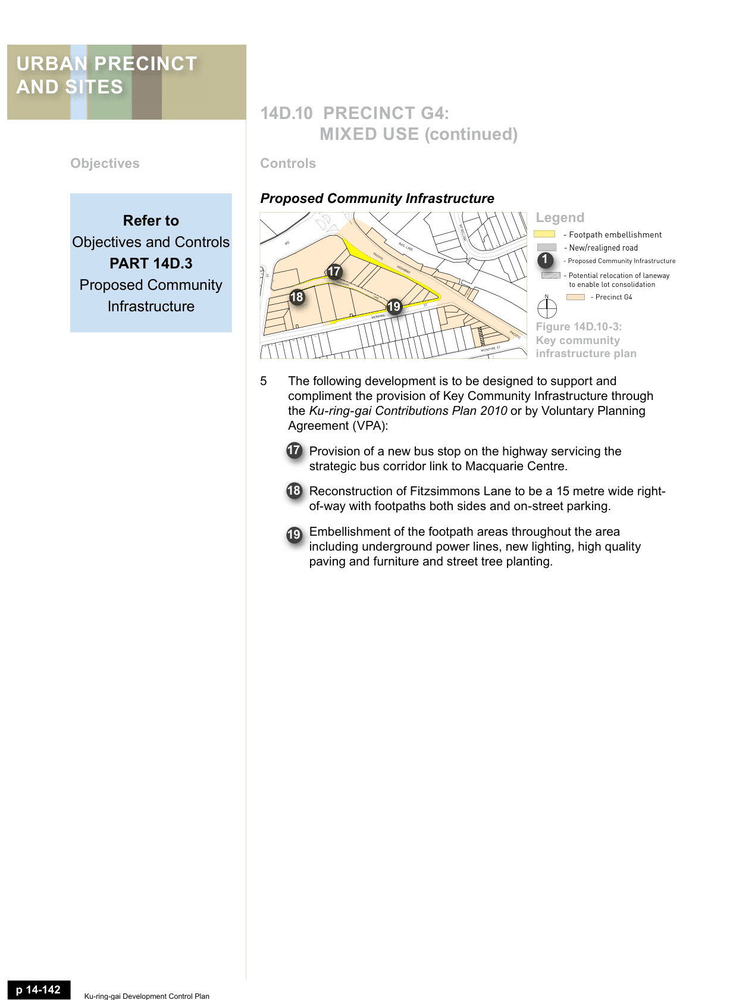
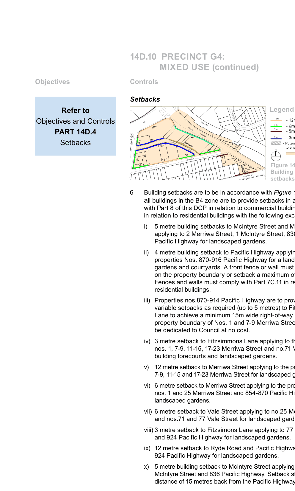

## 4 Provide new pedestrian accessway linking Merriwa Street and

### Fitzsimons Lane.

LANE

62

60

CHURCH  HILL

55

53

51

49

45

CECIL

64

66

68

HENRY

HENRY PASS

M

HIGHWAY

AVE

RAVENSWOOD

AVE

ST

2

ST

AVE

1A

PACIFIC

16

10

8

12

14

CECIL

673

3 ST 671

716

9

11

7

5

19 15

17

8A

25 21 30 28

26 24

22

30A

HIGHWAY

8

2A

2 4

6

11 15 9

663

667

669

2B

702 1 3

5 7

BRUCE

30B 30C

6

GREENGATE

ST

17A

700 657

2 698 4 6

8

15 11

9 7

PACIFIC

2

17

696 7

655A

6 4 8

14

10 12

3 1 5

19

3 5

694 GREENGATE

### GORDON LOCAL CENTRE

> [Picture on page 30: a map, saved as a picture (images/part-14d-gordon-local-centre-page-30-1.gif, 150 dpi); the street names and other small labels are on the picture.]
> Words printed on the picture (title and legend, copied from the PDF):
> PARK DENLEY LANE
> 30A 1 3 5
> MONA VALE RD RD
> 4 8 10
> MONA VALE RD
> 5 7 9 11
> 4 6 8
> 3 5 7 11
> 17 10A RD
> 2 33 35
> 24 22 20 18
> STANLEY 16 12
> 4 6 8
> 3 5 7 11
> 12 14 16 18
> 3 24 26
> 24 22 20 18
> HENRY PASS 6
> AVE 6 32
> 24 22 20 18
> R. O. W.
> AVE 59 5
> 82 3.66W PATHWAY
> 18A 20 5
> 40 38 36
> 37 72 74
> MCINTYRE 4 2
> 18A 20 3
> 49 47 45
> 68 66 64
> 17 4 696

Figure 14D.10-3:

WA N

10 12 14 16 18

### - Continuous awnings - Continuous awnings where possible - Continuous colonnade

### BUILDING ENTRIES AND CARPAT

#### 3m

### - Vehicular access to site - Pedestrian access to site

### - Continuous awnings - Continuous awnings where possible - Continuous colonnade

10 12 14 16 18

### G3

### - 10m setback - 6m setback - 3m setback - Nil setback - Alternate deep soil requirement

### 14D.10  PRECINCT G4:

### MIXED USE (continued)

### G2

### - Vehicular access to site - Pedestrian access to site 11

### BUILDING ENTRIES AND CARPAT

- Private land with public access - Through site link - Land dedication - Primary active frontage - Secondary active frontage

### HERITATGGEA

10 12 14 16 18

### - Heritage item

### Objectives

### Controls

### KEY COMMUNITY INFRASTRUCTRE

### - Vehicular access to site - Pedestrian access to site

### G1

### - Landmark building

### G2

### *

### Proposed Community Infrastructure

- Private land with public access - Through site link - Land dedication - Primary active frontage - Secondary active frontage

### KEY COMMUNITY INFRASTRUCTRE

### - Character item

### G5 26

### Legend

38 36 34 32 28 24 22 20 18 14 12 10 8 4 2

### G1

### - Precinct G1 - Precinct G2 - Precinct G3 - Precinct G4

Refer to

### Objectives and Controls

### - Refer to site specific DCP

### - Proposed road

### - Precinct G5

### - Proposed Community Infrastructure

### 1

### G5 86

### 17

- Footpath embellishment - New or existing park to be upgraded - Historic/character building to be retained - New/realigned road - Proposed pedestrian promenade - New community facility - Landscaping

### - Potential relocation of laneway

### to enable lot consolidation

4

### PART 14D.3

### Proposed Community

#### N

### - Precinct G1 - Precinct G2 - Precinct G3 - Precinct G4

1

### 18

### - Precinct G5

### 19

- Footpath embellishment - New or existing park to be upgraded - Historic/character building to be retained - New/realigned road - Proposed pedestrian promenade - New community facility - Landscaping

### Infrastructure

18 14 12 10 8 4 2

### - Potential relocation of laneway

### to enable lot consolidation

6

### Key community

### infrastructure plan

## 5 The following development is to be designed to support and

### compliment the provision of Key Community Infrastructure through

### the Ku-ring-gai Contributions Plan 2010 or by Voluntary Planning

### Agreement (VPA):

### 17

Provision of a new bus stop on the highway servicing the

### strategic bus corridor link to Macquarie Centre.

### 694 18

### Reconstruction of Fitzsimmons Lane to be a 15 metre wide right-

### of-way with footpaths both sides and on-street parking.

### 19

### Embellishment of the footpath areas throughout the area

### including underground power lines, new lighting, high quality

### paving and furniture and street tree planting.

2

> [Picture on page 31: a map, saved as a picture (images/part-14d-gordon-local-centre-page-31-1.gif, 150 dpi); the street names and other small labels are on the picture.]
> Words printed on the picture (title and legend, copied from the PDF):
> 45 R. O. W.
> 17 6 6A
> MT.WILLIAM MT.WILLIAM 14 16
> 18 19 21
> 4 7 9
> 27 25 23
> 12 14 16
> 21 19 17
> 27 25 23
> 27 25 23
> 26 24 22
> 21 19 17
> 21 19 17
> 12 10 8
> 26 24 22
> 26 24 22
> 27 25 23
> 12 10 8
> 12 10 8
> 21 19 17
> 26 24 22
> 7.32 / 3.66 W.
> ESMT FOR SERVICES
> 18 16 258 266
> 6 ST JOHNS
> 7.32 / 3.66 W.
> ESMT FOR SERVICES
> ESMT FOR SERVICES
> 7.32 / 3.66 W.
> ESMT FOR SERVICES
> 101 103 105
> 101 103 105
> 101 103 105
> 123 125 127
> 123 125 127
> 101 103 105
> 123 125 127
> 58 34 32
> ST 26 26A
> 123 125 127
> 4 6 8 10
> 673 58 56
> 4 6 8 10
> 4 6 8 10
> 1 3 5
> CR 1 3 5
> 1 3 5
> 4 6 8 10
> 1 3 5
> 29 39 12
> 4 8 10
> DENLEY LANE 16
> 4 8 10
> 4 8 10
> 5 7 9 11
> 5 7 9 11
> 5 7 9 11
> 4 8 10
> 5 7 9 11
> 4 6 8
> 4 6 8
> 4 6 8
> 3 5 7 11
> 3 5 7 11
> 3 5 7 11
> 4 6 8
> 3 5 7 11
> ST ST JOHNS
> ST ST AVE
> 24 22 20 18
> 24 22 20 18
> 9 16 12
> 3 26 81
> 24 22 20 18
> BYRON 5 14
> 93 1 80
> 27 8 10
> 9 PL 3
> 3 72 15
> 7 3.66W PATHWAY
> 22 3 48
> 45 48 CL

### 14D.10  PRECINCT G4:

### MIXED USE (continued)

43

11

### G3

### - 10m setback - 6m setback - 3m setback - Nil setback - Alternate deep soil requirement

1

2

11A

### G2

GR

### ALIGNMENT AND SETBACKS

1A

- Private land with public access - Through site link - Land dedication - Primary active frontage - Secondary active frontage

HIGHLANDS   WALK

### Objectives

### Controls 2
