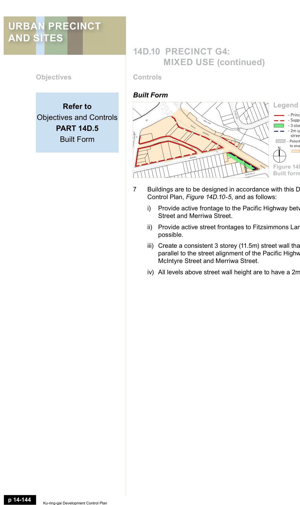

### 64 vi)	 6 metre setback to Merriwa Street applying to the properties

### - Refer to site specific DCP

### - Proposed road

HIGHWAY

2A

#### LYNBARA

#### LYNBARA

663

667

669

### - Proposed Community Infrastructure

2B

702

1

BRUCE

30B 30C 32A

#### LYNBARA

nos. 1 and 25 Merriwa Street and 854-870 Pacific Highway for

### landscaped gardens.

### vii)	 6 metre setback to Vale Street applying to no.25 Merriwa Street ST

17A

700 657

2 698

### and nos.71 and 77 Vale Street for landscaped gardens.

15

11

9

7 PACIFIC

17

696 655A

6 4 8

14

10 12

3 1 5

23 21

19

694

### viii)	3 metre setback to Fitzsimons Lane applying to 77 Vale Street GORDON LOCAL CENTRE

### and 924 Pacific Highway for landscaped gardens.

ix)	 12 metre setback to Ryde Road and Pacific Highway applying to

## 924 Pacific Highway for landscaped gardens.

### x)	 5 metre building setback to McIntyre Street applying to no.1

McIntyre Street and 836 Pacific Highway. Setback starts at a

### distance of 15 metres back from the Pacific Highway property line.

A

HWAY

MELKI

GHWAY

28 30 32 34 36

17 19 21 23 25

46 MINNS

CARLOTTA

S

> [Picture on page 32: a map, saved as a picture (images/part-14d-gordon-local-centre-page-32-10.gif, 150 dpi); the street names and other small labels are on the picture.]
> Words printed on the picture (title and legend, copied from the PDF):
> 3 4 35
> 40 38 36
> 7.32 / 3.66 W.
> ESMT FOR SERVICES
> 2 7 9
> 49 47 45
> MCINTYRE 58 56
> 68 66 64
> 101 103 105
> 12 14 16 18
> 55 123 125 127
> 2 47 49
> CHURCH  HILL PACIFIC
> ST CLIPSHAM LANE
> 4 6 8 10
> 1 3 5
> 4 8 10
> 40 38 36
> PL 67 65
> 5 7 9 11
> 64 34 32
> MONA VALE RD
> 4 6 8
> 49 47 45
> MCINTYRE 58 56
> 3 5 7 11
> 68 66 64
> 9 1 3
> 3 5 15
> 3 5 43
> ST 3.66W PATHWAY

Figure 14D.10-5:
