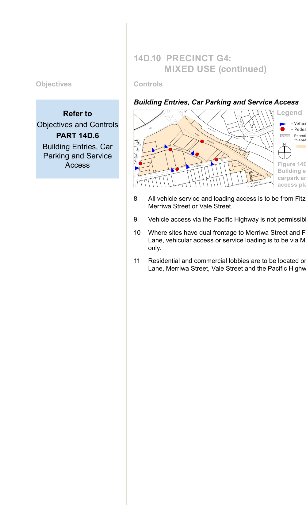

### 5 iii)	 Create a consistent 3 storey (11.5m) street wall that is built

ST.JOHNS

LANE

### - Landmark building

CHURCH  HILL

### parallel to the street alignment of the Pacific Highway between

### McIntyre Street and Merriwa Street. *

HENRY

### - Character item

### iv)	 All levels above street wall height are to have a 2m setback.

HENRY PASS

8 14 12 10 8 4 2

HIGHWAY

### - Refer to site specific DCP

### - Proposed road - Proposed Community Infrastructure

AVE

RAVENSWOOD

AVE

AVE

1A

PACIFIC

16

14

CECIL

673

3 ST 671

716

9

11

7

5

19 15

17

30 28

26 24

22

30A

HIGHWAY

2A

2

663

667

669

2B

702 1 3

5

BRUCE

30B 30C 32A

ST

17A

700 657

2 698

15

11

9 7

PACIFIC

17

696 655A

6 4 8

14

10 12

3 1 5

19

694 GREENGA

> [Picture on page 33: a map, saved as a picture (images/part-14d-gordon-local-centre-page-33-1.gif, 150 dpi); the street names and other small labels are on the picture.]
> Words printed on the picture (title and legend, copied from the PDF):
> 30 9 9A
> CR 16 16A
> 4 8 10
> LAWSON 33 35
> 5 7 9 11
> LANE MANDALAY  PL
> 4 6 8
> 3 5 7 11
> RAIL LINE ST
> 10 90 HENRY PASS
> 24 22 20 18
> 1 HIGHWAY 16
> IKARA 1 40 38 36
> 49 47 45
> 25 21 55
> 3.66W PATHWAY 58 56
> 68 66 64

Figure 14D.10-6:

2 4 6 8 10

#### 6m RADFORD

### street wall height

#### 3m

### LN G3

#### 2m

### PUBLIC DOMAIN AND PEDESTRIAN

### - 3m setback - Nil setback - Alternate deep soil requirement

54

#### 3m

#### 3m

### G2
