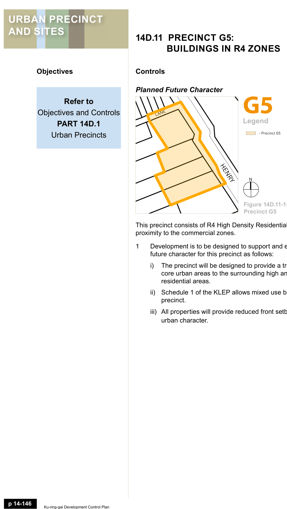

## 11 Residential and commercial lobbies are to be located on Fitzsimons

### Lane, Merriwa Street, Vale Street and the Pacific Highway.

HENRY

HENRY PASS

HIGHWAY

AVE

RAVENSWOOD

AVE

AVE

PACIFIC

16

CECIL

673

3 ST 671

716

9

11

7

5

19 15

17

30 28

26 24

22

30A

HIGHWAY

2A

663

667

669

2B

702

1

BRUCE

30B 30C 32A

ST

17A

700 657

2 698

15

11

9 7

PACIFIC

17

696 655A

6 4 8

14

10 12

3 1 5

23 21

19

694 GR

### GORDON LOCAL CENTRE

41 VAR WIDTH

### IC

> [Picture on page 34: a map, saved as a picture (images/part-14d-gordon-local-centre-page-34-3.gif, 150 dpi); the street names and other small labels are on the picture.]
> Words printed on the picture (title and legend, copied from the PDF):
> ST CLIPSHAM LANE
> LAGONDA AVE 42

Figure 14D.11-1:

### LANE 39

### G3

### - Nil setback - Alternate deep soil requirement

### CLIPSHAM LANE

### 14D.11  PRECINCT G5:

### BUILDINGS IN R4 ZONES

### Objectives

### Controls 7 9

### G2

### AVE

- Private land with public access - Through site link - Land dedication - Primary active frontage - Secondary active frontage

### Planned Future Character

### G1

### ST.JOHNS

### LANE

### LANE

### G5

### AVE

### G5

Refer to

### Objectives and Controls
