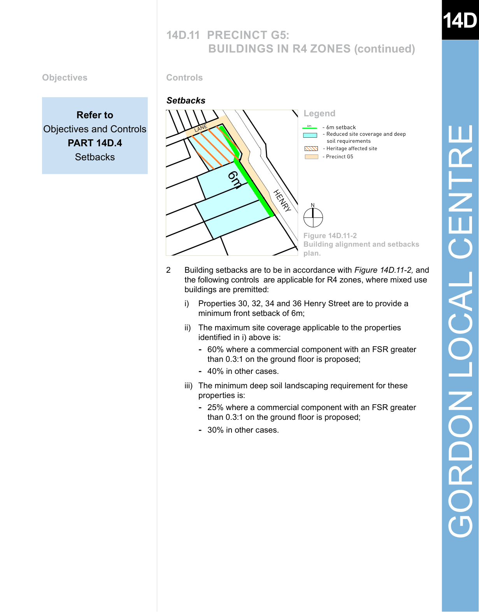

## 12 Legend

### - Precinct G1 - Precinct G2 - Precinct G3 - Precinct G4 - Precinct G5

0

### CHURCH  HILL

### PART 14D.1

### Urban Precincts

### - Potential relocation of laneway

### to enable lot consolidation

### N

### HENRY

#### HENRY PASS

### Precinct G5

### This precinct consists of R4 High Density Residential zones within close

### proximity to the commercial zones.

## 1 Development is to be designed to support and enhance the planned

### future character for this precinct as follows:

### HIGHWAY

i) The precinct will be designed to provide a transition from the

### core urban areas to the surrounding high and medium density

### residential areas.

### ii)	 Schedule 1 of the KLEP allows mixed use buildings within this

### precinct.

iii)	 All properties will provide reduced front setbacks to enhance the

### urban character.

### AVE

### RAVENSWOOD

### AVE

### YARABAH

D

23 (Howard)

### FIC

HAVILAH

#### 4-5m

TRYON

35 LANE RD

#### 4-5m

SHORT

L

### - Primary active frontage - Secondary active frontage

> [Picture on page 35: a map, saved as a picture (images/part-14d-gordon-local-centre-page-35-13.gif, 150 dpi); the street names and other small labels are on the picture.]
> Words printed on the picture (title and legend, copied from the PDF):
> 4 8 10
> 5 7 9 11
> TRAFALGAR 7 9
> 4 6 8
> 27 25 23
> 3 5 7 11
> 21 19 17
> 26 24 22
> 12 10 8
> 20 AVE LANE
> ST 47 49
> 7.32 / 3.66 W.
> ESMT FOR SERVICES
> 24 22 20 18
> 101 103 105 107
> 123 125 127
> 1-3 5 7
> 4 6 8 10
> 1 3 5
> 2-8 3-11 16
> 4 8 10
> 5 7 9 11
> 4 6 8
> 3 5 7 11
> 24 22 20 18
> 82 3.66W PATHWAY
> IKARA 1 80
> 6 4 2
> 1 7 3.66W PATHWAY

Figure 14D.11-2

#### 6m

#### 6m 2m

### PUBLIC DOMAIN AND PEDESTRIAN

#### 3m

#### WADE 3m

E

#### PL 10m

### CLIPSHAM LANE
