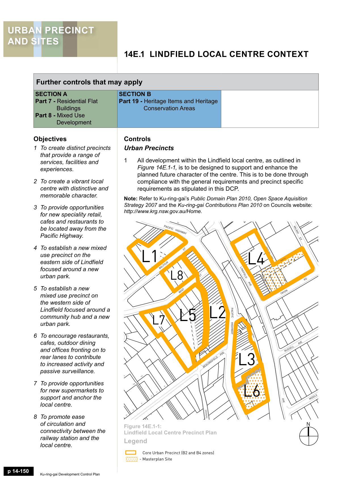

#### 14E		 Lindfield Local Centre

14E.1	 	Lindfield Local Centre Context 14E.2	 	Public Domain and Pedestrian Access 14E.3	 	Proposed Community Infrastructure 14E.4	 	Setbacks 14E.5	 	Built Form 14E.6	 	Building Entries, Car Parking and Service Access 14E.7	 	Precinct L1: Balfour Street Retail Area 14E.8	 	Precinct L2: Pacific Highway Retail Area 14E.9	 	Precinct L3: Tryon Place Mixed Use Area 14E.10		Precinct L4: Tryon Road and Lindfield Avenue Retail

Area

14E.11	 	Precinct L5: Lindfield Community Hub 14E.12		Precinct L6: 259-271 Pacific Highway, Lindfield 14E.13		Precinct L7: Buildings in R4 Zones 14E.14		Precinct L8: Buildings in R4 Zones

### LINDFIELD LOCAL CENTRE

> [Picture on page 2: a map, saved as a picture (images/part-14e-lindfield-local-centre-page-2-1.gif, 150 dpi); the street names and other small labels are on the picture.]
> Words printed on the picture (title and legend, copied from the PDF):
> services, facilities and
> 20 22 24 28 30
> ALIGNMENT AND SETBACKS
> centre with distinctive and
> 38 42 44 46 50
> RD 17 26
> Note: Refer to Ku-ring-gai’s Public Domain Plan 2010, Open Space Aquisition
> Strategy 2007 and the Ku-ring-gai Contributions Plan 2010 on Councils website:
> 3	 To provide opportunities
> for new speciality retail,
> cafes and restaurants to
> - 15m setback
> - 12m setback
> - 10m setback
> - 6m setback
> - 5m setback
> - 4m setback
> - 3m setback
> - 2m setback
> - Land dedication
> - Alternate deep soil requirement
> 1 ( UNFORMED )
> use precinct on the
> eastern side of Lindfield
> focused around a new
> - Primary active frontage
> - Secondary active frontage
> - 3 storey street wall
> - 2m upper level setback above street
> - 4m upper level setback above street
> PUBLIC DOMAIN AND PEDESTRIAN
> mixed use precinct on
> the western side of
> Lindfield focused around a
> 1B 33 48
> BENT 40 51
> - Through site link
> - Entry plaza/forecourt
> - Continuous awnings
> - Continuous awnings where possible
> - Continuous colonnade
> BUILDING ENTRIES AND CARPAT
> 6	 To encourage restaurants,
> cafes, outdoor dining
> rear lanes to contribute
> to increased activity and
> 36 9 19A 15A
> - Vehicular access to site
> - Pedestrian access to site
> 7	 To provide opportunities
> for new supermarkets to
> support and anchor the
> B2 Local Centre Development
> 21 19 17
> Site access points
> 26 Pedestrian access
> 12 10 8
> Lindfield Local Centre Precinct Plan
> 8	 To promote ease
> of circulation and
> connectivity between the
> railway station and the
> Core Urban Precinct (B2 and B4 zones)
> - Fringe Urban Precinct (R4 zone)
> - Masterplan Site
> 28A Precinct Number
> - Precinct S1
> - Precinct S2
> - Precinct S3

Figure 14E.1-1, is to be designed to support and enhance the

Figure 14E.1-1:
