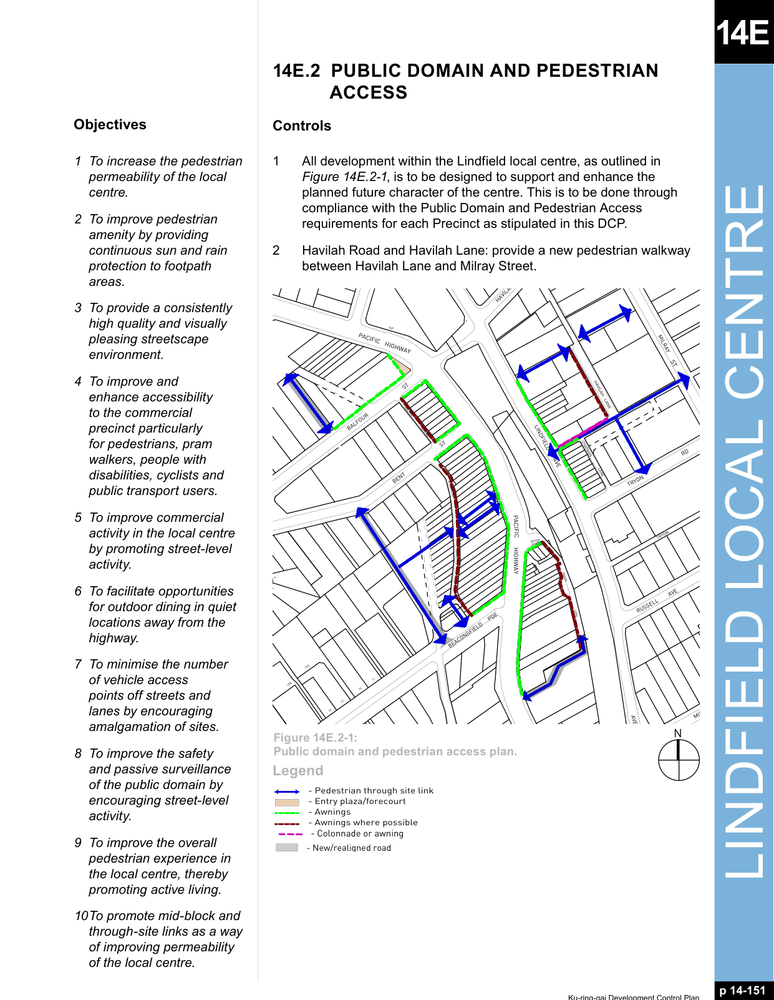

### 14E.1  LINDFIELD LOCAL CENTRE CONTEXT

11

#### Further controls that may apply

5

#### SECTION B

Part 19 - Heritage Items and Heritage

#### SECTION A

Part 7 - Residential Flat

Part 8 - Mixed Use

#### Controls Urban Precincts

11A

70

#### Objectives

1	 To create distinct precincts

that provide a range of

A

1 All development within the Lindfield local centre, as outlined in

planned future character of the centre. This is to be done through

compliance with the general requirements and precinct specific

requirements as stipulated in this DCP.

2	 To create a vibrant local

LA

A

16

be located away from the

### L1

### L4

4	 To establish a new mixed

### L8

### L2

### L5

### L7

5	 To establish a new

community hub and a new

5

### L3

and offices fronting on to

### L6

#### Legend

E

STRICK

11 LLEW

LLEWELLYN

D

MACKENZIE

TR

TREATTS

BLENHEIM

> [Picture on page 3: a map, saved as a picture (images/part-14e-lindfield-local-centre-page-3-5.gif, 150 dpi); the street names and other small labels are on the picture.]
> Words printed on the picture (title and legend, copied from the PDF):
> permeability of the local
> 2	 To improve pedestrian
> amenity by providing
> continuous sun and rain
> protection to footpath
> high quality and visually
> 21 19 17
> 12 10 8 6
> ALIGNMENT AND SETBACKS
> 20 22 24 28 30
> 32 34 10
> ALIGNMENT AND SETBACKS
> - 10m setback
> - 6m setback
> - 3m setback
> - Nil setback
> - Land dedication
> - Alternate deep soil requirement
> 38 42 44 46 50
> 4	 To improve and
> to the commercial
> for pedestrians, pram
> walkers, people with
> disabilities, cyclists and
> public transport users.
> ALIGNMENT AND SETBACKS
> 101 103 105
> 15 11 7 5
> GARRICK 1 272
> 12 10 8
> 123 125 127
> 5	 To improve commercial
> by promoting street-level
> 4 6 8 10
> - Primary active frontage
> - Secondary active frontage
> - 3 storey street wall
> - 2m upper level setback above street
> - 4m upper level setback above street
> 1 3 5
> - 15m setback
> - 12m setback
> - 10m setback
> - 6m setback
> - 5m setback
> - 4m setback
> - 3m setback
> - 2m setback
> - Land dedication
> - Alternate deep soil requirement
> 1 ( UNFORMED )
> PUBLIC DOMAIN AND PEDESTRIAN
> 101 103 105
> - 15m setback
> - 12m setback
> - 10m setback
> - 6m setback
> - 5m setback
> - 4m setback
> - 3m setback
> - 2m setback
> - Land dedication
> - Alternate deep soil landscaping
> (% of site)
> 6	 To facilitate opportunities
> locations away from the
> highway. 117 56A
> 51 123 125 127
> 152 19A 15A
> 1 4 8 10
> 5 7 9 11
> - Through site link
> - Entry plaza/forecourt
> - Continuous awnings
> - Continuous awnings where possible
> - Continuous colonnade
> 4 6 8 10
> BUILDING ENTRIES AND CARPAT
> 2 1 3 5 21
> 10 12 14 16 18
> 4 6 8
> of vehicle access
> points off streets and
> lanes by encouraging
> amalgamation of sites.
> - Primary active frontage
> - Secondary active frontage
> - 3 storey street wall
> - 2m upper level setback above street
> - 4m upper level setback above street
> 16 15 19
> 3 5 7 11
> - Vehicular access to site
> - Pedestrian access to site
> - Primary active frontage
> - Secondary active frontage
> - 3 storey street wall
> - 2m upper level setback above street
> - 4m upper level setback above street
> Public domain and pedestrian access plan.
> PUBLIC DOMAIN AND PEDESTRIAN
> PUBLIC DOMAIN AND PEDESTRIAN
> KEY COMMUNITY INFRASTRUCTRE
> 4 8 10
> 5 7 9 11
> VEN 6 RUSSELL
> and passive surveillance
> - Through site link
> - Entry plaza/forecourt
> - Continuous awnings
> - Continuous awnings where possible
> - Pedestrian through site link
> - Entry plaza/forecourt
> - Awnings where possible
> Colonnade or awning
> 10 12 14 16 18
> 4 6 8
> 4 - Continuous colonnade
> 3 5 7 11
> BUILDING ENTRIES AND CARPAT
> BUILDING ENTRIES AND CARPAT WAY
> 3.66W PATHWAY 18
> - Footpath embellishment
> - New or existing park to be upgraded
> - Historic/character building to be
> - New/realigned road
> - Proposed pedestrian promenade
> - New community facility
> - Vehicular access to site
> - Pedestrian access to site
> pedestrian experience in
> the local centre, thereby
> promoting active living.
> - Vehicular access to site
> - Pedestrian access to site
> 45 2 38
> 4 - Refer to Site Specific DCP for Precinct 5
> 10 6 3.66W PATHWAY
> - Heritage/character item
> 1-3 5 7
> 7 3.66W PATHWAY
> of improving permeability
> of the local centre.
> 3.66W PATHWAY 18

Figure 14E.2-1, is to be designed to support and enhance the

Figure 14E.2-1:
