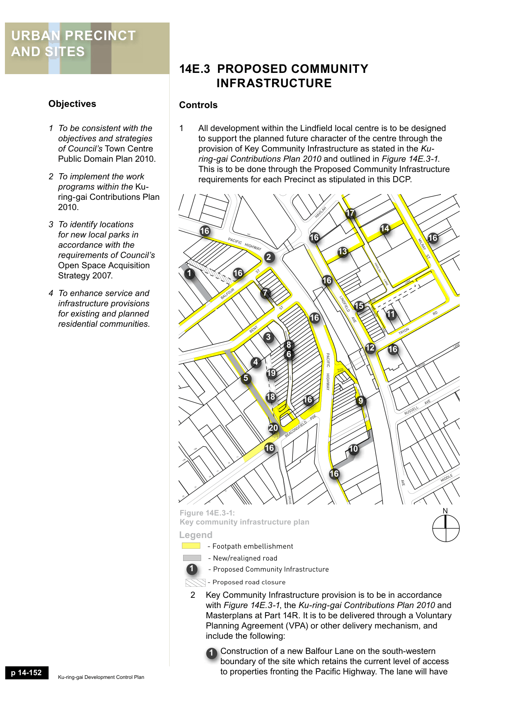

### 14E.2  PUBLIC DOMAIN AND PEDESTRIAN

### ACCESS

#### Controls

2A

19

1	 To increase the pedestrian

1 All development within the Lindfield local centre, as outlined in

planned future character of the centre. This is to be done through

compliance with the Public Domain and Pedestrian Access

requirements for each Precinct as stipulated in this DCP. 2 Havilah Road and Havilah Lane: provide a new pedestrian walkway

between Havilah Lane and Milray Street.

3	 To provide a consistently

0

9A

8

21

activity in the local centre

for outdoor dining in quiet

7	 To minimise the number

54

Y

#### Legend

#### Legend

8	 To improve the safety

of the public domain by

### LINDFIELD LOCAL CENTRE

9	 To improve the overall

LE

10	To promote mid-block and

through-site links as a way

WAIMEA

GREVILLEA

CHELMSFORD

26A AVE 1

3.66W PATHWAY

CLANVILLE

LANCASTER

6 CL

MARIANA

2 L

STRICKLAND

K

ADSTONE

TREATTS

> [Picture on page 4: a map, saved as a picture (images/part-14e-lindfield-local-centre-page-4-2.gif, 150 dpi); the street names and other small labels are on the picture.]
> Words printed on the picture (title and legend, copied from the PDF):
> ALIGNMENT AND SETBACKS
> - 9m setback
> - 15m setback
> - 13m setback
> GARRICK 1 272
> 12 10 8
> - 12m setback
> - 11m setback
> objectives and strategies
> of Council’s Town Centre
> Public Domain Plan 2010.
> 12 10 8 6
> ALIGNMENT AND SETBACKS
> 4 RD 287A
> 101 103 105
> programs within the Ku-
> ring-gai Contributions Plan
> - 10m setback
> - 6m setback
> - 5m setback
> - 4m setback
> - 3m setback
> - 2m setback
> - Land dedication
> - Alternate deep soil landscaping
> (% of site)
> ALIGNMENT AND SETBACKS
> RD 4 RD 287A
> 123 125 127
> - 10m setback
> - 6m setback
> - 3m setback
> - Nil setback
> - Land dedication
> - Alternate deep soil requirement
> 4 6 8 10 1
> ALIGNMENT AND SETBACKS
> 3	 To identify locations
> accordance with the
> requirements of Council’s
> Open Space Acquisition
> - Principal active frontage
> - Supporting active frontage
> - 3 storey street wall
> - 2m upper level setback above
> 97 38 42 44 46
> - 10m setback
> - 6m setback
> - 3m setback
> - Nil setback
> - Land dedication
> - Alternate deep soil requirement
> 101 103 105
> 1 3 5
> 107A 11 15
> 9 113 115
> - 4m upper level setback above
> 123 125 127
> 101 103 105
> street wall height
> 123 125 127
> PUBLIC DOMAIN AND PEDESTRIAN
> for existing and planned
> 5 7 9 11
> 4 6 8 10
> - Primary active frontage
> - Secondary active frontage
> - 3 storey street wall
> - 2m upper level setback above street
> - 4m upper level setback above street
> wall height 6
> 1 3 5
> - 15m setback
> - 12m setback
> - 10m setback
> - 6m setback
> - 5m setback
> - 4m setback
> - 3m setback
> - 2m setback
> - Land dedication
> - Alternate deep soil requirement
> 1 ( UNFORMED )
> PUBLIC DOMAIN AND PEDESTRIAN
> 4 6 8 10
> - Primary active frontage
> - Secondary active frontage
> - 3 storey street wall
> - 2m upper level setback above street
> - 4m upper level setback above street
> - Pedestrian through site link
> - Entry plaza/forecourt
> - Awnings where possible
> 10 12 14 16 18
> 4 6 8
> CATHERINE 1 3 5
> 51 15 19
> 3 5 7 11
> 4 PUBLIC DOMAIN AND PEDESTRIAN
> BUILDING ENTRIES AND CARPAT
> 5 7 9 11
> - Vehicular access to site
> - Pedestrian access to site
> - Through site link
> - Entry plaza/forecourt
> - Continuous awnings
> - Continuous awnings where possible
> - Continuous colonnade
> 55 22 16
> 5 7 9 11
> 19A 15A BUILDING ENTRIES AND CARPAT
> - Through site link
> - Entry plaza/forecourt
> - Continuous awnings
> - Continuous awnings where possible
> - Continuous colonnade
> - Primary active frontage
> - Secondary active frontage
> - 3 storey street wall
> - 2m upper level setback above street
> - 4m upper level setback above street
> 10 12 14 16 18
> 4 6 8
> - Heritage item
> PUBLIC DOMAIN AND PEDESTRIAN
> BUILDING ENTRIES AND CARPAT
> 3 5 7 11
> - Vehicular access to site
> - Pedestrian access to site
> 10 12 14 16 18
> 4 6 8
> 3 5 7 11
> - Landmark building
> - Vehicular access to site
> - Pedestrian access to site
> KEY COMMUNITY INFRASTRUCTRE
> - Through site link
> - Entry plaza/forecourt
> - Continuous awnings
> - Continuous awnings where possible
> - Continuous colonnade
> Key community infrastructure plan
> - Character item
> KEY COMMUNITY INFRASTRUCTRE
> BUILDING ENTRIES AND CARPAT
> - Vehicular access to site
> - Pedestrian access to site
> - Refer to site specific DCP
> - Proposed road
> 76 3.66W PATHWAY
> - Proposed Community Infrastructure
> - Proposed road closure
> - Footpath embellishment
> - New or existing park to be upgraded
> - Historic/character building to be
> - New/realigned road
> - Proposed pedestrian promenade
> - New community facility
> AVE 34 34B
> - Footpath embellishment
> - New or existing park to be upgraded
> - Historic/character building to be
> - New/realigned road
> - Proposed pedestrian promenade
> - New community facility
> 1-3 5 7
> include the following:

Figure 14E.3-1:

3
