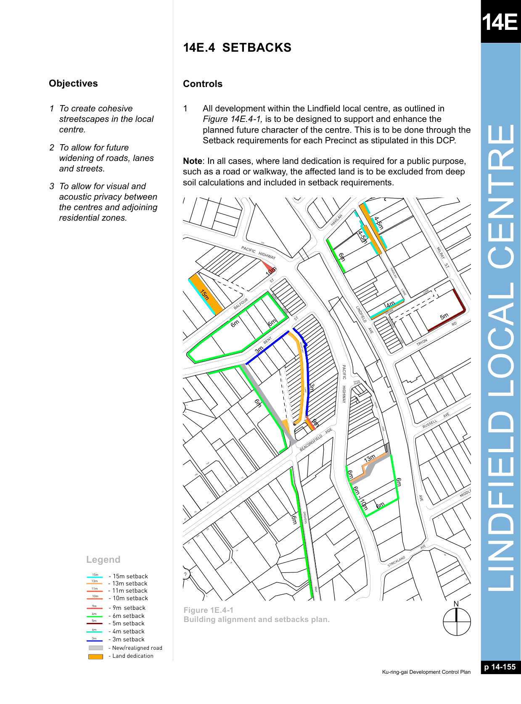

### 14E.3  PROPOSED COMMUNITY

### INFRASTRUCTURE

#### Controls

2A

9

1	 To be consistent with the

1 All development within the Lindfield local centre is to be designed

to support the planned future character of the centre through the

provision of Key Community Infrastructure as stated in the Ku-

ring-gai Contributions Plan 2010 and outlined in Figure 14E.3-1.

This is to be done through the Proposed Community Infrastructure

requirements for each Precinct as stipulated in this DCP.

2	 To implement the work

for new local parks in

MONA

9A

4	 To enhance service and

RD

### *

#### Legend

11

2 Key Community Infrastructure provision is to be in accordance

with Figure 14E.3-1, the Ku-ring-gai Contributions Plan 2010 and

Masterplans at Part 14R. It is to be delivered through a Voluntary

Planning Agreement (VPA) or other delivery mechanism, and

Construction of a new Balfour Lane on the south-western

boundary of the site which retains the current level of access

to properties fronting the Pacific Highway. The lane will have

### 14E.3  PROPOSED COMMUNITY

### INFRASTRUCTURE (continued)

#### Objectives

#### Controls

footpaths both sides of the carriageway and include a landscape

zone with significant screen planting along the western edge side

of the lane. (Land dedicated to Council as part of site redevelop-

ment).

#### 2

Extend right turn bay on Pacific Highway and Balfour Street/

Havilah Road intersection. 3 A community park on Bent Street of minimum 3,000m2 in size.

It is to include a large open space with deep soil planting on the

north eastern corner of the site fronting Bent Street and Wood-

ford Lane, play space and flexible open space. 4 A new multi-purpose community building including a library, child

care centre, and community facility. 5 Realignment of Drovers Way to create a new 15.0m wide two-

way street providing a link from Bent Street to Beaconsfield

Parade and including on-street parking and access to basement

parking. A new kiss-and-ride zone and taxi ranks on Woodford Lane.

#### 6

7 Upgrade and widening of Bent Lane including new footpaths. 8 Upgrade and widening of Woodford Lane including new foot-

paths, parking and access to basement parking and loading/

service access for Pacific Highway Properties. 9 Tryon Lane is retained and improved with new footpaths and car

parking. 10 Construction of new 13.0m wide two way lane with footpath

between Pacific Highway and Tryon Lane (land dedicated

to Council as part of site redevelopment). The road is to be

designed as a high quality accessway with broad footpaths on

both sides of the carriageway. 11 Creation of new Village Green on Council car park precinct

incorporating public basement car parking and commuter

carpark spaces (to be funded by Transport for NSW). 12 Installation of new traffic signals at the intersection of Tryon

Road and Lindfield Avenue (and removal of existing pedestrian

activated traffic signals on Lindfield Avenue). A new pedestrian lane way from Lindfield Ave to Havilah Road.

#### 13

A new pedestrian lane way from Havilah Lane to Milray Street.

#### 14

Modifications to pedestrianise Kochia Lane (part).

#### 15 16

### LINDFIELD LOCAL CENTRE

Embellishment of the footpath areas and public domain through-

out the area including underground power lines, new lighting,

high quality paving and furniture and street tree planting. 17 Upgrade and widening of Havilah Lane including new footpaths

(additional land dedicated to Council as part of redevelopment of

adjoining sites).

### 14E.3  PROPOSED COMMUNITY

### INFRASTRUCTURE (continued)

#### Objectives

#### Controls

#### 18

Construction of new commuter car park spaces (to be funded by

Transport for NSW) and a new kiss and ride area, public park-

ing, and additional parking associated with newly proposed land

uses.

#### 19

A civic plaza area with public seating and outdoor dining oppor-

tunities. A new pocket park to protect existing Tallow-wood tree.

#### 20

KIAMALA

NORTHCOTE

CR

A2

TREATTS

> [Picture on page 7: a map, saved as a picture (images/part-14e-lindfield-local-centre-page-7-6.gif, 150 dpi); the street names and other small labels are on the picture.]
> Words printed on the picture (title and legend, copied from the PDF):
> 1	 To create cohesive
> streetscapes in the local
> widening of roads, lanes
> acoustic privacy between
> the centres and adjoining
> ALIGNMENT AND SETBACKS
> - 10m setback
> - 6m setback
> - 3m setback
> - Nil setback
> - Land dedication
> - Alternate deep soil requirement
> ST 123 125 127
> 2 4 6 8 10 PL
> - Primary active frontage
> - Secondary active frontage
> - 3 storey street wall
> - 2m upper level setback above street
> - 4m upper level setback above street
> FRANCES 1 3 5
> PUBLIC DOMAIN AND PEDESTRIAN
> 6m - 10m
> 4 8 10
> 5 7 9 11
> - Through site link
> - Entry plaza/forecourt
> - Continuous awnings
> - Continuous awnings where possible
> - Continuous colonnade
> ALIGNMENT AND SETBACKS
> ALIGNMENT AND SETBACKS
> ALIGNMENT AND SETBACKS
> - 9m setback
> 51 53 BUILDING ENTRIES AND CARPAT
> ALIGNMENT AND SETBACKS
> - 9m setback
> 55 - 15m setback
> - 9m setback
> 10 12 14 16 18
> 4 6 8
> - 13m setback
> - 9m setback
> - 15m setback
> - 15m setback
> 3 5 7 11
> 37 38 - 13m setback
> - Vehicular access to site
> - Pedestrian access to site
> - 12m setback
> - 15m setback
> - 13m setback
> - 12m setback
> - 11m setback
> - 13m setback
> - 12m setback
> 10m ALIGNMENT AND SETBACKS
> PDE - 12m setback
> - 11m setback
> - 11m setback
> 10m - 11m setback
> KEY COMMUNITY INFRASTRUCTRE
> 5 - 9m setback
> 55 FLINDERS 5
> - 15m setback
> 2 FLINDERS 4m
> Building alignment and setbacks plan.
> - 13m setback
> - 12m setback
> - 11m setback
> - 10m setback
> - 6m setback
> - 5m setback
> - 4m setback
> - 3m setback
> - 2m setback
> - Land dedication
> - Alternate deep soil landscaping
> (% of site)
> - 10m setback
> - 6m setback
> - 5m setback
> - 4m setback
> - 3m setback
> - 2m setback
> - Land dedication
> - Alternate deep soil landscaping
> (% of site)
> - Footpath embellishment
> - New or existing park to be upgraded
> - Historic/character building to be
> - New/realigned road
> - Proposed pedestrian promenade
> - New community facility
> - 10m setback
> - 6m setback
> - 5m setback
> - 4m setback
> - 3m setback
> - 2m setback
> - Land dedication
> - Alternate deep soil landscaping
> (% of site)
> - 10m setback
> - 6m setback
> - 5m setback
> - 4m setback
> - 3m setback
> - 2m setback
> - Land dedication
> - Alternate deep soil landscaping
> (% of site)
> - Principal active frontage
> - Principal active frontage
> - Principal active frontage
> - 10m setback
> - 6m setback
> - 5m setback
> - 4m setback
> - 3m setback
> - 2m setback
> - Land dedication
> - Alternate deep soil landscaping
> - Principal active frontage
> - Supporting active frontage

Figure 14E.4-1, is to be designed to support and enhance the

Figure 1E.4-1
