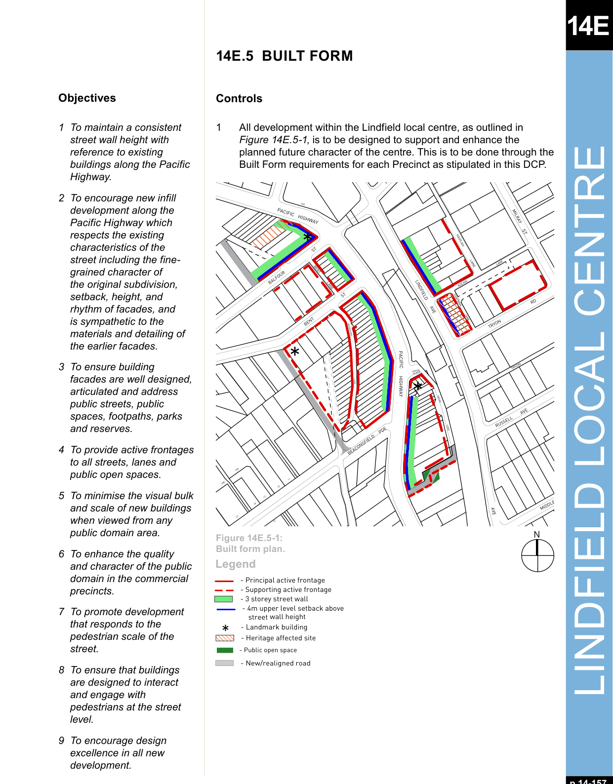

### 14E.4  SETBACKS

7

ST

#### Objectives

#### Controls

1 All development within the Lindfield local centre, as outlined in

planned future character of the centre. This is to be done through the

Setback requirements for each Precinct as stipulated in this DCP.

2	 To allow for future

Note: In all cases, where land dedication is required for a public purpose,

such as a road or walkway, the affected land is to be excluded from deep

soil calculations and included in setback requirements.

3	 To allow for visual and

9

39

283

#### Legend

E

E

### LINDFIELD LOCAL CENTRE

E E

RD 14

B 2B

NTON

NE

- Supporting active frontage

- Supporting active frontage

(% of site)

### 14E.4  SETBACKS (continued)

#### Objectives

#### Controls

2 All properties within the R4 High Density Residential zone are to

have a 10-12 metre front setback (refer to Part 7 of this DCP) with

the following exceptions and requirements:

i) 17-21 and 9-15 Bent Street are to provide 6 metre setbacks to

Bent Street and Balfour Street.

ii)	 10-14 Milray Street and 4 Havilah Road and 51, 55, 55A Lindfield

Avenue are to provide a reduced setback to Havilah Lane

consistent with that established on properties nos.2-6 and 8

Milray Street (indicatively 3-5 metres).

iii)	 51, 55, 55A and 57 Lindfield Avenue are to provide 6 metre

setbacks to Lindfield Avenue.

iv)	 Setbacks to accommodate property boundary realignment

affecting 51, 55, 55A Lindfield Avenue, 10, 12, 14 Milray and 3

Havilah Road to widen Havilah Lane to achieve a continuous

12 metre right-of-way (width varies indicatively between 4-5

metres). The affected land is to be excluded from deep soil

calculations and included in setback requirements and the land

is to be dedicated to Council at no cost.

v)	 A site coverage of 40% and deep soil requirement of 30%

applies to 51, 55 and 55A Lindfield Avenue to accommodate

boundary realignment.

vi)	 4 and 8 Beaconsfield Parade and A2, 2, 4, 6, 8, 8A and 10

Drovers Way are to provide a 6m setback to Drovers Way.

> [Picture on page 9: a map, saved as a picture (images/part-14e-lindfield-local-centre-page-9-1.gif, 150 dpi); the street names and other small labels are on the picture.]
> Words printed on the picture (title and legend, copied from the PDF):
> street wall height with
> reference to existing
> buildings along the Pacific
> ALIGNMENT AND SETBACKS
> - 9m setback
> 21 19 17
> - 15m setback
> - 13m setback
> GARRICK 1 272
> 12 10 8
> ALIGNMENT AND SETBACKS
> - 12m setback
> - 11m setback
> - 9m setback
> 51 53 10m
> 21 19 17
> - 15m setback BENT
> - 13m setback
> GARRICK 1 277
> 12 12 10 8
> - 12m setback LANE
> - 11m setback
> 21 19 17
> 16 6 258
> 12 10 8
> ALIGNMENT AND SETBACKS
> 16 20 22 24 28 30
> 101 103 105
> ALIGNMENT AND SETBACKS
> - 10m setback
> - 6m setback
> - 5m setback
> - 4m setback
> - 3m setback
> - 2m setback
> - Land dedication
> - Alternate deep soil landscaping
> (% of site)
> 38 42 44 46
> development along the
> Pacific Highway which
> respects the existing
> characteristics of the
> street including the fine-
> grained character of
> the original subdivision,
> setback, height, and
> rhythm of facades, and
> is sympathetic to the
> materials and detailing of
> 3 SLADE 150
> 22 101 103 105
> - 10m setback
> - 6m setback
> - 5m setback
> - 4m setback
> - 3m setback
> - 2m setback
> - Land dedication
> - Alternate deep soil landscaping
> (% of site)
> - 10m setback
> - 6m setback
> - 3m setback
> - Nil setback
> - Land dedication
> - Alternate deep soil requirement
> 107A 16-18 121A
> 123 125 127
> ALIGNMENT AND SETBACKS
> 2 BUILT FORM
> 1 101 103 105
> 4 6 8 10
> - Principal active frontage
> - Supporting active frontage
> - 3 storey street wall
> - 2m upper level setback above
> - 9m setback
> ALIGNMENT AND SETBACKS
> 1 3 5
> 21 19 17
> 123 125 127
> - 15m setback
> - 4m upper level setback above
> - 13m setback
> - 9m setback
> - 15m setback
> - 12m setback
> - 10m setback
> - 6m setback
> - 5m setback
> - 4m setback
> - 3m setback
> - 2m setback
> - Land dedication
> - Alternate deep soil requirement
> 12 10 8
> 3	 To ensure building
> facades are well designed,
> articulated and address
> public streets, public
> spaces, footpaths, parks
> ( UNFORMED )
> - 12m setback
> 21 19 17
> - 15m setback
> 4 6 8 10
> - 11m setback
> - 13m setback
> - Principal active frontage
> - Supporting active frontage
> - 3 storey street wall
> - 2m upper level setback above
> 12 10 8
> 1 3 5
> 56A 5 PUBLIC DOMAIN AND PEDESTRIAN
> - 12m setback
> - 11m setback
> 10 TRYON 3
> - 4m upper level setback above
> 4 8 10
> 4 6 8 10 5m
> - Primary active frontage
> - Secondary active frontage
> - 3 storey street wall
> - 2m upper level setback above street
> - 4m upper level setback above street
> street wall height
> 5 7 9 11
> 1 3 5
> public open spaces.
> PUBLIC DOMAIN AND PEDESTRIAN
> 277 43 43A
> PUBLIC DOMAIN AND PEDESTRIAN
> 4 8 10
> - Pedestrian through site link
> - Entry plaza/forecourt
> - Awnings where possible
> 10 12 14 16 18
> 4 6 8 5 7 9 11
> 267 101 103 105 12 16
> - Primary active frontage
> - Secondary active frontage
> - 3 storey street wall
> - 2m upper level setback above street
> - 4m upper level setback above street
> 16 15 19
> 3 5 7 11
> 4 8 10
> - 10m setback
> - 6m setback
> - 5m setback
> - 4m setback
> - 3m setback
> - 2m setback
> - Land dedication
> - Alternate deep soil landscaping
> (% of site)
> BUILDING ENTRIES AND CARPAT
> 5 7 9 11
> 123 125 127
> when viewed from any
> public domain area.
> 18 101 103 105
> PUBLIC DOMAIN AND PEDESTRIAN
> - Through site link
> - Entry plaza/forecourt
> - Continuous awnings
> - Continuous awnings where possible
> - Continuous colonnade
> - 10m setback
> - 6m setback
> - 5m setback
> - 4m setback
> - 3m setback
> - 2m setback
> - Land dedication
> - Alternate deep soil landscaping
> (% of site)
> - Pedestrian through site link
> - Entry plaza/forecourt
> - Awnings where possible
> 10 12 14 16 18
> 4 6 8
> Built form plan.
> - Vehicular access to site
> - Pedestrian access to site
> 123 125 127
> BUILDING ENTRIES AND CARPAT
> 1 55 24
> 3 5 7 11
> 22 BUILDING ENTRIES AND CARPAT
> 1 10 12 14 16 18
> 4 6 8
> 3 5 7 11
> - Vehicular access to site
> - Pedestrian access to site
> 4 6 8 10
> - Through site link
> - Entry plaza/forecourt
> - Continuous awnings
> - Continuous awnings where possible
> - Continuous colonnade
> - Principal active frontage
> - Supporting active frontage
> - 3 storey street wall
> - 2m upper level setback above
> - Vehicular access to site
> - Pedestrian access to site
> domain in the commercial
> 1 3 5
> - Heritage item
> BUILDING ENTRIES AND CARPAT
> 4 6 8 10
> - Principal active frontage
> - Supporting active frontage
> - 3 storey street wall
> - 2m upper level setback above
> - 4m upper level setback above
> KEY COMMUNITY INFRASTRUCTRE
> 36 1 3 5
> street wall height
> - 4m upper level setback above
> - Landmark building
> - Vehicular access to site
> - Pedestrian access to site
> PUBLIC DOMAIN AND PEDESTRIAN
> - Heritage affected site
> 4 8 10
> - Public open space
> 7	 To promote development
> that responds to the
> pedestrian scale of the
> PUBLIC DOMAIN AND PEDESTRIAN
> - Character item
> GREVILLEA 5 7 9 11
> - Landmark building
> 4 8 10
> 5 7 9 11
> 1-3 5 7
> - Footpath embellishment
> - New or existing park to be upgraded
> - Historic/character building to be
> - New/realigned road
> - Proposed pedestrian promenade
> - New community facility
> - Refer to site specific DCP
> - Proposed road
> - Pedestrian through site link
> - Entry plaza/forecourt
> - Awnings where possible
> - Character item
> 10 12 14 16 18
> 4 6 8
> - Proposed Community Infrastructure
> 3 5 7 11
> - Pedestrian through site link
> - Entry plaza/forecourt
> - Awnings where possible
> BUILDING ENTRIES AND CARPAT
> 10 12 14 16 18
> 4 6 8
> are designed to interact
> and engage with
> pedestrians at the street
> 45 8 CL
> 3 5 7 11
> 6 BUILDING ENTRIES AND CARPAT
> 4 2 23
> - Refer to site specific DCP
> - Proposed road
> - Vehicular access to site
> - Pedestrian access to site
> - Proposed Community Infrastructure
> KELBURN 59 48
> - Vehicular access to site
> - Pedestrian access to site
> 9	 To encourage design
> excellence in all new

Figure 14E.5-1, is to be designed to support and enhance the

Figure 14E.5-1:
