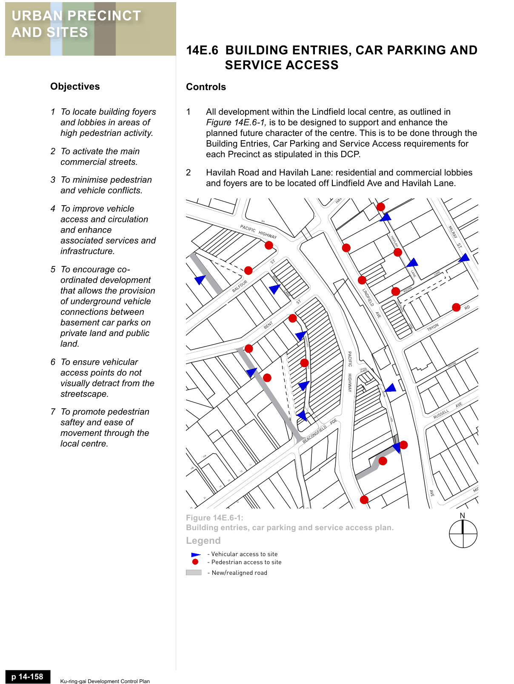

### 14E.5  BUILT FORM

15

#### Objectives

#### Controls

1 All development within the Lindfield local centre, as outlined in

planned future character of the centre. This is to be done through the

Built Form requirements for each Precinct as stipulated in this DCP.

1	 To maintain a consistent

### *

12

2	 To encourage new infill

the earlier facades. 123 125 127

0

### *

23

### *

4	 To provide active frontages

to all streets, lanes and

2

AY

5	 To minimise the visual bulk

and scale of new buildings

#### Legend

6	 To enhance the quality

and character of the public

### * *

45

### LINDFIELD LOCAL CENTRE

36

PL

8	 To ensure that buildings

PL

92

HERITATGGEA

- Heritage item

12 6.10W

- Heritage item

THE

STRICKLAND LANE

82 3.66W PATHWAY

- Landmark building

### *

6A RRABUNG 8

- Landmark building

### *

MACKENZIE

TREATTS

NHEIM

> [Picture on page 10: a map, saved as a picture (images/part-14e-lindfield-local-centre-page-10-4.gif, 150 dpi); the street names and other small labels are on the picture.]
> Words printed on the picture (title and legend, copied from the PDF):
> high pedestrian activity.
> 3	 To minimise pedestrian
> and vehicle conflicts.
> 21 19 17
> 4	 To improve vehicle
> access and circulation
> associated services and
> GARRICK 1 272
> 12 10 8 6
> ALIGNMENT AND SETBACKS
> ALIGNMENT AND SETBACKS
> 4 RD 287A
> - 9m setback
> 21 19 17
> - 15m setback
> - 13m setback
> 12 10 8 6
> - 12m setback
> - 11m setback
> - 10m setback
> - 6m setback
> - 3m setback
> - Nil setback
> - Land dedication
> - Alternate deep soil requirement
> 101 103 105 107
> 5	 To encourage co-
> that allows the provision
> of underground vehicle
> basement car parks on
> private land and public
> 123 125 127
> 101 103 105 107
> - 10m setback
> - 6m setback
> - 5m setback
> - 4m setback
> - 3m setback
> - 2m setback
> - Land dedication
> - Alternate deep soil landscaping
> (% of site)
> 123 125 127
> 4 6 8 10
> 6	 To ensure vehicular
> access points do not
> visually detract from the
> - Primary active frontage
> - Secondary active frontage
> - 3 storey street wall
> - 2m upper level setback above street
> - 4m upper level setback above street
> 1 3 5
> PUBLIC DOMAIN AND PEDESTRIAN
> 4 6 8 10
> - Principal active frontage
> - Supporting active frontage
> - 3 storey street wall
> - 2m upper level setback above
> 1 3 5
> 7	 To promote pedestrian
> saftey and ease of
> movement through the
> 4 8 10
> - 4m upper level setback above
> 5 7 9 11 street wall height
> - Through site link
> - Entry plaza/forecourt
> - Continuous awnings
> - Continuous awnings where possible
> - Continuous colonnade
> PUBLIC DOMAIN AND PEDESTRIAN
> BUILDING ENTRIES AND CARPAT
> 4 8 10
> 10 12 14 16 18
> 4 6 8
> 5 7 9 11
> 3 5 7 11
> - Vehicular access to site
> - Pedestrian access to site
> - Pedestrian through site link
> - Entry plaza/forecourt
> - Awnings where possible
> KEY COMMUNITY INFRASTRUCTRE
> 10 12 14 16 18
> 4 6 8
> Building entries, car parking and service access plan.
> 3 5 7 11
> BUILDING ENTRIES AND CARPAT
> AVE 1 35
> - Vehicular access to site
> - Pedestrian access to site
> 3.66W PATHWAY 18
> - Footpath embellishment
> - New or existing park to be upgraded
> - Historic/character building to be
> - New/realigned road
> - Proposed pedestrian promenade
> - New community facility
> - Heritage item
> 15 3.66W PATHWAY
> - Landmark building
> 1-3 5 7
> - Character item
> - Refer to site specific DCP
> - Proposed road

Figure 14E.6-1, is to be designed to support and enhance the

Figure 14E.6-1:

2
