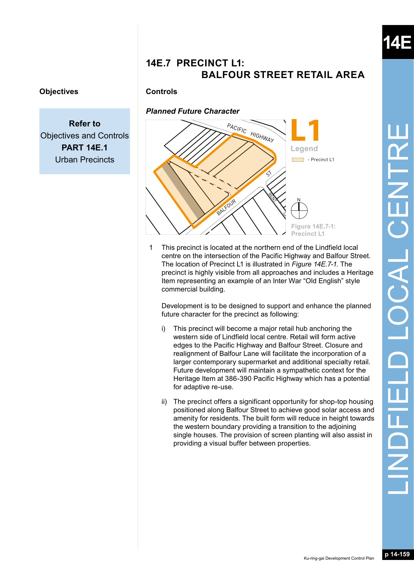

### 14E.6  BUILDING ENTRIES, CAR PARKING AND

### SERVICE ACCESS

19

#### Objectives

#### Controls

1	 To locate building foyers

and lobbies in areas of

1 All development within the Lindfield local centre, as outlined in

planned future character of the centre. This is to be done through the

Building Entries, Car Parking and Service Access requirements for

each Precinct as stipulated in this DCP.

2	 To activate the main

2 Havilah Road and Havilah Lane: residential and commercial lobbies

and foyers are to be located off Lindfield Ave and Havilah Lane.

#### Legend

CHELM

11

15

17

### *

5

CL

7 3.66W PATHWAY

- Proposed Community Infrastructure

ONE

LEHAM

- Land dedication

> [Picture on page 11: a map, saved as a picture (images/part-14e-lindfield-local-centre-page-11-3.gif, 150 dpi); the street names and other small labels are on the picture.]
> Words printed on the picture (title and legend, copied from the PDF):
> - Alternate deep soil requirement
> 1 ( UNFORMED )
> - 4m upper level setback above street
> PUBLIC DOMAIN AND PEDESTRIAN
> - Pedestrian through site link
> - Entry plaza/forecourt
> Awnings where possible
> - Continuous colonnade
> BUILDING ENTRIES AND CARPAT
> - Vehicular access to site
> - Pedestrian access to site
> SFIELD 1 18
> - Precinct L1
> - Precinct L2
> - Precinct L3
> - Precinct L4
> - Precinct L5
> - Precinct L6
> - Precinct L7
> - Precinct L8
> - Precinct L9
> 1-3 5 7
> for adaptive re-use.

Figure 14E.7-1:
