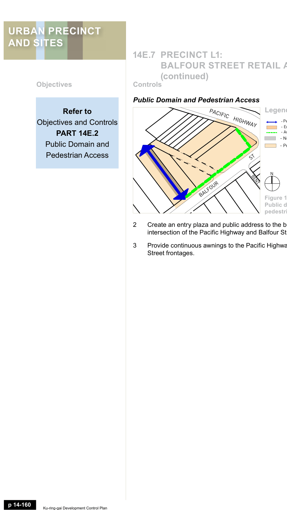
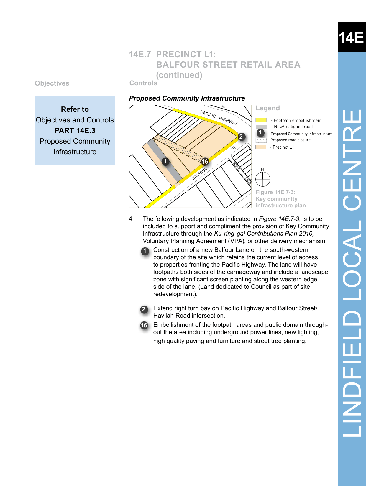
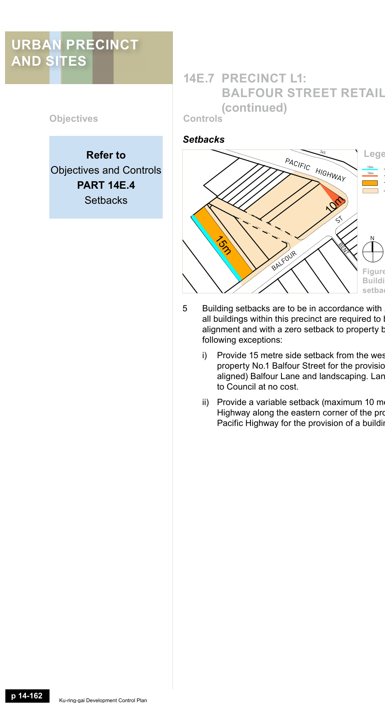
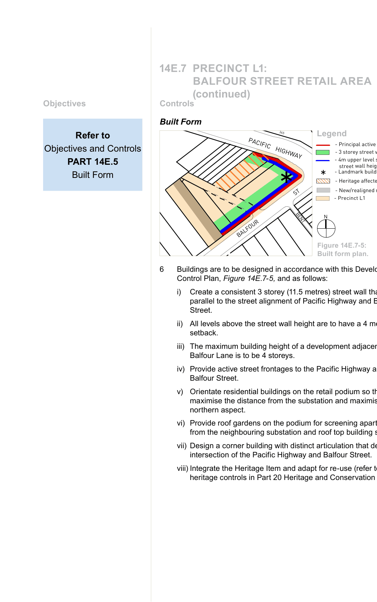
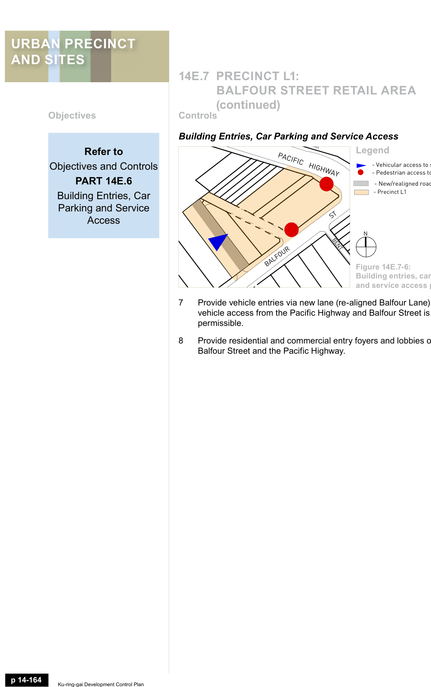
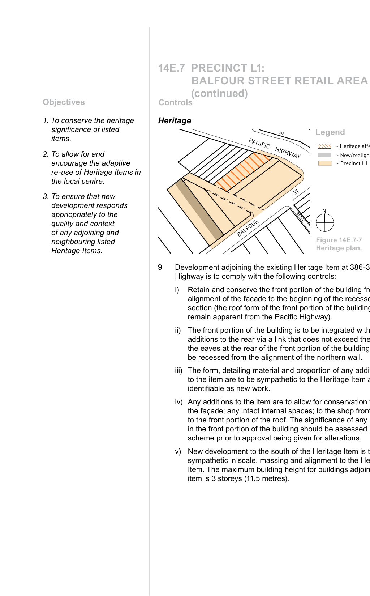
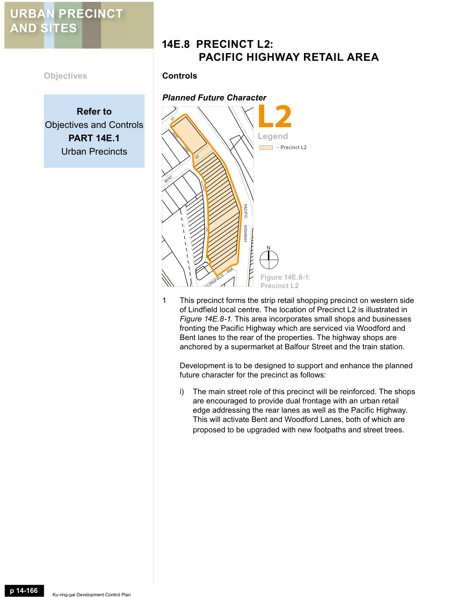

### 14E.7  PRECINCT L1:

### BALFOUR STREET RETAIL AREA

#### Objectives

#### Controls Planned Future Character

Refer to

#### Objectives and Controls

### KEITH L1

#### Legend

#### PART 14E.1

#### Urban Precincts

1 This precinct is located at the northern end of the Lindfield local

centre on the intersection of the Pacific Highway and Balfour Street.

The location of Precinct L1 is illustrated in Figure 14E.7-1. The

precinct is highly visible from all approaches and includes a Heritage

Item representing an example of an Inter War “Old English” style

Development is to be designed to support and enhance the planned

future character for the precinct as following:

i) This precinct will become a major retail hub anchoring the

western side of Lindfield local centre. Retail will form active

edges to the Pacific Highway and Balfour Street. Closure and

realignment of Balfour Lane will facilitate the incorporation of a

larger contemporary supermarket and additional specialty retail.

Future development will maintain a sympathetic context for the

Heritage Item at 386-390 Pacific Highway which has a potential

ii)	 The precinct offers a significant opportunity for shop-top housing

positioned along Balfour Street to achieve good solar access and

amenity for residents. The built form will reduce in height towards

the western boundary providing a transition to the adjoining

single houses. The provision of screen planting will also assist in

providing a visual buffer between properties.

### LINDFIELD LOCAL CENTRE

( U

> [Picture on page 12: a map, saved as a picture (images/part-14e-lindfield-local-centre-page-12-2.gif, 150 dpi); the street names and other small labels are on the picture.]
> Words printed on the picture (title and legend, copied from the PDF):
> ( UNFORMED )
> 5 7 9 11
> VALLEY 47 24
> 10 12 14 16 18
> 4 6 8
> 3 5 7 11
> 24 22 20 18
> 9 1 41
> 1-3 5 7
> 9 LLEWELLYN 4 2 7
> 1-3 5 7

AVE PUBLIC DOMAIN AND PEDESTRIAN

E

- 12m setback

- 10m setback

- 6m setback

- 5m setback

- 4m setback

- 3m setback

- 2m setback

- Land dedication

- Alternate deep soil requirement

BUILT FORM wall height

- Continuous awnings where possible

- Continuous colonnade

PUBLIC DOMAIN AND PEDESTRIAN

BUILDING ENTRIES AND CARPAT

HAVILAH

- Vehicular access to site

- Pedestrian access to site

#### Objectives

### 14E.7  PRECINCT L1:

### BALFOUR STREET RETAIL AREA

### (continued)

#### Controls

- Primary active frontage

- Secondary active frontage

- 3 storey street wall

- 2m upper level setback above street wall height

- 4m upper level setback above street wall height

#### Public Domain and Pedestrian Access

KEY COMMUNITY INFRASTRUCTRE

- Pedestrian through site link

- Entry plaza/forecourt Awnings Awnings where possible

- Continuous colonnade PUBLIC DOMAIN AND PEDESTRIAN

#### Legend

BUILDING ENTRIES AND CARPAT

VE

Refer to

#### Objectives and Controls

- Vehicular access to site

- Pedestrian access to site

- Pedestrian through site link

- Entry plaza/forecourt Awnings Awnings where possible

- Continuous colonnade

#### PART 14E.2

Public Domain and

BUILDING ENTRIES AND CARPAT

- Footpath embellishment

- New or existing park to be upgraded

- Historic/character building to be retained

- New/realigned road

- Proposed pedestrian promenade

- New community facility

- Landscaping

#### Pedestrian Access

- Vehicular access to site

- Pedestrian access to site

141

- Precinct L1

- Precinct L2

- Precinct L3

- Precinct L4

- Precinct L5

- Precinct L6

- Precinct L7

- Precinct L8

- Precinct L9

2

LINDFIEL

#### Figure 14E.7-2:

Public domain and

pedestrian access plan.

- Precinct L1

- Precinct L2

- Precinct L3

- Precinct L4

- Precinct L5

- Precinct L6

- Precinct L7

- Precinct L8

- Precinct L9

16

2 Create an entry plaza and public address to the building at the

intersection of the Pacific Highway and Balfour Street. 3 Provide continuous awnings to the Pacific Highway and Balfour

WOODFORD

TRYON

PLACE

LANE

PACIFIC

HIGHWAY

33 BENT

PDE

BEACONSFIELD

L

DROVERS

R

Y

> [Picture on page 13: a map, saved as a picture (images/part-14e-lindfield-local-centre-page-13-3.gif, 150 dpi); the street names and other small labels are on the picture.]
> Words printed on the picture (title and legend, copied from the PDF):
> 4 6 8 10 PUBLIC DOMAIN AND PEDESTRIAN
> - Alternate deep soil requirement
> 1 ( UNFORMED )
> 2A 1 3 5
> 2 2 56A
> 16 PUBLIC DOMAIN AND PEDESTRIAN
> - Pedestrian through site link
> - Awnings where possible
> 10 12 14 16 18
> BUILDING ENTRIES AND CARPAT
> - Continuous awnings where possible
> - Continuous colonnade
> 4 8 10
> - Vehicular access to site
> - Pedestrian access to site
> - 4m upper level setback above street
> - 4m upper level setback above street
> BUILDING ENTRIES AND CARPAT
> 5 7 9 11
> - Continuous awnings
> - Continuous awnings where possible
> - Continuous colonnade
> 10 12 14 16 18
> 4 6 8
> PUBLIC DOMAIN AND PEDESTRIAN
> PUBLIC DOMAIN AND PEDESTRIAN
> 3 5 7 11
> BUILDING ENTRIES AND CARPAT
> 24 22 20 18
> - Vehicular access to site
> - Pedestrian access to site
> - Heritage item
> 10 12 14 16 18
> 4 6 8
> 3 5 7 11
> - Vehicular access to site
> - Pedestrian access to site
> KEY COMMUNITY INFRASTRUCTRE
> 1B ST RD
> - Landmark building
> - Through site link
> - Entry plaza/forecourt
> - Continuous awnings
> - Continuous awnings where possible
> - Continuous colonnade
> - Pedestrian through site link
> - Entry plaza/forecourt
> Awnings where possible
> - Continuous colonnade
> KEY COMMUNITY INFRASTRUCTRE
> - Character item
> BUILDING ENTRIES AND CARPAT
> 24 22 20 18
> 12 10 8 4 2
> BUILDING ENTRIES AND CARPAT
> - Vehicular access to site
> - Pedestrian access to site
> - Refer to site specific DCP
> - Proposed road
> 24 22 20 18
> - Proposed Community Infrastructure
> 36 3 14
> - Vehicular access to site
> - Pedestrian access to site
> 28 34 50
> - Proposed road closure
> - Footpath embellishment
> - New or existing park to be upgraded
> - Historic/character building to be
> - New/realigned road
> - Proposed pedestrian promenade
> - New community facility
> - Footpath embellishment
> - New or existing park to be upgraded
> - Historic/character building to be
> - New/realigned road
> - Proposed pedestrian promenade
> - New community facility
> 26A 4 2
> 23 30 8 3
> - Precinct L1
> - Precinct L2
> - Precinct L3
> - Precinct L4
> - Precinct L5
> - Precinct L6
> - Precinct L7
> - Precinct L8
> - Precinct L9
> 2 4 STRICKLAND
> 5 4 2
> 1-3 5 7
> 1-3 5 7

Figure 14E.7-3:

CR

RD GILLO

- Land dedication

NE

### 14E.7  PRECINCT L1:

### BALFOUR STREET RETAIL AREA

### (continued)

#### Objectives

### *

#### Proposed Community Infrastructure

#### Legend

E

Refer to

#### Objectives and Controls

24

#### PART 14E.3

#### Proposed Community Infrastructure

29

ES

16

18

VERIL

4 The following development as indicated in Figure 14E.7-3, is to be

included to support and compliment the provision of Key Community

Infrastructure through the Ku-ring-gai Contributions Plan 2010,

Voluntary Planning Agreement (VPA), or other delivery mechanism:

#### 1

Construction of a new Balfour Lane on the south-western

boundary of the site which retains the current level of access

to properties fronting the Pacific Highway. The lane will have

footpaths both sides of the carriageway and include a landscape

zone with significant screen planting along the western edge

side of the lane. (Land dedicated to Council as part of site

Extend right turn bay on Pacific Highway and Balfour Street/

Havilah Road intersection. Embellishment of the footpath areas and public domain through-

out the area including underground power lines, new lighting, high quality paving and furniture and street tree planting.

17

### LINDFIELD LOCAL CENTRE

PDE

NORWOOD

PDE

E

> [Picture on page 14: a map, saved as a picture (images/part-14e-lindfield-local-centre-page-14-2.gif, 150 dpi); the street names and other small labels are on the picture.]
> Words printed on the picture (title and legend, copied from the PDF):
> 2 1 ( UNFORMED )
> 29 27 25 23
> 21 19 17
> 26 24 22
> 12 10 8
> 3 4 61
> 27 25 23
> 21 19 17
> 7.32 / 3.66 W.
> ESMT FOR SERVICES
> 26 24 22
> 12 10 8 6
> 27 25 23
> 21 19 17
> 26 24 22
> 12 10 8
> 7.32 / 3.66 W.
> ESMT FOR SERVICES
> 101 103 105
> 3 4 KILLEATON
> 123 125 127
> 14 12 MONA
> 7.32 / 3.66 W.
> ESMT FOR SERVICES
> 101 103 105
> 123 125 127
> 26A AVE 4 6 8 10
> 101 103 105
> DAINTON 1 3 5
> 123 125 127
> STURT 1-3 5 7
> 4 6 8 10
> 1 3 5
> 4 8 10
> 5 7 9 11
> 4 6 8 10
> 1 3 5
> 4 8 10
> 10 12 14 16 18
> 4 6 8
> 5 7 9 11
> 3 5 7 11
> 4 8 10
> 5 7 9 11
> 10 12 14 16 18
> 4 6 8
> 3 5 7 11
> 10 12 14 16 18
> 4 6 8
> 24 22 20 18
> 3 5 7 11
> 24 22 20 18
> 24 22 20 18
> 72 3 15
> 3.66W PATHWAY 3.66W PATHWAY
> 4 4 2
> 82 3.66W PATHWAY
> 72 43 15
> PRIESTLEY 6 10
> 3.66W PATHWAY 3.66W PATHWAY
> 6 4 2
> 7 3.66W PATHWAY

- Alternate deep soil requirement

wall height

ALIGNMENT AND SETBACKS PUBLIC DOMAIN AND PEDESTRIAN

- 9m setback

- 15m setback

#### 4

- 13m setback

- 12m setback HAVILAH

### 14E.7  PRECINCT L1:

### BALFOUR STREET RETAIL AREA

### (continued)

#### Controls

ALIGNMENT AND SETBACKS

- 11m setback

- 9m setback

- Pedestrian through site link

- Entry plaza/forecourt Awnings Awnings where possible

- Continuous colonnade

#### Setbacks

5m - 15m setback

ALIGNMENT AND SETBACKS

2

#### 4-5m

BUILDING ENTRIES AND CARPAT

- 13m setback

#### Legend

- 9m setback

- 12m setback

- 11m setback

3 - 15m setback

Refer to

#### Objectives and Controls 18 16

- Vehicular access to site

- Pedestrian access to site

- 13m setback

- 12m setback

#### 6m

#### PART 14E.4

- 11m setback

- 10m setback

- 6m setback

- 5m setback

- 4m setback

- 3m setback

- 2m setback

- Land dedication

- Alternate deep soil landscaping (% of site)

#### Setbacks LINK

BUILT FORM

#### 10m 152

- 10m setback

- 6m setback

- 5m setback

- 4m setback

- 3m setback

- 2m setback

- Land dedication

- Alternate deep soil landscaping (% of site)

- Precinct L1

- Precinct L2

- Precinct L3

- Precinct L4

- Precinct L5

- Precinct L6

- Precinct L7

- Precinct L8

- Precinct L9

PL

- Principal active frontage

- Supporting active frontage

- 3 storey street wall

- 2m upper level setback above

BUILT FORM

#### 15m

- 10m setback

- 6m setback

- 5m setback

- 4m setback

- 3m setback

- 2m setback

- Land dedication

- Alternate deep soil landscaping (% of site)

street

wall height

- 4m upper level setback above BUILT FORM

LANE street

wall height

#### Figure 14E.7-4

Building alignment and

setbacks plan.

PUBLIC DOMAIN AND PEDESTRIAN

- Principal active frontage

- Supporting active frontage

- 3 storey street wall

- 2m upper level setback above street

wall height

- 4m upper level setback above

AVE

LINDFIELD

- Principal active frontage

- Supporting active frontage

- 3 storey street wall

- 2m upper level setback above

street

wall height

street

5

wall height

- 4m upper level setback above

PUBLIC DOMAIN AND PEDESTRIAN

street wall height

- Pedestrian through site link

- Entry plaza/forecourt

- Awnings

- Awnings where possible

- Colonnade

5 Building setbacks are to be in accordance with Figure 14E.7-4 and

all buildings within this precinct are required to be built to the street

alignment and with a zero setback to property boundaries with the

following exceptions:

WOODFORD PUBLIC DOMAIN AND PEDESTRIAN

BUILDING ENTRIES AND CARPAT

- Vehicular access to site

- Pedestrian access to site

- Pedestrian through site link

- Entry plaza/forecourt

- Awnings

- Awnings where possible

- Colonnade

i) Provide 15 metre side setback from the western boundary of

property No.1 Balfour Street for the provision of a new (re-

aligned) Balfour Lane and landscaping. Land is to be dedicated

to Council at no cost.

#### 3m

BUILDING ENTRIES AND CARPAT

TRYON

PLACE

- Pedestrian through site link

- Entry plaza/forecourt

- Awnings

- Awnings where possible

- Colonnade

HERITATGGEA

ii)	 Provide a variable setback (maximum 10 metres) from the Pacific

LANE

BUILDING ENTRIES AND CARPAT

- Heritage item

- Vehicular access to site

- Pedestrian access to site

Highway along the eastern corner of the properties Nos.376-394

Pacific Highway for the provision of a building forecourt.

PACIFIC

HIGHWAY

- Vehicular access to site

- Pedestrian access to site

- Landmark building

HERITATGGEA

#### 6m

### *

- Heritage item

HERITATGGEA

- Character item

143

- Heritage item

- Landmark building

#### 5m

### *

- Refer to site specific DCP

- Proposed road

- Proposed Community Infrastructure

- Landmark building

- Character item

143

### *

- Character item

143

- Refer to site specific DCP

- Proposed road

- Proposed Community Infrastructure

- Refer to site specific DCP

- Proposed road

- Proposed Community Infrastructure

#### 6m

DROVERS

#### 6m

AVERIL

PDE

BEACONSFIELD

BEACONSFIELD

K

T

AV

CR 123 125 127 ALIGNMENT AND SETBACKS

- 2m upper level setback above

- 4m upper level setback above

- 4m setback

> [Picture on page 15: a map, saved as a picture (images/part-14e-lindfield-local-centre-page-15-8.gif, 150 dpi); the street names and other small labels are on the picture.]
> Words printed on the picture (title and legend, copied from the PDF):
> - 9m setback
> 1 3 5 ALIGNMENT AND SETBACKS
> - 15m setback
> ALIGNMENT AND SETBACKS
> - 9m setback
> 51 53 - 13m setback
> - 3m setback
> - 2m setback
> - Land dedication
> ( UNFORMED ) 15m
> - 9m setback
> - 12m setback
> - 15m setback
> 4 6 8 10 15m
> - 11m setback
> - Principal active frontage
> - Supporting active frontage
> 3 - 13m setback
> 4 6 8 10 - 15m setback
> 5 - 13m setback
> - 12m setback
> - 12m setback
> - 11m setback
> - 11m setback
> 7.32 / 3.66 W.
> ESMT FOR SERVICES
> 7.32 / 3.66 W.
> ESMT FOR SERVICES
> 7.32 / 3.66 W.
> ESMT FOR SERVICES
> 4 8 10
> - Awnings where possible
> 4 8 10
> 10 12 14 16 18
> 4 6 8
> 5 7 9 11
> 5 7 9 11
> 101 103 105
> 3 5 7 11
> - Through site link
> - Entry plaza/forecourt
> - Continuous awnings
> - Continuous colonnade
> - 10m setback
> - 6m setback
> - 5m setback
> - 4m setback
> - 3m setback
> - 2m setback
> - Land dedication
> (% of site)
> - Secondary active frontage
> - 3 storey street wall
> COLLEGE RD 117 16
> 123 125 127
> 101 103 105
> - 10m setback
> - 6m setback
> - 5m setback
> - 4m setback
> - 3m setback
> - 2m setback
> - Land dedication
> (% of site)
> 101 103 105
> - Entry plaza/forecourt
> - Awnings where possible
> 10 12 14 16 18
> 4 6 8
> - Vehicular access to site
> - Pedestrian access to site
> - 10m setback
> - 6m setback
> - 5m setback
> - 4m setback
> - 3m setback
> - 2m setback
> - Land dedication
> (% of site)
> 10 12 14 16 18
> 4 6 8
> 123 125 127
> ST 15 19
> 3 5 7 11
> 123 125 127
> 3 5 7 11
> - Vehicular access to site
> - Pedestrian access to site
> 4 6 8 10
> 24 22 20 18
> - Principal active frontage
> - Supporting active frontage
> - 3 storey street wall
> - Vehicular access to site
> - Pedestrian access to site
> AVE TRYON 4
> - Pedestrian through site link
> - Entry plaza/forecourt
> Awnings where possible
> - Continuous colonnade
> 1 3 5
> - Heritage item
> 4 6 8 10
> - Principal active frontage
> - Supporting active frontage
> - 3 storey street wall
> 4 6 8 10
> 1 3 5 BUILDING ENTRIES AND CARPAT
> - Principal active frontage
> - Supporting active frontage
> - 3 storey street wall
> street wall height
> 1 3 5
> 10 3.66W PATHWAY
> - Landmark building
> 24 22 20 18 10
> 24 22 20 18
> - Heritage affected site
> - Vehicular access to site
> - Pedestrian access to site
> DR 29 GILLOTT
> 4 8 10
> - Character item
> 5 7 9 11
> - Landmark building
> 4 8 10
> 72 1 15
> 1 3.66W PATHWAY
> 4 8 10
> 5 7 9 11
> - Footpath embellishment
> - New/realigned road
> - New community facility
> 5 7 9 11
> - Refer to site specific DCP
> - Proposed road
> - Entry plaza/forecourt
> - Awnings where possible
> - Character item
> 10 12 14 16 18
> 4 6 8
> STANLEY 28 5 74
> 3 5 7 11
> - Entry plaza/forecourt
> - Awnings where possible
> 10 12 14 16 18
> 4 6 8
> 1 1 5
> - Entry plaza/forecourt
> - Awnings where possible
> 10 12 14 16 18
> 4 6 8
> - Precinct L1
> - Precinct L2
> - Precinct L3
> - Precinct L4
> - Precinct L5
> - Precinct L6
> - Precinct L7
> - Precinct L8
> - Precinct L9
> 3 5 7 11
> 4 BUILDING ENTRIES AND CARPAT
> - Refer to site specific DCP
> - Proposed road
> 31 15 19
> 3 5 7 11
> Built form plan.
> - Vehicular access to site
> - Pedestrian access to site
> 28 55 47
> - Vehicular access to site
> - Pedestrian access to site
> - Vehicular access to site
> - Pedestrian access to site
> 24 22 20 18
> 1-3 5 7
> - Heritage item
> 24 22 20 18
> 24 22 20 18
> - Heritage item
> - Heritage item
> 3-11 3.66W PATHWAY
> - Landmark building
> - Landmark building
> 80 ii)	 All levels above the street wall height are to have a 4 metre
> - Landmark building
> 27 8 9
> - Character item
> 9 41 iii)	 The maximum building height of a development adjacent to new
> - Character item
> - Refer to site specific DCP
> - Proposed road
> 39 3.66W PATHWAY
> - Refer to site specific DCP
> - Proposed road
> - Refer to site specific DCP
> - Proposed road
> Balfour Street. 3

Figure 14E.7-5:

- Alternate deep soil requirement

- 2m upper level setback above

- 4m upper level setback above

PUBLIC DOMAIN AND PEDESTRIAN

ANE

- Pedestrian through site link

- Continuous awnings where possible BUILDING ENTRIES AND CARPAT

- Alternate deep soil landscaping

- 2m upper level setback above street

- 4m upper level setback above street

HAVILAH

#### Objectives

### 14E.7  PRECINCT L1:

### BALFOUR STREET RETAIL AREA

### (continued)

#### Controls

BUILDING ENTRIES AND CARPAT

- Alternate deep soil landscaping PUBLIC DOMAIN AND PEDESTRIAN

- Pedestrian through site link

- Alternate deep soil landscaping

#### Built Form

BUILDING ENTRIES AND CARPAT

- 2m upper level setback above

KEY COMMUNITY INFRASTRUCTRE

Refer to

#### Objectives and Controls

- 2m upper level setback above

- 4m upper level setback above

#### PART 14E.5

- 2m upper level setback above

E

- 4m upper level setback above

#### Built Form 2

- 4m upper level setback above

### *

PUBLIC DOMAIN AND PEDESTRIAN

NE

PUBLIC DOMAIN AND PEDESTRIAN

B

### *

PUBLIC DOMAIN AND PEDESTRIAN

ANE

### AVE *

ANE

- New or existing park to be upgraded

- Historic/character building to be

- Proposed pedestrian promenade

- Pedestrian through site link

3

- Proposed Community Infrastructure

- Pedestrian through site link

BUILDING ENTRIES AND CARPAT

- Pedestrian through site link

BUILDING ENTRIES AND CARPAT

- Proposed Community Infrastructure

AVE

LINDFIELD

6 Buildings are to be designed in accordance with this Development

Control Plan, Figure 14E.7-5, and as follows:

i) Create a consistent 3 storey (11.5 metres) street wall that is built

parallel to the street alignment of Pacific Highway and Balfour

### *

### * - Character item

### *

3

TRYON

3

PLACE

Balfour Lane is to be 4 storeys.

- Proposed Community Infrastructure

iv)	 Provide active street frontages to the Pacific Highway and

- Proposed Community Infrastructure

PACIFIC

HIGHWAY

- Proposed Community Infrastructure

### *

v)	 Orientate residential buildings on the retail podium so that they

maximise the distance from the substation and maximise the

vi)	 Provide roof gardens on the podium for screening apartments

from the neighbouring substation and roof top building services.

vii)	 Design a corner building with distinct articulation that defines the

intersection of the Pacific Highway and Balfour Street.

viii)	Integrate the Heritage Item and adapt for re-use (refer to specific

heritage controls in Part 20 Heritage and Conservation Areas).

### LINDFIELD LOCAL CENTRE

AVERIL

PDE

BEACONSFIELD

17 56 - Alternate deep soil requirement

REID

FF

> [Picture on page 16: a map, saved as a picture (images/part-14e-lindfield-local-centre-page-16-4.gif, 150 dpi); the street names and other small labels are on the picture.]
> Words printed on the picture (title and legend, copied from the PDF):
> 121 ( UNFORMED )
> - Principal active frontage
> - Supporting active frontage
> - 2m upper level setback above
> - 4m upper level setback above
> 5 7 9 11
> street wall height
> - Continuous colonnade
> PUBLIC DOMAIN AND PEDESTRIAN
> BUILDING ENTRIES AND CARPAT
> PUBLIC DOMAIN AND PEDESTRIAN
> 4 8 10
> 10 12 14 16 18
> 4 6 8
> 5 7 9 11
> 3 5 7 11
> - Vehicular access to site
> - Pedestrian access to site
> - Pedestrian through site link
> - Entry plaza/forecourt
> - Awnings where possible
> 10 12 14 16 18
> 4 6 8
> - Pedestrian through site link
> - Entry plaza/forecourt
> Awnings where possible
> - Continuous colonnade
> 3 5 7 11
> BUILDING ENTRIES AND CARPAT
> BUILDING ENTRIES AND CARPAT
> 24 22 20 18
> - Vehicular access to site
> - Pedestrian access to site
> - Vehicular access to site
> - Pedestrian access to site
> 26 IKARA 10
> 24 22 20 18
> - Footpath embellishment
> - Historic/character building to be
> - New/realigned road
> - Proposed pedestrian promenade
> - New community facility
> - Heritage item
> - Landmark building
> 36 AVE 3.66W PATHWAY
> - Precinct L1
> - Precinct L2
> - Precinct L3
> - Precinct L4
> - Precinct L5
> - Precinct L6
> - Precinct L7
> - Precinct L8
> - Precinct L9
> 26 - Character item
> - Refer to site specific DCP
> - Proposed road
> Building entries, carpark
> and service access plan.

Figure 14E.7-6:

D

- Continuous awnings where possible

- 4m upper level setback above street

3m

HAVILAH

#### Objectives

### 14E.7  PRECINCT L1:

### BALFOUR STREET RETAIL AREA

### (continued)

KEY COMMUNITY INFRASTRUCTRE

#### Legend

#### Building Entries, Car Parking and Service Access

E

Refer to

#### Objectives and Controls

#### PART 14E.6

#### Building Entries, Car

- New or existing park to be upgraded

#### Parking and Service

#### Access

143

### *

147

- Proposed Community Infrastructure

AV

LINDFIELD

3

7 Provide vehicle entries via new lane (re-aligned Balfour Lane). Direct

vehicle access from the Pacific Highway and Balfour Street is not

6

8 Provide residential and commercial entry foyers and lobbies off

Balfour Street and the Pacific Highway.

TRYON

PLACE

PACIFIC

HIGHWAY

NDEL

AVER

PDE

ONSFIELD

(

CR

> [Picture on page 17: a map, saved as a picture (images/part-14e-lindfield-local-centre-page-17-3.gif, 150 dpi); the street names and other small labels are on the picture.]
> Words printed on the picture (title and legend, copied from the PDF):
> 2 4 6 8 10
> CARCOOLA - 2m upper level setback above
> CARCOOLA BUILT FORM
> 56A 1 3 5
> street wall height
> RADE AVE VALE
> 10 12 14 16 18
> 4 6 8
> 10 12 14 16 18
> 4 6 8
> 3 5 7 11
> 3 5 7 11
> - Entry plaza/forecourt
> 24 22 20 18
> significance of listed
> 24 22 20 18 14
> - Heritage affected site
> - Landmark building
> 4 3.66W PATHWAY
> 4 2 AVE 20
> - New/realigned road
> encourage the adaptive
> the local centre.
> - Character item
> - Precinct L1
> - Precinct L2
> - Precinct L3
> - Precinct L4
> - Precinct L5
> - Precinct L6
> - Precinct L7
> - Precinct L8
> - Precinct L9
> - Proposed road
> 1-3 5 7
> appriopriately to the
> quality and context
> of any adjoining and
> Heritage Items. LANE
> identifiable as new work.

Figure 14E.7-7

- 4m upper level setback above

- Continuous awnings where possible

- Continuous colonnade

BUILDING ENTRIES AND CARPAT

- Pedestrian through site link

- Awnings where possible PUBLIC DOMAIN AND PEDESTRIAN

BUILDING ENTRIES AND CARPAT

- Vehicular access to site

- Pedestrian access to site

#### Objectives

### 14E.7  PRECINCT L1:

### BALFOUR STREET RETAIL AREA

### (continued)

#### Controls

HAVILAH

- Vehicular access to site

- Pedestrian access to site

KEY COMMUNITY INFRASTRUCTRE

- Pedestrian through site link

Awnings where possible

- Continuous colonnade

#### Heritage

BUILDING ENTRIES AND CARPAT

#### Legend

1\. To conserve the heritage

- Vehicular access to site

- Pedestrian access to site

### *

- Footpath embellishment

- New or existing park to be upgraded

- Historic/character building to be

- Proposed pedestrian promenade

- New community facility

2\. To allow for and

re-use of Heritage Items in

2

- Refer to site specific DCP

- Proposed Community Infrastructure

3\. To ensure that new

AVE

LINDFIELD

9 Development adjoining the existing Heritage Item at 386-390 Pacific

Highway is to comply with the following controls:

i) Retain and conserve the front portion of the building from the

alignment of the facade to the beginning of the recessed link

section (the roof form of the front portion of the building should

remain apparent from the Pacific Highway).

ii)	 The front portion of the building is to be integrated with new

TRYON

PLACE

additions to the rear via a link that does not exceed the height of

the eaves at the rear of the front portion of the building, and is to

be recessed from the alignment of the northern wall.

iii)	 The form, detailing material and proportion of any additions

C

I

F

I

C

A

P

Y

A

W

H

G

I

H

to the item are to be sympathetic to the Heritage Item and yet

iv)	 Any additions to the item are to allow for conservation works to

the façade; any intact internal spaces; to the shop fronts; and

to the front portion of the roof. The significance of any interiors

in the front portion of the building should be assessed in any

scheme prior to approval being given for alterations.

v)	 New development to the south of the Heritage Item is to be

sympathetic in scale, massing and alignment to the Heritage

Item. The maximum building height for buildings adjoining the

item is 3 storeys (11.5 metres).

### LINDFIELD LOCAL CENTRE

AVERIL

PDE

BEACONSFIELD

( U

REID

> [Picture on page 18: a map, saved as a picture (images/part-14e-lindfield-local-centre-page-18-3.gif, 150 dpi); the street names and other small labels are on the picture.]
> Words printed on the picture (title and legend, copied from the PDF):
> PUBLIC DOMAIN AND PEDESTRIAN
> - Pedestrian through site link
> - Entry plaza/forecourt
> Awnings where possible
> - Continuous colonnade MILRAY
> BUILDING ENTRIES AND CARPAT
> - Vehicular access to site
> - Pedestrian access to site
> - Precinct L1
> - Precinct L2
> - Precinct L3
> - Precinct L4
> - Precinct L5
> - Precinct L6
> - Precinct L7
> - Precinct L8
> - Precinct L9
> 1-3 5 7
> 1-3 5 7

Figure 14E.8-1:

Figure 14E.8-1. This area incorporates small shops and businesses

### AND SITES ST

1

ENT
