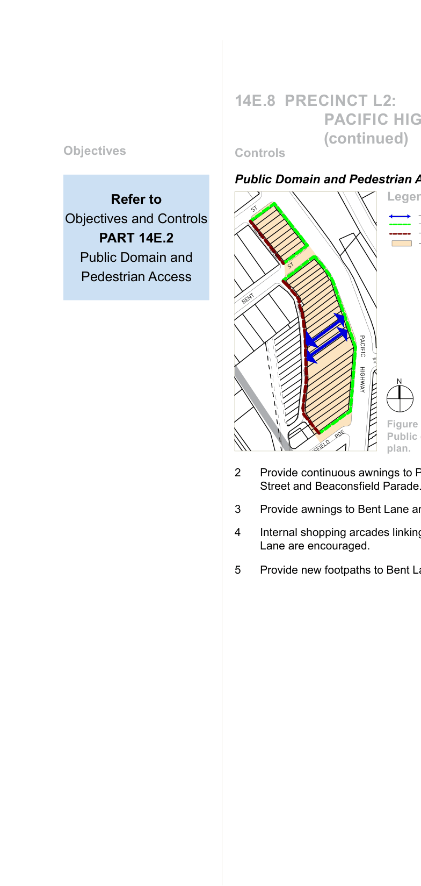
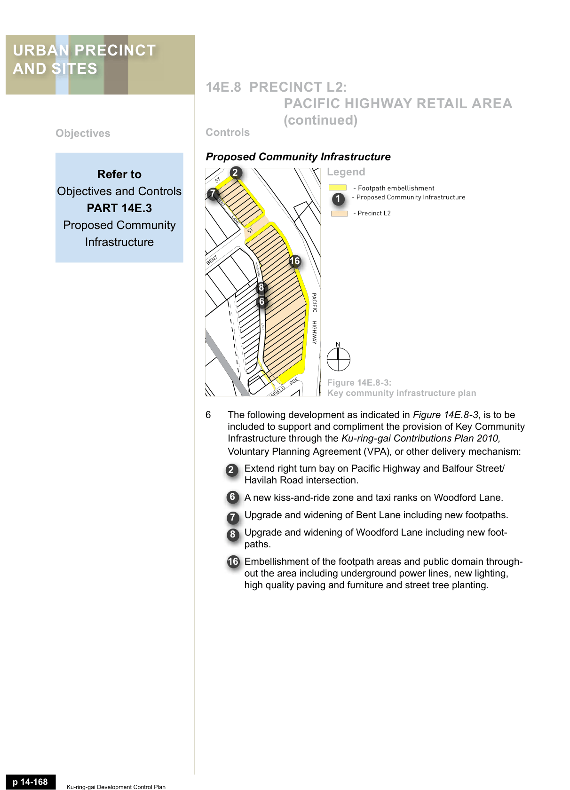
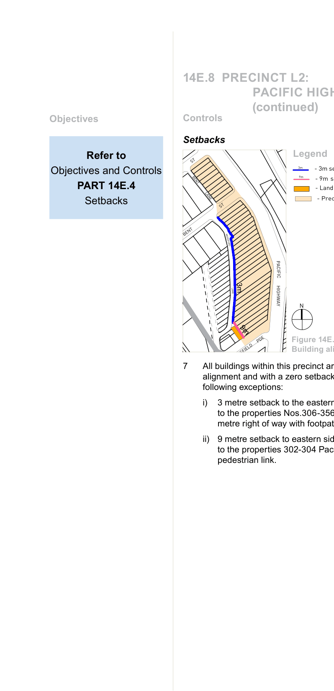
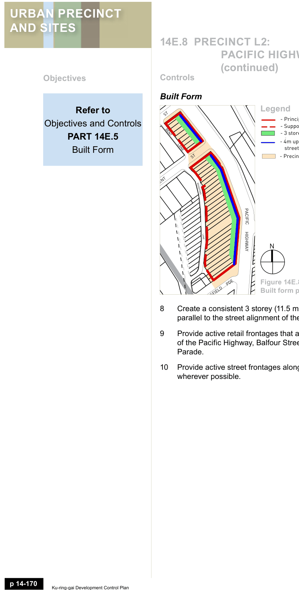
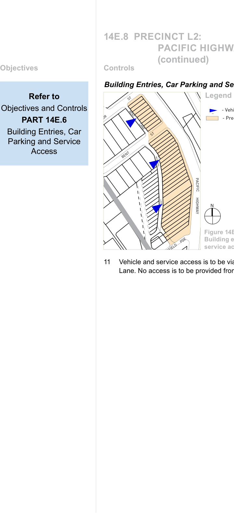

### 14E.8  PRECINCT L2:

### PACIFIC HIGHWAY RETAIL AREA

D

#### Objectives

#### Controls Planned Future Character

Refer to

#### Objectives and Controls

### L2

#### Legend

#### PART 14E.1

#### Urban Precincts

### L2

1

RUSSELL

LANE

65 63

61 TRAFALGA

1

1 This precinct forms the strip retail shopping precinct on western side

of Lindfield local centre. The location of Precinct L2 is illustrated in

fronting the Pacific Highway which are serviced via Woodford and

Bent lanes to the rear of the properties. The highway shops are

anchored by a supermarket at Balfour Street and the train station.

Development is to be designed to support and enhance the planned

future character for the precinct as follows:

5

T

36

i) The main street role of this precinct will be reinforced. The shops

are encouraged to provide dual frontage with an urban retail

edge addressing the rear lanes as well as the Pacific Highway.

This will activate Bent and Woodford Lanes, both of which are proposed to be upgraded with new footpaths and street trees.

R 2

> [Picture on page 19: a map, saved as a picture (images/part-14e-lindfield-local-centre-page-19-2.gif, 150 dpi); the street names and other small labels are on the picture.]
> Words printed on the picture (title and legend, copied from the PDF):
> ( UNFORMED )
> 7.32 / 3.66 W.
> ESMT FOR SERVICES
> 7.32 / 3.66 W.
> ESMT FOR SERVICES
> 123 125 127
> 4 6 8 10
> 4 6 8 10
> 1 3 5
> 1 3 5
> 4 8 10
> 5 7 9 11
> 4 8 10
> 5 7 9 11
> 10 12 14 16 18
> 4 6 8
> 10 12 14 16 18
> 4 6 8
> 3 5 7 11
> 3 5 7 11
> 24 22 20 18
> 24 22 20 18
> 10 1-3 5 7
> 8 6 LANE
> 3.66W PATHWAY 1
> 5 4 2
> 7 3.66W PATHWAY
> Street and Beaconsfield Parade.
> Lane are encouraged.

- Land dedication

- Alternate deep soil requirement

- 10m setback

- 6m setback

- 5m setback

- 4m setback

- 3m setback

- 2m setback

- Land dedication

- Alternate deep soil landscaping (% of site)

- 12m setback

- 10m setback

- 6m setback

- 5m setback

- 4m setback

- 3m setback

- 2m setback

- Land dedication

- Alternate deep soil landscaping (% of site)

- 4m upper level setback above street wall height

BUILT FORM

PUBLIC DOMAIN AND PEDESTRIAN

R

LANE

#### Objectives

### 14E.8  PRECINCT L2:

### PACIFIC HIGHWAY RETAIL AREA

### (continued)

- Primary active frontage

- Secondary active frontage

- 3 storey street wall

- 2m upper level setback above street wall height

- 4m upper level setback above street wall height

MILRAY

- Pedestrian through site link

- Entry plaza/forecourt Awnings Awnings where possible

- Continuous colonnade

- Primary active frontage

- Secondary active frontage

- 3 storey street wall

- 2m upper level setback above street wall height

- 4m upper level setback above street wall height

#### Public Domain and Pedestrian Access

PUBLIC DOMAIN AND PEDESTRIAN

ST

BUILDING ENTRIES AND CARPAT

#### Legend

PUBLIC DOMAIN AND PEDESTRIAN

#### Legend

m

- Vehicular access to site

- Pedestrian access to site

Refer to

#### Objectives and Controls

LANE

HAVILAH

- Pedestrian through site link

- Entry plaza/forecourt

- Awnings

- Awnings where possible

- Colonnade

KOCHIA

LANE

- Pedestrian through site link

- Entry plaza/forecourt

- Awnings

- Awnings where possible

- Colonnade BUILDING ENTRIES AND CARPAT

#### PART 14E.2

Public Domain and

BUILDING ENTRIES AND CARPAT

CHAPMAN

#### Pedestrian Access

- Vehicular access to site

- Pedestrian access to site

LANE

- Vehicular access to site

- Pedestrian access to site

- Precinct L1

- Precinct L2

- Precinct L3

- Precinct L4

- Precinct L5

- Precinct L6

- Precinct L7

- Precinct L8

- Precinct L9

RD

TRYON

RUSSELL

HERITATGGEA

8

HERITATGGEA

- Heritage/character item

- Heritage/character item

TRYON

LANE

15

RUSSELL

AVE

#### Figure 14E.8-2:

#### Public domain and pedestrian access

2 Provide continuous awnings to Pacific Highway, Balfour Street, Bent

HARBOUR

3 Provide awnings to Bent Lane and Woodford Lane where possible.

MIDDLE

AVE

4 Internal shopping arcades linking Pacific Highway and Woodford

1

5 Provide new footpaths to Bent Lane and Woodford Lane.

36

6

AVE

STRICKLAND

3

1

CHELMSFORD

21

STRICKLAND

ST

LLEWELLYN 11

9 LLEWELLYN

7

9

11

15

17

19

11A

1-3 5 7

9A

26

22

18

16

20

LANE

3

5

14

24

28

30

32

34

12

### LINDFIELD LOCAL CENTRE

10

1

ST

10

12

8

2-8

3-11

6

218

BURLEIGH

4

2

STRICKLAND LANE

S

> [Picture on page 20: a map, saved as a picture (images/part-14e-lindfield-local-centre-page-20-2.gif, 150 dpi); the street names and other small labels are on the picture.]
> Words printed on the picture (title and legend, copied from the PDF):
> 24 53 2C
> - Awnings where possible
> 10 12 14 16 18
> BUILDING ENTRIES AND CARPAT
> - Vehicular access to site
> - Pedestrian access to site
> 4 8 10
> 5 7 9 11
> PUBLIC DOMAIN AND PEDESTRIAN
> 24 22 20 18
> - Continuous awnings where possible
> - Continuous colonnade
> HAVILAH - Heritage item
> BUILDING ENTRIES AND CARPAT
> - Landmark building
> 10 12 14 16 18
> 4 6 8
> 3 5 7 11
> 27 8 TRYON
> - Vehicular access to site
> - Pedestrian access to site
> - Pedestrian through site link
> - Entry plaza/forecourt
> Awnings where possible
> - Continuous colonnade
> - Character item
> BUILDING ENTRIES AND CARPAT
> KEY COMMUNITY INFRASTRUCTRE
> 6 3.66W PATHWAY
> - Refer to site specific DCP
> - Proposed road
> - Vehicular access to site
> - Pedestrian access to site
> - Proposed Community Infrastructure
> 24 22 20 18
> 7 10 1
> 82 3.66W PATHWAY 18
> - Footpath embellishment
> - New or existing park to be upgraded
> - Historic/character building to be
> - New/realigned road
> - Proposed pedestrian promenade
> - New community facility
> - Precinct L1
> - Precinct L2
> - Precinct L3
> - Precinct L4
> - Precinct L5
> - Precinct L6
> - Precinct L7
> - Precinct L8
> - Precinct L9
> 28 5 39
> 4 2 25
> 1-3 5 7
> Key community infrastructure plan
> Havilah Road intersection.
> 1-3 5 7

Figure 14E.8-3:

NT

### 14E.8  PRECINCT L2:

### PACIFIC HIGHWAY RETAIL AREA

### (continued)

#### Controls

### *

#### Proposed Community Infrastructure

#### Legend

Refer to

#### Objectives and Controls

#### PART 14E.3

#### Proposed Community Infrastructure

8

6 The following development as indicated in Figure 14E.8-3, is to be

included to support and compliment the provision of Key Community

Infrastructure through the Ku-ring-gai Contributions Plan 2010, Voluntary Planning Agreement (VPA), or other delivery mechanism:

#### 2

Extend right turn bay on Pacific Highway and Balfour Street/

6 A new kiss-and-ride zone and taxi ranks on Woodford Lane. Upgrade and widening of Bent Lane including new footpaths.

#### 7 8

Upgrade and widening of Woodford Lane including new foot-

paths. Embellishment of the footpath areas and public domain through-

out the area including underground power lines, new lighting,

high quality paving and furniture and street tree planting.

10A

1

4

STRICKLAND LANE

> [Picture on page 21: a map, saved as a picture (images/part-14e-lindfield-local-centre-page-21-1.gif, 150 dpi); the street names and other small labels are on the picture.]
> Words printed on the picture (title and legend, copied from the PDF):
> 27 25 23
> 27 25 23
> 21 19 17
> 21 19 17
> 26 24 22
> 26 24 22
> 12 10 8
> 12m - 12m setback
> 12 10 8
> 6 2 1B
> RD 285 287A
> 10m - 11m setback
> 7.32 / 3.66 W. 18 16
> ESMT FOR SERVICES
> 14 12 258
> 7.32 / 3.66 W.
> ESMT FOR SERVICES
> 27 25 23
> 21 19 17 265
> 26 24 22
> 101 103 105
> 101 103 105
> 12 10 8
> (% of site)
> 15 - 11m setback
> 123 125 127
> 123 125 127
> 150 6m AVE
> 7.32 / 3.66 W.
> ESMT FOR SERVICES
> 3 4 2C
> 4 6 8 10 2m
> 4 6 8 10
> 1 3 5
> 1 3 5 street
> 101 103 105
> 123 125 127
> 1-3 5 7
> 4 8 10
> YARRABUNG 4 8 10
> 5 7 9 11
> 5 7 9 11
> 32 6m 3-11
> 4 6 8 10
> 1 3 5
> 10 12 14 16 18
> 4 6 8
> 10 12 14 16 18
> 4 6 8
> 3 5 7 11
> 3 5 7 11
> 4 8 10
> 55 ST 59
> 5 7 9 11
> 24 22 20 18 10
> 24 22 20 18
> 10 12 14 16 18
> 4 6 8
> 3 5 7 11
> 7 10 3
> 4 3.66W PATHWAY
> 4 2 AVE 20
> 31 1 35
> 28 5 74 39
> 72 3.66W PATHWAY
> 24 22 20 18
> 1 2 7
> 32 7 4
> 82 3.66W PATHWAY
> IKARA 1 80
> NORWOOD 28 5 39
> 6 3.66W PATHWAY

Figure 14E.8-4

2 1 ( UNFORM

IDE

wall height ALIGNMENT AND SETBACKS

ALIGNMENT AND SETBACKS

HAVILAH PUBLIC DOMAIN AND PEDESTRIAN

- 9m setback

- 9m setback

R

LANE

- 15m setback

- 15m setback

- 13m setback

- 13m setback

### 14E.8  PRECINCT L2:

### PACIFIC HIGHWAY RETAIL AREA

### (continued)

#### Controls

5m

#### Objectives

- 12m setback

- 11m setback

MILRAY

- Pedestrian through site link

- Entry plaza/forecourt Awnings Awnings where possible

- Continuous colonnade

ST

BUILDING ENTRIES AND CARPAT

#### Legend

ALIGNMENT AND SETBACKS

Refer to

#### Objectives and Controls

LANE

HAVILAH

T

- Vehicular access to site

- Pedestrian access to site

- 9m setback

- 15m setback

#### PART 14E.4

- 13m setback

LANE

- 10m setback

- 6m setback

- 5m setback

- 4m setback

- 3m setback

- 2m setback

- Land dedication

- Alternate deep soil landscaping

- 12m setback

- 10m setback

- 6m setback

- 5m setback

- 4m setback

- 3m setback

- 2m setback

- Land dedication

- Alternate deep soil landscaping (% of site)

#### Setbacks

5m

CHAPMAN

BUILT FORM

BUILT FORM

LANE

RD

TRYON

RUSSELL

L

- Precinct L1

- Precinct L2

- Precinct L3

- Precinct L4

- Precinct L5

- Precinct L6

- Precinct L7

- Precinct L8

- Precinct L9

T

- Principal active frontage

- Supporting active frontage

- 3 storey street wall

- 2m upper level setback above

- Principal active frontage

- Supporting active frontage

- 3 storey street wall

- 2m upper level setback above

wall height

- 4m upper level setback above

wall height

- 4m upper level setback above

TRYON

LANE

street wall height

- 10m setback

- 6m setback

- 5m setback

- 4m setback

- 3m setback

- 2m setback

- Land dedication

- Alternate deep soil landscaping (% of site)

D

street wall height PUBLIC DOMAIN AND PEDESTRIAN

BUILT FORM

PUBLIC DOMAIN AND PEDESTRIAN

3m

3m

15

9

RUSSELL

AVE

- Principal active frontage

- Supporting active frontage

- 3 storey street wall

- 2m upper level setback above

- Pedestrian through site link

- Entry plaza/forecourt

- Awnings where possible

- Colonnade

- Pedestrian through site link

- Entry plaza/forecourt

- Awnings where possible

- Colonnade

wall height

- 4m upper level setback above

#### Building alignment and setbacks plan.

BUILDING ENTRIES AND CARPAT

street wall height

BUILDING ENTRIES AND CARPAT PUBLIC DOMAIN AND PEDESTRIAN

3m

- Vehicular access to site

- Pedestrian access to site

- Vehicular access to site

- Pedestrian access to site

7 All buildings within this precinct are required to be built to the street

alignment and with a zero setback to property boundaries with the

following exceptions:

4

HARBOUR

HERITATGGEA

HERITATGGEA

MIDDLE

AVE

- Heritage item

- Pedestrian through site link

- Entry plaza/forecourt

- Awnings where possible

- Colonnade

- Heritage item

i) 3 metre setback to the eastern side of Woodford Lane applying

to the properties Nos.306-356 Pacific Highway to create a 11

metre right of way with footpaths on both sides.

BUILDING ENTRIES AND CARPAT

1

ii)	 9 metre setback to eastern side of Woodford Lane applying

- Landmark building

- Landmark building

### *

### *

- Vehicular access to site

- Pedestrian access to site

to the properties 302-304 Pacific Highway to create a new

- Character item

- Character item HERITATGGEA

36

- Refer to site specific DCP

- Proposed road

AVE

STRICKLAND

- Heritage item

3

1

- Refer to site specific DCP

- Proposed road

CHELMSFORD

- Proposed Community Infrastructure

- Proposed Community Infrastructure

- Landmark building

21

### *

- Character item

STRICKLAND

ST

- Refer to site specific DCP

- Proposed road LLEWELLYN

- Proposed Community Infrastructure

11 9

LLEWELLYN

7

9

11

15

17

19

11A

1-3 5 7

9A

26

22

18

16

20

LANE

3

5

14

24

28

30

32

34

10A

### LINDFIELD LOCAL CENTRE

12

10

1

ST

10

12

8

2-8

3-11

6

218

BURLEIGH

4

STRICKLAND LANE

- Alternate deep soil requirement

2 1 ( UNFORMED

ALIGNMENT AND SETBACKS

- 9m setback

ALIGNMENT AND SETBACKS

F

- 15m setback

WOODSIDE 21

- 9m setback

- 13m setback

GARRICK

> [Picture on page 22: a map, saved as a picture (images/part-14e-lindfield-local-centre-page-22-12.gif, 150 dpi); the street names and other small labels are on the picture.]
> Words printed on the picture (title and legend, copied from the PDF):
> 7.32 / 3.66 W.
> ESMT FOR SERVICES ST 6
> 7.32 / 3.66 W.
> ESMT FOR SERVICES
> 101 103 105 107
> - 6m setback
> - 5m setback
> - 4m setback
> - 3m setback
> - 2m setback
> (% of site)
> 63 101 103 105
> 123 125 127
> (% of site)
> 123 125 127
> 2 4 6 8 10
> 1 3 5
> 4 6 8 10
> 1 3 5
> 4 8 10
> 5 7 9 11
> 4 8 10
> 5 7 9 11
> - Precinct L1
> - Precinct L2
> - Precinct L3
> - Precinct L4
> - Precinct L5
> - Precinct L6
> - Precinct L7
> - Precinct L8
> - Precinct L9
> 31 10 12 14 16 18
> 4 6 8
> 3 5 7 11
> 10 12 14 16 18
> 4 6 8
> 3 5 7 11
> 1-3 5 7
> 24 22 20 18
> 24 22 20 18
> 3 5 3
> Built form plan.
> 43 3.66W PATHWAY
> 28 5 39
> 26 1 4
> 6 3.66W PATHWAY

Figure 14E.8-5:

- 15m setback

- 12m setback

- 13m setback

- 11m setback

- 12m setback

- 11m setback

- 4m upper level setback above street

PUBLIC DOMAIN AND PEDESTRIAN

LANE

ANE

- 10m setback

- Land dedication

- Alternate deep soil landscaping

### 14E.8  PRECINCT L2:

### PACIFIC HIGHWAY RETAIL AREA

### (continued)

#### Controls

#### Objectives

MILRAY

- 10m setback

- 6m setback

- 5m setback

- 4m setback

- 3m setback

- 2m setback

- Land dedication

- Alternate deep soil landscaping BUILT FORM

ST

#### Built Form

- Pedestrian through site link

- Entry plaza/forecourt

Awnings where possible

- Continuous colonnade

BUILT FORM BUILDING ENTRIES AND CARPAT

Refer to

#### Objectives and Controls

- Principal active frontage

- Supporting active frontage

- 3 storey street wall

- 2m upper level setback above

LANE

HAVILAH

- Vehicular access to site

- Pedestrian access to site

#### PART 14E.5

- Principal active frontage

- Supporting active frontage

- 3 storey street wall

- 2m upper level setback above

wall height

- 4m upper level setback above

m

street wall height

LANE

#### Built Form

wall height

- 4m upper level setback above wall height

PUBLIC DOMAIN AND PEDESTRIAN

CHAPMAN

m

PUBLIC DOMAIN AND PEDESTRIAN LANE

m

RD

TRYON

- Pedestrian through site link

- Entry plaza/forecourt

- Awnings where possible

- Pedestrian through site link

- Entry plaza/forecourt

- Awnings where possible

CLANVILLE BUILDING ENTRIES AND CARPAT

TRYON

LANE

BUILDING ENTRIES AND CARPAT

- Vehicular access to site

- Pedestrian access to site

15

- Vehicular access to site

- Pedestrian access to site HERITATGGEA

HERITATGGEA

- Heritage item

RUSSELL

AVE

- Heritage item

24

- Landmark building

### *

- Landmark building

### *

- Character item

8 Create a consistent 3 storey (11.5 metres) street wall that is built

parallel to the street alignment of the Pacific Highway.

- Character item

HARBOUR

- Refer to site specific DCP

- Proposed road

L

- Proposed Community Infrastructure

- Refer to site specific DCP

- Proposed road

9 Provide active retail frontages that are built to the street alignments

of the Pacific Highway, Balfour Street, Bent Street and Beaconsfield

MIDDLE

AVE

- Proposed Community Infrastructure

10 Provide active street frontages along Bent Lane and Woodford Lane

1

36

2

AVE

STRICKLAND

1

CHELMSFORD

21

18

STRICKLAND

ST

LLEWELLYN 11

9 LLEWELLYN

7

9

11

15

17

19

11A

1-3 5 7

9A

5

26

22

18

16

20

LANE

14

24

28

30

32

34

12

S

D

D

WO

(% of site)

LINK

STURT

> [Picture on page 23: a map, saved as a picture (images/part-14e-lindfield-local-centre-page-23-7.gif, 150 dpi); the street names and other small labels are on the picture.]
> Words printed on the picture (title and legend, copied from the PDF):
> 4 8 10
> 5 7 9 11
> 10 12 14 16 18
> 4 6 8
> 3 5 7 11
> 24 22 20 18
> 82 3.66W PATHWAY
> LLEWELLYN 72 15
> 1-3 5 7
> 6 4 2

Figure 14E.8-6:

- Principal active frontage

- Supporting active frontage

- 2m upper level setback above

T

- 4m upper level setback above

LANE RD

street wall height

ST

VALE STANLEY AVE ST

MONA

LN

2m

PUBLIC DOMAIN AND PEDESTRIAN

WOODFORD

3m

STANLEY

10m

GHFIELD

TRYON

LANE

PLACE

- Pedestrian through site link

- Entry plaza/forecourt Awnings Awnings where possible

- Continuous colonnade

### 14E.8  PRECINCT L2:

### PACIFIC HIGHWAY RETAIL AREA

### (continued)

#### Controls

#### Objectives

LANE STANLEY

MILRAY

C

I

F

I

C

A

P

Y

A

W

H

G

I

H

BUILDING ENTRIES AND CARPAT

ST

- Pedestrian through site link

- Entry plaza/forecourt

- Awnings

- Awnings where possible

- Colonnade

#### Building Entries, Car Parking and Service Access

LANE

KEITH BUILDING ENTRIES AND CARPAT

#### Legend

- Vehicular access to site

- Pedestrian access to site

PDE BEACONSFIELD

LANE

HAVILAH

Refer to

#### Objectives and Controls

- Vehicular access to site

- Pedestrian access to site

CL

CRESTA

KOCHIA

LANE

#### PART 14E.6

#### Building Entries, Car

HERITATGGEA

CHAPMAN

#### Parking and Service

AVE

- Heritage item

DR
