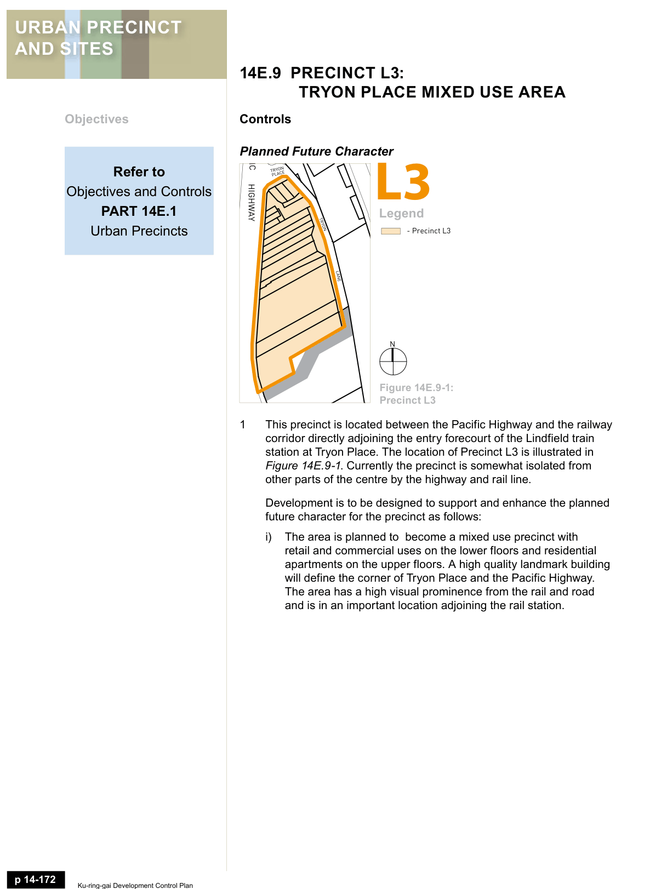
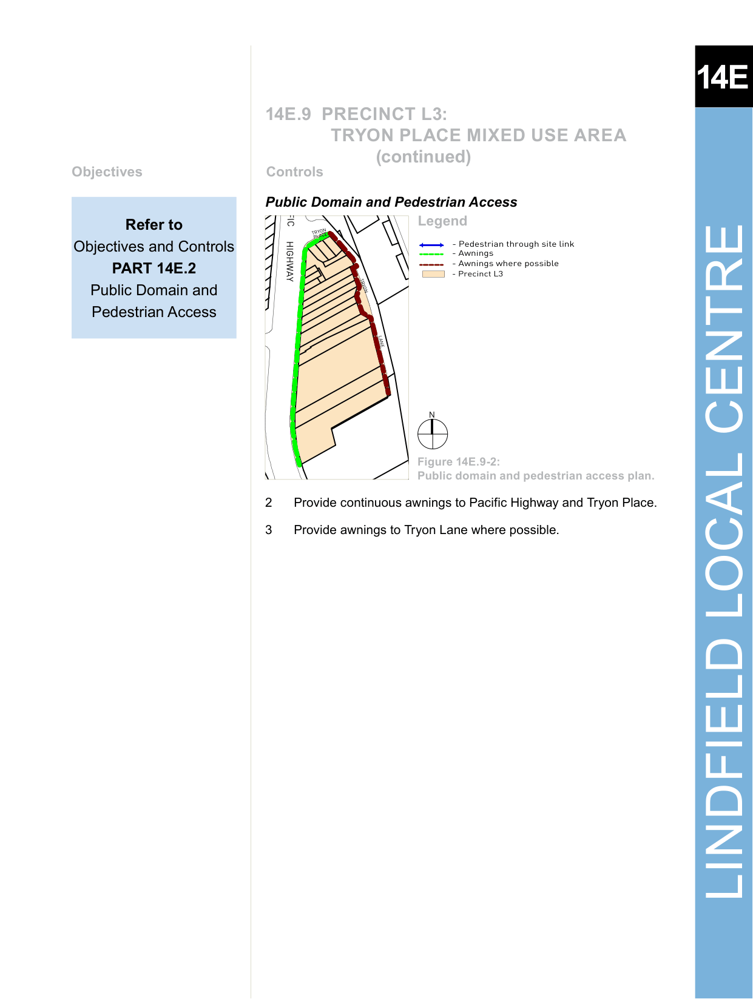
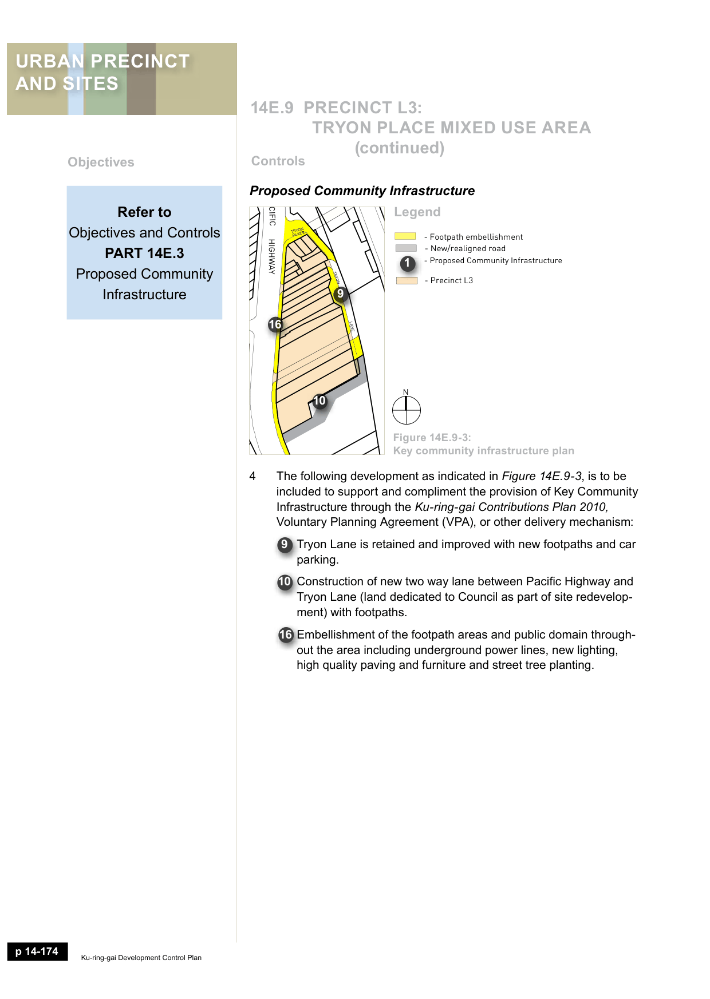
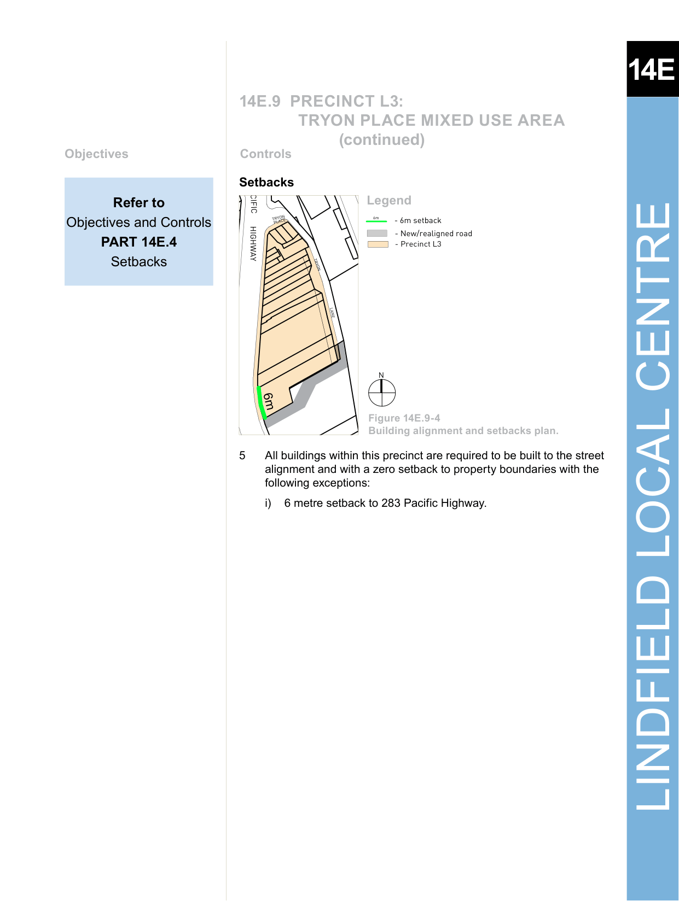
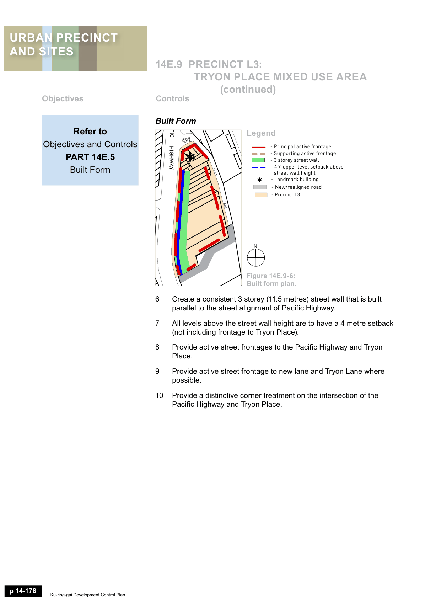

## 5 Access

10

LANE

- Precinct L1

- Precinct L2

- Precinct L3

- Precinct L4

- Precinct L5

- Precinct L6

- Precinct L7

- Precinct L8

- Precinct L9

RD

TRYON

4

- Landmark building

WAY

DROVERS

6

8

### *

23

25

8

6

10

20A

22

24

29

PDE

- Character item

31

PDE

LACE

TRYON

LANE

33

2

4

11

15

GLADSTONE

- Refer to site specific DCP

- Proposed road

12

16

25

15

- Proposed Community Infrastructure

27

14 31

29

14A

RUSSELL

AVE

LANE

NT

36

32

24

26

Building entries, car parking and

service access plan.

22 20

11 Vehicle and service access is to be via Woodford Lane and Bent Lane. No access is to be provided from the Pacific Highway.

4

HARBOUR

8

PL

3

5

10 7

MIDDLE

9

AVE

1

3

5

ST

8

36

6

2

4

AVE

STRICKLAND

1

CHELMSFORD

38

21

40

16

18

NORWOOD

STRICKLAND

ST

LLEWELLYN 11

9 LLEWELLYN

7

9

11

15

17

19

11A

1-3 5 7

9A

26

22

18

16

20

22

20

14

12

LANE

### LINDFIELD LOCAL CENTRE

14

24

28

30

32

34

10A

12

12

10

ST

2-8

3-11

BURLEIGH

H

> [Picture on page 24: a map, saved as a picture (images/part-14e-lindfield-local-centre-page-24-2.gif, 150 dpi); the street names and other small labels are on the picture.]
> Words printed on the picture (title and legend, copied from the PDF):
> PUBLIC DOMAIN AND PEDESTRIAN
> - Pedestrian through site link
> - Entry plaza/forecourt
> Awnings where possible
> - Continuous colonnade
> BUILDING ENTRIES AND CARPAT
> - Vehicular access to site
> - Pedestrian access to site
> - Precinct L1
> - Precinct L2
> - Precinct L3
> - Precinct L4
> - Precinct L5
> - Precinct L6
> - Precinct L7
> - Precinct L8
> - Precinct L9
> 1-3 5 7
> 1-3 5 7

Figure 14E.9-1:

Figure 14E.9-1. Currently the precinct is somewhat isolated from

### 14E.9  PRECINCT L3:

### TRYON PLACE MIXED USE AREA

#### Objectives

#### Controls Planned Future Character

Refer to

#### Objectives and Controls

### L3

#### Legend

#### PART 14E.1

#### Urban Precincts

5

1 This precinct is located between the Pacific Highway and the railway

corridor directly adjoining the entry forecourt of the Lindfield train

station at Tryon Place. The location of Precinct L3 is illustrated in

other parts of the centre by the highway and rail line. Development is to be designed to support and enhance the planned

future character for the precinct as follows:

3

i) The area is planned to  become a mixed use precinct with

retail and commercial uses on the lower floors and residential

apartments on the upper floors. A high quality landmark building

will define the corner of Tryon Place and the Pacific Highway.

The area has a high visual prominence from the rail and road

and is in an important location adjoining the rail station.

1

STRICKLAND

4 D 287

> [Picture on page 25: a map, saved as a picture (images/part-14e-lindfield-local-centre-page-25-2.gif, 150 dpi); the street names and other small labels are on the picture.]
> Words printed on the picture (title and legend, copied from the PDF):
> ( UNFORMED ) 5
> 7.32 / 3.66 W.
> ESMT FOR SERVICES
> 7.32 / 3.66 W.
> ESMT FOR SERVICES
> - 10m setback
> - 6m setback
> - 5m setback
> - 4m setback
> - 3m setback
> - 2m setback
> - Land dedication
> - Alternate deep soil landscaping
> (% of site)
> - 12m setback
> - 10m setback
> - 6m setback
> - 5m setback
> - 4m setback
> - 3m setback
> - 2m setback
> - Land dedication
> - Alternate deep soil landscaping
> (% of site)
> 117 14 CHAPMAN
> 16 123 125 127
> PUBLIC DOMAIN AND PEDESTRIAN
> 4 6 8 10
> 2 4 6 8 10
> 1 3 5
> 1 3 5
> - Pedestrian through site link
> - Entry plaza/forecourt
> Awnings where possible
> - Continuous colonnade
> - Primary active frontage
> - Secondary active frontage
> - 3 storey street wall
> - 2m upper level setback above street
> - 4m upper level setback above street
> - Primary active frontage
> - Secondary active frontage
> - 3 storey street wall
> - 2m upper level setback above street
> - 4m upper level setback above street
> BUILDING ENTRIES AND CARPAT
> PUBLIC DOMAIN AND PEDESTRIAN
> 9 PUBLIC DOMAIN AND PEDESTRIAN
> 4 8 10
> 5 7 9 11
> - Vehicular access to site
> - Pedestrian access to site
> 4 8 10
> 5 7 9 11
> - Pedestrian through site link
> - Entry plaza/forecourt
> - Awnings where possible
> 10 12 14 16 18
> 4 6 8
> - Pedestrian through site link
> - Entry plaza/forecourt
> - Awnings where possible
> 10 12 14 16 18
> 4 6 8
> 3 5 7 11
> BUILDING ENTRIES AND CARPAT
> 41 RD MARJORIE
> 3 5 7 11
> BUILDING ENTRIES AND CARPAT
> - Vehicular access to site
> - Pedestrian access to site
> - Precinct L1
> - Precinct L2
> - Precinct L3
> - Precinct L4
> - Precinct L5
> - Precinct L6
> - Precinct L7
> - Precinct L8
> - Precinct L9
> 55 26A AVE
> - Vehicular access to site
> - Pedestrian access to site
> 24 22 20 18
> - Heritage/character item
> 24 22 20 18
> 9 LLEWELLYN 14
> - Heritage/character item
> 2-8 3.66W PATHWAY 18
> 9 41 RD
> 6 3.66W PATHWAY
> 28 5 39
> Public domain and pedestrian access plan.
> 5 4 2
> 7 3.66W PATHWAY
> 1-3 5 7

Figure 14E.9-2:

ST 4

- Alternate deep soil requirement

OODFORD

#### Objectives

### 14E.9  PRECINCT L3:

### TRYON PLACE MIXED USE AREA

### (continued)

#### Controls Public Domain and Pedestrian Access

N

#### Legend

N

#### Legend

Refer to

#### Objectives and Controls

#### PART 14E.2

Public Domain and

#### Pedestrian Access

E

2 Provide continuous awnings to Pacific Highway and Tryon Place. 3 Provide awnings to Tryon Lane where possible.

### LINDFIELD LOCAL CENTRE

STRICKLAND LANE

T

2 ON

YA 1

> [Picture on page 26: a map, saved as a picture (images/part-14e-lindfield-local-centre-page-26-4.gif, 150 dpi); the street names and other small labels are on the picture.]
> Words printed on the picture (title and legend, copied from the PDF):
> 24 4 6 8 10
> 2 23 (Howard)
> - Pedestrian through site link
> - Awnings where possible
> 10 12 14 16 18
> ST CATHERINE LANE
> BUILDING ENTRIES AND CARPAT
> HOWARD 4 8 10
> - Vehicular access to site
> - Pedestrian access to site
> - Continuous awnings where possible
> - Continuous colonnade
> 4 8 10
> BUILDING ENTRIES AND CARPAT
> PUBLIC DOMAIN AND PEDESTRIAN
> 5 7 9 11
> - Continuous awnings
> - Continuous awnings where possible
> - Continuous colonnade
> 10 12 14 16 18
> 4 6 8
> 24 22 20 18
> - Heritage item
> 3 5 7 11
> LANE BUILDING ENTRIES AND CARPAT
> - Vehicular access to site
> - Pedestrian access to site
> 10 12 14 16 18
> 4 6 8
> - Landmark building
> 3 5 7 11
> - Vehicular access to site
> - Pedestrian access to site
> KEY COMMUNITY INFRASTRUCTRE
> - Pedestrian through site link
> - Entry plaza/forecourt
> Awnings where possible
> - Continuous colonnade
> BUILDING ENTRIES AND CARPAT
> - Character item
> KEY COMMUNITY INFRASTRUCTRE
> 24 22 20 18
> 16 3.66W PATHWAY
> AVE 30 4
> - Vehicular access to site
> - Pedestrian access to site
> - Refer to site specific DCP
> - Proposed road
> - Proposed Community Infrastructure
> 24 22 20 18 5
> 3.66W PATHWAY 18
> - Footpath embellishment
> - New or existing park to be upgraded
> - Historic/character building to be
> - New/realigned road
> - Proposed pedestrian promenade
> - New community facility
> 3.66W PATHWAY 18
> 26 4 IKARA
> 7 1 80
> - Footpath embellishment
> - New or existing park to be upgraded
> - Historic/character building to be
> - New/realigned road
> - Proposed pedestrian promenade
> - New community facility
> 28 5 39 45
> 27 3 8
> - Precinct L1
> - Precinct L2
> - Precinct L3
> - Precinct L4
> - Precinct L5
> - Precinct L6
> - Precinct L7
> - Precinct L8
> - Precinct L9
> 44 6 4 2
> 44 6 4 2
> 1-3 5 7
> Key community infrastructure plan
> 1-3 5 7

Figure 14E.9-3:

### 14E.9  PRECINCT L3:

### TRYON PLACE MIXED USE AREA

### (continued)

#### Controls

#### Objectives

### *

#### Proposed Community Infrastructure

#### Legend

Refer to

#### Objectives and Controls

#### PART 14E.3

#### Proposed Community Infrastructure

4 The following development as indicated in Figure 14E.9-3, is to be included to support and compliment the provision of Key Community Infrastructure through the Ku-ring-gai Contributions Plan 2010, Voluntary Planning Agreement (VPA), or other delivery mechanism: 9 Tryon Lane is retained and improved with new footpaths and car

parking. Construction of new two way lane between Pacific Highway and Tryon Lane (land dedicated to Council as part of site redevelop-

ment) with footpaths. Embellishment of the footpath areas and public domain through-out the area including underground power lines, new lighting, high quality paving and furniture and street tree planting.

B

NE

CR 56A

> [Picture on page 27: a map, saved as a picture (images/part-14e-lindfield-local-centre-page-27-2.gif, 150 dpi); the street names and other small labels are on the picture.]
> Words printed on the picture (title and legend, copied from the PDF):
> 16 5 7 9 11
> - Continuous awnings where possible
> - Continuous colonnade
> PUBLIC DOMAIN AND PEDESTRIAN
> BUILDING ENTRIES AND CARPAT
> 10 12 14 16 18
> 4 6 8
> 3 5 7 11
> - Vehicular access to site
> - Pedestrian access to site
> ALIGNMENT AND SETBACKS
> - Pedestrian through site link
> - Entry plaza/forecourt
> Awnings where possible
> - Continuous colonnade
> - 9m setback
> 27 25 23
> 21 19 17
> KEY COMMUNITY INFRASTRUCTRE
> - 15m setback
> BUILDING ENTRIES AND CARPAT
> 26 24 22
> - 13m setback
> 12 10 8
> - 12m setback
> - 11m setback
> - Vehicular access to site
> - Pedestrian access to site
> 24 22 20 18
> 7.32 / 3.66 W.
> ESMT FOR SERVICES
> 3.66W PATHWAY 18
> 1 4 AVE
> - Footpath embellishment
> - New or existing park to be upgraded
> - Historic/character building to be
> - New/realigned road
> - Proposed pedestrian promenade
> - New community facility
> 101 103 105
> - 10m setback
> - 6m setback
> - 5m setback
> - 4m setback
> - 3m setback
> - 2m setback
> - Land dedication
> - Alternate deep soil landscaping
> (% of site)
> - Precinct L1
> - Precinct L2
> - Precinct L3
> - Precinct L4
> - Precinct L5
> - Precinct L6
> - Precinct L7
> - Precinct L8
> - Precinct L9
> 123 125 127
> 44 6 4 2 23
> 1-3 5 7
> 4 6 8 10
> - Principal active frontage
> - Supporting active frontage
> - 3 storey street wall
> - 2m upper level setback above
> 1 3 5
> - 4m upper level setback above
> street wall height
> PUBLIC DOMAIN AND PEDESTRIAN
> 4 8 10
> Building alignment and setbacks plan.
> 5 7 9 11
> - Pedestrian through site link
> - Entry plaza/forecourt
> - Awnings where possible
> 10 12 14 16 18
> 4 6 8
> 3 5 7 11
> BUILDING ENTRIES AND CARPAT
> - Vehicular access to site
> - Pedestrian access to site
> 24 22 20 18
> - Heritage item
> 82 3.66W PATHWAY
> - Landmark building
> IKARA 1 80
> - Character item
> 28 5 39
> 6 3.66W PATHWAY
> 6 4 2
> - Refer to site specific DCP
> - Proposed road
> - Proposed Community Infrastructure
> 1-3 5 7

Figure 14E.9-4

SIDE

#### Objectives

### 14E.9  PRECINCT L3:

### TRYON PLACE MIXED USE AREA

### (continued)

#### Controls Setbacks

D

#### Legend

TRAFAL

Refer to

#### Objectives and Controls

## 5 PART 14E.4 Setbacks

LN

5 All buildings within this precinct are required to be built to the street

alignment and with a zero setback to property boundaries with the

following exceptions:

i) 6 metre setback to 283 Pacific Highway.

36

### *

### LINDFIELD LOCAL CENTRE

STRICKLAND LANE

INK

### *

- 3m setback

- Principal active frontage

> [Picture on page 28: a map, saved as a picture (images/part-14e-lindfield-local-centre-page-28-5.gif, 150 dpi); the street names and other small labels are on the picture.]
> Words printed on the picture (title and legend, copied from the PDF):
> 11 CR 150
> - 2m setback
> - Land dedication
> - Alternate deep soil requirement
> - Supporting active frontage
> - 2m upper level setback above
> 1 ( UNFORMED )
> 2A 1 3 5 ALIGNMENT AND SETBACKS
> - 4m upper level setback above
> 2 CR 56A
> - 9m setback
> 52 4 6 8 10
> - 15m setback
> - 13m setback
> 23 (Howard) PUBLIC DOMAIN AND PEDESTRIAN
> - 12m setback
> - 11m setback
> RD LANE 270
> 5 7 9 11
> 7.32 / 3.66 W.
> ESMT FOR SERVICES
> 4 8 10
> - 2m upper level setback above street
> - 4m upper level setback above street
> 4 5 7 9 11
> - Pedestrian through site link
> - Entry plaza/forecourt
> - Awnings where possible
> - Through site link
> - Entry plaza/forecourt
> - Continuous awnings
> - Continuous awnings where possible
> - Continuous colonnade
> 10 12 14 16 18
> 4 6 8
> PUBLIC DOMAIN AND PEDESTRIAN
> 3 5 7 11
> BUILDING ENTRIES AND CARPAT
> BUILDING ENTRIES AND CARPAT
> 101 103 105 107
> 10 12 14 16 18
> 4 6 8
> - 10m setback
> - 6m setback
> - 5m setback
> - 4m setback
> - 3m setback
> - 2m setback
> - Land dedication
> - Alternate deep soil landscaping
> (% of site)
> 63 Built Form
> 121 15 19
> 3 5 7 11
> - Vehicular access to site
> - Pedestrian access to site
> - Vehicular access to site
> - Pedestrian access to site
> 123 125 127
> - Pedestrian through site link
> - Entry plaza/forecourt
> Awnings where possible
> - Continuous colonnade
> KEY COMMUNITY INFRASTRUCTRE
> BUILDING ENTRIES AND CARPAT
> 24 22 20 18
> - Heritage item
> 4 6 8 10
> - Principal active frontage
> - Supporting active frontage
> - 3 storey street wall
> - 2m upper level setback above
> - Vehicular access to site
> - Pedestrian access to site
> BEACONSFIELD 7 26
> 1 3 5
> 24 22 20 18
> - Landmark building
> - 4m upper level setback above
> - Character item
> PUBLIC DOMAIN AND PEDESTRIAN
> - Footpath embellishment
> - New or existing park to be upgraded
> - Historic/character building to be
> - New/realigned road
> - Proposed pedestrian promenade
> - New community facility
> 4 8 10
> 43 3.66W PATHWAY RD
> 5 7 9 11
> CLOSE 26 4
> - Refer to site specific DCP
> - Proposed road
> 28 5 AMINYA
> - Precinct L1
> - Precinct L2
> - Precinct L3
> - Precinct L4
> - Precinct L5
> - Precinct L6
> - Precinct L7
> - Precinct L8
> - Precinct L9
> - Proposed Community Infrastructure
> - Pedestrian through site link
> - Entry plaza/forecourt
> - Awnings where possible
> 10 12 14 16 18
> 4 6 8
> 46 15 19
> 3 5 7 11
> 1 7 STRICKLAND
> BUILDING ENTRIES AND CARPAT
> 1-3 5 7
> - Vehicular access to site
> - Pedestrian access to site
> Built form plan.
> 24 22 20 18
> - Heritage item
> 82 3.66W PATHWAY
> - Landmark building
> IKARA 1 80
> - Character item
> 28 5 39
> 6 3.66W PATHWAY
> 6 4 2
> - Refer to site specific DCP
> - Proposed road
> 1 7 3.66W PATHWAY
> - Proposed Community Infrastructure
> 1-3 5 7

Figure 14E.9-6:

45
