### 14E.9  PRECINCT L3:

### TRYON PLACE MIXED USE AREA

### (continued)

#### Controls

#### Objectives

#### Legend

Refer to

#### Objectives and Controls

#### PART 14E.5

#### Built Form

### *

### * wall height

6 Create a consistent 3 storey (11.5 metres) street wall that is built

parallel to the street alignment of Pacific Highway. 7 All levels above the street wall height are to have a 4 metre setback

(not including frontage to Tryon Place).

### *

8 Provide active street frontages to the Pacific Highway and Tryon

9 Provide active street frontage to new lane and Tryon Lane where

10 Provide a distinctive corner treatment on the intersection of the

Pacific Highway and Tryon Place.

1

STRICKLAND LAN

(% of site)

VE

AVE 48 49 TRYON

WOODSID LINK

152 23 (Howard)

STURT

6 6A LANE

R

- Principal active frontage

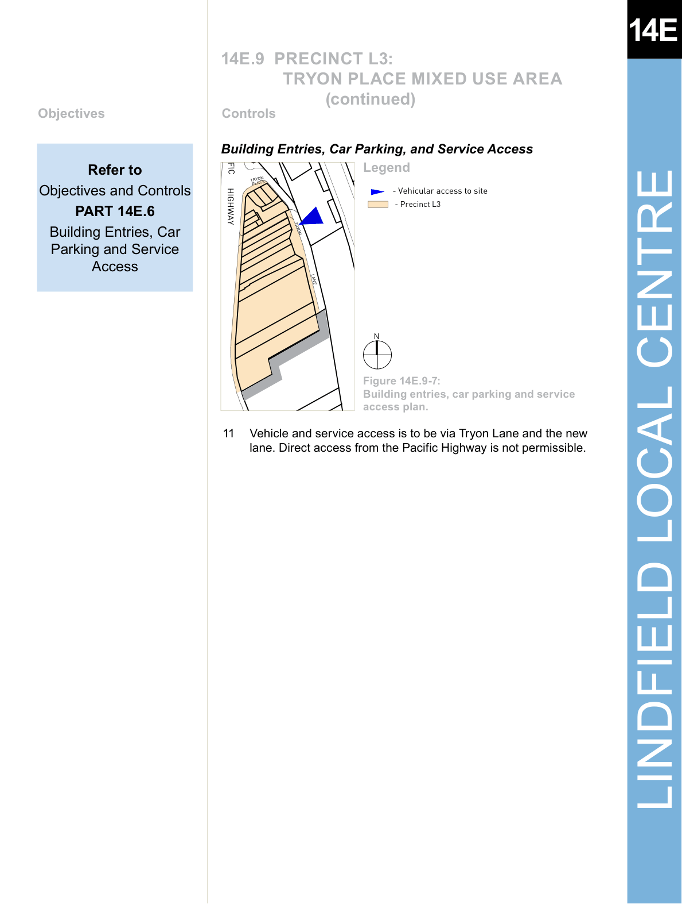

> [Picture on page 29: a map, saved as a picture (images/part-14e-lindfield-local-centre-page-29-10.gif, 150 dpi); the street names and other small labels are on the picture.]
> Words printed on the picture (title and legend, copied from the PDF):
> - Supporting active frontage
> - 2m upper level setback above
> 1 3 5 street
> - 4m upper level setback above
> street wall height
> PUBLIC DOMAIN AND PEDESTRIAN
> 4 8 10
> 5 7 9 11
> - Pedestrian through site link
> - Entry plaza/forecourt
> Awnings where possible
> - Continuous colonnade
> BUILDING ENTRIES AND CARPAT
> - Pedestrian through site link
> - Entry plaza/forecourt
> - Awnings where possible
> 10 12 14 16 18
> 4 6 8
> - Vehicular access to site
> - Pedestrian access to site
> 3 5 7 11
> BUILDING ENTRIES AND CARPAT
> - Vehicular access to site
> - Pedestrian access to site
> 24 22 20 18
> - Heritage item
> - Precinct L1
> - Precinct L2
> - Precinct L3
> - Precinct L4
> - Precinct L5
> - Precinct L6
> - Precinct L7
> - Precinct L8
> - Precinct L9
> 82 3.66W PATHWAY
> - Landmark building
> - Character item
> 4 1-3 5 7
> 6 3.66W PATHWAY
> - Refer to site specific DCP
> - Proposed road
> - Proposed Community Infrastructure
> Building entries, car parking and service
> 1-3 5 7

Figure 14E.9-7:

ST

STANLEY

ST

LN

WOODFORD

LEY

CLOSE

LANE

### 14E.9  PRECINCT L3:

### TRYON PLACE MIXED USE AREA

### (continued)

#### Controls

#### Objectives

#### Building Entries, Car Parking, and Service Access

6

LANE

BEACONSFIELD

Refer to

#### Objectives and Controls

TRAFALGA

CL

CRESTA

#### PART 14E.6

#### Building Entries, Car

AVE

#### Parking and Service

#### Access

WAY

DROVERS

### *

23

25

20A

22

24

29 11 26 31

GLADSTONE 33

12

6

14

14A

17

19

11 Vehicle and service access is to be via Tryon Lane and the new

lane. Direct access from the Pacific Highway is not permissible.

14

18

19A 21B

### LINDFIELD LOCAL CENTRE

25

7

Ku-ring-gai Development Control Plan STRICKLAND LANE

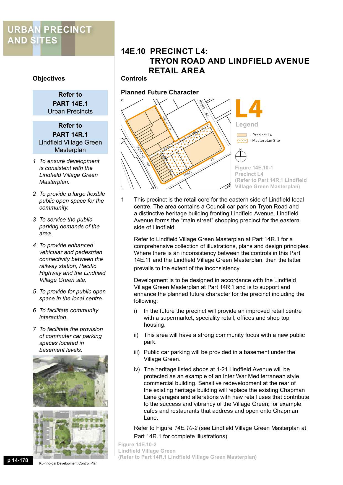

> [Picture on page 30: a map, saved as a picture (images/part-14e-lindfield-local-centre-page-30-1.gif, 150 dpi); the street names and other small labels are on the picture.]
> Words printed on the picture (title and legend, copied from the PDF):
> - Continuous awnings where possible
> - Continuous colonnade
> PUBLIC DOMAIN AND PEDESTRIAN
> BUILDING ENTRIES AND CARPAT
> - Vehicular access to site
> - Pedestrian access to site
> - Pedestrian through site link
> - Entry plaza/forecourt
> Awnings where possible
> - Continuous colonnade
> BUILDING ENTRIES AND CARPAT
> - Vehicular access to site
> - Pedestrian access to site
> B2 Local Centre Development
> Site access points
> 26 Pedestrian access
> LOWANA - Masterplan Site
> Lindfield Village Green
> 1-3 5 7
> - Precinct L1
> - Precinct L2
> - Precinct L3
> - Precinct L4
> - Precinct L5
> - Precinct L6
> - Precinct L7
> - Precinct L8
> - Precinct L9
> 1	 To ensure development
> is consistent with the
> Lindfield Village Green
> 1-3 5 7
> (Refer to Part 14R.1 Lindfield
> Village Green Masterplan)
> parking demands of the
> 4	 To provide enhanced
> vehicular and pedestrian
> connectivity between the
> railway station, Pacific
> Highway and the Lindfield
> Village Green site.
> 6	 To facilitate community
> of commuter car parking
> spaces located in
> JMD design + tonkin zulaikha greer
> JMD design + tonkin zulaikha greer
> Lindfield Village Green
> 1-3 5 7
> Lindfield Village Green
> (Refer to Part 14R.1 Lindfield Village Green Masterplan)
> Lindfield Village Green

Figure 14E.10-1

Figure 14E.10-2

LIGHTCL

D

### 14E.10  PRECINCT L4:

### TRYON ROAD AND LINDFIELD AVENUE

### RETAIL AREA

#### Objectives

#### Controls Planned Future Character

Refer to

#### PART 14E.1

A

#### Legend

Refer to

#### PART 14R.1

### L4

28

9

### L4

13

2	 To provide a large flexible

public open space for the

1 This precinct is the retail core for the eastern side of Lindfield local

centre. The area contains a Council car park on Tryon Road and

a distinctive heritage building fronting Lindfield Avenue. Lindfield

Avenue forms the “main street” shopping precinct for the eastern

side of Lindfield.

3	 To service the public

Refer to Lindfield Village Green Masterplan at Part 14R.1 for a

comprehensive collection of illustrations, plans and design principles.

Where there is an inconsistency between the controls in this Part

14E.11 and the Lindfield Village Green Masterplan, then the latter prevails to the extent of the inconsistency.

47

5	 To provide for public open

space in the local centre.

Development is to be designed in accordance with the Lindfield

Village Green Masterplan at Part 14R.1 and is to support and

enhance the planned future character for the precinct including the

following:

i) In the future the precinct will provide an improved retail centre

with a supermarket, speciality retail, offices and shop top

4

ii)	 This area will have a strong community focus with a new public

7	 To facilitate the provision

IL

iii)	 Public car parking will be provided in a basement under the

5

iv)	 The heritage listed shops at 1-21 Lindfield Avenue will be

5

protected as an example of an Inter War Mediterranean style

commercial building. Sensitive redevelopment at the rear of

the existing heritage building will replace the existing Chapman

Lane garages and alterations with new retail uses that contribute

to the success and vibrancy of the Village Green; for example,

cafes and restaurants that address and open onto Chapman

Refer to Figure 14E.10-2 (see Lindfield Village Green Masterplan at Part 14R.1 for complete illustrations).

4 RD 3

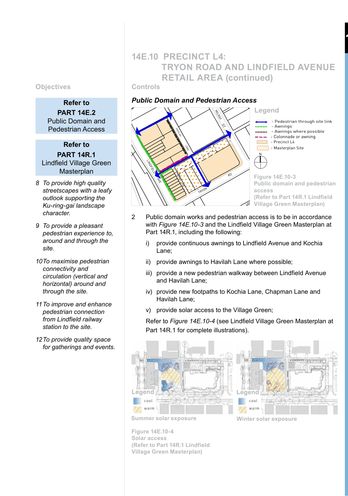

> [Picture on page 31: a map, saved as a picture (images/part-14e-lindfield-local-centre-page-31-2.gif, 150 dpi); the street names and other small labels are on the picture.]
> Words printed on the picture (title and legend, copied from the PDF):
> 7.32 / 3.66 W.
> ESMT FOR SERVICES
> 7.32 / 3.66 W.
> REID ESMT FOR SERVICES
> - 5m setback
> - 4m setback
> - 3m setback
> - 2m setback
> - Land dedication
> - Alternate deep soil requirement
> ( UNFORMED )
> - 10m setback
> - 6m setback
> - 5m setback
> - 4m setback
> - 3m setback
> - 2m setback
> - Land dedication
> - Alternate deep soil landscaping
> (% of site)
> - Continuous awnings where possible
> - Continuous colonnade
> - 12m setback
> - 10m setback
> - 6m setback
> - 5m setback
> - 4m setback
> - 3m setback
> - 2m setback
> - Land dedication
> - Alternate deep soil landscaping
> (% of site)
> 36A 12 117
> 123 125 127
> BUILDING ENTRIES AND CARPAT
> PUBLIC DOMAIN AND PEDESTRIAN
> 6 6A KEITH
> - Vehicular access to site
> - Pedestrian access to site
> 4 6 8 10
> 4 6 8 10
> 1 3 5
> 1 3 5
> - Pedestrian through site link
> - Entry plaza/forecourt
> Awnings where possible
> - Continuous colonnade
> - Primary active frontage
> - Secondary active frontage
> - 3 storey street wall
> - 2m upper level setback above street
> - 4m upper level setback above street
> - Primary active frontage
> - Secondary active frontage
> - 3 storey street wall
> - 2m upper level setback above street
> - 4m upper level setback above street
> - Primary active frontage
> - Secondary active frontage
> - 3 storey street wall
> - 2m upper level setback above street
> - 4m upper level setback above street
> BUILDING ENTRIES AND CARPAT
> LOWANA PUBLIC DOMAIN AND PEDESTRIAN
> PUBLIC DOMAIN AND PEDESTRIAN
> PUBLIC DOMAIN AND PEDESTRIAN
> 4 8 10
> B2 Local Centre Development
> 5 7 9 11
> 4 8 10
> - Vehicular access to site
> - Pedestrian access to site
> 5 7 9 11
> Public Domain and
> Site access points
> 26 Pedestrian access
> - Through site link
> - Entry plaza/forecourt
> - Continuous awnings
> - Continuous awnings where possible
> - Pedestrian through site link
> - Entry plaza/forecourt
> - Awnings where possible
> Colonnade or awning
> 10 12 14 16 18
> 4 6 8
> - Pedestrian through site link
> - Entry plaza/forecourt
> - Awnings where possible
> - Continuous colonnade
> 10 12 14 16 18
> 4 6 8
> 3 5 7 11
> BUILDING ENTRIES AND CARPAT
> LOWANA - Masterplan Site
> BUILDING ENTRIES AND CARPAT
> 3 5 7 11
> 1-3 5 7
> BUILDING ENTRIES AND CARPAT
> - Vehicular access to site
> - Pedestrian access to site
> Lindfield Village Green
> - Precinct L1
> - Precinct L2
> - Precinct L3
> - Precinct L4
> - Precinct L5
> - Precinct L6
> - Precinct L7
> - Precinct L8
> - Precinct L9
> - Vehicular access to site
> - Pedestrian access to site
> - Vehicular access to site
> - Pedestrian access to site
> - Refer to Site Specific DCP for Precinct 5
> 24 22 20 18
> 16 STRICKLAND STRICKLAND
> - Heritage/character item
> 24 22 20 18
> - Heritage/character item
> 1-3 5 7 1
> 3.66W PATHWAY 18
> Public domain and pedestrian
> (Refer to Part 14R.1 Lindfield
> Village Green Masterplan)
> 3.66W PATHWAY 18
> streetscapes with a leafy
> outlook supporting the
> 5 4 2
> pedestrian experience to,
> around and through the
> 1-3 5 7
> BEACONSFIELD 6.10W and Havilah Lane;
> 10	To maximise pedestrian
> circulation (vertical and
> horizontal) around and
> through the site.
> JMD design + tonkin zulaikha greer
> winter solar exposure
> summer solar exposure
> from Lindfield railway
> station to the site.
> for gatherings and events.
> winter solar exposure
> winter solar exposure
> Summer solar exposure
> Winter solar exposure
> Lindfield Village Green
> Lindfield Village Green
> 1-3 5 7
> (Refer to Part 14R.1 Lindfield
> Village Green Masterplan)

Figure 14E.10-3

Figure 14E.10-4

LIGHTCLI

8

### 14E.10  PRECINCT L4:

### TRYON ROAD AND LINDFIELD AVENUE

### RETAIL AREA (continued)

#### Controls

#### Objectives

43

43A

TRYON

#### Public Domain and Pedestrian Access

38

40

42

39

41

3m

#### Legend

E

3m

#### Legend

E

8

Refer to

#### PART 14E.2

VALLEY

2

4

6

LD

VALLEY

Refer to

#### PART 14R.1

3

3A

5

1A

9B

1

5

1B

8	 To provide high quality

2 Public domain works and pedestrian access is to be in accordance

with Figure 14E.10-3 and the Lindfield Village Green Masterplan at

Part 14R.1, including the following:

9	 To provide a pleasant

34

30A

32A 32

i) provide continuous awnings to Lindfield Avenue and Kochia

MIDDLE

ii)	 provide awnings to Havilah Lane where possible;

35

33

37

iii)	 provide a new pedestrian walkway between Lindfield Avenue

3

iv)	 provide new footpaths to Kochia Lane, Chapman Lane and

JMD design + tonkin zulaikha

v)	 provide solar access to the Village Green;

47

49

51

11	To improve and enhance

Refer to Figure 14E.10-4 (see Lindfield Village Green Masterplan at Part 14R.1 for complete illustrations).

AVE 40

12	To provide quality space

JMD design + to

1

#### Legend

#### Legend

9

7

5

KELBURN

### LINDFIELD LOCAL CENTRE

35 24B

STRICKLAND LANE

### 14E.10  PRECINCT L4:

### TRYON ROAD AND LINDFIELD AVENUE

### RETAIL AREA (continued)

#### Controls

#### Objectives

vi)	 improved pedestrian access is to be provided, including the

following:

- Lindfield Station to Kochia Lane via a new pedestrian

crossing;

- Lindfield Ave to Kochia Lane;

- Lindfield Ave to Tryon Road;

- Lindfield Station to Havilah Lane.

JMD design + tonkin zulaikha greer

JMD design + tonkin zulaikha greer

Pedestrian desire lines

Pedestrian desire lines

Lindfield Ave - Tryon Rd

Refer to Figure 14E.10-5 (see Lindfield Village Green Masterplan at Part 14R.1 for complete illustrations).

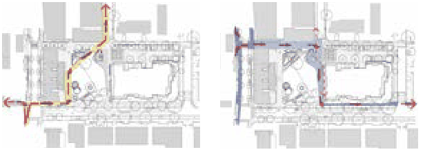

> [Picture on page 32: a picture, saved as a picture (images/part-14e-lindfield-local-centre-page-32-20.gif, 150 dpi).]
> Words printed on the picture (title and legend, copied from the PDF):
> JMD design + tonkin zulaikha greer
> Pedestrian desire lines

station to Havilah Ln

JMD design + tonkin zulaikha greer

Pedestrian desire lines

station to Kochia Ln

Lindfield Ave - Kochia Ln

Lindfield Ave - Kochia Lne new pedestrian crossing

Lindfield Village Green

#### Lindfield Ave - Tryon Rd

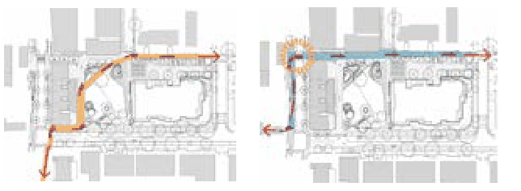

> [Picture on page 32: a picture, saved as a picture (images/part-14e-lindfield-local-centre-page-32-29.gif, 150 dpi).]
> Words printed on the picture (title and legend, copied from the PDF):
> Lindfield Village Green

#### Figure 14E.10-5

#### Pedestrian desire lines

(Refer to Part 14R.1 Lindfield

#### Village Green Masterplan)

#### Station - Havilah Lane

#### Station - Kochia Lane

Lindfield Village Green

JMD design + tonkin zulaikha greer

Lindfield Village Green

the north plaza

vii)	 provide the following features within the Village Green:

- gazebos and pavillions on northern edge of park;

- plaza area within the northern portion of the park;

- open grass areas on southern portion of park to capture

JMD design + tonkin zulaikha greer

the north plaza

Lindfield Village Green

JMD design + tonkin zulaikha greer

maximum solar exposure;

- landscaping features including a water feature, pavillions,

water sensitive urban design (WSUD) gardens.

JMD design + tonkin zulaikha greer

the water feature

the pavilions

WSUD gardens

JMD design + tonkin zulaikha greer

Refer to Figure 14E.10-6 (see Lindfield Village Green Masterplan at Part 14R.1 for complete illustrations).

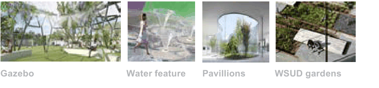

> [Picture on page 32: a picture, saved as a picture (images/part-14e-lindfield-local-centre-page-32-58.gif, 150 dpi).]
> Words printed on the picture (title and legend, copied from the PDF):
> Hiroshi Senju Museum Karuizawa, Japan - Ryue Nishizawa
> Lindfield Village Green
> WSUD gardens
> Water feature Pavillions
> Lindfield Village Green

Lindfield Village Green

#### North plaza Figure 14E.10-6

#### Village Green features

(Refer to Part 14R.1 Lindfield

#### Village Green Masterplan) Gazebo

Lindfield Village Green

Lindfield Village Green

### 14E.10  PRECINCT L4:

### TRYON ROAD AND LINDFIELD AVENUE

### RETAIL AREA (continued)

#### Controls

#### Objectives

JMD design + tonkin zulaikha greer

viii)	provide street planting on the plaza, street and Village Green;

tree planting

Refer to Figure 14E.10-7 (see Lindfield Village Green Masterplan at

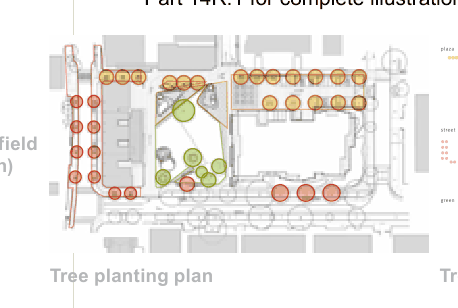

> [Picture on page 33: a picture, saved as a picture (images/part-14e-lindfield-local-centre-page-33-10.gif, 150 dpi).]
> Words printed on the picture (title and legend, copied from the PDF):
> plaza
> street
> green
> Tree planting plan

Part 14R.1 for complete illustrations).

JMD design + tonkin zulaikha greer

tree planting

Tristaniopsis laurina

Corymbia maculata Tristaniopsis laurina Melaleuca quinquenervia Melaleuca quinquenervia

Angophora costata

existing Angophora costata

Stenocarpus sinuatus

Stenocarpus sinuatus

#### Figure 14E.10-7

#### Tree planting

(Refer to Part 14R.1 Lindfield

#### Village Green Masterplan)

Jacaranda mimosifolia Liriodendron tulipifera Liriodendron tulipifera Wisteria floribunda Brachychiton acerifolius

Lindfield Village Green

#### Tree planting examples

ix)	 provide spaces that allow the Village Green to be used for small

events, markets, festivals, night screen/stage and markets.

JMD design + tonkin zulaikha greer

Lindfield Village Green

park usage

small event

Refer to Figure 14E.10-8 (see Lindfield Village Green Masterplan at

Part 14R.1 for complete illustrations).

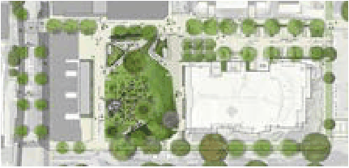

> [Picture on page 33: a picture, saved as a picture (images/part-14e-lindfield-local-centre-page-33-35.gif, 150 dpi).]
> Words printed on the picture (title and legend, copied from the PDF):
> JMD design + tonkin zulaikha greer

expanded event lawn

festival

Lindfield Village Green

#### Park use - small event

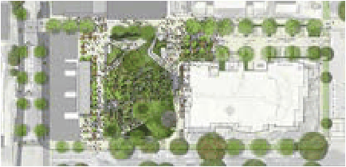

> [Picture on page 33: a picture, saved as a picture (images/part-14e-lindfield-local-centre-page-33-40.gif, 150 dpi).]
> Words printed on the picture (title and legend, copied from the PDF):
> JMD design + tonkin zulaikha greer

#### Figure 14E.10-8

#### Village Green uses

(Refer to Part 14R.1 Lindfield

#### Village Green Masterplan)

plaza usage

market day

Lindfield Village Green

#### Park use - festival

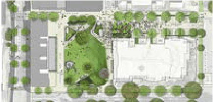

> [Picture on page 33: a picture, saved as a picture (images/part-14e-lindfield-local-centre-page-33-49.gif, 150 dpi).]

### LINDFIELD LOCAL CENTRE

Lindfield Village Green

#### Park use - market day

AY

m

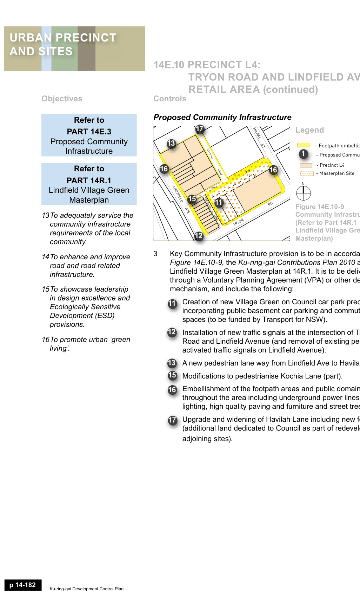

> [Picture on page 34: a map, saved as a picture (images/part-14e-lindfield-local-centre-page-34-3.gif, 150 dpi); the street names and other small labels are on the picture.]
> Words printed on the picture (title and legend, copied from the PDF):
> 23 (Howard) PUBLIC DOMAIN AND PEDESTRIAN
> - Awnings where possible
> 10 12 14 16 18
> - Vehicular access to site
> - Pedestrian access to site
> ST 40 16
> - Continuous colonnade
> BUILDING ENTRIES AND CARPAT
> 4 8 10
> 5 7 9 11
> - Continuous awnings
> - Continuous colonnade
> 24 22 20 18
> - Heritage item
> - Vehicular access to site
> - Pedestrian access to site
> 10 12 14 16 18
> 4 6 8
> - Pedestrian through site link
> - Entry plaza/forecourt
> Awnings where possible
> - Continuous colonnade
> - Landmark building
> 3 5 7 11
> - Vehicular access to site
> - Pedestrian access to site
> - Character item
> - Vehicular access to site
> - Pedestrian access to site
> B2 Local Centre Development
> Site access points
> - Refer to site specific DCP
> - Proposed road
> 24 22 20 18
> - Masterplan Site
> 1-3 5 7
> Lindfield Village Green
> - Footpath embellishment
> - New/realigned road
> - New community facility
> - Precinct L1
> - Precinct L2
> - Precinct L3
> - Precinct L4
> - Precinct L5
> - Precinct L6
> - Precinct L7
> - Precinct L8
> - Precinct L9
> 1-3 5 7
> (Refer to Part 14R.1
> Lindfield Village Green
> requirements of the local
> road and road related
> 15	To showcase leadership
> in design excellence and
> A 15A 16	To promote urban ‘green
> 1-3 5 7

Figure 14E.10-9

Figure 14E.10-9, the Ku-ring-gai Contributions Plan 2010 and the

LIG

BUILDING ENTRIES AND CARPAT

D

- Continuous awnings where possible

PUBLIC DOMAIN AND PEDESTRIAN

- Continuous awnings where possible

1

3

BUILDING ENTRIES AND CARPAT

#### Objectives

### 14E.10 PRECINCT L4:

### TRYON ROAD AND LINDFIELD AVENUE

### RETAIL AREA (continued)

#### Controls

43

### *

TRYON

RD

BUILDING ENTRIES AND CARPAT

30

32

34

38 36

40

42

#### Proposed Community Infrastructure Legend

39 37

41

35

KEY COMMUNITY INFRASTRUCTRE

#### Legend

8

Refer to

#### PART 14E.3

- Proposed Community Infrastructure

VALLEY

2

4

6

RD

NELSON

VALLEY

Refer to

#### PART 14R.1

- New or existing park to be upgraded

- Historic/character building to be

- Proposed pedestrian promenade

3

3A

5

6

2

4

1A

1

1

RUSSELL

LANE

65 63

1B

13	To adequately service the

61

13

6

TRAFALGAR 57

59

14	To enhance and improve

55

3 Key Community Infrastructure provision is to be in accordance with

Lindfield Village Green Masterplan at 14R.1. It is to be delivered

through a Voluntary Planning Agreement (VPA) or other delivery

mechanism, and include the following:

30A

32A 32 MIDDLE

#### 11

35

33

37

Creation of new Village Green on Council car park precinct

incorporating public basement car parking and commuter carpark

spaces (to be funded by Transport for NSW). Installation of new traffic signals at the intersection of Tryon

Road and Lindfield Avenue (and removal of existing pedestrian

activated traffic signals on Lindfield Avenue).

49

51

A new pedestrian lane way from Lindfield Ave to Havilah Road.

#### 13

RD

15 Modifications to pedestrianise Kochia Lane (part).

AVE

#### 16

4

Embellishment of the footpath areas and public domain

throughout the area including underground power lines, new

lighting, high quality paving and furniture and street tree planting. 11

9

7

1

Upgrade and widening of Havilah Lane including new footpaths

(additional land dedicated to Council as part of redevelopment of adjoining sites).

WAIMEA

27

25

32

30

36

34

23

9

7

KELBURN

35 24B

22

20

16

14

24

18

28

26

STRICKLAND LANE

T

A

S

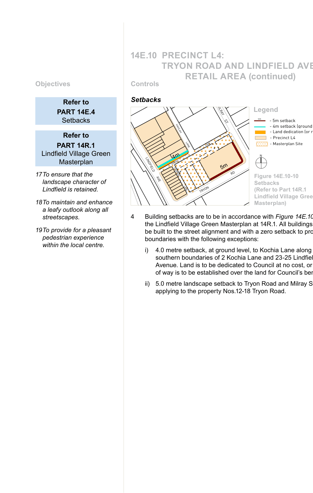

> [Picture on page 35: a map, saved as a picture (images/part-14e-lindfield-local-centre-page-35-4.gif, 150 dpi); the street names and other small labels are on the picture.]
> Words printed on the picture (title and legend, copied from the PDF):
> - Continuous awnings where possible
> - Continuous colonnade
> PUBLIC DOMAIN AND PEDESTRIAN
> BUILDING ENTRIES AND CARPAT
> - Vehicular access to site
> - Pedestrian access to site
> 16 20 22 24 28 30
> ALIGNMENT AND SETBACKS
> 16 20 22 24 28 30
> 4 ALIGNMENT AND SETBACKS
> 38 42 44 46
> ALIGNMENT AND SETBACKS
> - 9m setback
> 38 42 44 46 50
> - Pedestrian through site link
> - Entry plaza/forecourt
> Awnings where possible
> - Continuous colonnade
> 27 25 23
> 21 19 17
> - 15m setback
> 26 24 22
> - 13m setback
> 12m BUILDING ENTRIES AND CARPAT
> 12 10 8
> - 12m setback
> - 11m setback
> - Vehicular access to site
> - Pedestrian access to site
> B2 Local Centre Development
> 7.32 / 3.66 W.
> ESMT FOR SERVICES
> Site access points
> 26 Pedestrian access
> 23 CHELMSFORD 8
> 3m Open Space
> - 15m setback
> - 12m setback
> - 10m setback
> - 6m setback
> - 5m setback
> - 4m setback
> - 4m setback (ground level)
> - 2m setback
> - Land dedication (or right of way)
> - Alternate deep soil requirement
> ( UNFORMED )
> - 15m setback
> - 12m setback
> - 10m setback
> - 6m setback
> - 5m setback
> - 4m setback
> - 4m setback (ground level)
> - 2m setback
> - Land dedication (or right of way)
> - Alternate deep soil requirement
> LOWANA - Masterplan Site
> 1 ( UNFORMED )
> 1-3 5 7
> 101 103 105
> - 10m setback
> - 6m setback
> - 5m setback
> - 4m setback
> - 3m setback
> - 2m setback
> - Land dedication
> - Alternate deep soil landscaping
> (% of site)
> Lindfield Village Green
> 123 125 127
> - Precinct L1
> - Precinct L2
> - Precinct L3
> - Precinct L4
> - Precinct L5
> - Precinct L6
> - Precinct L7
> - Precinct L8
> - Precinct L9
> 8 23 (Howard)
> landscape character of
> Lindfield is retained.
> 4 6 8 10
> - Principal active frontage
> - Supporting active frontage
> - 3 storey street wall
> - 2m upper level setback above
> 1-3 5 7
> - Primary active frontage
> - Secondary active frontage
> - 3 storey street wall
> 1 3 5
> (Refer to Part 14R.1
> Lindfield Village Green
> - 4m upper level setback above
> - Primary active frontage
> - Secondary active frontage
> - 3 storey street wall
> PUBLIC DOMAIN AND PEDESTRIAN
> PUBLIC DOMAIN AND PEDESTRIAN
> PUBLIC DOMAIN AND PEDESTRIAN
> 4 8 10
> 5 7 9 11
> - Through site link
> - Entry plaza/forecourt
> - Continuous awnings
> - Continuous colonnade
> within the local centre.
> - Through site link
> - Entry plaza/forecourt
> - Continuous awnings
> - Continuous colonnade
> BUILDING ENTRIES AND CARPAT
> - Pedestrian through site link
> - Entry plaza/forecourt
> - Awnings where possible
> 10 12 14 16 18
> 4 6 8
> BUILDING ENTRIES AND CARPAT
> 3 5 7 11
> BUILDING ENTRIES AND CARPAT
> - Vehicular access to site
> - Pedestrian access to site
> - Vehicular access to site
> - Pedestrian access to site
> - Vehicular access to site
> - Pedestrian access to site
> - Reduced site coverage and deep
> 24 22 20 18
> - Reduced site coverage and deep
> - Heritage item
> - Landmark building
> 8 CLANVILLE - Character item
> 28 5 LLEWELLYN
> 39 STRICKLAND 7
> 1-3 5 7
> 1-3 5 7
> - Refer to site specific DCP
> - Proposed road
> 3-11 RD 6
> 1-3 5 7

Figure 14E.10-10

1

3

### 14E.10  PRECINCT L4:

### TRYON ROAD AND LINDFIELD AVENUE

### RETAIL AREA (continued)

#### Controls

#### Objectives

TRYON

RD 30

32

34

38 36

40

39 37

41

35

ELD

Refer to

#### PART 14E.4

8

A

VALLEY

Refer to

#### PART 14R.1

2

4

RD

NELSON

VAL

9

3

6

2

4

1A

1

1

17	To ensure that the

RUSSELL

LANE

65

- 2m upper level setback above street

- 4m upper level setback above street

63

1

- 2m upper level setback above street

- 4m upper level setback above street

61

18	To maintain and enhance

a leafy outlook along all

TRAFALGAR 57

59

4 Building setbacks are to be in accordance with Figure 14E.10-10 and

the Lindfield Village Green Masterplan at 14R.1. All buildings are to

be built to the street alignment and with a zero setback to property

boundaries with the following exceptions:

- Continuous awnings where possible

19	To provide for a pleasant

55

- Continuous awnings where possible

RES

30A

32 MID

35

33

i) 4.0 metre setback, at ground level, to Kochia Lane along the

southern boundaries of 2 Kochia Lane and 23-25 Lindfield

Avenue. Land is to be dedicated to Council at no cost, or a right

of way is to be established over the land for Council’s benefit.

ii)	 5.0 metre landscape setback to Tryon Road and Milray Street

B

applying to the property Nos.12-18 Tryon Road.

9

ERIL

RD

1

### *

AVE

11

9

7

- Proposed Community Infrastructure

WAIMEA

2

27

25

32

30

36

34

23

9 KELBURN

### LINDFIELD LOCAL CENTRE

22

20

24

18

28

26

R

S

H

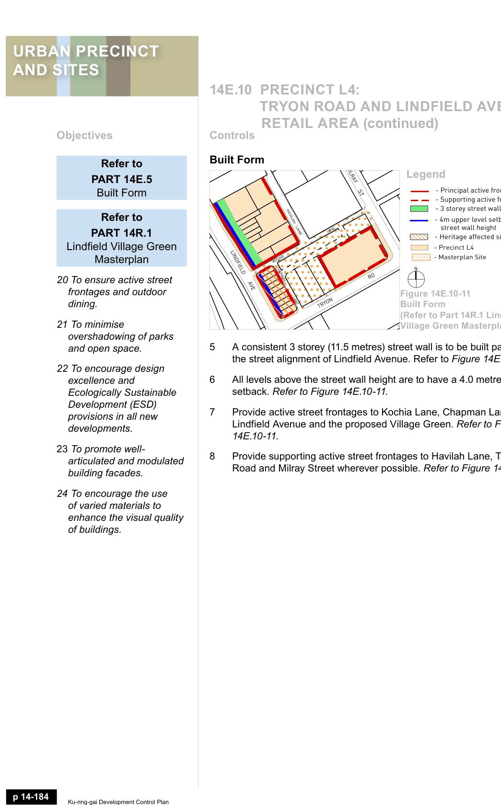

> [Picture on page 36: a map, saved as a picture (images/part-14e-lindfield-local-centre-page-36-2.gif, 150 dpi); the street names and other small labels are on the picture.]
> Words printed on the picture (title and legend, copied from the PDF):
> - Alternate deep soil requirement
> ALIGNMENT AND SETBACKS
> 1 ( UNFORMED )
> - 9m setback
> ALIGNMENT AND SETBACKS
> - 15m setback
> - 9m setback
> 55 - 13m setback
> - Principal active frontage
> - Supporting active frontage
> - 2m upper level setback above
> - 12m setback
> - 15m setback
> 20 AVE LANE
> - 13m setback
> - 11m setback
> 3 4 12 10 8 1 ST
> - 12m setback
> - 4m upper level setback above
> 43 43A 287A
> - 11m setback
> 7.32 / 3.66 W.
> ESMT FOR SERVICES MILRAY
> - Continuous awnings where possible
> - Continuous colonnade
> 7.32 / 3.66 W.
> ESMT FOR SERVICES
> 4 8 10
> 5 7 9 11
> BUILDING ENTRIES AND CARPAT
> PUBLIC DOMAIN AND PEDESTRIAN
> 101 103 105 107 22
> - 10m setback
> - 6m setback
> - 5m setback
> - 4m setback
> - 3m setback
> - 2m setback
> - Land dedication
> - Alternate deep soil landscaping
> (% of site)
> - Vehicular access to site
> - Pedestrian access to site
> - Pedestrian through site link
> - Entry plaza/forecourt
> - Awnings where possible
> 63 101 103 105
> 123 125 127
> 10 12 14 16 18
> 4 6 8
> - 10m setback
> - 6m setback
> - 5m setback
> - 4m setback
> - 3m setback
> - 2m setback
> - Land dedication
> - Alternate deep soil landscaping
> (% of site)
> 3 5 7 11
> Built Form 47
> 123 125 127
> BUILDING ENTRIES AND CARPAT
> - Pedestrian through site link
> - Entry plaza/forecourt
> Awnings where possible
> - Continuous colonnade
> BUILDING ENTRIES AND CARPAT
> - Vehicular access to site
> - Pedestrian access to site
> 4 6 8 10
> - Principal active frontage
> - Supporting active frontage
> - 3 storey street wall
> - 2m upper level setback above
> B2 Local Centre Development
> 1 3 5
> - Vehicular access to site
> - Pedestrian access to site
> 4 6 8 10
> - Principal active frontage
> - Supporting active frontage
> - 3 storey street wall
> - 2m upper level setback above
> - 4m upper level setback above
> Site access points
> 1 3 5
> 26 Pedestrian access
> 24 22 20 18
> - 4m upper level setback above
> - Heritage affected site
> street wall height
> Lindfield Village Green
> LOWANA - Masterplan Site
> 4 8 10
> 1-3 5 7
> - Landmark building
> 5 7 9 11
> 4 8 10
> 5 7 9 11
> - Precinct L1
> - Precinct L2
> - Precinct L3
> - Precinct L4
> - Precinct L5
> - Precinct L6
> - Precinct L7
> - Precinct L8
> - Precinct L9
> - Character item
> CLOSE 26 4
> - Pedestrian through site link
> - Entry plaza/forecourt
> - Awnings where possible
> 10 12 14 16 18
> 4 6 8
> 72 15 6.10W
> frontages and outdoor
> 3 5 7 11
> - Pedestrian through site link
> - Entry plaza/forecourt
> - Awnings where possible
> BUILDING ENTRIES AND CARPAT
> 10 12 14 16 18
> 4 6 8
> - Refer to site specific DCP
> - Proposed road
> (Refer to Part 14R.1 Lindfield
> Village Green Masterplan)
> 3 5 7 11
> 9 LLEWELLYN 7 7
> BUILDING ENTRIES AND CARPAT
> 1-3 5 7
> - Vehicular access to site
> - Pedestrian access to site
> 21	 To minimise
> overshadowing of parks
> and open space.
> - Vehicular access to site
> - Pedestrian access to site
> 14A RICHARD 1 6
> 24 22 20 18
> - Heritage item
> 24 22 20 18
> - Heritage item
> - Landmark building
> IKARA 1 80
> 22	 To encourage design
> provisions in all new
> 43 3.66W PATHWAY
> - Landmark building
> 6 10 IKARA 1
> - Character item
> - Character item
> 23	 To promote well-
> articulated and modulated
> - Refer to site specific DCP
> - Proposed road
> 45 48 CL
> - Refer to site specific DCP
> - Proposed road
> 1 7 3.66W PATHWAY
> of varied materials to
> enhance the visual quality
> 1-3 5 7

Figure 14E.10-11

- Land dedication

PUBLIC DOMAIN AND PEDESTRIAN

- 4m upper level setback above street

1

3

0

m

#### Objectives

### 14E.10  PRECINCT L4:

### TRYON ROAD AND LINDFIELD AVENUE

### RETAIL AREA (continued)

#### Controls

TRYON

RD 30

32

34

38 36

40

39 37

41

A

35

Refer to

#### PART 14E.5

8

VALLEY

PUBLIC DOMAIN AND PEDESTRIAN

Refer to

#### PART 14R.1

RD

2

4

RD

NELSON

VAL

PUBLIC DOMAIN AND PEDESTRIAN

149

m

### *

3

6

2

4

1A

1

3m

1

20	 To ensure active street

RUSSELL

LANE

65 63

1

- Proposed Community Infrastructure

61

5 A consistent 3 storey (11.5 metres) street wall is to be built parallel to

the street alignment of Lindfield Avenue. Refer to Figure 14E.10-11.

57

59

6 All levels above the street wall height are to have a 4.0 metre

setback. Refer to Figure 14E.10-11.

55

RD

30A

32 MID

149

### *

35

33

7 Provide active street frontages to Kochia Lane, Chapman Lane,

Lindfield Avenue and the proposed Village Green. Refer to Figure

### *

7

8 Provide supporting active street frontages to Havilah Lane, Tryon

Road and Milray Street wherever possible. Refer to Figure 14E.10-1

- Proposed Community Infrastructure

- Proposed Community Infrastructure

RD

24	 To encourage the use

25

AVE

11

9

7

WAIMEA

27

25

32

30

36

34

23

9 KELBURN

A

22

20

24

18

28

26

N

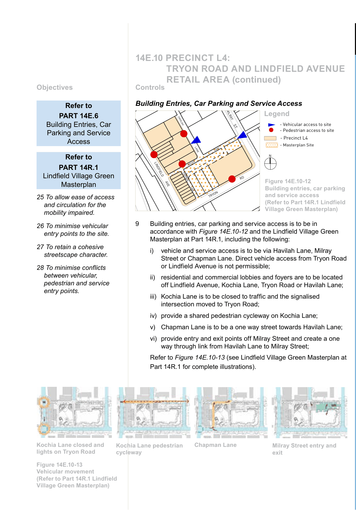

> [Picture on page 37: a map, saved as a picture (images/part-14e-lindfield-local-centre-page-37-2.gif, 150 dpi); the street names and other small labels are on the picture.]
> Words printed on the picture (title and legend, copied from the PDF):
> 2 4 6 8 10
> - Principal active frontage
> - Supporting active frontage
> - 2m upper level setback above
> - Continuous awnings where possible
> - Continuous colonnade
> - 4m upper level setback above
> BUILDING ENTRIES AND CARPAT
> DROVERS    WAY AVE
> street wall height
> LANE WOODSIDE RUSSELL
> PUBLIC DOMAIN AND PEDESTRIAN
> - Vehicular access to site
> - Pedestrian access to site
> 4 8 10
> - Pedestrian through site link
> - Entry plaza/forecourt
> Awnings where possible
> - Continuous colonnade
> 5 7 9 11
> BUILDING ENTRIES AND CARPAT
> - Pedestrian through site link
> - Entry plaza/forecourt
> - Awnings where possible
> 10 12 14 16 18
> 4 6 8
> - Vehicular access to site
> - Pedestrian access to site
> 3 5 7 11
> B2 Local Centre Development
> BUILDING ENTRIES AND CARPAT
> Site access points
> 26 Pedestrian access
> Building Entries, Car
> - Vehicular access to site
> - Pedestrian access to site
> Parking and Service
> - Masterplan Site
> 1-3 5 7
> 24 22 20 18
> - Heritage item
> - Precinct L1
> - Precinct L2
> - Precinct L3
> - Precinct L4
> - Precinct L5
> - Precinct L6
> - Precinct L7
> - Precinct L8
> - Precinct L9
> 21 3.66W PATHWAY
> - Landmark building
> Lindfield Village Green 80
> - Character item
> 1-3 5 7
> Building entries, car parking
> and service access
> (Refer to Part 14R.1 Lindfield
> Village Green Masterplan)
> and circulation for the
> 6 4 2
> - Refer to site specific DCP
> - Proposed road
> - Proposed Community Infrastructure
> 26	 To minimise vehicular
> 28	 To minimise conflicts
> pedestrian and service
> JMD design + tonkin zulaikha greer
> JMD design + tonkin zulaikha greer
> JMD design + tonkin zulaikha greer
> new traffic conditions
> entry & exit: off Milray St
> shared pedestrian cycle way: Kochia Ln
> Kochia Ln closed
> one way: Chapman Ln to Havilah Ln
> one way through link: Havilah Ln to Milray St
> signalised intersection moved to Tryon rd
> Kochia Lane closed and
> lights on Tryon Road
> Kochia Lane pedestrian
> Milray Street entry and
> Lindfield Village Green
> Lindfield Village Green
> Lindfield Village Green
> 1-3 5 7
> Lindfield Village Green
> (Refer to Part 14R.1 Lindfield
> Village Green Masterplan)

Figure 14E.10-12

Figure 14E.10-13

m

A

### 14E.10 PRECINCT L4:

### TRYON ROAD AND LINDFIELD AVENUE

### RETAIL AREA (continued)

#### Controls

#### Objectives

4

TRYON

38 36

40

#### Building Entries, Car Parking and Service Access

39 37

41

#### Legend

8

Refer to

#### PART 14E.6

VALLEY

2

4

RD

VALLEY

D

3

3A

151

2

4

Refer to

#### PART 14R.1

1A

1

### *

1B

25	 To allow ease of access

entry points to the site.

9 Building entries, car parking and service access is to be in

accordance with Figure 14E.10-12 and the Lindfield Village Green

Masterplan at Part 14R.1, including the following:

27	 To retain a cohesive

30A

32A 32 MIDDL

i) vehicle and service access is to be via Havilah Lane, Milray

Street or Chapman Lane. Direct vehicle access from Tryon Road

or Lindfield Avenue is not permissible;

35

33

ii)	 residential and commercial lobbies and foyers are to be located

off Lindfield Avenue, Kochia Lane, Tryon Road or Havilah Lane;

iii)	 Kochia Lane is to be closed to traffic and the signalised

intersection moved to Tryon Road;

51

iv)	 provide a shared pedestrian cycleway on Kochia Lane;

v)	 Chapman Lane is to be a one way street towards Havilah Lane;

vi)	 provide entry and exit points off Milray Street and create a one

AVE

way through link from Havilah Lane to Milray Street;

JMD design + tonkin zulaikha greer

Refer to Figure 14E.10-13 (see Lindfield Village Green Masterplan at Part 14R.1 for complete illustrations).

11

1

25

23

9

7

KELBURN

### LINDFIELD LOCAL CENTRE

35 24B

STRICKLAND LANE

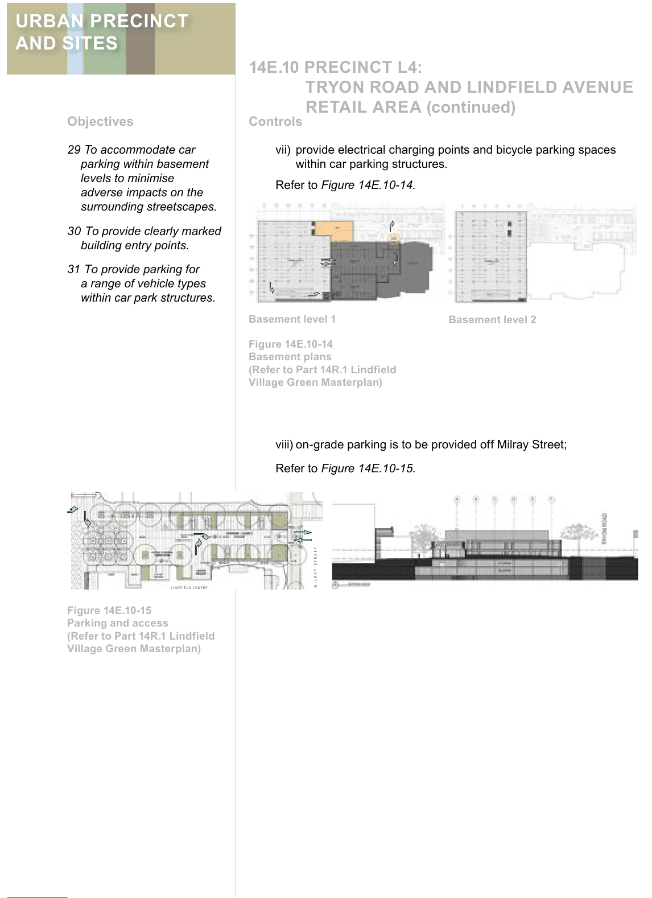

> [Picture on page 38: a map, saved as a picture (images/part-14e-lindfield-local-centre-page-38-1.gif, 150 dpi); the street names and other small labels are on the picture.]
> Words printed on the picture (title and legend, copied from the PDF):
> JMD design + tonkin zulaikha greer
> JMD design + tonkin zulaikha greer
> basement level 1
> basement level 2
> within car parking structures.
> preferred car park entry
> subject to funding
> alternative car park entry
> Refer to Figure 14E.10-14.
> 29	 To accommodate car
> parking within basement
> levels to minimise
> adverse impacts on the
> building entry points.
> within car park structures.
> Basement level 1
> Basement level 2
> the green sections
> Lindfield Village Green
> Lindfield Village Green
> (Refer to Part 14R.1 Lindfield
> Village Green Masterplan)
> JMD design + tonkin zulaikha greer
> on-grade car park
> preferred car park entry
> LIN DF IELD CE N T RE
> Lindfield Village Green
> Lindfield Village Green
> Parking and access
> (Refer to Part 14R.1 Lindfield
> Village Green Masterplan)

Figure 14E.10-14

Figure 14E.10-15

### 14E.10 PRECINCT L4:

### TRYON ROAD AND LINDFIELD AVENUE

### RETAIL AREA (continued)

#### Controls

#### Objectives

vii)	 provide electrical charging points and bicycle parking spaces

30	 To provide clearly marked

JMD design + tonkin zulaikha greer

31	 To provide parking for

a range of vehicle types

viii)	on-grade parking is to be provided off Milray Street; Refer to Figure 14E.10-15.

W

S

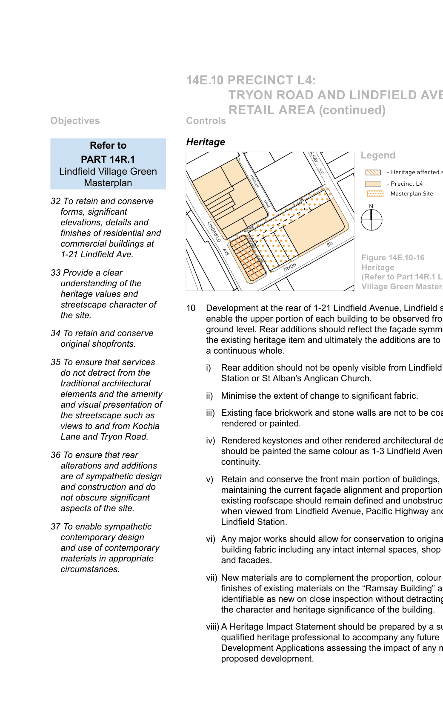

> [Picture on page 39: a map, saved as a picture (images/part-14e-lindfield-local-centre-page-39-3.gif, 150 dpi); the street names and other small labels are on the picture.]
> Words printed on the picture (title and legend, copied from the PDF):
> CARCOOLA - 2m upper level setback above
> - 4m upper level setback above
> - Continuous colonnade
> BUILDING ENTRIES AND CARPAT
> - Vehicular access to site
> - Pedestrian access to site
> - Pedestrian through site link
> - Awnings where possible
> 10 12 14 16 18
> 4 6 8
> 3 5 7 11
> - Pedestrian through site link
> - Entry plaza/forecourt
> Awnings where possible
> - Continuous colonnade
> - Vehicular access to site
> - Pedestrian access to site
> - Vehicular access to site
> - Pedestrian access to site
> B2 Local Centre Development
> Site access points
> 24 22 20 18
> 26 Pedestrian access
> - Heritage affected site
> Lindfield Village Green
> - Landmark building
> 1-3 5 7
> LANE 34A 1
> - Precinct L1
> - Precinct L2
> - Precinct L3
> - Precinct L4
> - Precinct L5
> - Precinct L6
> - Precinct L7
> - Precinct L8
> - Precinct L9
> - Character item
> 14 28 LANE
> 6 4 2
> - Refer to site specific DCP
> - Proposed road
> - Masterplan Site
> elevations, details and
> finishes of residential and
> commercial buildings at
> 1-21 Lindfield Ave.
> 1-3 5 7
> (Refer to Part 14R.1 Lindfield
> Village Green Masterplan)
> 33	 Provide a clear
> understanding of the
> heritage values and
> streetscape character of
> rendered or painted.
> elements and the amenity
> and visual presentation of
> the streetscape such as
> Lane and Tryon Road.
> alterations and additions
> are of sympathetic design
> and construction and do
> not obscure significant
> aspects of the site.
> 37	 To enable sympathetic
> and use of contemporary
> materials in appropriate
> 1-3 5 7

Figure 14E.10-16

- Continuous awnings where possible

0

1

BUILDING ENTRIES AND CARPAT

### 14E.10 PRECINCT L4:

### TRYON ROAD AND LINDFIELD AVENUE

### RETAIL AREA (continued)

#### Controls

#### Objectives

BUILDING ENTRIES AND CARPAT

TRYON

RD 30

32

34

38 36

40

39 37

41

#### Heritage

35

#### Legend

8

Refer to

#### PART 14R.1

VALLEY

### *

47

2

4

1

RD

NELSON

VALLE

3

3A

6

2

4

1A

1

32	 To retain and conserve

- Proposed Community Infrastructure

1

RUSSELL

LANE

65 63

1B

61 TRAFALGAR 57

59

34	 To retain and conserve

55

10 Development at the rear of 1-21 Lindfield Avenue, Lindfield should

enable the upper portion of each building to be observed from

ground level. Rear additions should reflect the façade symmetry of

the existing heritage item and ultimately the additions are to present

a continuous whole.

30A

3 32 MIDDL

35

33

i) Rear addition should not be openly visible from Lindfield Train

Station or St Alban’s Anglican Church.

ii)	 Minimise the extent of change to significant fabric.

iii)	 Existing face brickwork and stone walls are not to be coated,

51

35	 To ensure that services

do not detract from the

views to and from Kochia

iv)	 Rendered keystones and other rendered architectural details

RD

should be painted the same colour as 1-3 Lindfield Avenue for

AVE

v)	 	Retain and conserve the front main portion of buildings,

36	 To ensure that rear

11

9

7

2

maintaining the current façade alignment and proportions. The

existing roofscape should remain defined and unobstructed

when viewed from Lindfield Avenue, Pacific Highway and

vi)	 Any major works should allow for conservation to original

WAIMEA

building fabric including any intact internal spaces, shop fronts

27

25

32

30

36

34

vii)	 New materials are to complement the proportion, colour and

23

9

finishes of existing materials on the “Ramsay Building” and be

identifiable as new on close inspection without detracting from

the character and heritage significance of the building.

KELBURN

### viii)	A Heritage Impact Statement should be prepared by a suitably LINDFIELD LOCAL CENTRE

qualified heritage professional to accompany any future

Development Applications assessing the impact of any major

22

20

16

24

18

28

26

STRICKLAND

### 14E.10 PRECINCT L4:

### TRYON ROAD AND LINDFIELD AVENUE

### RETAIL AREA (continued)

#### Controls

#### Objectives

11 Site specific development controls for end bays, 1-3 Lindfield

Avenue & 17-21 Lindfield Avenue

38	. To conserve the heritage

significance of listed

items.

i) The two end bays were designed to be viewed from three

elevations, it is essential views to these elevations are

maintained.

ii)	 Maintain the monumental form of end bays, and ensure views

39\. To allow for and

encourage the adaptive

re-use of Heritage Items in

the local centre.

to the upper two stories of the buildings from and to Tryon Road

and Kochia Lane remain uninterrupted.

iii)	 A setback to align with interior line of rendered wall strip should

be introduced to both end bays from Tryon Road and Kochia

Lane respectively (Figure 14E.10-19).

iv)	 Retain significant fabric and building elements

40\. To ensure that new

development responds

appriopriately to the

quality and context

of any adjoining and

neighbouring listed

Heritage Items.

v)	 Consider reinstating elements such as spiral barley-twist

columns in-between raking arches on second level of 1-3

Lindfield Avenue façade.

vi)	 The brick retaining wall on Chapman Lane may be removed or

altered to accommodate a secondary entrance.

vii)	 Additions should not exceed 4m including the top of parapet or

balustrade. (Figure 14E.10-19)

viii)	An additional mezzanine or second level may be constructed to

the rear of 17-21 Lindfield Avenue. The additional level must be

transparent glass, including the roof so the upper portion of the

façade can still be seen. The height of this transparent addition

must be below the rendered horizontal band of the existing upper

storey at the maximum. (Figure 14E.10-19

12 Site specific development controls for central retail section, 5-15

Lindfield Avenue, Lindfield:

i) Non-original rear additions to 5-15 Lindfield Avenue, Lindfield

may be removed and replaced with contemporary additions that

are sympathetic in form, detailing and proportion. New additions

should be easily identifiable as new work.

ii)	 Rear additions should be limited to one level and should not

exceed 4m including top of a parapet of balustrade. (Figure

14E.10-19).

iii)	 The rooftop terrace may remain or be introduced above new rear

additions. A limited number of removable structures will allow for

the rear elevation to be appreciated in an unobstructed way.

iv)	 Removal of non-original fabric including paintwork should be

considered.

v)	 Existing breezeways between the central retail section and end

bays must not be obscured or obstructed, breezeways between

in between central retail section may be infilled at ground level.

(See Figure 14E.10-19).

vi)	 Air conditioning units and services should be removed to a more

discrete location.

### 14E.10 PRECINCT L4:

### TRYON ROAD AND LINDFIELD AVENUE

### RETAIL AREA (continued)

#### Controls

#### Objectives

13 To encourage restoration and redevelopment to the rear of Nos.

1-21 Lindfield Avenue and to protect the Heritage Item, the retail

parking requirements may be reduced by up to 100%. The applicant

will be required to provide a report assessing the potential impacts

on public parking around the centre in order for a parking reduction

to be considered. The report is to be consistent with the Council’s

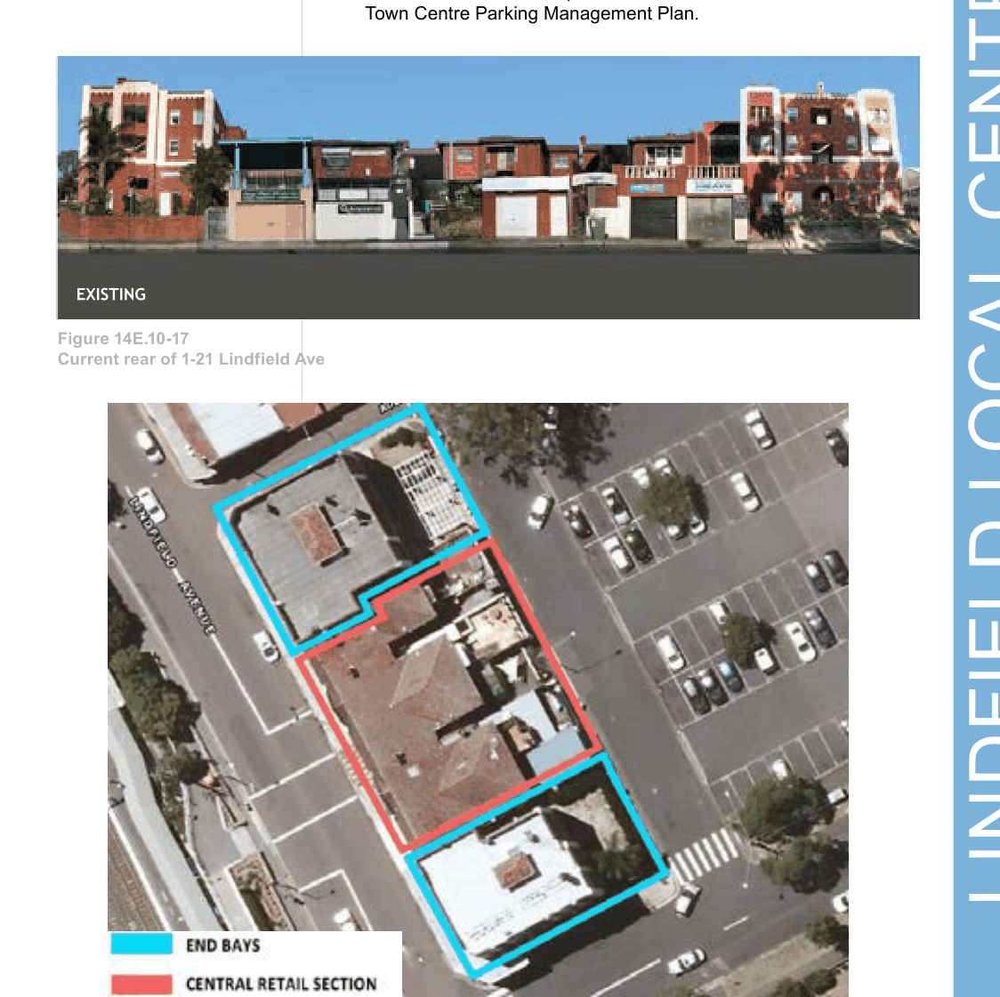

> [Picture on page 41: a picture, saved as a picture (images/part-14e-lindfield-local-centre-page-41-12.gif, 150 dpi).]
> Words printed on the picture (title and legend, copied from the PDF):
> C9 A Heritage Impact Statement should be prepared by a suitably qualified heritage
> professional to accompany any future Development Applications to assessing the
> impact of any major proposed development.
> Current rear of 1-21 Lindfield Ave
> Site specific development controls will address the two distinct components of the 'Ramsay
> Building', the end bays and the central retail section (See Figure 15 below). The building was
> constructed as one building, as such, any development to the rear should be consistent,
> presenting an integrated frontage to Chapman Lane.

Figure 14E.10-17

Town Centre Parking Management Plan.

C9 A Heritage Impact Statement should be prepared by a suitably qualified heritage

professional to accompany any future Development Applications to assessing the

impact of any major proposed development.

### 5.3 Site Specific Development Controls
