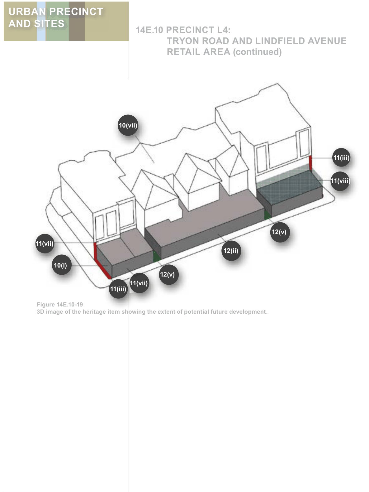

### 5.3 Site Specific Development Controls

Site specific development controls will address the two distinct components of the 'Ramsay

Building', the end bays and the central retail section (See Figure 15 below). The building was

constructed as one building, as such, any development to the rear should be consistent,

presenting an integrated frontage to Chapman Lane.

### LINDFIELD LOCAL CENTRE

Figure 15: The distinct components of the "Ramsay Building". (Original Image Source: SIX Maps 2016)

#### Figure 14E.10-18

The distinct components of the “Ramsay Building”. (Original Image Source: LPI, 2016)

#### 5.3.1 End Bays, 1-3 Lindfield Avenue & 17-21 Lindfield Avenue Controls

Figure 15: The distinct components of the "Ramsay Building". (Original Image Source: SIX Maps 2016)

C10 The two end bays were designed to be viewed from three elevations, it is

essential views to these elevations are maintained.

> [Picture on page 42: a picture, saved as a picture (images/part-14e-lindfield-local-centre-page-42-1.gif, 150 dpi).]
> Words printed on the picture (title and legend, copied from the PDF):
> 3D image of the heritage item showing the extent of potential future development.
> 21 Lindfield Avenue.
> CITY PLAN HERITAGE P/L - H-16089 DCP UPDATE 1-21 LINDFIELD AVENUE LINDFIELD - JUNE 2016
> 17/18

Figure 16: A 3D image of the heritage item showing the extent of potential future development. A

Figure 14E.10-19

Figure 17: A 3D image showing a reduced extent of the permitted additional level or mezzanine at 17-

selection of the development clauses is cross referenced in the image above.
