### 14E.10 PRECINCT L4:

### TRYON ROAD AND LINDFIELD AVENUE

### RETAIL AREA (continued)

#### 10(vii)

#### 11(iii)

#### 11(viii)

#### 12(v)

#### 11(vii)

#### 12(ii)

#### 10(i)

#### 12(v)

#### 11(vii)

#### 11(iii)

### 14E.11  PRECINCT L5:

### LINDFIELD HUB

#### Controls

#### Objectives

#### Planned Future Character

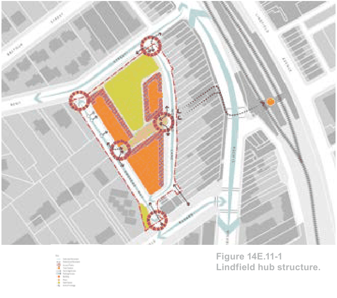

> [Picture on page 43: a picture, saved as a picture (images/part-14e-lindfield-local-centre-page-43-6.gif, 150 dpi).]
> Words printed on the picture (title and legend, copied from the PDF):
> Lindfield hub structure.

Figure 14E.11-1

Refer to

#### PART 14E.1

Urban Precincts

1	 To provide a vibrant

community hub with a

mix of retail, residential,

commercial and

community facilities.

2	 To provide a large flexible

public open space for the

community.

3	 To improve vehicular

movement through the

area.

4	 To retain the existing

number of Council car

parking spaces.

5	 To provide adequate

parking associated

with the new land uses

developed on the site. 1 This precinct is located on the western side of Lindfield local centre

and is owned by Ku-ring-gai Council. The Lindfield Hub is to become

a community focal point with recreational activities and community

facilities. It will include a new urban park, multi-purpose community

facilities, commuter and community car parking, residential buildings

and a new road connecting Bent Street and Beaconsfield Parade.

6	 To provide enhanced

vehicular and pedestrian

connectivity between the

railway station, Pacific

Highway and the Lindfield

Hub site.

Development is to support and enhance the planned future character

of this Precinct by providing the following:

7	 To provide a civic plaza

that connects the site to

Pacific Highway.

i) Community Hub: a range of facilities including a community

centre, new park, restaurants and cafes, commuter car parking,

new library with direct ground level access located adjacent to a

new town square, and parking associated with new and existing

uses.

ii)	 Public Realm: A community park with a retail and community

facility frontage providing passive surveillance opportunities

and a civic plaza for outdoor dining and other leisure and social

activities. A pocket park with native plantings at the south west

corner of Drovers Way and Beaconsfield Parade.

### LINDFIELD LOCAL CENTRE

iii)	 Retail A retail area arranged around the vertical circulation

linking the basement levels to a civic plaza; including a

supermarket and a mix of specialty retail at ground level. The

overall minimum retail/commercial floor space for the site is to

be approximately 5,000m2  to ensure an appropriate mix of uses

are realised at the site.

### 14E.11  PRECINCT L5:

### LINDFIELD HUB (continued)

#### Controls

iv)	 Residential: Buildings providing a mix of 1, 2 and 3 bedroom

units.

v)	 Drovers Way: A new tree lined street with on street parking,

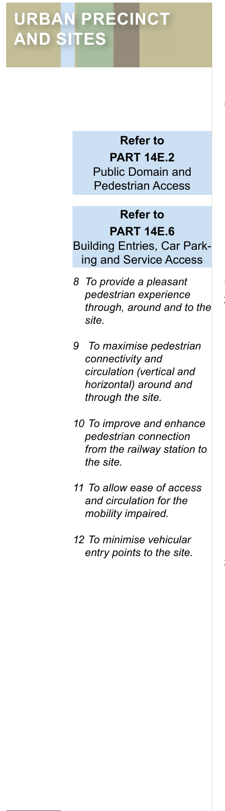

> [Picture on page 44: a map, saved as a picture (images/part-14e-lindfield-local-centre-page-44-7.gif, 150 dpi); the street names and other small labels are on the picture.]
> Words printed on the picture (title and legend, copied from the PDF):
> Public Domain and
> Building Entries, Car Park-
> ing and Service Access
> 9	 To maximise pedestrian
> circulation (vertical and
> horizontal) around and
> through the site.
> and circulation for the
> 12	 To minimise vehicular

Refer to

#### PART 14E.2

landscaped areas and access into the retail arcade, and access

to basement parking and servicing.

vi)	 Woodford Lane: An active lane providing opportunities for the

retail units fronting Pacific Highway to open out to the civic plaza

at the rear.

Refer to

#### PART 14E.6

Refer to Figure 14E.11-1.

2 Pedestrian access is to include the following:

#### Access and Movement

8	 To provide a pleasant

through, around and to the

i) a pedestrian through site link from Pacific Highway to Drovers

Way along the new retail/commercial/community building

frontages and through the civic plaza;

ii)	 a pedestrian walkway from Beaconsfield Parade to Bent Street,

with direct access to the new retail/commercial/community

facilities;

iii)	 a pedestrian link from Woodford Lane to Beaconsfield Parade;

iv)	 pedestrian access off Woodford Lane to the large civic plaza in

the centre of the site.

v)	 pedestrian access from all surrounding streets;

10	 To improve and enhance

from the railway station to

vi)	 pedestrian access to residential lobbies/foyers from Woodford

Lane

vii)	 direct pedestrian access to the community building from Bent

11	 To allow ease of access

Street. Refer to Figures 14E.11-1 and 14E. 11-2.

entry points to the site.

3 Vehicular access is to include the following:

i) all basement parking is to be accessed from Drovers Way (new

road);

ii)	 residential parking is to be accessed from Drovers Way;

iii)	 service access to all buildings is to be from Drovers Way;

iv)	 pick up drop off areas are to be provided on Drovers Way and

Woodford Lane.

v)	 Access to the Scout Hall Site from Woodford lane is to be

maintained. Refer to Figures 14E.11.1 and 14E. 11-2

### 14E.11  PRECINCT L5:

### LINDFIELD HUB (continued)

#### Controls

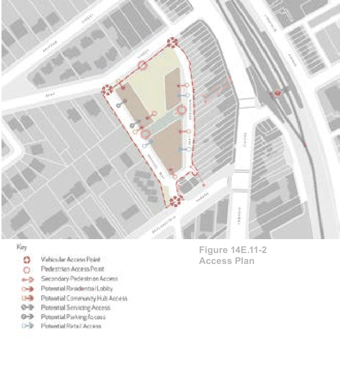

> [Picture on page 45: a picture, saved as a picture (images/part-14e-lindfield-local-centre-page-45-4.gif, 150 dpi).]
> Words printed on the picture (title and legend, copied from the PDF):
> Access Plan

Figure 14E.11-2

#### Objectives

13	 To retain a cohesive

streetscape character. 14	 To minimise conflicts

between vehicular,

pedestrian and service

entry points. 15	 To provide unambiguous

and clearly marked

building entry points. 16	 To provide a clear

distinction between

commercial, retail and

residential building entry

points.

### LINDFIELD LOCAL CENTRE

### 14E.11  PRECINCT L5:

### LINDFIELD HUB (continued)

#### Controls

#### Objectives

#### Public Domain

4 Public domain areas are to be in accordance with following:

Refer to

#### PART 14E.2

Public Domain and

Pedestrian Access

i) existing and upgraded streets are to provide pedestrian and

cycle access, generous footpaths, on-street parking, public

seating and tree canopy;

17	 To provide a new

community public park.

ii)	 a minimum of 15 (1000L) large canopy trees within the new

public park;

iii)	 deep soil planting is to be provided in accordance with Design

18	 To maximise and

enhance the Ku-ring-gai

landscape character to all

streetscapes.

Criteria and Design Guidance in Part 3E of the Apartment

Design Guide;

iv)	 Sufficient soil depth and volume is to be provided to suppor large

19	 To provide open spaces

that cater for a range of

uses, including day and

night uses.

canopy trees in the main park area, plaza and along any new

or existing public streets. Soil depths should generally be 1.2m

with soil volume of 150m3 per tree. Where planted on deck, for

instance above the retail level or parking, the soil depth to be

maintained can be reduced to a minimum 1.0m and the minimum

soil volume to 80m3 per tree

20	 To provide open spaces

that cater for different age

groups.

v)	 Provide a community park on Bent Street with a minimum area

of 3000m2, including the following:

- strong connections to the new community hub;

21	 To create accessible,

comfortable and safe open

spaces.

- main park to be located at or as near as possible to the level

of Woodford Lane to ensure direct and accessible pedestrian

access from the laneway for the full length of its frontage;

22	 To maximise pedestian

connections to open

spaces.

- areas for highly programmed community activities, including,

but not limited to carols, outdoor movies, yoga and passive

recreational opportunities and native play;

23	 To provide open green

spaces for passive

recreation.

- an open turf area

- a main pedestrian movement spine

- The northern perimeter of the park is to have:

24	 To maximise connections

to the new community hub

building.

- an informal tree grove;

- endemic tree species for canopy trees;

- mass planted under storey consisting of native and

exotic species appropriate for the site conditions;

- clear sight lines through all landscaped areas; and

- soil depth (as defined under iv) where appropriate to

accommodate large canopy trees so as to avoid tree

pits protruding above the finished park or plaza level.

- a play space with:

- an adjacent cafe outdoor seating area;

- play areas to cater for toddlers and young children (0-7);

- a water and native play theme;

### 14E.11  PRECINCT L5:

### LINDFIELD HUB (continued)

#### Controls

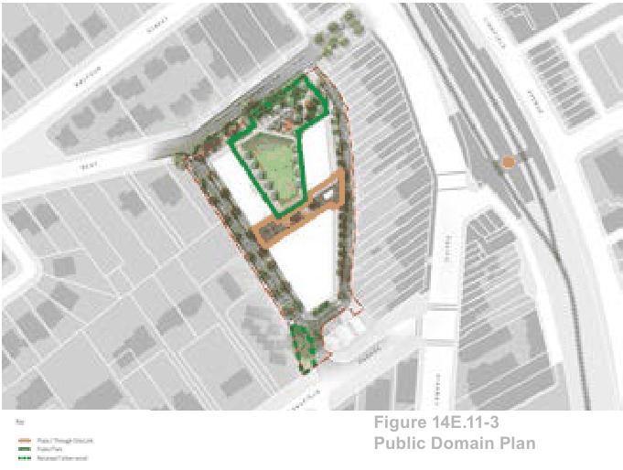

> [Picture on page 47: a picture, saved as a picture (images/part-14e-lindfield-local-centre-page-47-4.gif, 150 dpi).]
> Words printed on the picture (title and legend, copied from the PDF):
> Public Domain Plan

Figure 14E.11-3

#### Objectives

25	 To ensure solar access

to onsite open spaces,

community facilities and

residential dwellings.

vi)	 provide a civic plaza with an approximate area of 900m2,

including the following:

- a high quality public space with a northern aspect and views

over the park landscape;

- circulation paths in high quality unit pavers;

- external seating zones for informal gatherings;

- grove tree planting and seating to street edge;

- access to centralised lift and escalators to retail below;

- a lift entry to library, childcare, community hub and retail

below;

- improved connections to Pacific Highway and train station;

- mass planting under trees.

vii)	 new park and plaza with minimum area of 3,900m2 with park

open to the sky and plaza open to the sky, with the exception of

awnings or the like where required for weather protection only;

viii)	Community facilities comprising not less than a total of 3,000m2

including new library with minimum area of 1,250m2, community

facility with minimum area of 1,200m2 and child care centre with

minimum area of 550m;

ix)	 Community building to have direct access to the park and high

level of connectivity from surrounding street frontages. Refer to Figure 14E.12-3

### LINDFIELD LOCAL CENTRE

5 Solar access is to include the following:

i) Open spaces are to receive morning sun with minimal

overshadowing from the new development;

ii)	 The main public park is to receive direct sunlight to a minimum of

50% of its area for each hour between 9am and 3pm on June 21;

R

INDERS

- Principal active frontage

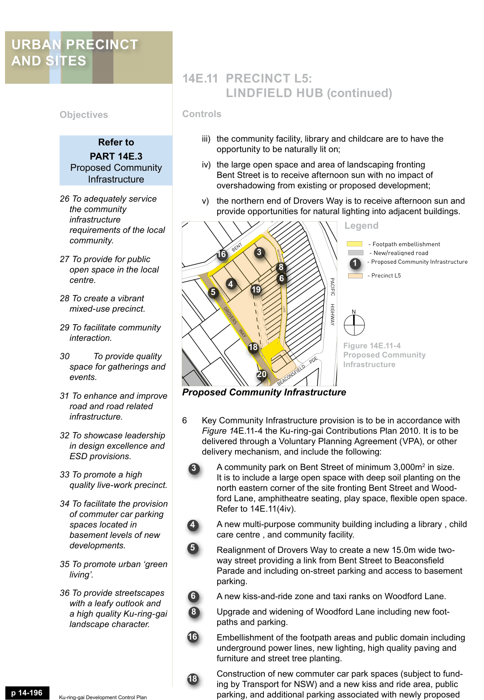

> [Picture on page 48: a map, saved as a picture (images/part-14e-lindfield-local-centre-page-48-4.gif, 150 dpi); the street names and other small labels are on the picture.]
> Words printed on the picture (title and legend, copied from the PDF):
> 7.32 / 3.66 W.
> ESMT FOR SER RD
> - Alternate deep soil requirement
> - Supporting active frontage
> - 2m upper level setback above
> - Nil setback
> - Land dedication
> - Alternate deep soil requirement
> - 4m upper level setback above
> - 10m setback
> - 6m setback
> - 5m setback
> - 4m setback
> - 3m setback
> - 2m setback
> - Land dedication
> - Alternate deep soil requirement
> ( UNFORMED ) PUBLIC DOMAIN AND PEDESTRIAN
> 5 7 9 11
> 4 6 8 10
> 1 3 5
> PUBLIC DOMAIN AND PEDESTRIAN
> 4 6 8 10
> - 2m upper level setback above street
> - 4m upper level setback above street
> - Pedestrian through site link
> - Entry plaza/forecourt
> - Awnings where possible
> 10 12 14 16 18
> 4 6 8
> 11 1 1 3 5
> PARK 345 GILLOTT
> 3 5 7 11
> PUBLIC DOMAIN AND PEDESTRIAN
> BUILDING ENTRIES AND CARPAT
> 4 8 10
> - Primary active frontage
> - Secondary active frontage
> - 3 storey street wall
> - 2m upper level setback above street
> - 4m upper level setback above street
> 5 7 9 11
> - Vehicular access to site
> - Pedestrian access to site
> - Through site link
> - Entry plaza/forecourt
> - Continuous awnings
> - Continuous awnings where possible
> - Continuous colonnade
> PUBLIC DOMAIN AND PEDESTRIAN
> 4 8 10
> BUILDING ENTRIES AND CARPAT
> 5 7 9 11
> - Through site link
> - Entry plaza/forecourt
> - Continuous awnings
> - Continuous awnings where possible
> - Continuous colonnade
> 10 12 14 16 18
> 4 6 8
> 24 22 20 18
> STANLEY WOODFORD AVE
> - Heritage item
> 3 5 7 11
> BUILDING ENTRIES AND CARPAT
> - Vehicular access to site
> - Pedestrian access to site
> 10 12 14 16 18
> 4 6 8
> - Pedestrian through site link
> - Entry plaza/forecourt
> Awnings where possible
> - Continuous colonnade
> 82 3.66W PATHWAY
> - Landmark building
> 3 5 7 11
> - Vehicular access to site
> - Pedestrian access to site
> KEY COMMUNITY INFRASTRUCTRE
> BUILDING ENTRIES AND CARPAT
> LANE 55 43
> 9 - Character item
> KEY COMMUNITY INFRASTRUCTRE
> - Vehicular access to site
> - Pedestrian access to site
> 24 22 20 18
> 16 3.66W PATHWAY
> 26	 To adequately service
> requirements of the local
> - Refer to site specific DCP
> - Proposed road
> 16 3 32
> - Proposed Community Infrastructure
> 24 22 20 18 5
> 3.66W PATHWAY 18
> - Footpath embellishment
> - New or existing park to be upgraded
> - Historic/character building to be
> - New/realigned road
> - Proposed pedestrian promenade
> - New community facility
> 7 4 14
> - Footpath embellishment
> - New or existing park to be upgraded
> - Historic/character building to be
> - New/realigned road
> - Proposed pedestrian promenade
> - New community facility
> - Precinct L1
> - Precinct L2
> - Precinct L3
> - Precinct L4
> - Precinct L5
> - Precinct L6
> - Precinct L7
> - Precinct L8
> - Precinct L9
> 5 3.66W PATHWAY
> 29	 To facilitate community
> 1-3 5 7 AMINYA
> 30 To provide quality
> space for gatherings and
> 35 2 24B
> road and road related
> 32	 To showcase leadership
> in design excellence and
> quality live-work precinct.
> of commuter car parking
> spaces located in
> basement levels of new
> 36	 To provide streetscapes
> a high quality Ku-ring-gai
> 1-3 5 7

Figure 14E.11-4

Figure 14E.11-4 the Ku-ring-gai Contributions Plan 2010. It is to be

- 3m setback

3m

### 14E.11  PRECINCT L5:

### LINDFIELD HUB (continued)

#### Controls

#### Objectives

iii)	 the community facility, library and childcare are to have the

opportunity to be naturally lit on;

iv)	 the large open space and area of landscaping fronting

Refer to

#### PART 14E.3

Bent Street is to receive afternoon sun with no impact of

overshadowing from existing or proposed development;

v)	 the northern end of Drovers Way is to receive afternoon sun and

### *

RES

provide opportunities for natural lighting into adjacent buildings.

#### Legend

27	 To provide for public

open space in the local

LANE

RIL

28	 To create a vibrant

15

7

#### Proposed Community Infrastructure

31	 To enhance and improve

HARBO

MIDDLE

6 Key Community Infrastructure provision is to be in accordance with

delivered through a Voluntary Planning Agreement (VPA), or other

delivery mechanism, and include the following:

1

33	 To promote a high

A community park on Bent Street of minimum 3,000m2 in size.

It is to include a large open space with deep soil planting on the

north eastern corner of the site fronting Bent Street and Wood-

ford Lane, amphitheatre seating, play space, flexible open space.

Refer to 14E.11(4iv). A new multi-purpose community building including a library , child

care centre , and community facility.

34	 To facilitate the provision

21

35	 To promote urban ‘green

Realignment of Drovers Way to create a new 15.0m wide two-

way street providing a link from Bent Street to Beaconsfield

Parade and including on-street parking and access to basement

STRICKLAN 24

28

30

32

6 A new kiss-and-ride zone and taxi ranks on Woodford Lane.

26

22

#### 8

Upgrade and widening of Woodford Lane including new foot-

paths and parking.

with a leafy outlook and

Embellishment of the footpath areas and public domain including

underground power lines, new lighting, high quality paving and

furniture and street tree planting. Construction of new commuter car park spaces (subject to fund-

ing by Transport for NSW) and a new kiss and ride area, public

parking, and additional parking associated with newly proposed

### 14E.11  PRECINCT L5:

### LINDFIELD HUB (continued)

#### Objectives

#### Controls

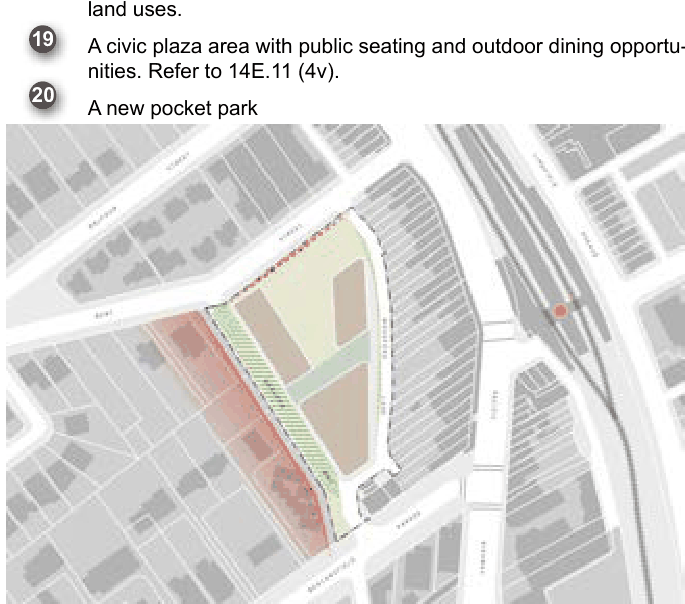

> [Picture on page 49: a picture, saved as a picture (images/part-14e-lindfield-local-centre-page-49-5.gif, 150 dpi).]
> Words printed on the picture (title and legend, copied from the PDF):
> 19
> 20

land uses. A civic plaza area with public seating and outdoor dining opportu-

nities. Refer to 14E.11 (4v).

Refer to

#### PART 14E.4

Setbacks

A new pocket park

37	 To support the Ku-ring-gai

landscape character within

Lindfield. 38	 To maintain and enhance

a leafy outlook along all

streetscapes. 39	 To provide for a pleasant

pedestrian experience

within the local centre.

#### Figure 14E.11-5

#### Setbacks Diagram

#### Setbacks

7 Building setbacks are to be built to the street alignment with a zero

setback to property boundaries with the following exceptions:

i) a minimum 3.0m front setback Bent Street;

ii)	 Land is to be dedicated to Council at no costs to allow the

widening of Lane

iii)	 The top storey of a building is to be set back a minimum of

3m from the outer face of the floors below on all sides (roof

projection is allowed beyond the outer face of the top storey). Note: Lift cores are to be located internally within the building to

facilitate the top storey setback Refer to Figure 14E.11-5.

#### Built Form

### LINDFIELD LOCAL CENTRE

8 Buildings are to be located and designed in accordance with the

following:

i) retail, commercial and community buildings are to provide

frontages that allow passive surveillance to streets, lanes and

public spaces;

ii)	 active frontages are to be provided to all external areas adjacent

to community and retail and commercial buildings;

### 14E.11  PRECINCT L5:

### LINDFIELD HUB (continued)

#### Controls

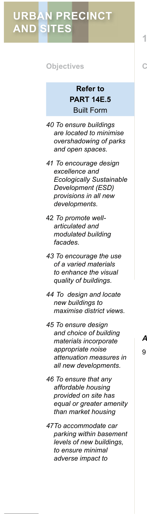

> [Picture on page 50: a map, saved as a picture (images/part-14e-lindfield-local-centre-page-50-4.gif, 150 dpi); the street names and other small labels are on the picture.]
> Words printed on the picture (title and legend, copied from the PDF):
> 40	 To ensure buildings
> are located to minimise
> overshadowing of parks
> and open spaces.
> 41	 To encourage design
> provisions in all new
> 42	 To promote well-
> of a varied materials
> to enhance the visual
> quality of buildings.
> new buildings to
> maximise district views.
> 45	 To ensure design
> and choice of building
> attenuation measures in
> all new developments.
> provided on site has
> equal or greater amenity
> than market housing
> 47	To accommodate car
> parking within basement
> levels of new buildings,
> to ensure minimal
> adverse impact to

#### Objectives

iii)	 all buildings fronting the civic plaza and public open space are to incorporate active frontages;

Refer to

#### PART 14E.5

iv)	 provision of continuous shade structures (awnings or

colonnades) to all buildings fronting the new park at the corner of

Bent and Woodford Lane;

v)	 the community building is to be located at the corner of Bent

Street and Drovers Way and is to provide an active frontage and

direct pedestrian connection to both Bent Street and the park;

vi)	 provide an active pedestrian street at Bent Street with direct

access to the community hub, community park, civic plaza and

into the main vertical circulation;

vii)	 Bent Street is to have a visual connection to the open space,

community facility, library and civic plaza;

viii)	where supermarket frontage is visible to the street it is to be

activated by features such as visible product shelves, office

functions positioned along the street edge, and by sleeving with

other street-facing tenancies

ix)	 considerations for modulation and articulation of buildings;

x)	 adequate soil depth to be provided to enable planting of large

canopy trees within public open space so as to avoid tree pits

protruding above the finished park of plaza levels.

43	 To encourage the use

xi)	 no building is to be greater the 9 storeys in height adjoining any

street frontage.

44	 To  design and locate

Note: The 1st storey is measured from 1m above the existing ground

level.

#### Affordable Housing

9 All affordable housing units provided on the site under clause 6.13(3)

of Ku-ring-gai Local Environmental Plan 2015 are to include a range

of dwelling sizes and be designed and located so as to achieve an

amenity that is equal to or greater than other units on the site.

46	 To ensure that any

### 14E.11  PRECINCT L5:

### LINDFIELD HUB (continued)

#### Objectives

#### Controls Roads

10 All roads and associated footpath embellishment is to be in

accordance with the following:

Refer to

#### PART 14E.6

Building Entries, car Park-

ing and Service Access

i) Woodford Lane is to be a one way street and 11.0m wide,

including:

- 4.0 m one way traffic lane running south;

surrounding streetscapes.

- 2.4m parking zone;

- 1.5m wide footpath to eastern edge;

- 1.8m wide clear footpath area to west, with additional 1.3m for

tree planting at 6.0m centres.

Refer to Figure 14E.11-6.

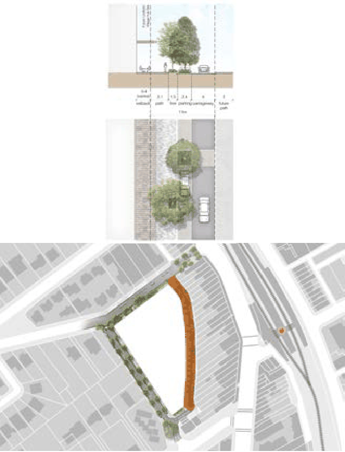

> [Picture on page 51: a picture, saved as a picture (images/part-14e-lindfield-local-centre-page-51-21.gif, 150 dpi).]

48	 To allow provisions for electrical charging points and bicycle parking spaces within car park structures in new developments.

49	 To ensure the community facility has street presence and opens to the public domain.

50	 To provide high quality streetscapes that encourage active transport.

### LINDFIELD LOCAL CENTRE

#### Figure 14E.11-6

#### Woodford Lane

### 14E.11  PRECINCT L5:

### LINDFIELD HUB (continued)

#### Controls

#### Objectives

ii)	 Woodford Lane (South) is to be a two way street and 8.7m wide,

including:

- 6.0m two way carriageway;

- 1.5m wide footpath to north edge;

- 1.2m wide footpath to south edge;

- street tree planting.

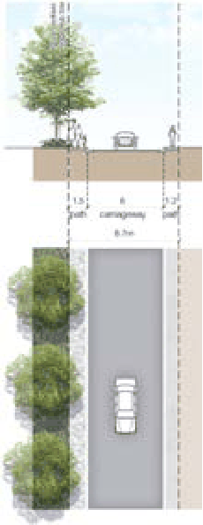

> [Picture on page 52: a picture, saved as a picture (images/part-14e-lindfield-local-centre-page-52-11.gif, 150 dpi).]

Refer to Figure 14E.11-7.

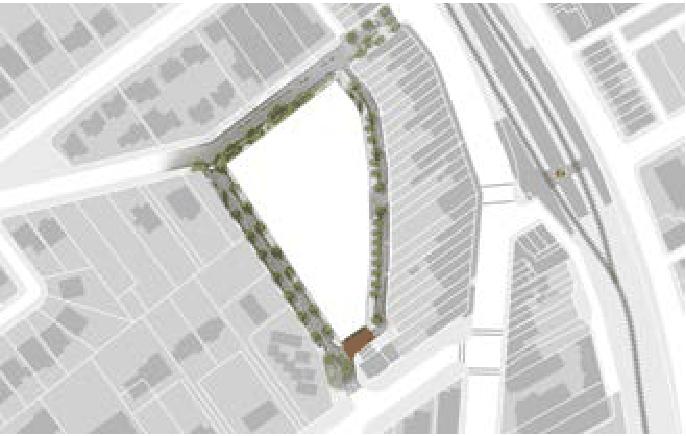

> [Picture on page 52: a picture, saved as a picture (images/part-14e-lindfield-local-centre-page-52-13.gif, 150 dpi).]

#### Figure 14E.11-7

#### Woodford Lane (South)

### 14E.11  PRECINCT L5:

### LINDFIELD HUB (continued)

#### Controls

iii)	 Drovers Way is to be a two way street and 15.0m wide,

including:

- 6.5 m two way carriageway;

- 2.3m parking zone/tree planting on both sides of carriageway;

- 2.4m  wide footpaths both sides of street and 1.5m wide

footpath on the Western side of the street

- street trees at 12.0m centres. Refer to Figure 14E.11-8.

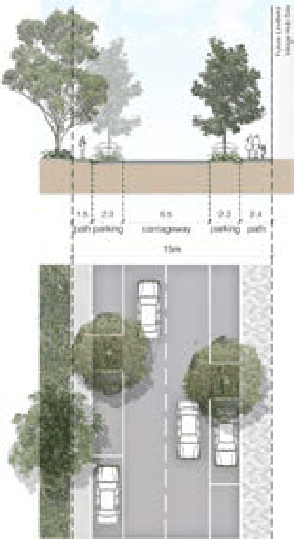

> [Picture on page 53: a picture, saved as a picture (images/part-14e-lindfield-local-centre-page-53-12.gif, 150 dpi).]

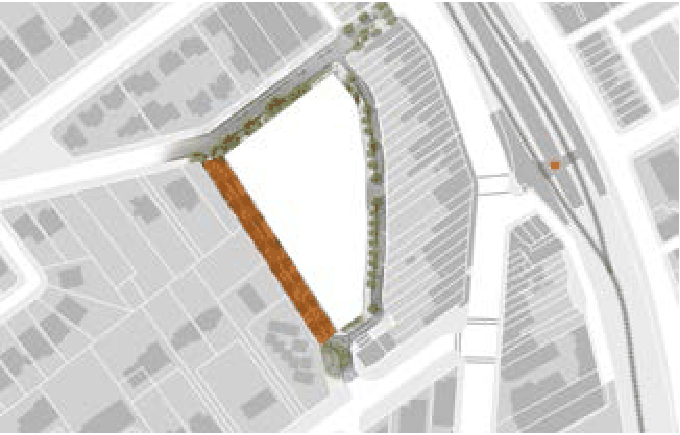

> [Picture on page 53: a picture, saved as a picture (images/part-14e-lindfield-local-centre-page-53-13.gif, 150 dpi).]

### LINDFIELD LOCAL CENTRE

#### Figure 14E.11-8

#### Drovers Way

### 14E.11  PRECINCT L5:

### LINDFIELD HUB (continued)

#### Controls

iv)	 Bent Street road reserve is to remain as existing but shall be

upgraded to include

- 1.8metre wide footpath on southern side;

- street trees at 6.0m centres in a mass planted verge;

- underground power;

- increased on-street parking. Refer to Figure 14E.11-9

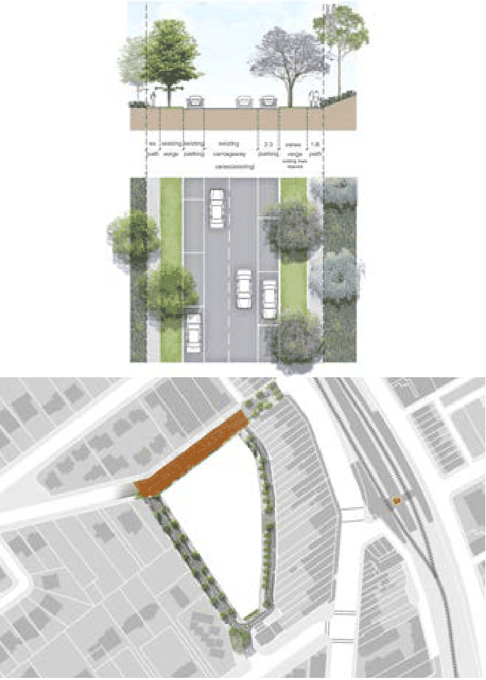

> [Picture on page 54: a picture, saved as a picture (images/part-14e-lindfield-local-centre-page-54-11.gif, 150 dpi).]

#### Figure 14E.11-9

#### Bent Street

### 14E.11  PRECINCT L5:

### LINDFIELD HUB (continued)

#### Controls

#### Objectives

#### Travel Demand Managment

11 The following travel demand management measures are to be

implemented:

i) Preparation of a site specific travel plan including travel access

guides for residents and workplace travel plans for employees of

LVH

ii)	 The travel plan should be maintained and updated at least

annually.

iii)	 Where possible, opportunities to limit the amount of parking

provided by sharing parking between the various uses and/

or reducing the parking provision for residents should

be considered. The parking provisions applicable to the

development should be considered as a maximum.

iv)	 Provide capacity for car share facilities in the basement car park

for use by residents and employees and on street for use of

visitors.

v)	 Provide capacity for ride share facilities on-street.

vi)	 Implement a real-time app for the commuter and public parking

to reduce necessary traffic circulation and congestion, reduce

time needed to find a space and improve the turnover of the

spaces provided.

### LINDFIELD LOCAL CENTRE

ST 56A

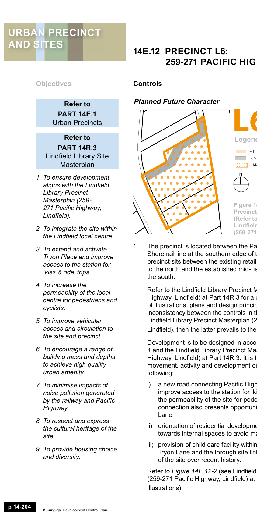

> [Picture on page 56: a map, saved as a picture (images/part-14e-lindfield-local-centre-page-56-2.gif, 150 dpi); the street names and other small labels are on the picture.]
> Words printed on the picture (title and legend, copied from the PDF):
> 43 43A 52A
> 6 6A 58
> 6 6A 2C
> K LANE GILLOTT
> 4 8 10
> 5 7 9 11
> 10 12 14 16 18
> 4 6 8
> 3 5 7 11
> 4 Site Location
> 24 22 20 18
> Lindfield Library Site
> 1-3 5 7
> IKARA 1 80
> 6 8 CLANVILLE
> LLEWELLYN 72 15
> 7 3.66W PATHWAY
> 6 4 2
> 1	 To ensure development
> aligns with the Lindfield
> 271 Pacific Highway,
> the Lindfield local centre.
> Tryon Place and improve
> ‘kiss & ride’ trips.
> 4	 To increase the
> permeability of the local
> centre for pedestrians and
> 5	 To improve vehicular
> access and circulation to
> the site and precinct.
> building mass and depths
> to achieve high quality
> noise pollution generated

HAV

PUBLIC DOMAIN AND PEDESTRIAN

15

- Continuous awnings where possible

- Continuous colonnade
