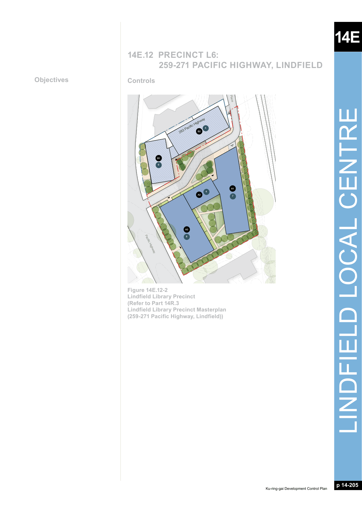
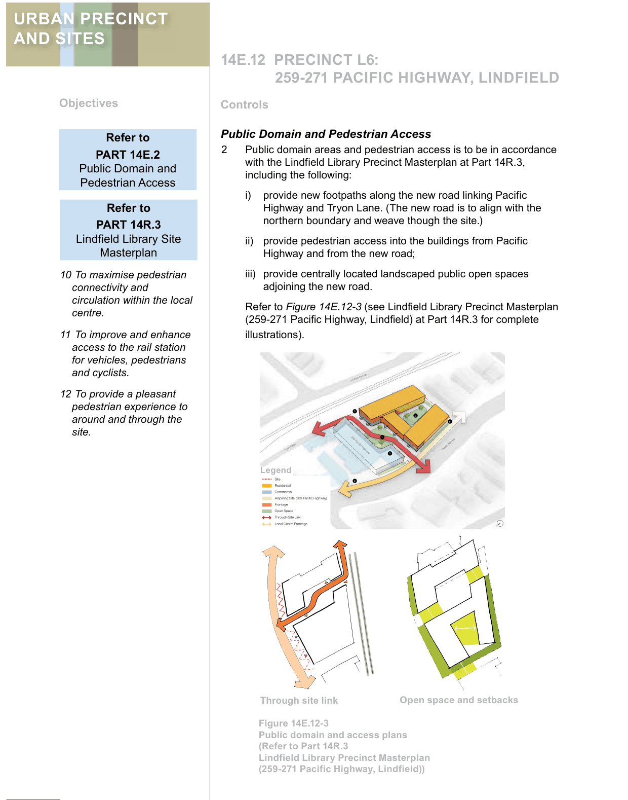
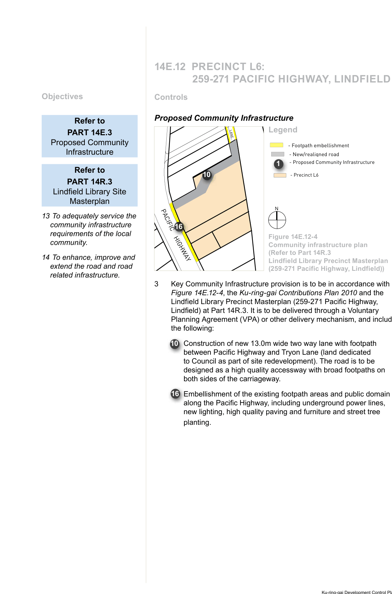
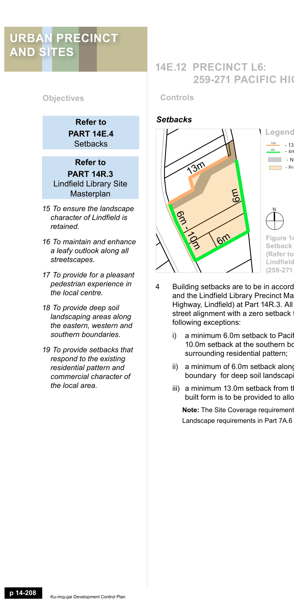
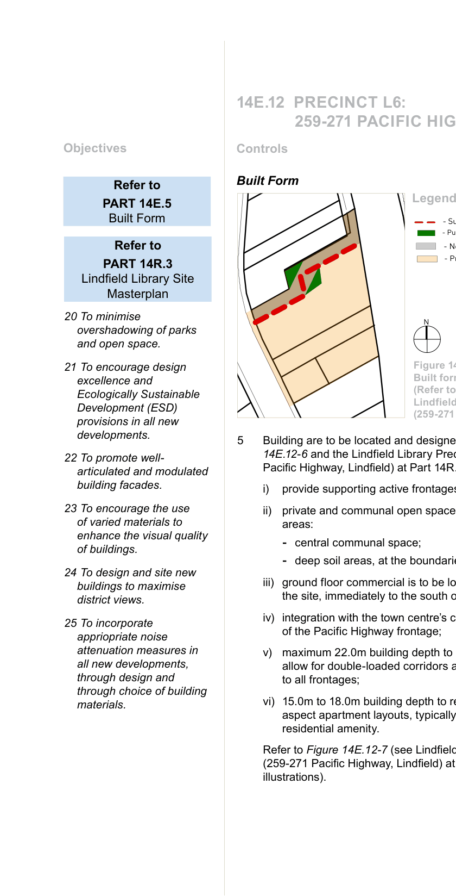
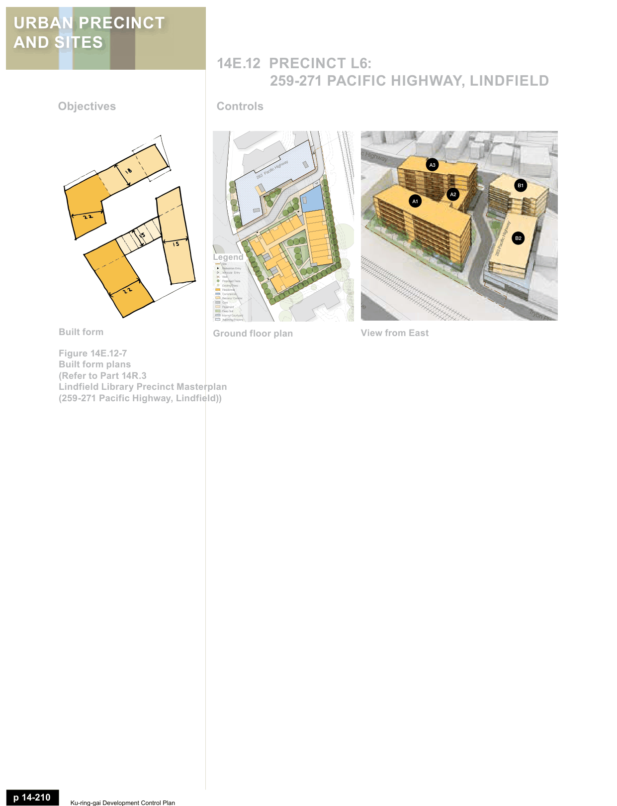
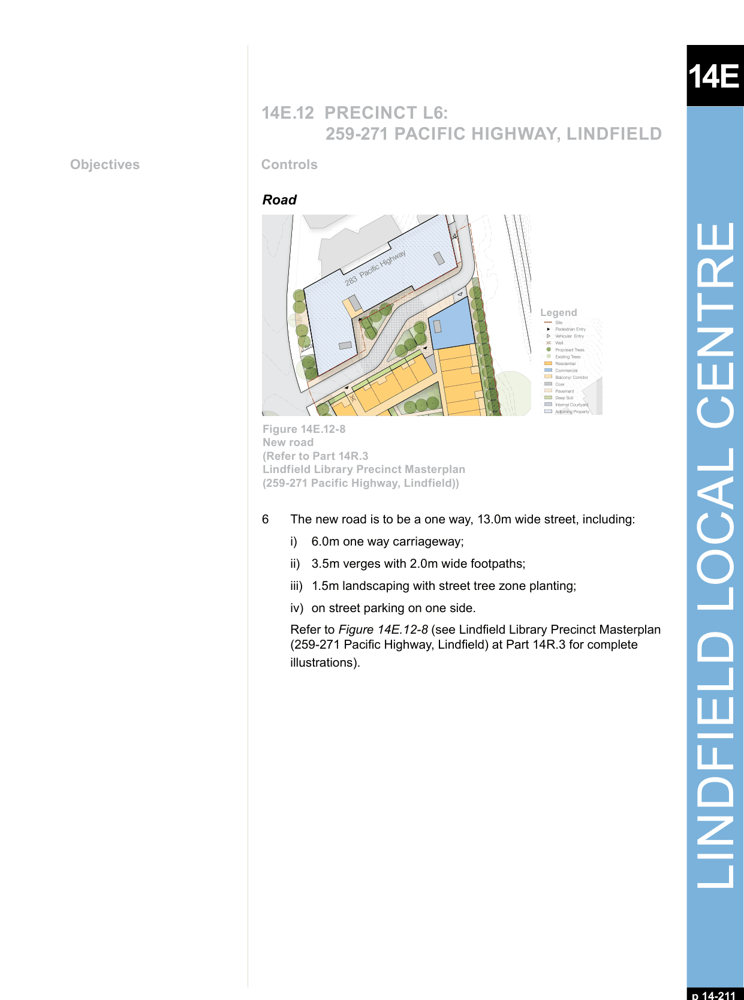
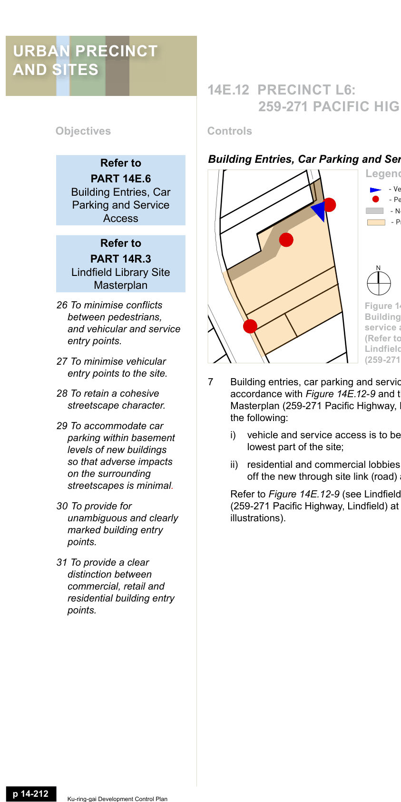
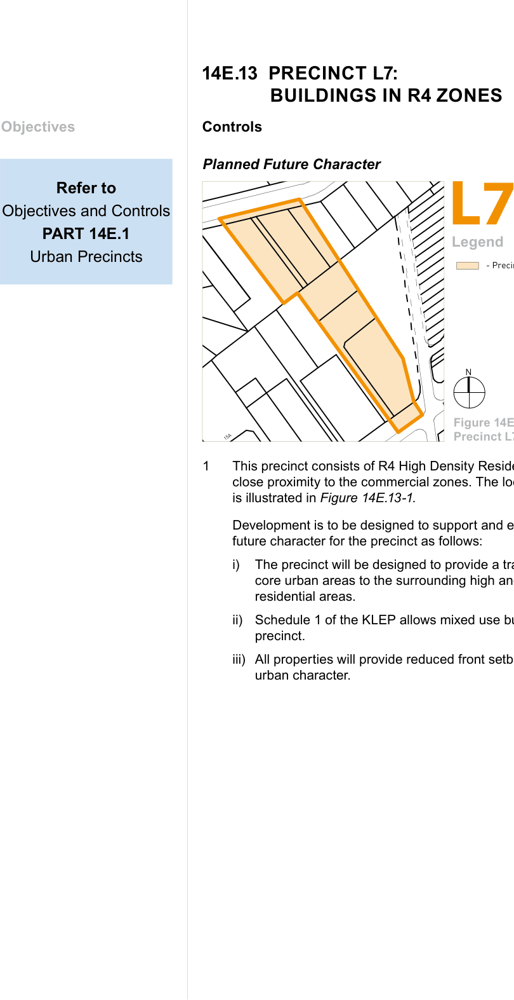

### 14E.12  PRECINCT L6:

### 259-271 PACIFIC HIGHWAY, LINDFIELD

BUILDING ENTRIES AND CARPAT

- Through site link

- Entry plaza/forecourt

- Continuous awnings

- Continuous awnings where possible

- Continuous colonnade

#### Controls

#### Objectives

- Pedestrian through site link

- Entry plaza/forecourt Awnings Awnings where possible

- Continuous colonnade

- Vehicular access to site

- Pedestrian access to site

BUILDING ENTRIES AND CARPAT

RUSSELL

AVE

BUILDING ENTRIES AND CARPAT

#### Planned Future Character

17

- Vehicular access to site

- Pedestrian access to site

- Vehicular access to site

- Pedestrian access to site KEY COMMUNITY INFRASTRUCTRE

Refer to

#### PART 14E.1

B2 Local Centre Development

#### Legend

Site access points

26 Pedestrian access Open Space

Refer to

#### PART 14R.3

11

- Masterplan Site

21B

- Precinct L1

- Precinct L2

- Precinct L3

- Precinct L4

- Precinct L5

- Precinct L6

- Precinct L7

- Precinct L8

- Precinct L9

### L6

- Footpath embellishment

- New or existing park to be upgraded

- Historic/character building to be retained

- New/realigned road

- Proposed pedestrian promenade

- New community facility

- Landscaping

HARBOUR

17

MIDDLE

7

1

#### Figure 14E.12-1 (Refer to Part 14R.3

#### Lindfield Library Precinct Masterplan

(259-271 Pacific Highway, Lindfield))

2	 To integrate the site within

3	 To extend and activate

access to the station for

1 The precinct is located between the Pacific Highway and the North

Shore rail line at the southern edge of the Lindfield local centre. The

precinct sits between the existing retail and commercial development

to the north and the established mid-rise residential developments to

the south.

36

CHE

Refer to the Lindfield Library Precinct Masterplan (259-271 Pacific

Highway, Lindfield) at Part 14R.3 for a comprehensive collection

of illustrations, plans and design principles. Where there is an

inconsistency between the controls in this Part 14E.12 and the

Lindfield Library Precinct Masterplan (259-271 Pacific Highway, Lindfield), then the latter prevails to the extent of the inconsistency.

21

STRICKLAND

6	 To encourage a range of

Development is to be designed in accordance with Figure 14E.12-

1 and the Lindfield Library Precinct Masterplan (259-271 Pacific

Highway, Lindfield) at Part 14R.3. It is to support a number of

movement, activity and development outcomes, including the

following:

26

24

28

30

32

34

15

17

19

7	 To minimise impacts of

by the railway and Pacific

i) a new road connecting Pacific Highway and Tyron Lane will

improve access to the station for ‘kiss & ride’ trips, and increase

the permeability of the site for pedestrians and cyclists. The new

connection also presents opportunities for the activation of Tyron

ii)	 orientation of residential development towards the new road and

towards internal spaces to avoid major noise sources.

8	 To respect and express

the cultural heritage of the

iii)	 provision of child care facility within the site at the junction of

9	 To provide housing choice

Tryon Lane and the through site link to reflect the community use

of the site over recent history. Refer to Figure 14E.12-2 (see Lindfield Library Precinct Masterplan

(259-271 Pacific Highway, Lindfield) at Part 14R.3 for complete illustrations).

> [Picture on page 57: a map, saved as a picture (images/part-14e-lindfield-local-centre-page-57-1.gif, 150 dpi); the street names and other small labels are on the picture.]
> Words printed on the picture (title and legend, copied from the PDF):
> 271 Pacific Highway
> BA GFA NSA Dwellings
> al (m2) (m2) (m2) (units)
> 00 270 230 -
> ,160 5,585 4,747 59
> - - -
> ,480 1,154 981 12
> - - -
> 283 Pacific Highway
> ,000 4,680 3,978 50
> 4,940 11,689 9,936 121
> BA GFA NSA Dwellings
> al (m2) (m2) (m2) (units)
> 00 540 459 -
> ,400 2,652 2,254 28
> 20 828 704 -
> ,600 1,248 1,061 13
> ,520 5,268 4,478 41
> Pedestrian Entry Pavement
> NSA = 85%
> Vehicular  Entry Deep Soil
> Proposed Trees Internal Courtyard
> Exsiting Trees Neighbouring Site
> m2-45m2 of GFA (40m2 Average)
> 19 spot/dwelling. Visitor spot 1
> further design development.
> Lindfield Library Precinct
> (Refer to Part 14R.3
> Lindfield Library Precinct Masterplan
> (259-271 Pacific Highway, Lindfield))

Figure 14E.12-2

### 14E.12  PRECINCT L6:

### 259-271 PACIFIC HIGHWAY, LINDFIELD

#### Controls

#### Objectives

### LINDFIELD LOCAL CENTRE

> [Picture on page 58: a picture, saved as a picture (images/part-14e-lindfield-local-centre-page-58-1.gif, 150 dpi).]
> Words printed on the picture (title and legend, copied from the PDF):
> Public Domain and
> Pedestrian Access
> Urban Design Concepts
> Lindfield Library Site
> Masterplan
> 3.3 Masterplan Concept
> adjoining the new road.
> Lindfield Avenue
> Urban Design Concepts
> 3
> 10	 To maximise pedestrian
> connectivity and
> circulation within the local
> centre.
> 3.3 Masterplan Concept
> 3
> 2
> The following concept integrates possible development of
> the site at 283 Pacific Highway to provide a holistic response
> to this part of Lindfield Local Centre.
> 1\. Through-site connection aligns with the subject site’s
> northern boundary, removing the constraints associated
> with building interfaces along the Pacific Highway and
> Tryon Place frontages;
> 2\. Open space is split into two key areas; a public space
> that straddles the through-site link, and a private
> amenity space (potentially with deep soil) at the
> southern boundary of the site;
> 3\. Ground floor commercial is focused at the northern
> edge of the subject site, immediately to the south of the
> through-site link;
> 4\. Integration with the town centre’s character is focused
> at the northern extent of the Pacific Highway frontage;
> 5\. Deep soil landscape setbacks along eastern/southern
> boundaries.
> for vehicles, pedestrians
> and cyclists.
> Lindfield Avenue
> 1
> Tryon Place
> 3
> 283 Pacific Highway 3
> 2
> The following concept integrates possible development of
> the site at 283 Pacific Highway to provide a holistic response
> to this part of Lindfield Local Centre.
> 1\. Through-site connection aligns with the subject site’s
> northern boundary, removing the constraints associated
> with building interfaces along the Pacific Highway and
> Tryon Place frontages;
> 2\. Open space is split into two key areas; a public space
> that straddles the through-site link, and a private
> amenity space (potentially with deep soil) at the
> southern boundary of the site;
> 3\. Ground floor commercial is focused at the northern
> edge of the subject site, immediately to the south of the
> through-site link;
> 4\. Integration with the town centre’s character is focused
> at the northern extent of the Pacific Highway frontage;
> 5\. Deep soil landscape setbacks along eastern/southern
> boundaries.
> 5
> 1
> Urban Design Concepts
> pedestrian experience to
> around and through the
> site.
> Pacific Highway
> Tryon Place
> 283 Pacific Highway 3
> 4
> Urban Design Concepts
> Legend
> Legend
> Site
> 4
> Residential
> 3.4 Masterplan Parameters
> Commercial
> Legend
> Site
> Adjoining Site (283 Pacific Highway)
> 3.4 Masterplan Parameters
> Residential
> Frontage
> Commercial
> Adjoining Site (283 Pacific Highway)
> Open Space
> Frontage
> Activity and Connection
> Open Space
> Built Form
> Through-Site Link
> Open Space
> Local Centre Frontage
> Through-Site Link
> N
> Activity and Connection
> Open Space
> Built Form
> Local Centre Frontage
> SJB Architects
> 24
> SJB Architects
> Open space and setbacks
> Through site link
> The realignment of the through-site link removes the potential conflicts of the
> building interfaces between the subject site and neighbouring 283 Pacific Highway.
> The through-site link aligns with the site’s northern boundary, weaving through a
> public open space towards Tryon Place. Activation of the Pacific Highway frontage
> can be limited to the adjoining property (no. 283). Pedestrian access to the
> buildings is taken from the Pacific Highway frontage and from the through-site link.
> The realignment of the through-site link removes the potential conflicts of the
> building interfaces between the subject site and neighbouring 283 Pacific Highway.
> A range of building lengths and
> desired   urban, amenity and d
> for double-loaded corridors and
> metre deep blocks assume a s
> maximise residential amenity.
> The through-site link aligns with the site’s northern boundary, weaving through a
> public open space towards Tryon Place. Activation of the Pacific Highway frontage
> can be limited to the adjoining property (no. 283). Pedestrian access to the
> buildings is taken from the Pacific Highway frontage and from the through-site link.
> The setback to the Pacific Highway frontage is a minimum of 6 metres adjacent to
> the town centre  and increasing to 10 metres at the southern boundary in response
> to the surrounding residential grain. A minimum of 6 metres along the southern
> boundary allows for deep soil landscaping.
> A range of building lengths and
> desired   urban, amenity and de
> for double-loaded corridors and
> metre deep blocks assume a sin
> maximise residential amenity.
> Building separation distances align with the requirement of the Council’s DCP.
> The setback to the Pacific Highway frontage is a minimum of 6 metres adjacent to
> the town centre  and increasing to 10 metres at the southern boundary in response
> to the surrounding residential grain. A minimum of 6 metres along the southern
> boundary allows for deep soil landscaping.
> Building separation distances align with the requirement of the Council’s DCP.
> Public domain and access plans
> (Refer to Part 14R.3
> Lindfield Library Precinct Masterplan
> (259-271 Pacific Highway, Lindfield))
> SJB Architects

Figure 51. Concept Diagram

Figure 51. Concept Diagram

Figure 52. Connections and Activation

Figure 53. Open Spaces

Figure 54. Built Form

Figure 52. Connections and Activation

Figure 53. Open Spaces

Figure 54. Built Form

Figure 14E.12-3

### 14E.12  PRECINCT L6:

### 259-271 PACIFIC HIGHWAY, LINDFIELD

#### Objectives

#### Controls Public Domain and Pedestrian Access

Refer to

#### PART 14E.2

2 Public domain areas and pedestrian access is to be in accordance

with the Lindfield Library Precinct Masterplan at Part 14R.3,

including the following:

i) provide new footpaths along the new road linking Pacific

Highway and Tryon Lane. (The new road is to align with the

northern boundary and weave though the site.)

Refer to

#### PART 14R.3

ii)	 provide pedestrian access into the buildings from Pacific

Highway and from the new road;

iii)	 provide centrally located landscaped public open spaces

Refer to Figure 14E.12-3 (see Lindfield Library Precinct Masterplan

(259-271 Pacific Highway, Lindfield) at Part 14R.3 for complete illustrations).

11	 To improve and enhance

access to the rail station

12	 To provide a pleasant

SJB Architects

A

2C

LAWSON

> [Picture on page 59: a map, saved as a picture (images/part-14e-lindfield-local-centre-page-59-4.gif, 150 dpi); the street names and other small labels are on the picture.]
> Words printed on the picture (title and legend, copied from the PDF):
> 49 RD TRYON
> 2 CARCOOLA 1
> - Pedestrian through site link
> - Awnings where possible
> 10 12 14 16 18
> 8 PUBLIC DOMAIN AND PEDESTRIAN
> BUILDING ENTRIES AND CARPAT
> - Vehicular access to site
> - Pedestrian access to site
> - Continuous awnings where possible
> - Continuous colonnade
> PUBLIC DOMAIN AND PEDESTRIAN
> 4 8 10
> BUILDING ENTRIES AND CARPAT
> 5 7 9 11
> - Continuous awnings
> - Continuous awnings where possible
> - Continuous colonnade
> 26 NEWHAVEN 10
> 10 12 14 16 18
> 4 6 8
> 24 22 20 18
> BUILDING ENTRIES AND CARPAT
> - Heritage item
> 3 5 7 11
> - Vehicular access to site
> - Pedestrian access to site
> - Pedestrian through site link
> - Entry plaza/forecourt
> Awnings where possible
> - Continuous colonnade
> 10 12 14 16 18
> 4 6 8
> 3 5 7 11
> 15 3.66W PATHWAY
> - Landmark building
> - Vehicular access to site
> - Pedestrian access to site
> IKARA 1 80
> BUILDING ENTRIES AND CARPAT
> KEY COMMUNITY INFRASTRUCTRE
> 6 LANE 10
> KEITH - Character item
> KEY COMMUNITY INFRASTRUCTRE
> - Vehicular access to site
> - Pedestrian access to site
> 24 22 20 18
> - Refer to site specific DCP
> - Proposed road
> 24 22 20 18 3
> - Proposed Community Infrastructure
> IKARA 1 80
> - Footpath embellishment
> - New or existing park to be upgraded
> - Historic/character building to be
> - New/realigned road
> - Proposed pedestrian promenade
> - New community facility
> 6 10 5
> 41 3.66W PATHWAY
> IKARA 1 80
> - Precinct L1
> - Precinct L2
> - Precinct L3
> - Precinct L4
> - Precinct L5
> - Precinct L6
> - Precinct L7
> - Precinct L8
> - Precinct L9
> - Footpath embellishment
> - New or existing park to be upgraded
> - Historic/character building to be
> - New/realigned road
> - Proposed pedestrian promenade
> - New community facility
> Lindfield Library Site
> 3.66W PATHWAY 3.66W PATHWAY
> 1-3 5 7
> requirements of the local
> Community infrastructure plan
> (Refer to Part 14R.3
> Lindfield Library Precinct Masterplan
> (259-271 Pacific Highway, Lindfield))
> 1-3 5 7

Figure 14E.12-4

Figure 14E.12-4, the Ku-ring-gai Contributions Plan 2010 and the

YAR

### 14E.12  PRECINCT L6:

### 259-271 PACIFIC HIGHWAY, LINDFIELD

#### Objectives

#### Controls

### *

#### Proposed Community Infrastructure

Refer to

#### PART 14E.3

9

Refer to

#### PART 14R.3

DORSET

15

HARBOUR

13	 To adequately service the

27

14	 To enhance, improve and

extend the road and road

3 Key Community Infrastructure provision is to be in accordance with

Lindfield Library Precinct Masterplan (259-271 Pacific Highway,

Lindfield) at Part 14R.3. It is to be delivered through a Voluntary

Planning Agreement (VPA) or other delivery mechanism, and include

CHELMSF

21

Construction of new 13.0m wide two way lane with footpath

between Pacific Highway and Tryon Lane (land dedicated

to Council as part of site redevelopment). The road is to be

designed as a high quality accessway with broad footpaths on

both sides of the carriageway.

STRICKLAND

Embellishment of the existing footpath areas and public domain

along the Pacific Highway, including underground power lines,

new lighting, high quality paving and furniture and street tree planting.

11

15

17

19

22

18

16

20

14

24

### LINDFIELD LOCAL CENTRE

24

A

> [Picture on page 60: a map, saved as a picture (images/part-14e-lindfield-local-centre-page-60-2.gif, 150 dpi); the street names and other small labels are on the picture.]
> Words printed on the picture (title and legend, copied from the PDF):
> 48 49 TRYON
> 4 6 8 10 53A
> 5 7 9 11
> 10 12 14 16 18
> 4 6 8
> 3 5 7 11
> 27 25 23
> 21 19 17
> 26 24 22
> 12 10 8
> 51 53 - 12m setback
> 27 25 23
> PART 14E.4 PL
> 21 19 17
> 26 24 22
> 24 22 20 18
> 16 12 10 8
> 7.32 / 3.66 W.
> ESMT FOR SERVICES
> 3.66W PATHWAY 269
> 7.32 / 3.66 W.
> ESMT FOR SERVICES
> WAIMEA 107A 36
> Lindfield Library Site
> 101 103 105
> 123 125 127
> 5 BUILT FORM
> 101 103 105
> 1-3 5 7
> 123 125 127
> character of Lindfield is
> 4 6 8 10
> 1 3 5
> 4 6 8 10
> 1 3 5 street
> 4 8 10
> 5 7 9 11
> pedestrian experience in
> the local centre.
> 4 8 10
> 5 7 9 11
> 10 12 14 16 18
> 4 6 8
> 3 5 7 11
> 24 RD 2
> landscaping areas along
> the eastern, western and
> 10 12 14 16 18
> 4 6 8
> 3 5 7 11
> surrounding residential pattern;
> 24 22 20 18
> 16 12 6
> respond to the existing
> residential pattern and
> commercial character of
> the local area.
> 24 22 20 18
> Landscape requirements in Part 7A.6 do not apply to this site.
> 9 6 41
> PRIESTLEY 6 10
> 26 37 4
> 6 3.66W PATHWAY
> 1-3 5 7
> 6 4 2
> 1 7 3.66W PATHWAY

- Continuous awnings where possible

- Continuous colonnade

15

BUILDING ENTRIES AND CARPAT

#### 6m

### 14E.12  PRECINCT L6:

### 259-271 PACIFIC HIGHWAY, LINDFIELD

- Pedestrian through site link

- Entry plaza/forecourt Awnings Awnings where possible

- Continuous colonnade

- Vehicular access to site

- Pedestrian access to site

#### Controls

#### Objectives

ALIGNMENT AND SETBACKS BUILDING ENTRIES AND CARPAT

- 9m setback

RUSSELL

AVE

KEY COMMUNITY INFRASTRUCTRE

- 15m setback

ALIGNMENT AND SETBACKS

#### 5m

- 13m setback

- Vehicular access to site

- Pedestrian access to site

- 9m setback

#### Legend

Refer to

- 11m setback

- 15m setback

- 13m setback

- 12m setback

- 11m setback

#### 13m

- Footpath embellishment

- New or existing park to be upgraded

- Historic/character building to be retained

- New/realigned road

- Proposed pedestrian promenade

- New community facility

- Landscaping

- Precinct L1

- Precinct L2

- Precinct L3

- Precinct L4

- Precinct L5

- Precinct L6

- Precinct L7

- Precinct L8

- Precinct L9

Refer to

#### PART 14R.3

4

- 10m setback

- 6m setback

- 5m setback

- 4m setback

- 3m setback

- 2m setback

- Land dedication

- Alternate deep soil landscaping (% of site)

#### 6m

HARBOUR

- 10m setback

- 6m setback

- 5m setback

- 4m setback

- 3m setback

- 2m setback

- Land dedication

- Alternate deep soil landscaping (% of site)

MIDDLE

15	 To ensure the landscape

BUILT FORM

#### 6m CARCOOLA

- Principal active frontage

- Supporting active frontage

- 3 storey street wall

- 2m upper level setback above

#### 6m - 10m

street

wall height

- 4m upper level setback above

1

16	 To maintain and enhance

a leafy outlook along all

- Principal active frontage

- Supporting active frontage

- 3 storey street wall

- 2m upper level setback above

street wall height

#### 6m

#### Figure 14E.12-5 (Refer to Part 14R.3

#### Lindfield Library Precinct Masterplan

(259-271 Pacific Highway, Lindfield))

MONA

wall height

- 4m upper level setback above

PUBLIC DOMAIN AND PEDESTRIAN

street wall height

17	 To provide for a pleasant

PUBLIC DOMAIN AND PEDESTRIAN

- Pedestrian through site link

- Entry plaza/forecourt

- Awnings

- Awnings where possible

- Colonnade

36

4 Building setbacks are to be in accordance with Figure 14E.12-5

and the Lindfield Library Precinct Masterplan (259-271 Pacific

Highway, Lindfield) at Part 14R.3. All buildings are to be built to the

street alignment with a zero setback to property boundaries with the

following exceptions:

BUILDING ENTRIES AND CARPAT

18	 To provide deep soil

- Pedestrian through site link

- Entry plaza/forecourt

- Awnings

- Awnings where possible

- Colonnade

CHELMSFOR

BUILDING ENTRIES AND CARPAT

- Vehicular access to site

- Pedestrian access to site

i) a minimum 6.0m setback to Pacific Highway, increasing to a

10.0m setback at the southern boundary in response to the

ii)	 a minimum of 6.0m setback along the southern and eastern

- Vehicular access to site

- Pedestrian access to site

HERITATGGEA

boundary  for deep soil landscaping;

21

- Heritage item

19	 To provide setbacks that

iii)	 a minimum 13.0m setback from the northern site boundary to the

HERITATGGEA

built form is to be provided to allow for a new public road.

- Heritage item

- Landmark building

Note: The Site Coverage requirements in Part 7A.5, and Deep Soil

### *

STRICKLAND

- Landmark building

- Character item

### *

- Character item

9

11

15

17

19

- Refer to site specific DCP

- Proposed road

- Proposed Community Infrastructure

11

LLEWELLYN

11A

- Refer to site specific DCP

- Proposed road

- Proposed Community Infrastructure

26

22

18

16

20

LANE

14

24

28

30

32

34

12

12

10

ST

2-8

3-11

BURLEIGH

E

D

49 ON

> [Picture on page 61: a map, saved as a picture (images/part-14e-lindfield-local-centre-page-61-4.gif, 150 dpi); the street names and other small labels are on the picture.]
> Words printed on the picture (title and legend, copied from the PDF):
> 2C 53A BUILT FORM
> 2 CR 56A
> 6 6A 53A
> 5 7 9 11
> 7.32 / 3.66 W.
> ESMT FOR SERVICES
> TRYON 258 RUSSELL
> 10 12 14 16 18
> 4 6 8
> 3 5 7 11
> 101 103 105
> 123 125 127
> 24 22 20 18
> 4 6 8 10
> 1 3 5
> 82 3.66W PATHWAY 18
> IKARA 1 80
> Lindfield Library Site
> 4 8 10
> 8 LAWSON 26
> 5 7 9 11
> 9 LLEWELLYN AMINYA 7
> 1-3 5 7
> 20	 To minimise
> overshadowing of parks
> and open space. LLEWELLYN
> 1-3 5 7
> 10 12 14 16 18
> 4 6 8
> 3 5 7 11
> 21	 To encourage design
> provisions in all new
> 24 22 20 18
> 82 3.66W PATHWAY
> 22	 To promote well-
> articulated and modulated
> IKARA 1 80
> of varied materials to
> enhance the visual quality
> 6 4 2
> 1 7 3.66W PATHWAY
> buildings to maximise
> to all frontages;
> 25	 To incorporate
> attenuation measures in
> all new developments,
> through design and
> through choice of building
> 1-3 5 7

WOODS

TRYON ALIGNMENT AND SETBACKS

- 9m setback

- 15m setback

- 13m setback

- 12m setback

- 11m setback

#### LANE *

- Continuous awnings where possible

- Continuous colonnade

15

PUBLIC DOMAIN AND PEDESTRIAN BUILDING ENTRIES AND CARPAT

### 14E.12  PRECINCT L6:

### 259-271 PACIFIC HIGHWAY, LINDFIELD

- Pedestrian through site link

- Entry plaza/forecourt Awnings Awnings where possible

- Continuous colonnade

#### Objectives

#### Controls

- Vehicular access to site

- Pedestrian access to site

- Through site link

- Entry plaza/forecourt

- Continuous awnings

- Continuous awnings where possible

- Continuous colonnade

BUILDING ENTRIES AND CARPAT

- 10m setback

- 6m setback

- 5m setback

- 4m setback

- 3m setback

- 2m setback

- Land dedication

- Alternate deep soil landscaping (% of site)

RUSSELL

AVE

BUILDING ENTRIES AND CARPAT

KEY COMMUNITY INFRASTRUCTRE

#### Built Form

BUILT FORM

- Vehicular access to site

- Pedestrian access to site

#### Legend

Refer to

#### PART 14E.5

- Vehicular access to site

- Pedestrian access to site

- Public open space

- Principal active frontage

- Supporting active frontage

- 3 storey street wall

- 2m upper level setback above wall height

- 4m upper level setback above street

wall height

- Footpath embellishment

- New or existing park to be upgraded

- Historic/character building to be retained

- New/realigned road

- Proposed pedestrian promenade

- New community facility

- Landscaping

Refer to

#### PART 14R.3

1

- Precinct L1

- Precinct L2

- Precinct L3

- Precinct L4

- Precinct L5

- Precinct L6

- Precinct L7

- Precinct L8

- Precinct L9

PUBLIC DOMAIN AND PEDESTRIAN

DORSET

HARBOUR

MIDDLE

- Pedestrian through site link

- Entry plaza/forecourt

- Awnings

- Awnings where possible

- Colonnade

29A

BUILDING ENTRIES AND CARPAT

1

- Vehicular access to site

- Pedestrian access to site

#### Figure 14E.12-6

#### Built form plan

(Refer to Part 14R.3

#### Lindfield Library Precinct Masterplan

(259-271 Pacific Highway, Lindfield))

HERITATGGEA

- Heritage item

5 Building are to be located and designed in accordance with Figure

14E.12-6 and the Lindfield Library Precinct Masterplan (259-271

Pacific Highway, Lindfield) at Part 14R.3, including the following:

- Landmark building

i) provide supporting active frontages to the new road;

### *

36

ii)	 private and communal open space is to be split into two key

- Character item

T

areas:

18

CHELMS

- central communal space;

23	 To encourage the use

- Refer to site specific DCP

- Proposed road

- deep soil areas, at the boundaries of the site;

- Proposed Community Infrastructure

iii)	 ground floor commercial is to be located at the northern edge of

21

the site, immediately to the south of the road.

24	 To design and site new

iv)	 integration with the town centre’s character at the northern extent

of the Pacific Highway frontage;

v)	 maximum 22.0m building depth to Pacific Highway frontage to STRICKLAND

24

28

30

32

34

allow for double-loaded corridors and apartments that orientate

11

15

17

19

vi)	 15.0m to 18.0m building depth to rear of site to allow for single

11

LLEWELLYN

aspect apartment layouts, typically oriented to maximise

11A

26

22

18

16

20

LANE

Refer to Figure 14E.12-7 (see Lindfield Library Precinct Masterplan

(259-271 Pacific Highway, Lindfield) at Part 14R.3 for complete

12

### LINDFIELD LOCAL CENTRE

10

ST

2-8

3-11

22

> [Picture on page 62: a map, saved as a picture (images/part-14e-lindfield-local-centre-page-62-1.gif, 150 dpi); the street names and other small labels are on the picture.]
> Words printed on the picture (title and legend, copied from the PDF):
> Urban Design Concepts
> Urban Design Concepts
> 3.13   Ground Floor Plan
> 3.13   Ground Floor Plan
> 283  Pacific Highway
> 283  Pacific Highway
> 283 Pacific Highway
> 283 Pacific Highway
> Middle Harbour Road
> Proposed Trees 10m
> Middle Harbour Road
> Core Pacific Highway
> View from East
> Ground floor plan
> View from the East
> ure 54. Built Form
> Built form plans
> (Refer to Part 14R.3
> Lindfield Library Precinct Masterplan
> (259-271 Pacific Highway, Lindfield))
> ange of building lengths and depths are proposed in order to achieve the
> sired   urban, amenity and development outcomes. The 22 metre blocks allows
> double-loaded corridors and apartments that orientate to all frontages. The 18
> etre deep blocks assume a single aspect apartment layout, typically oriented to
> aximise residential amenity.
> 283 Pacific Highway
> View from the South West

Figure 14E.12-7

### 14E.12  PRECINCT L6:

### 259-271 PACIFIC HIGHWAY, LINDFIELD

#### Controls

#### Objectives

#### 1

> [Picture on page 63: a map, saved as a picture (images/part-14e-lindfield-local-centre-page-63-1.gif, 150 dpi); the street names and other small labels are on the picture.]
> Words printed on the picture (title and legend, copied from the PDF):
> Urban Design Concepts
> 3.13   Ground Floor Plan
> ound Floor Plan
> 283  Pacific Highway
> (Refer to Part 14R.3
> Lindfield Library Precinct Masterplan
> (259-271 Pacific Highway, Lindfield))
> Middle Harbour Road

Figure 14E.12-8

### 14E.12  PRECINCT L6:

### 259-271 PACIFIC HIGHWAY, LINDFIELD

#### Controls

#### Objectives

#### Road

6 The new road is to be a one way, 13.0m wide street, including:

i) 6.0m one way carriageway;

ii)	 3.5m verges with 2.0m wide footpaths;

iii)	 1.5m landscaping with street tree zone planting;

iv)	 on street parking on one side. Refer to Figure 14E.12-8 (see Lindfield Library Precinct Masterplan

(259-271 Pacific Highway, Lindfield) at Part 14R.3 for complete illustrations).

### LINDFIELD LOCAL CENTRE

- Principal active frontage

- Supporting active frontage

- 2m upper level setback above

> [Picture on page 64: a map, saved as a picture (images/part-14e-lindfield-local-centre-page-64-4.gif, 150 dpi); the street names and other small labels are on the picture.]
> Words printed on the picture (title and legend, copied from the PDF):
> ST 16 123 125 127
> 12 6 6A 4
> 4 8 10
> 10 12 14 16 18
> 4 6 8
> 5 7 9 11
> 3 5 7 11
> 10 12 14 16 18
> 4 6 8
> 3 5 7 11
> 24 22 20 18
> Building Entries, Car
> MIDDLE 16 12
> Parking and Service
> 3.66W PATHWAY 18
> 24 22 20 18
> 26A AVE LOWANA
> 28 5 3
> Lindfield Library Site
> 31 1-3 5 7
> 1-3 5 7
> 26	 To minimise conflicts
> and vehicular and service
> 27	 To minimise vehicular
> 29	 To accommodate car
> parking within basement
> levels of new buildings
> so that adverse impacts
> on the surrounding
> streetscapes is minimal.
> 30	 To provide for
> unambiguous and clearly
> marked building entry
> commercial, retail and
> residential building entry
> 1-3 5 7

street

- 4m upper level setback above street wall height

- Continuous awnings where possible

- Continuous colonnade

15

PUBLIC DOMAIN AND PEDESTRIAN

PUBLIC DOMAIN AND PEDESTRIAN

BUILDING ENTRIES AND CARPAT

### 14E.12  PRECINCT L6:

### 259-271 PACIFIC HIGHWAY, LINDFIELD

- Pedestrian through site link

- Entry plaza/forecourt Awnings Awnings where possible

- Continuous colonnade

NT

- Vehicular access to site

- Pedestrian access to site

BUILDING ENTRIES AND CARPAT

#### Controls

#### Objectives

RUSSELL

AVE

- Through site link

- Entry plaza/forecourt

- Continuous awnings

- Continuous awnings where possible

- Continuous colonnade

- Pedestrian through site link

- Entry plaza/forecourt

- Awnings

- Awnings where possible

- Colonnade

KEY COMMUNITY INFRASTRUCTRE

- Vehicular access to site

- Pedestrian access to site

#### Building Entries, Car Parking and Service Access

BUILDING ENTRIES AND CARPAT

BUILDING ENTRIES AND CARPAT

9

#### Legend

Refer to

#### PART 14E.6

- Vehicular access to site and car park

- Pedestrian access to site

- Vehicular access to site

- Pedestrian access to site

HERITATGGEA

- Heritage item

- Precinct L1

- Precinct L2

- Precinct L3

- Precinct L4

- Precinct L5

- Precinct L6

- Precinct L7

- Precinct L8

- Precinct L9

- Landmark building

HARBOUR

- Footpath embellishment

- New or existing park to be upgraded

- Historic/character building to be retained

- New/realigned road

- Proposed pedestrian promenade

- New community facility

- Landscaping

Refer to

#### PART 14R.3

### *

11

- Character item

RSET

MIDDLE

- Refer to site specific DCP

- Proposed road

- Proposed Community Infrastructure

1

4A

#### Figure 14E.12-9

Building entries, car parking and

service access

(Refer to Part 14R.3

#### Lindfield Library Precinct Masterplan

(259-271 Pacific Highway, Lindfield))

8

entry points to the site. 28	 To retain a cohesive

7 Building entries, car parking and service access is to be in

accordance with Figure 14E.12-9 and the Lindfield Library Precinct

Masterplan (259-271 Pacific Highway, Lindfield) at 14R.3, including

the following:

36

i) vehicle and service access is to be via the new road at the

lowest part of the site;

ii)	 residential and commercial lobbies and foyers are to be located

AVE

off the new through site link (road) and Pacific Highway.

CH

Refer to Figure 14E.12-9 (see Lindfield Library Precinct Masterplan

(259-271 Pacific Highway, Lindfield) at Part 14R.3 for complete

21

17

19

STRICKLAND

24

28

30

32

34

31	 To provide a clear

ST

11

LLEWELLYN

26

22

18

20

11A

9A LANE

12

10

ST

D

E 48 49 ON

WOOD

GHWAY

> [Picture on page 65: a map, saved as a picture (images/part-14e-lindfield-local-centre-page-65-4.gif, 150 dpi); the street names and other small labels are on the picture.]
> Words printed on the picture (title and legend, copied from the PDF):
> 1-3 5 7
> 22 ii)	 Schedule 1 of the KLEP allows mixed use buildings within this

Figure 14E.13-1:

KOCHIA
