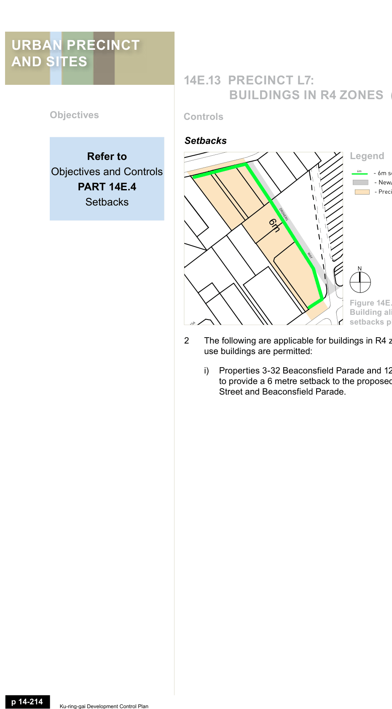
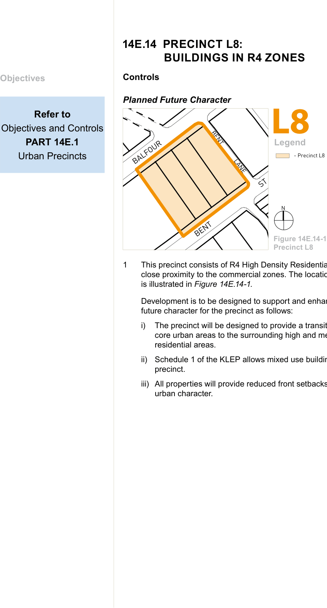

### 14E.13  PRECINCT L7:

### BUILDINGS IN R4 ZONES

CHAPMAN

- Pedestrian through site link

- Entry plaza/forecourt

Awnings where possible

- Continuous colonnade

12

AVE

LINDFIELD

#### Controls

#### Objectives

2

BUILDING ENTRIES AND CARPAT

4

CRES 6

10

LANE

#### Planned Future Character

- Vehicular access to site

- Pedestrian access to site

6

8

19A 15A

19B

17

15

11

9

Refer to

#### Objectives and Controls

21

19

### L7

WALLACE

TRYON

29

25

27

PLACE

#### PART 14E.1

#### Urban Precincts

12

20A

14

20

22

24 16

1 18

- Precinct L1

- Precinct L2

- Precinct L3

- Precinct L4

- Precinct L5

- Precinct L6

- Precinct L7

- Precinct L8

- Precinct L9

2

PACIFIC

HIGHWAY

PL

VERIL

5 4

TRYON

3

33 19A 21B

35

31

29

LANE

BENT

25A

25B

19

21

36

23

29A

20

24

22

2

29

25

27

31

33

35 24B

GLADSTONE 26 24A

LINDEL

4 3

1 This precinct consists of R4 High Density Residential zones within

close proximity to the commercial zones. The location of Precinct L7

is illustrated in Figure 14E.13-1. Development is to be designed to support and enhance the planned

future character for the precinct as follows:

1

9

i) The precinct will be designed to provide a transition from the

core urban areas to the surrounding high and medium density

3

5

7

ST

10

12

8

6

iii)	 All properties will provide reduced front setbacks to enhance the

STRICKLAND

37 38

41

PDE

40

42

LLEWELLYN

1-3 5 7

### PACIFIC LINDFIELD LOCAL CENTRE

10A

PDE

#### 4-5m

- Continuous awnings where possible

- Continuous colonnade

KOCHIA

BUILDING ENTRIES AND CARPAT

- Pedestrian through site link

Awnings where possible

- Continuous colonnade

CHAPMAN

> [Picture on page 66: a map, saved as a picture (images/part-14e-lindfield-local-centre-page-66-10.gif, 150 dpi); the street names and other small labels are on the picture.]
> Words printed on the picture (title and legend, copied from the PDF):
> 4 17 CR 16
> 10 12 14 16 18
> 4 6 8
> 3 5 7 11
> 27 25 23
> 21 19 17
> 26 24 22
> 12 10 8
> 24 22 20 18 6
> 7.32 / 3.66 W.
> ESMT FOR SERVICES
> 3.66W PATHWAY 18
> 101 103 105
> 123 125 127
> 1-3 5 7
> ROSLYN 4 2
> 4 6 8 10
> 1 3 5
> 4 8 10
> 5 7 9 11
> 10 12 14 16 18
> 4 6 8
> 3 5 7 11
> Street and Beaconsfield Parade.
> 24 22 20 18
> 82 3.66W PATHWAY
> IKARA 1 80
> 6 4 2
> 1 7 3.66W PATHWAY

Figure 14E.13-2

### 14E.13  PRECINCT L7:

### BUILDINGS IN R4 ZONES  (continued)

AVE

LINDFIELD

- Vehicular access to site

- Pedestrian access to site

BUILDING ENTRIES AND CARPAT

ALIGNMENT AND SETBACKS

#### Objectives

#### Controls

LANE

- 9m setback

- Vehicular access to site

- Pedestrian access to site

KEY COMMUNITY INFRASTRUCTRE

- 15m setback

- 13m setback

#### Setbacks

- 12m setback

- 11m setback

#### Legend

Refer to

#### Objectives and Controls

TRYON

#### PART 14E.4

PLACE

- Precinct L1

- Precinct L2

- Precinct L3

- Precinct L4

- Precinct L5

- Precinct L6

- Precinct L7

- Precinct L8

- Precinct L9

#### Setbacks

- Footpath embellishment

- New or existing park to be upgraded

- Historic/character building to be

- New/realigned road

- Proposed pedestrian promenade

- New community facility

- Landscaping

PACIFIC

HIGHWAY

- 10m setback

- 6m setback

- 5m setback

- 4m setback

- 3m setback

- 2m setback

- Land dedication

- Alternate deep soil landscaping (% of site)

TRYON

#### 6m

BUILT FORM

LANE

9

- Principal active frontage

- Supporting active frontage

- 3 storey street wall

- 2m upper level setback above wall height

- 4m upper level setback above street wall height

EL

PUBLIC DOMAIN AND PEDESTRIAN

Building alignment and

AM

2 The following are applicable for buildings in R4 zones, where mixed

use buildings are permitted:

- Pedestrian through site link

- Entry plaza/forecourt

- Awnings where possible

- Colonnade

BUILDING ENTRIES AND CARPAT

i) Properties 3-32 Beaconsfield Parade and 12-16 Bent Street are

to provide a 6 metre setback to the proposed new street, Bent

- Vehicular access to site

- Pedestrian access to site

HERITATGGEA

- Heritage item

- Landmark building

### *

STRICKLAND

- Character item

- Refer to site specific DCP

- Proposed road

- Proposed Community Infrastructure

PDE

LLEWELLYN

1-3 5 7

PACIFIC

23 (H

> [Picture on page 67: a map, saved as a picture (images/part-14e-lindfield-local-centre-page-67-2.gif, 150 dpi); the street names and other small labels are on the picture.]
> Words printed on the picture (title and legend, copied from the PDF):
> - Entry plaza/forecourt
> - Precinct L1
> - Precinct L2
> - Precinct L3
> - Precinct L4
> - Precinct L5
> - Precinct L6
> - Precinct L7
> - Precinct L8
> - Precinct L9
> 1-3 5 7

Figure 14E.14-1:

- Pedestrian through site link

Awnings where possible

- Continuous colonnade
