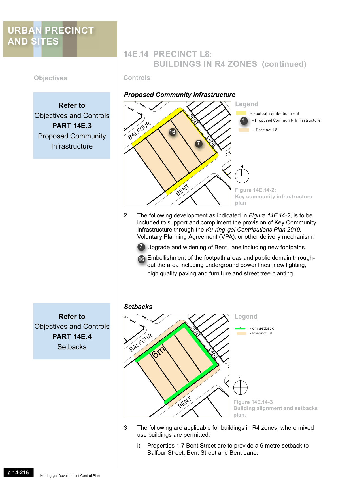
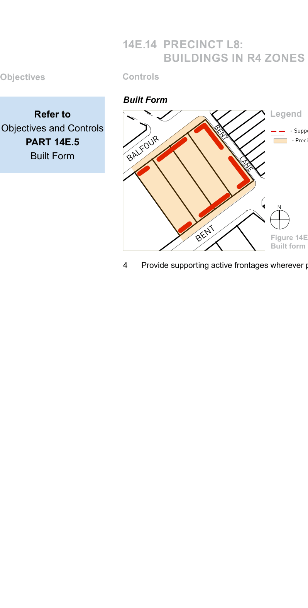

### 14E.14  PRECINCT L8:

### BUILDINGS IN R4 ZONES

2

BUILDING ENTRIES AND CARPAT

4

RES 6

#### Controls

#### Objectives

- Vehicular access to site

- Pedestrian access to site

#### Planned Future Character

19A 15A

19B

17

15

11

9

21

19

Refer to

#### Objectives and Controls

25

27

### L8

#### Legend

12

20A

14

20

22

24 16

1 18

#### PART 14E.1

#### Urban Precincts

2

PL

RIL

5 4

3

19A 21B

25A

25B

19

AVE

LINDFIELD

21

23

29A

20

24

22

29

25

27

31

33

35 24B

GLADSTONE 26 24A

1 This precinct consists of R4 High Density Residential zones within

close proximity to the commercial zones. The location of Precinct L8

is illustrated in Figure 14E.14-1. Development is to be designed to support and enhance the planned

future character for the precinct as follows:

TRYON

PLACE

28

26

i) The precinct will be designed to provide a transition from the

core urban areas to the surrounding high and medium density

PACIFIC

HIGHWAY

ii)	 Schedule 1 of the KLEP allows mixed use buildings within this

TRYON

iii)	 All properties will provide reduced front setbacks to enhance the

1

10 12

14

PDE

### LINDFIELD LOCAL CENTRE

25A

C

S

> [Picture on page 68: a map, saved as a picture (images/part-14e-lindfield-local-centre-page-68-3.gif, 150 dpi); the street names and other small labels are on the picture.]
> Words printed on the picture (title and legend, copied from the PDF):
> - Awnings where possible
> 10 12 14 16 18
> 4 6 8 4 6 8 10
> 1 3 5 BUILDING ENTRIES AND CARPAT
> ST PUBLIC DOMAIN AND PEDESTRIAN
> - Vehicular access to site
> - Pedestrian access to site
> 4 8 10
> - Pedestrian through site link
> Awnings where possible
> - Continuous colonnade
> 5 7 9 11
> 24 22 20 18
> - Continuous awnings where possible
> - Continuous colonnade
> - Heritage item
> BUILDING ENTRIES AND CARPAT
> BUILDING ENTRIES AND CARPAT
> 10 12 14 16 18
> 4 6 8
> - Landmark building
> - Vehicular access to site
> - Pedestrian access to site
> 3 5 7 11
> - Vehicular access to site
> - Pedestrian access to site
> - Character item
> KEY COMMUNITY INFRASTRUCTRE
> - Refer to site specific DCP
> - Proposed road
> - Proposed Community Infrastructure
> 24 22 20 18
> 16 20 22 24 28 30
> ALIGNMENT AND SETBACKS
> - Precinct L1
> - Precinct L2
> - Precinct L3
> - Precinct L4
> - Precinct L5
> - Precinct L6
> - Precinct L7
> - Precinct L8
> - Precinct L9
> 38 42 44 46 50 26A
> 3.66W PATHWAY 18
> - Footpath embellishment
> - New or existing park to be upgraded
> - Historic/character building to be
> - New/realigned road
> - Proposed pedestrian promenade
> - New community facility
> 1 38 16-18
> 9 LLEWELLYN AVE
> 1-3 5 7
> - 15m setback
> - 12m setback
> - 10m setback
> - 6m setback
> - 5m setback
> - 4m setback
> - 3m setback
> - 2m setback
> - Land dedication
> - Alternate deep soil requirement
> ( UNFORMED )
> 3-11 7 RD 6
> Key community infrastructure
> - Primary active frontage
> - Secondary active frontage
> - 3 storey street wall
> - 2m upper level setback above street
> - 4m upper level setback above street
> PUBLIC DOMAIN AND PEDESTRIAN
> - Pedestrian through site link
> - Entry plaza/forecourt
> Awnings where possible
> - Continuous colonnade
> BUILDING ENTRIES AND CARPAT
> ALIGNMENT AND SETBACKS
> - Vehicular access to site
> - Pedestrian access to site
> - 9m setback
> 27 25 23
> 21 19 17
> - 15m setback
> 26 24 22
> - 13m setback
> 12 10 8
> - 12m setback
> - 11m setback
> 7.32 / 3.66 W.
> ESMT FOR SERVICES
> - Precinct L1
> - Precinct L2
> - Precinct L3
> - Precinct L4
> - Precinct L5
> - Precinct L6
> - Precinct L7
> - Precinct L8
> - Precinct L9
> 101 103 105 A1
> 1-3 5 7
> - 10m setback
> - 6m setback
> - 5m setback
> - 4m setback
> - 3m setback
> - 2m setback
> - Land dedication
> - Alternate deep soil landscaping
> (% of site)
> 123 125 127
> 2 4 6 8 10
> - Principal active frontage
> - Supporting active frontage
> - 3 storey street wall
> - 2m upper level setback above
> 1 3 5
> - 4m upper level setback above
> Building alignment and setbacks
> street wall height
> PUBLIC DOMAIN AND PEDESTRIAN
> 4 8 10
> 5 7 9 11
> - Pedestrian through site link
> - Entry plaza/forecourt
> - Awnings where possible
> 10 12 14 16 18
> BUILDING ENTRIES AND CARPAT PLACE
> - Vehicular access to site
> - Pedestrian access to site

Figure 14E.14-2:

Figure 14E.14-3

D

HA

AM E

### 14E.14  PRECINCT L8:

### BUILDINGS IN R4 ZONES  (continued)

#### Controls

#### Objectives

### *

GATE

#### Proposed Community Infrastructure

#### Legend

Refer to

#### Objectives and Controls

#### PART 14E.3

#### Proposed Community Infrastructure AVE

AVE

2 The following development as indicated in Figure 14E.14-2, is to be

included to support and compliment the provision of Key Community

Infrastructure through the Ku-ring-gai Contributions Plan 2010,

Voluntary Planning Agreement (VPA), or other delivery mechanism: 7 Upgrade and widening of Bent Lane including new footpaths.

#### 16

Embellishment of the footpath areas and public domain through-

out the area including underground power lines, new lighting, high quality paving and furniture and street tree planting.

#### Setbacks

1

31

Refer to

#### Objectives and Controls

#### PART 14E.4

#### Setbacks

### 6m

AVE

3 The following are applicable for buildings in R4 zones, where mixed

use buildings are permitted:

i) Properties 1-7 Bent Street are to provide a 6 metre setback to

Balfour Street, Bent Street and Bent Lane.

D

L

> [Picture on page 69: a map, saved as a picture (images/part-14e-lindfield-local-centre-page-69-3.gif, 150 dpi); the street names and other small labels are on the picture.]
> Words printed on the picture (title and legend, copied from the PDF):
> 7.32 / 3.66 W.
> ESMT FOR SERVICES
> 101 103 105 107
> 123 125 127
> Built Form CHELMSFORD
> 4 6 8 10
> 26A 1 3 5
> 1-3 5 7
> 4 8 10
> 5 7 9 11
> 10 12 14 16 18
> 4 6 8
> 3 5 7 11
> Built form plan.
> 24 22 20 18
> 82 3.66W PATHWAY
> IKARA 1 80
> 6 4 2

Figure 14E.14-4:

ALIGNMENT AND SETBACKS

- 9m setback

- 15m setback

- 13m setback

- 12m setback

RD AVE

- 11m setback

16 73B

27

29

- Pedestrian through site link

Awnings where possible

- Continuous colonnade

2

BUILDING ENTRIES AND CARPAT

4

### 14E.14  PRECINCT L8:

### BUILDINGS IN R4 ZONES  (continued)

ST

#### Controls

#### Objectives

- Vehicular access to site

- Pedestrian access to site

15A

- 10m setback

- 6m setback

- 5m setback

- 4m setback

- 3m setback

- 2m setback

- Land dedication

- Alternate deep soil landscaping (% of site)

19B

17

15

11

9

BUILT FORM

21

19

#### Legend

25

27

Refer to

#### Objectives and Controls

12

20A

14

20

22

6m

16

18

- Principal active frontage

- Supporting active frontage

- 3 storey street wall

- 2m upper level setback above

#### PART 14E.5

- Precinct L1

- Precinct L2

- Precinct L3

- Precinct L4

- Precinct L5

- Precinct L6

- Precinct L7

- Precinct L8

- Precinct L9

2

PL

4

#### Built Form

wall height

- 4m upper level setback above

3

6m RD

street wall height

9B

AVE

VALE STANLEY MONA

2m

PUBLIC DOMAIN AND PEDESTRIAN

MEMORIAL

19A 21B

3m

3m

E

LINDFIELD

10m

25A

25B

17

19

21

23

29A

20 STANLEY

24

22

ROSEDALE

RD

29

25

27

31

33

35 24B

- Pedestrian through site link

- Entry plaza/forecourt

- Awnings where possible

- Colonnade

GLADSTONE 26

PORTERS

BUILDING ENTRIES AND CARPAT

- Vehicular access to site

- Pedestrian access to site

4 Provide supporting active frontages wherever possible.

HERITATGGEA

SHINFIELD

- Heritage item

DR

5

4

7

- Landmark building

### *

11

9

TRYON

PLACE

- Character item

6

DORSET 16

21

19

17

15

18

14

12

8

6

10

- Refer to site specific DCP

- Proposed road

#### PACIFIC

#### HIGHWAY

- Proposed Community Infrastructure

CRES

8

10 12

PDE

BEACONSFIELD

### LINDFIELD LOCAL CENTRE

DROVE

### THIS PAGE IS INTENTIONALLY BLANK
